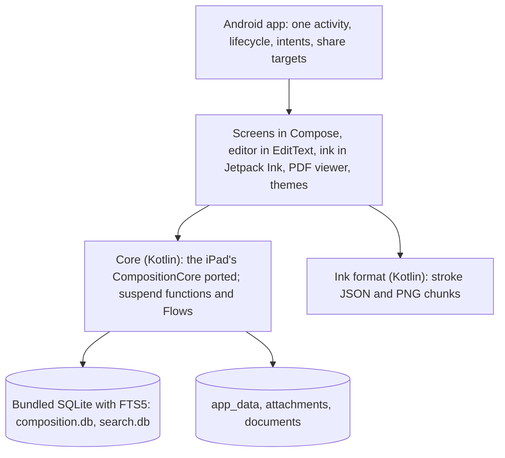

# Android app: design, feature tracker and compromises

A native Android app for Composition (shown to people as **Benchnote**, the name chosen for the iOS release), for **phones and tablets**, in **Kotlin with Jetpack Compose**. This page
holds the design, a tracker of which features the Android app will have, and every compromise made to get it running. **Design only:
no app code exists. Spike A1, the first slice of the Kotlin core, is done ([A1 status](#a1-status)).** Dates are 2026-11-20. It follows the structure and rules of the iPad design ([ipad-app-design.md](ipad-app-design.md)),
and every Android row is scored against an iPad row.

**Direction (2026-11-20, you):** "provide as much of the same functionality for Android phones and tablets as I'm providing for iPhones and iPads."
That sets the bar: the iOS app (iPhone and iPad, universal since [#341](https://github.com/meddlin/composition/pull/341)) is the reference, not the desktop app. It also follows the native-per-platform
decision of 2026-11-07 (Swift on Apple, C# on Windows, Rust on Linux): native screens on Android, not a web view and not a cross-platform toolkit.

## How to read this page

- the [**feature tracker**](#feature-tracker): every row of the iPad's tracker, with how Android does it and how far along it is;
- the [**compromise register**](#compromise-register): what we give up on Android, why, and what would make us revisit it;
- the [**decision log**](#decisions): what is proposed and what needs you;
- the [**spikes and gates**](#spikes-and-gates): the questions to answer before any app code, and where each one can run.

| | Meaning |
|---|---|
| **Kind** | What sort of work the row is. A prediction until Status says otherwise. |
| 🧩 | **Core rule:** the rule lives in the core, which is **ported to Kotlin** from the iPad's Swift core ([D1](#decisions)) and checked by the [conformance corpus](#keeping-the-implementations-honest). |
| 🔁 | **Port:** the iPad has it as Swift UI code, and Android rebuilds it in Kotlin and Compose. |
| ⭐ | **Native upgrade:** Android gives something better than the iPad version, or it comes free |
| 🆕 | **New** on Android, with no iPad counterpart to copy |
| ⚠️ | **Risky:** unknown until tried |
| ❌ | Not on Android |
| **Plan** | **M1**, **M2** or **M3†**: the [milestone](#v1-scope-and-milestones) (**†** marks release polish, the first to drop) · **Later** · **Parked** · **Never** |
| **Status** | ⬜ not started · 🔬 spiked · 🔨 built · 🤖 verified on an Android device · ⛔ dropped |

**Every row is ⬜ today.** A row gets 🤖 only after a person has used it on a real Android phone or tablet. Whatever this page says about Android
behaviour without a source or a spike result is **unverified**.

## Summary

- **Feasible: a Kotlin app over a Kotlin core.** The iOS app is about 15,600 lines of Swift interface code (62 files), which Android redoes in
  Compose. **The core is ported to Kotlin too** (you, 2026-11-20, [D1](#decisions)): the iPad's `CompositionCore` (about 16,500 lines in 85 files)
  is the reference, and the conformance corpus says when each part of the port agrees with the desktop. All line counts were measured with `wc -l` on 2026-11-20.
- **Recommended shape (proposed):** Kotlin throughout; Jetpack Compose for screens; Android's own **`EditText`** for the editor, hosted in Compose
  (spike A2 decides); **SQLite with FTS5** on the same schema, through AndroidX's bundled SQLite; **Jetpack Ink** (`androidx.ink`, stable 1.0 since December 2025) for drawing, reading and
  writing the same stroke JSON in the same PNG; a PDF stack chosen by spike A3; backup and restore as on the iPad, built ready for sync.
- **D1 is decided: Kotlin, with no layer to run Swift on Android.** **Spike A1 is done (2026-11-20):** the first slice of the Kotlin core (schema, store,
  Trash Can, frontmatter, settings, backup) matches the desktop on every case of the corpus, on the Mac's JVM and on the Android emulator, and
  the desktop restores the backups it writes ([A1 status](#a1-status)).
- **The costs that matter most:** a third notes interface (web, iOS, Android) and a fifth copy of the rules ([C2](#compromise-register)); the
  Live tab's hidden marks have to be solved again, this time on Android's text stack ([R2](#risks-and-unknowns)); the PDF libraries are the least mature
  part ([R4](#risks-and-unknowns)); no system find bar and no public undo, so we build both ([C5](#compromise-register)).
- **What needs you:** D2 timing, D5 ink editing on Android, D6 the application id, D8 the Play account type, D10 test hardware, D11 scope.

## Goals and non-goals

**Goals** (proposed)

1. Read and write notes on Android phones and tablets, in the same Markdown and with the same MDX components as the other products.
2. **Feel native on Android** ([the native bar](#the-native-bar)): the platform's text editing and keyboards, Material navigation, windows and foldables, TalkBack.
3. Local-first and offline, like the iPad.
4. A stylus: handwriting into text fields, and drawing or handwriting notes (`<Ink>`), subject to [D5](#decisions).
5. Move data to and from the desktop app and the iPad without loss, at least through backup and restore.
6. **One note format and one schema.** Android does not invent its own.
7. **One app for phones and tablets**, foldables included, as the iOS app is one app for iPhone and iPad.

**Non-goals for v1** (proposed, carried over from the iPad unless marked)

- The sync engine, sign-in and server (the iPad's D8).
- The To-do and RSS Reader plugins. The Reading List is in, as on the iPad.
- **No AI helper** (the iPad's D19, carried over unless you say otherwise).
- The terminal app, the panel grid and pop-out windows.
- **New on Android:** Wear OS, Android TV, Android Auto and Chromebooks as targets. The app may run on a Chromebook, but nothing is built or tested for it.
- Editing `<Drawio>` diagrams.

## What the app is today

Facts that drive the design, checked against `main` at `616d807`.

| Fact | What it means for Android | Source |
|---|---|---|
| **The iOS app is the reference.** Interface: 62 Swift files, about 15,600 lines. `CompositionCore`: 85 files, about 16,500. `CompositionInk`: 8 files, about 1,100. `CompositionPDF`: 5 files, about 430. | Both the interface and the core are rewritten in Kotlin (D1). The Swift is the reference for what each piece does. | `apps/ios/` |
| **`CompositionCore` is the reference for the Kotlin core.** It holds the store, the Trash Can, the schema pass, backup (its own tar and gzip), a port of `js-yaml`, search with the typo layer, the MDX scanner, the typing aids, the Live rules, image naming, the PDF tables, the Reading List, Follow the sun and reflow. Many of those are themselves ports of the desktop's TypeScript, checked over UTF-16 offsets. | Kotlin's `String` is UTF-16, as JavaScript's is, so caret and offset rules port more directly than they did to Swift. | `apps/ios/CompositionCore/Sources` |
| **`CompositionInk`'s format code is separate from its drawing code.** `InkModel`, `InkJSON`, `InkPNG` and `InkTag` are the stroke format and the PNG chunks. `InkRenderer`, `InkCrop`, `InkTranscript` and `InkPencilKit` use CoreGraphics, Vision and PencilKit. | The format half ports to Kotlin as core code. Drawing, cropping and recognition are Android work. | [architecture/ink.md](architecture/ink.md) |
| **`CompositionPDF` is PDFKit throughout.** The PDF *tables and rules* live in `CompositionCore/PDF`. | The PDF data layer ports with the core. The reader, marks geometry and export are Android work. | [pdf-markup-plan.md](pdf-markup-plan.md) |
| **The conformance corpus was written for "any later" core.** Store, Trash Can, search, MDX, frontmatter, settings, typing aids, list continuation, images, organization, Live, PDF names, refs and text, sun, reflow, Reading List, and ink. `apps/ios/scripts/conformance.sh` runs it, and so does CI (`.github/workflows/ios-core.yml`). | A Kotlin runner reads the same folder, so the Kotlin core gets its correctness check without new cases. | [fixtures/conformance/README.md](../fixtures/conformance/README.md) |
| **The schema is shared and migrated by `ensureColumn`**, with the `uuid` pass, WAL, and the search index in a file of its own (`search.db`). | Same rules as the iPad, ported. | [architecture/data-model.md](architecture/data-model.md), [architecture/search.md](architecture/search.md) |
| **Android's own SQLite has no FTS5** (reports, and the "no such module: fts5" error people hit with the platform driver). The AndroidX bundled SQLite compiles FTS5 in, according to its build file. | The app ships AndroidX's bundled SQLite. A1 checks `PRAGMA compile_options` for FTS5 and the `fts5vocab` and `trigram` pieces the typo layer uses. | [Sources](#sources) |
| **The iPad core leans on how Apple builds SQLite** (seen 2026-11-20, see the Change log). The Mac's system SQLite (3.54.0) has, among others, `USE_URI`, `DEFAULT_RECURSIVE_TRIGGERS`, `ENABLE_SNAPSHOT`, `ENABLE_PREUPDATE_HOOK`, `ENABLE_SESSION`, `DQS=3` and `THREADSAFE=2`. The core opens a backup's database as `file:…?immutable=1`, a URI filename. Against a SQLite built without URI filenames, all 13 backup restores failed with "unable to open database file". | The Kotlin core either uses a SQLite that accepts URI filenames or opens backups another way. Recursive triggers on by default could change what the `uuid` and future sync triggers do. A1 lists the bundled SQLite's options beside Apple's and the desktop's. | `PRAGMA compile_options` |
| **The desktop's Live editor already noted Android keyboards.** Its pickers take printable keys by cancelling `keydown`, which "is unreliable under IME and on Android keyboards". | Soft keyboards send text, not key presses. On Android the `<` and `[[` pickers and list continuation must react to the text change, not to keys. | [live-editor-parity-plan.md](live-editor-parity-plan.md) |
| **The ink format expects other editors.** The stroke JSON keeps unknown fields, a PencilKit blob is only trusted while a digest of the strokes still matches, and the chunks are unsafe to copy. | Android can edit an iPad drawing without silently breaking it. The iPad then re-edits from the strokes and loses only PencilKit's own copy (see C8). | [architecture/ink.md](architecture/ink.md) |
| **This Mac:** Android Studio, SDK platform 36.1, build tools 36.1 and 37.0, one emulator (Pixel 10, Android 17, **16 KB page size** image). No tablet or foldable emulator, no Java outside Android Studio. | Enough for A1; the rest is in [Setting up this Mac](#setting-up-this-mac). | `~/Library/Android/sdk` |

## Options considered

| | Option | Verdict |
|---|---|---|
| O1 | **A web shell** (Capacitor or a WebView around the web UI) | Fails the native bar, for the same reasons as the iPad's O2: hover controls, web text editing on touch, keyboards and the stylus all go through a browser. **Rejected.** |
| O2 | **Kotlin and Compose, with the core ported to Kotlin** and checked by the corpus | Idiomatic and uses mature tools. About 16,500 lines of core to port, plus the iPad's own ports (the js-yaml loader and dumper, tar and gzip, the typo layer, the Live rules). Every rule change then lands in five languages (TypeScript, Swift, C#, Rust, Kotlin). **Decided** (you, 2026-11-20, D1). |
| O3 | **Kotlin and Compose, with the iPad's Swift core on Android**, built with the Swift SDK for Android and called through swift-java | One copy of the rules for the Apple and Android apps, at the price of a translation layer, a young toolchain and a bigger app. **Rejected** (you, 2026-11-20): "Don't complicate things by trying to add a translation layer to get Swift running on Android." |
| O4 | **Skip**, which turns SwiftUI into Compose | The same translation layer, and it does not translate the UIKit parts (the TextKit 2 editor, PencilKit, PDFKit). **Rejected** with O3. |
| O5 | Flutter, React Native, or Compose Multiplatform shared with iOS | The iOS app is already native Swift, so these would add a third interface style without replacing one. **Not researched further.** |
| O6 | **The Linux app's Rust core**, called through UniFFI | Rust on Android is proven, but the Linux core is design and spikes only ([linux-native-app-design.md](linux-native-app-design.md)). **Not available.** |

## Languages and dependencies

The iPad's policy, carried over: **the newest language that reaches the API, and no more.**

| Language | Use |
|---|---|
| **Kotlin** | Everything by default: the core, screens, platform glue ([D1](#decisions)) |
| **Jetpack Compose** | Screens, navigation, lists, settings, sheets |
| **Android Views** | Only where Compose falls short, hosted in `AndroidView`: the editor (`EditText`, if A2 agrees), and possibly the PDF viewer (`PdfViewerFragment` is a Fragment) |
| **Swift** | **Not used on Android** (D1) |
| **C** | Through packages only: the bundled SQLite |
| **Java, C++** | **Not planned.** Jetpack Ink ships its own native code, which is not ours to maintain. |

**Dependencies** (proposed; each gets an exact version and a row here before it is added, and Gradle's dependency verification is on from the first build):

| Need | Candidate | Note |
|---|---|---|
| Layout across sizes | Compose Material 3 and `material3-adaptive` (list-detail and supporting panes), Jetpack WindowManager | Window size classes and fold postures |
| Database | `androidx.sqlite` 2.7.1 with its bundled driver (it also runs on a desktop JVM, so the core's tests run on the Mac) | **In use (A1):** SQLite 3.50.1 with FTS5, `fts5vocab` and `trigram`; about 1.3 MB per CPU type in the APK |
| Markdown | commonmark-java with its GFM extensions | A new list of divergences, as the iPad's S4 made for swift-markdown |
| YAML (frontmatter) | None: a port of the iPad's own port of `js-yaml` | `frontmatter-cases.json` (111 blocks read, 123 written) |
| Backup archives | `java.util.zip` for gzip, and our own tar reader and writer, as the iPad wrote its own | Backups both ways with the desktop (A1) |
| Hashing | `java.security.MessageDigest` | |
| Ink | `androidx.ink` 1.0.x | Strokes, brushes, low-latency drawing, rendering |
| PDF | `androidx.pdf` (1.0.0-beta01, August 2026), the platform's `PdfRenderer`, or PDFium. For export, PdfBox-Android or PDFium's annotation API | Chosen by A3 |
| Handwriting recognition | ML Kit Digital Ink, or ML Kit text recognition on the drawn picture | Chosen by A4 and you (D15) |
| Charts | Our own drawing on a Compose `Canvas`, or a chart library | Four chart kinds (bar, line, area, pie). Our own drawing avoids a dependency. Decided at the build step. |
| Links and players | Custom Tabs (`androidx.browser`) for `<Repo>`, the system `WebView` for `<YouTube>` and Reading List pages | The web views are the listed exceptions (C9) |

## Proposed architecture

**Layout (proposed):** `apps/android/`, a Gradle project beside `apps/ios`: `app/` (the application), `core/` (the Kotlin core), `ink/`, `pdf/`.
**`core/` has no Android framework dependency**, as `CompositionCore` has no UIKit: it is plain Kotlin over `androidx.sqlite`'s bundled driver, which
also runs on a desktop JVM, so its tests and the corpus run on the Mac in seconds (as `swift test` runs the iPad core without a simulator), and again on
the emulator for Android's own behaviour.

**The core's API is the seam.** Screens talk only to Kotlin `suspend` functions and `Flow`s, the counterpart of the iPad's store actor and GRDB's
`ValueObservation`.

### The core (D1)

**Decided (you, 2026-11-20): the core is Kotlin.** No layer runs Swift on Android. The iPad's `CompositionCore` is the reference, and the
conformance corpus is the test of the port. It is ported in the order the iPad's build plan took its own pieces:

1. The schema pass (`ensureColumn` and the `uuid` pass), the store and the Trash Can (`store-script.json`, `trash-script.json`).
2. Backup and restore, both ways with the desktop.
3. Settings and frontmatter (the iPad's `js-yaml` port).
4. Search: the query parser, the FTS5 index and the typo layer.
5. The MDX scanner and the component helpers.
6. Images.
7. The typing aids and list continuation.
8. Organization.
9. The Live rules.
10. Reflow and Follow the sun.
11. The Reading List.
12. The PDF tables and refs.
13. The ink format.

Each step is done when its suites pass. It is predictable work. The standing cost is that every later rule change lands in Kotlin too (C2).

### Keeping the implementations honest

The corpus in `fixtures/conformance/` is the guard, as on the iPad. **JUnit suites, one per Swift suite and named after it**, read the folder from
`COMPOSITION_CONFORMANCE_DIR`. A suite with no generated files is reported as **skipped, never passed**, as the Swift side does. They run
on the Mac's JVM and on the emulator. A CI job on a Linux runner runs them on the same path filters as `ios-core.yml`. Every action in that job is
pinned to a commit SHA ([AGENTS.md](../AGENTS.md)). The desktop then restores the backups the Kotlin core wrote, as `conformance.sh` does for Swift.

### Markdown and MDX

Parsing is the core's: commonmark-java (GFM) and a Kotlin port of the restricted MDX scanner, checked against `mdx-notes.json` and
`component-cases.json`. Drawing is Android's:

| Component | Android drawing |
|---|---|
| `<Info>`, `<Warning>` | A tinted panel with an icon |
| `<Toc>` | From the headings; tap to scroll |
| `<Mark>` | A background-colour span in five colours, with the iPad's `markContrast` rule |
| `<Footnotes>` | Superscript citations and a numbered list |
| `<Image>`, header image | Decoded from `app_data/` with `ImageDecoder`, at the asked width |
| `<Chart>` | Drawn on a Compose `Canvas` (or a library) from the same CSV block: bar, line, area, pie |
| `<Repo>` | A card that opens in Custom Tabs |
| `<Drawio>` | The PNG, as an image. Not edited (C10) |
| `<YouTube>` | A link card first. The player in a `WebView` is a listed exception (C9) |
| `<Ink>` | Drawn from the strokes with Jetpack Ink's renderer in the scheme's colours; a tap opens it for editing (D5) |

**The preview's container is a spike question (A2).** The iPad draws the preview in one read-only text view with blocks as attachments, so a selection
can cross blocks (the highlight menu needs it). Android's text views take spans but cannot hold live views, so charts and players would sit in overlays
placed at their spans. The alternative is Compose blocks in one `SelectionContainer`, which may not hold a selection across a lazy list. A2 tries both
on the showcase note (`fixtures/conformance/preview-showcase/`).

### The editor

**Proposed: `EditText`, hosted in Compose.** It is the text engine Android's keyboards, spell checker, selection handles and magnifier, voice typing and
**stylus handwriting** (on by default for every `EditText` on Android 14 and later) are built and tested against, and its layout is made for long, changing
text. Compose's `BasicTextField` is the alternative: it also takes handwriting (foundation 1.7 and later, Android 14 and later), and its
`OutputTransformation` might hide Live marks more cleanly. **A2 decides**, on a 5,000-line note.

| Tab | Android approach | Risk |
|---|---|---|
| **Markdown** | Source text with syntax colours as spans, re-coloured only where the text changed (the iPad's Step 5 approach) | Low–medium |
| **Preview** | The A2 choice above | Medium |
| **Split** | Side by side on a wide window, stacked on a narrow one | Low |
| **Live** | Marks hidden away from the caret. The iPad uses a tiny clear font and reveals before the next key. Android's nearest tools are a 1-pixel size span with a transparent colour, or a zero-width replacement span. The new risks are the keyboard's composing region, Gboard's own caret logic and handwriting gestures landing on hidden text. Checked by `live-cases.json`. | **High** (C19) |

**What Android does not give, so we build it:**

- **Find in a note:** no system find bar (the iPad uses `UIFindInteraction`).
- **Undo and redo buttons:** `EditText` keeps an undo history only for hardware-keyboard shortcuts, with no public API (unverified), so the toolbar's Undo needs our own history.
- **Tab and Shift+Tab:** soft keyboards have no Tab key, so both go on a toolbar above the keyboard as well as on hardware keys.

**What ports as Android pieces:**

- The `<` and `[[` lists, as a popup at the caret (from the layout's line and offset), driven by the text change.
- Highlight, recolour and remove, as items in the text-selection menu.
- Image paste, through `OnReceiveContentListener`, which also takes images from Gboard's image keyboard.
- Return in lists, from the newline the keyboard commits (`list-continuation-cases.json`).

### Ink and the stylus

| Layer | What | Notes |
|---|---|---|
| **0. Handwriting into text** | The keyboard turns stylus writing in a text field into typed text | Android 14 and later, with a keyboard that supports it (Gboard, Samsung's). Nothing of ours to build. |
| **1. Jetpack Ink** | Low-latency drawing (`InProgressStrokesView`), stock brushes, rendering, full screen first | The drawing surface Google's own apps use |
| **2. Stylus events** | Hover, the side button, the eraser end, palm rejection (cancelled touches) | Later, as on the iPad |

**Same format, no new tag.** Android reads and writes the `<Ink>` tag and the PNG with its `inKJ` chunk exactly as [architecture/ink.md](architecture/ink.md)
specifies, and is checked by `fixtures/conformance/ink/`. It never writes `inKP` (PencilKit's blob). Whether it drops an existing blob or keeps it stale
behind its digest is A4's to settle; both are safe. The mapping from the stroke JSON's points to Jetpack Ink's inputs is **unverified**:

| Stroke JSON | Jetpack Ink | Question for A4 |
|---|---|---|
| `x`, `y`, `t` | position and elapsed time | Units: points against pixels and density (`pHYs`) |
| `force` | pressure | Same 0–1 scale? |
| `altitude`, `azimuth` | tilt, orientation | Angle conventions |
| `width`, `height` (per point) | one brush size per stroke | How the iPad's per-point nib size is drawn and written |
| `ink` (`pen`, `pencil`, `marker`, …) | stock brush families | Unknown names are kept and drawn like a pen, as the format already requires |

**Recognition into `alt`.** The iPad uses Vision. Android has two candidates: **ML Kit Digital Ink**, which reads the strokes and works offline once a model
of about 20 MB per language has been downloaded from Google, or ML Kit's **text recognition** on the rendered picture, which is offline from the start but reads pictures, not strokes.
A4 tries both on your handwriting. D15 is yours, because the first needs a network download.

### PDFs

What the iPad does, from [pdf-markup-plan.md](pdf-markup-plan.md): import a PDF as a note that owns it; read it beside the note; highlight, underline,
strike through and type notes, stored as **raw PDF user-space coordinates** beside the file; draw on pages; bookmarks, Quote, Cite this page and `pdf:` links;
search a PDF's own words (exactly as the desktop's `pageSearchText` makes them) and its marks; export an annotated copy, native or flattened.

The tables and rules come with the core. The rest needs a PDF library that gives **page rendering, word selection with geometry in PDF user space, text
extraction that matches `pdf-text.json`, and writing annotations**. No single candidate is known to do all four:

| Candidate | For | Against |
|---|---|---|
| `androidx.pdf` | Google's viewer, with selection and search; an editable variant adds ink annotations through `androidx.ink` | Still beta (1.0.0-beta01, August 2026); the viewer needs Android 12 and SDK extension 13; geometry access is new (`getSelectionBounds`, July 2026) |
| Platform `PdfRenderer` | No dependency | Rendering is certain. Text and selection depend on SDK extensions (unverified). |
| PDFium | Mature, the engine Chrome uses, with character boxes and an annotation API | We write the JNI glue, or adopt a wrapper |

**A3** runs all three against `pdf-geometry.pdf` (the nine page geometries; a mark must land on ANCHOR TEXT) and `pdf-text.pdf`, and exports a file
the desktop's pdf.js opens.

### Search

As on the iPad: FTS5 in its own `search.db`, the typo layer over its vocabulary, the field filters (`tag:`, `title:`, `description:`, `created:`, `updated:`),
50 results, all ported with the core and checked by `search-queries.json` and `search-expected.json`. **Android's system search (AppSearch)**, the counterpart of Spotlight, is Later.

### App structure, windows and themes

- **Panes by width, not device.** Three panes on a wide window (the sidebar, the list, the note), two on a medium one, and one at a time on a phone,
  with Material 3's adaptive scaffolds. The breakpoints are the window size classes (compact under 600 dp, medium to 840, expanded above). This is the
  iPad's rule ("layout decisions use the width of the view"), and the iPhone Duo findings ([iphone-duo-compatibility.md](iphone-duo-compatibility.md))
  are the checklist for phone widths and folding.
- **Every size and orientation.** Apps that target Android 16 cannot lock orientation or resizability on screens 600 dp and wider; Play requires that target
  from 2026-08-31. Turning the device, folding it or resizing a window must keep the text, the caret and any pending save. **Proposed:** the activity
  handles those changes itself rather than being rebuilt, as the iPad keeps one text view through a rotation.
- **Back.** Apps that target Android 16 get predictive back. The system back gesture pops panes on a phone. The app's own back and forward history
  (`navHistory`) stays on buttons and Ctrl+[ and Ctrl+].
- **Windows.** Split screen, free-form windows on tablets, and foldable postures through Jetpack WindowManager. "Open in new window" is Later, as on the iPad.
- **Edge to edge** is required from Android 15's target, so every screen handles insets.
- **Drag and drop.** Compose's drag and drop for notes and groups, and images dropped in from other apps in split screen.
- **Themes.** The five schemes plus System, as Compose colour schemes from the desktop's tokens, checked against `globals.css` as the iPad's Step 10 did;
  Follow the sun from `sun.json`. Material You's wallpaper colours could become an extra choice later (⭐). Fonts: the system's sans serif, serif and monospace.
- **Keyboard.** Ctrl where the iPad has ⌘, and the shortcuts listed in Android's own shortcut list (Meta+/).

### Lifecycle and saving

Android may stop the process at any time after the app leaves the screen, and has no `beginBackgroundTask`. **Proposed:** debounce as on the iPad, flush
on `ON_STOP` and when the window loses focus, and restore the open note and caret after the process dies (`rememberSaveable` and saved state; the
counterpart of the iPad's `@SceneStorage`). Backups run as foreground work so they are not cut off. **A5** checks it: a kill mid-typing, "Don't keep
activities", rotation, folding, split screen.

### Sync and the data model

**The iPad's D8, carried over:** v1 is backup and restore, built sync-ready, with the identical schema (the `uuid` pass, and the triggers and outbox when
they land on the desktop). Backups go in and out through the system file picker. The sync engine comes later from
[cross-device-sync-design.md](cross-device-sync-design.md), and needs a Kotlin engine of its own.

**Google's cloud backup is a new question.** Android backs app data up to Google Drive on its own (Auto Backup). It copies files while the app may be
writing them, and it stops backing up an app whose data passes 25 MB. **Proposed ([D14](#decisions)):** exclude the database and its WAL files from
cloud backup (the iPad's "never the database in iCloud Drive" rule), and include them in device-to-device transfer, which has no such cap.

## Packaging, distribution and signing

- **Application id (D6).** Permanent once published. The iOS release is to use `com.rushinglabs.benchnote.ios` (the Benchnote rename is not on
  `main` yet, which still builds `com.rushinglabs.composition.ipad.dev`), and the Mac keeps `com.rushinglabs.composition`.
  **Proposed:** `com.rushinglabs.benchnote`, labelled Benchnote.
- **Versions (D7).** **Proposed:** minimum Android 12 (API 31), the floor `androidx.pdf`'s viewer needs; target API 36, which Play requires of new apps
  since 2026-08-31. Handwriting into text needs Android 14 and degrades to typing below it.
- **Native code.** The app writes none, but Jetpack Ink and the bundled SQLite carry native libraries. Play requires native libraries to work
  with **16 KB memory pages** for apps that target Android 15 and later. Google first gave 2025-11-01 for this, and its page now says updates without it are
  refused from 2027-02-01. Both libraries must be checked for it. This Mac's emulator is already a 16 KB image.
- **Test installs (M1, M2):** from Android Studio or `adb install` onto your own devices. No Play account is needed. Google's developer verification
  allows installs over ADB.
- **Release (M3), through Play:**
  - **The account (D8).** A *personal* account created after 2023-11-13 must run a closed test with **at least 12 testers opted in for 14 days in a row**
    before it can publish to production. An *organization* account is exempt and needs a D-U-N-S number for Rushing Labs.
  - **Signing.** Play App Signing, with an upload key that stays with you and never enters the repo.
  - **The listing.** A Data safety form (the counterpart of the privacy label), a privacy policy, and phone and tablet screenshots.
  - **Payment.** A payments profile if the app is paid (D9).
- **Outside Play.** From 2026-09-30, installs outside Play in Brazil, Indonesia, Singapore and Thailand need a verified developer. The rest of the
  world follows from 2027.

## The native bar

How "native on Android" is checked, mirroring the iPad's N1–N7. Audited in A6 and before each release; the only web views are the exceptions in C9.

| # | Criterion | How it is checked | Status |
|---|---|---|:-:|
| N1 | Text editing is the platform's: keyboards and IMEs, spell check, voice typing, stylus handwriting, selection handles and magnifier, the selection menu. Our own find bar and undo history feel like the system's. | Hands-on with Gboard, Samsung's keyboard, a hardware keyboard and a stylus | ⬜ |
| N2 | Navigation and controls are Compose and Material 3 (or Views where hosted): adaptive panes, lists, menus, bottom sheets, dialogs | Review; no web view outside the exceptions | ⬜ |
| N3 | Adapts: phone portrait and landscape, tablet both ways, split screen, free-form windows, fold and unfold while typing, rotation without losing the caret | Every window size class on the emulator; fold on a foldable emulator; then devices | ⬜ |
| N4 | Input: the stylus (draw, handwrite, hover, eraser), mouse and trackpad (hover, right-click menus), hardware keyboard shortcuts in the system list, drag and drop within and across apps | Hands-on | ⬜ |
| N5 | System integration: the photo picker, camera, file picker, share sheet both ways, predictive back, state restored after the process dies | Kill and relaunch mid-typing (A5) | ⬜ |
| N6 | Accessibility: TalkBack labels, font scale to 200%, display size, contrast in all six schemes, Switch Access basics | Android's Accessibility Scanner, then a person | ⬜ |
| N7 | Performance (targets are proposals): about a second from a cold start to the notes list on the test tablet; no visible lag typing in a 5,000-line note; ink latency comparable to Google's own apps | Android Studio's profilers, side by side | ⬜ |

## v1 scope and milestones

**Proposed (D11): the iPad's v1** (its D13): the full notes editor, without plugins except the Reading List, built in the iPad's order.

| Milestone | What | Installed as |
|---|---|---|
| **M1: usable notebook** | The Kotlin core; notebooks, groups, notes, Trash Can, favorites; Markdown, Preview and Split; search with the typo layer; images; the MDX components except `<Ink>` and `<YouTube>`; the schemes and Follow the sun; backup and restore; phone and tablet layouts. **The Live tab follows right after**, as on the iPad. | Your own devices, from Android Studio |
| **M2: stylus and PDFs** | `<Ink>` with Jetpack Ink, handwriting recognition, then PDFs in the iPad's order (the tables, import, the reader, typed markup, ink on pages, export, search by page text) | Your own devices |
| **M3: first release** | M1 and M2 hardened; release polish (†); the native-bar audit (A6); the Reading List; `docs/manual-tests/android.md` | Play: internal testing, then a closed test (12 testers for 14 days if the account is personal), then production |

**Timing (D2), proposed:** this page and spikes A1 to A4 now, because they are cheap and A1 proves the first slice of the core; M1 after the iPad's M3. Until then any
change to the rules costs nothing extra on Android.

## Feature tracker

Every row of the iPad's tracker, re-scored for Android. Every status is ⬜.

### Platform and shell

| Feature | Kind | Plan | Android approach and notes |
|---|:-:|:-:|---|
| App shell and lifecycle | 🆕 | M1 | One activity with Compose; flush on stop; state restored after the process dies (A5) |
| Five colour schemes plus System | 🔁 | M1 | Compose colour schemes from the desktop's tokens, checked against `globals.css` |
| Follow the sun (four hours) | 🧩 | M1 | `sun.json` |
| Fonts | ⭐ | M1 | The system's sans serif, serif and monospace |
| Font scale, TalkBack, reduced animation | 🔁 | M1 | Non-linear font scaling (Android 14 and later) up to 200% |
| Hardware-keyboard shortcuts | ⭐ | M1 | Ctrl for ⌘; listed in the system's shortcut list |
| Phone and tablet layouts | 🔁 | M1 | Window size classes; one pane on a phone |
| Portrait and landscape | 🔁 | M1 | Required anyway on screens 600 dp and wider |
| Split screen, free-form windows, foldables | ⚠️ | M1 | WindowManager; fold and unfold while typing |
| Predictive back, edge to edge | 🆕 | M1 | Required by the target API |
| Auto-update, data location setting | ❌ | Never | Play updates the app; the app's storage is private |
| Window translucency, developer docs viewer | ❌ | Never | As on the iPad |

### Notes and organization

| Feature | Kind | Plan | Android approach and notes |
|---|:-:|:-:|---|
| Create, edit, delete notes, autosave | 🧩 | M1 | Debounce plus flush on stop |
| Frontmatter | 🧩 | M1 | `frontmatter-cases.json`; the iPad's js-yaml port, ported again |
| Groups: create, rename, delete, move, reorder | 🧩 | M1 | `store-script.json` |
| Notebooks | 🧩 | M1 | |
| Favorites | 🧩 | M1 | `settings.json`, as on the iPad |
| Trash Can (60 days) | 🧩 | M1 | `trash-script.json` |
| Drag and drop of notes and groups | 🔁 | M1 | Long-press to drag on touch |
| Home page | 🔁 | M3† | |
| Outline (heading rail) | 🔁 | M3† | |
| Back and forward | 🧩 | M1 | `organization-cases.json`; buttons and Ctrl+[ ] |
| Resizable panes | 🔁 | M1 | The adaptive scaffold's divider, where it has one (unverified) |
| Open a note in another window | 🔁 | Later | Several instances of the activity |
| Panels grid, pop-outs, command palette | ❌ | Never | As on the iPad |
| Notebook backgrounds | 🔁 | Later | |

### Search

| Feature | Kind | Plan | Android approach and notes |
|---|:-:|:-:|---|
| Full-text search | 🧩 | M1 | FTS5 in `search.db`, on the app's own SQLite |
| Typo-tolerant search | 🧩 | M1 | The iPad's layer; `search-queries.json`, `search-expected.json` |
| Field filters | 🧩 | M1 | |
| Search bar | 🔁 | M1 | Material 3's search bar |
| Find in a note | 🆕 | M1 | Our own find bar (no system one) |
| System search (AppSearch) | ⭐ | Later | The counterpart of Spotlight |

### Writing

| Feature | Kind | Plan | Android approach and notes |
|---|:-:|:-:|---|
| Markdown tab | ⚠️ | M1 | `EditText` with colour spans, re-coloured incrementally (A2) |
| Preview tab | ⚠️ | M1 | A2 picks spans and overlays, or Compose blocks |
| Split tab | 🔁 | M1 | |
| Live tab | ⚠️ | Right after M1 | `live-cases.json`; hidden marks on Android's text stack (C19) |
| Handwriting into text, autocorrect, voice typing | ⭐ | M1 | Come with the keyboard and `EditText` on Android 14 and later |
| Undo and redo | 🆕 | M1 | Our own history for the buttons (C5) |
| Tab and Shift+Tab indent | 🧩 | M1 | Hardware keys and a toolbar over the keyboard |
| `<` component, prop and value lists | 🧩 | M1 | A popup at the caret, driven by text changes |
| Note links: `[[` and the picker | 🧩 | M1 | Same |
| Lists continue on Return | 🧩 | M1 | `list-continuation-cases.json` |
| Insert a stored image | 🔁 | M1 | |
| Paste an image | ⭐ | M1 | `OnReceiveContentListener`, including Gboard's image keyboard |
| Add a photo, a camera shot or a file | 🔁 | M1 | Photo picker (no permission needed), camera, system file picker; HEIC to JPEG (C17) |
| Markdown image to `<Image />` | 🧩 | M1 | `images-cases.json` |
| Highlight text with `<Mark>` | 🔁 | M1 | Items in the selection menu |
| Ruler, reflow | 🧩 | M3† | `reflow.json` |
| Header image | 🔁 | M3† | |
| Code fence line numbers | 🧩 | Later | Not built on the iPad either (`code-fence-cases.json`) |

### MDX components

| Component | Kind | Plan | Android approach and notes |
|---|:-:|:-:|---|
| `<Info>`, `<Warning>`, `<Toc>`, `<Mark>`, `<Footnotes>` | 🧩 | M1 | Parsed by the core, drawn natively |
| `<Image>` | 🔁 | M1 | |
| `<Chart>` | 🔁 | M1 | Bar, line, area, pie |
| `<Repo>` | 🔁 | M1 | Custom Tabs |
| `<YouTube>` | 🔁 | M3† | Link card; player in a `WebView` (C9) |
| `<Drawio>` shown | 🔁 | M1 | |
| `<Drawio>` edited | ❌ | Never | C10 |
| `<Ink>` | ⚠️ | M2 | Jetpack Ink |

### Images and files

| Feature | Kind | Plan | Android approach and notes |
|---|:-:|:-:|---|
| Stored images in `app_data/` | 🧩 | M1 | The desktop's file names and sniffing |
| Images page | 🔁 | M3† | |
| Attachments | 🔁 | Later | |
| Backup and restore | 🧩 | M1 | Through the system file picker |
| Share sheet: send a note, receive text, links and pictures | ⭐ | Later | A link shared in could land in the Reading List |

### Plugins and other products

| Feature | Kind | Plan | Android approach and notes |
|---|:-:|:-:|---|
| Reading List | 🧩 | M3 | `reading-list.json`; pages in a `WebView` with no script bridge (C9) |
| To-do and its weekly cycle | 🔁 | After sync | As on the iPad |
| RSS Reader | 🔁 | Later | |
| AI helper | ❌ | Parked | The iPad's D19 carried over |
| Terminal app | ❌ | Never | |

### Ink and the stylus

| Feature | Kind | Plan | Android approach and notes |
|---|:-:|:-:|---|
| Ink canvas | ⚠️ | M2 | Jetpack Ink, full screen first |
| `<Ink>` with stroke JSON in the PNG | 🧩 | M2 | `fixtures/conformance/ink/` (41 validation cases) |
| Theme-aware ink | 🔁 | M2 | Semantic colours |
| Edit a drawing made on the iPad | ⚠️ | M2 | Needs D5; the digest rule keeps it safe (C8) |
| Handwritten page | 🔁 | M2 | |
| Handwriting recognition into `alt` | ⚠️ | M2 | ML Kit (D15, C7) |
| Palm rejection | 🆕 | M2 | Cancelled touches and stylus-only drawing |
| Stylus hover, side button, eraser end | ⭐ | Later | |
| Draw and Hold (straighten, snap) | 🔁 | After M3 | Our own code (unverified that Jetpack Ink has it) |

### PDFs

| Feature | Kind | Plan | Android approach and notes |
|---|:-:|:-:|---|
| The three PDF tables and `documents/` | 🧩 | M2 | `fixtures/conformance/pdf/` |
| Import a PDF | 🔁 | M2 | System file picker, several at once |
| Reader beside its note | ⚠️ | M2 | A3 |
| Highlight, underline, strikethrough, typed notes | ⚠️ | M2 | Geometry in PDF user space (A3) |
| Highlights and Notes tabs, Quote, Cite this page, `pdf:` links | 🧩 | M2 | `pdf-refs.json` |
| Stylus ink on a PDF | ⚠️ | M2 | Jetpack Ink over the page |
| Export annotated PDF | ⚠️ | M2 | A3 |
| Search by a PDF's own words | ⚠️ | M2 | Extraction must match `pdf-text.json` |
| Search by marks | 🧩 | M2 | |

### Sync and portability

| Feature | Kind | Plan | Android approach and notes |
|---|:-:|:-:|---|
| Backup round trip with the desktop and the iPad | 🧩 | M1 | Both ways, checked by the corpus |
| Stable `uuid` | 🧩 | M1 | |
| Change capture: triggers, outbox | 🧩 | Later | When it lands on the desktop |
| Sign-in and the sync engine | 🧩 | Later | |
| Export as `.md` files | 🔁 | Later | |
| The database in Google's cloud backup | ❌ | Never | D14 |

## Compromise register

What we give up on Android. Ids are this page's own (the iPad's ids are written as "the iPad's C12"). Never renumber; add the next one.
**Status:** *Proposed* · *Accepted* · *Resolved* · *Rejected*.

| Id | Compromise | Impact | Why | Mitigation and when to revisit | Status |
|---|---|:-:|---|---|:-:|
| **C1** | **Android has its own database;** data moves by backup and restore, by hand | High | Sandbox; no sync yet | The sync engine | Proposed |
| **C2** | **A third notes interface (web, iOS, Android), and a fifth copy of the rules** (TypeScript, Swift, C#, Rust, Kotlin) | High | The price of native, and no translation layer (D1) | The corpus guards every copy; a rule is not done until every core's suite passes | Accepted (you, 2026-11-20) |
| **C3** | **The app looks like Android (Material 3), not like the iPad or the desktop** | Low | It is the point of native | The schemes kept for colour | Proposed |
| **C4** | **Search is FTS5 with a typo layer, not Meilisearch** | Low | As the iPad's C1, which the iPad's S2 settled | The same acceptance queries | Proposed |
| **C5** | **No system find bar and no public undo:** both are ours | Med | `EditText` lacks them | Model them on Google's own apps; N1 checks they feel native | Proposed |
| **C6** | **Handwriting into text needs Android 14 and a keyboard that supports it** | Med | It belongs to the keyboard | Typing always works; the stylus still draws | Proposed |
| **C7** | **Recognising handwriting needs either a model downloaded from Google once per language, or a weaker offline read of the picture** | Med | No on-device recognizer ships with Android | D15; the transcript stays editable, as on the iPad | Proposed |
| **C8** | **PencilKit's textured inks (pencil, crayon, watercolour) draw as plain strokes on Android, and an Android edit costs the iPad its PencilKit copy** | Low | PencilKit is Apple-only | The format's digest rule: the iPad re-edits from the strokes | Proposed |
| **C9** | **A few things stay web views:** the YouTube player, the Reading List's pages | Low | No native equivalent | Listed exceptions; any other web view fails N2 | Proposed |
| **C10** | **`<Drawio>` is shown, not edited** | Med | As on the iPad | | Proposed |
| **C11** | **The plugins wait** (To-do after sync, RSS later); **no AI helper** | Med | As on the iPad | | Proposed |
| **C12** | **No terminal app** | Low | | | Proposed |
| **C13** | **No in-app updater, no data location setting** | Low | Play updates the app | | Proposed |
| **C14** | **A minimum Android version** (proposed: 12) leaves older devices out | Low | The PDF viewer's floor | D7 | Proposed |
| **C15** | **Contributors need Android Studio and a JDK** to touch the Android app | Low | Native tools | The core's tests run on any JVM, without an emulator | Proposed |
| **C16** | **Gradle dependencies enter the supply chain** | Low | Better than writing a PDF engine or an ink stack | Exact versions, dependency verification, a row in [Languages](#languages-and-dependencies) first | Proposed |
| **C17** | **HEIC photos become JPEG** on import | Low | The desktop accepts PNG, JPEG, GIF and WebP | As the iPad's C18 | Proposed |
| **C18** | **Marks on a PDF are invisible to other apps until export** | Med | As the iPad's C20 | Export annotated PDF | Proposed |
| **C19** | **The Live tab may ship reduced**, with the Markdown tab as the fallback | Med | Hidden marks against keyboards' composing logic | A2; `live-cases.json` | Proposed |
| **C20** | **The database stays out of Google's cloud backup** | Med | Copies taken mid-write can be corrupt; the 25 MB cap stops the backup altogether | Our own backup; device-to-device transfer keeps it | Proposed |
| **C21** | **The app would be bigger, carrying Swift's runtime and Foundation** (only under O3) | Low | | Does not apply: the core is Kotlin (D1) | Resolved (2026-11-20) |

## Decisions

Recommendations are proposals until the status says *Decided*.

| Id | Decision | Recommendation | Status |
|---|---|---|:-:|
| D0 | Design before code | Nothing is built until this page is agreed (Gate A) | Proposed (the iPad's rule) |
| **D1** | **The core** | O2: a Kotlin core, ported from the iPad's Swift core and checked by the corpus. No translation layer to run Swift on Android (O3 and O4 rejected). | **Decided** (you, 2026-11-20) |
| **D2** | **Timing** | This page and spikes A1–A4 now; M1 after the iPad's M3 | **Needs you** |
| D3 | Interface toolkit | Kotlin and Jetpack Compose, with Views only where Compose falls short | Proposed |
| D4 | Editor | `EditText` hosted in Compose; settled by A2 | Proposed |
| **D5** | **Can Android edit ink?** The iPad's D11 made ink view-only on every non-Apple device. | **Yes, on Android:** you asked for the iPad's functionality, and the stroke format was built for other editors. Windows and Linux stay view-only. | **Needs you** |
| **D6** | **Application id** | `com.rushinglabs.benchnote`, labelled Benchnote. It cannot change after the first upload. | **Needs you** |
| D7 | Minimum and target versions | Minimum Android 12 (API 31), target API 36 | Proposed; A1 and A3 confirm |
| **D8** | **Play account type** | Organization, if getting a D-U-N-S number for Rushing Labs is easy; otherwise personal, with the 12-tester closed test planned into M3 | **Needs you before M3** |
| D9 | Price | The iPad's, once that is set | Later |
| **D10** | **Test hardware** | A phone, and a tablet with a pressure-sensitive stylus (a Samsung Galaxy Tab S with its S Pen is the usual choice). A foldable if you want the iPhone Duo's counterpart. The emulator covers sizes, not the pen. | **Needs you before A2 and A4 on a device** |
| **D11** | **v1 scope** | The iPad's v1 (its D13), the Reading List in, no AI helper | **Needs your yes** |
| D12 | Sync | The iPad's D8: backup and restore, sync-ready | Proposed |
| D13 | Search | The iPad's D3: FTS5 and the typo layer | Proposed |
| D14 | Google's cloud backup | The database and its WAL files excluded from cloud backup, included in device-to-device transfer | Proposed |
| D15 | Handwriting recognition | Decided after A4 on your handwriting: ML Kit Digital Ink (a network download per language) or text recognition on the picture (offline) | Needs A4, then you |
| D16 | Distribution | M1 and M2 on your own devices from Android Studio; M3 through Play's testing tracks | Proposed |

## Risks and unknowns

| Id | Risk | Chance and impact | Mitigation |
|---|---|---|---|
| R1 | Swift on Android is not solid enough for the core | | **Retired** (2026-11-20): the core is Kotlin (D1) |
| R2 | The Live tab cannot hide marks cleanly under Android keyboards (composing regions, Gboard's caret logic, handwriting gestures) | Medium, medium | A2 with Gboard, Samsung's keyboard, a hardware keyboard and a stylus; C19 |
| R3 | Typing lags in a long note with colour spans | Medium, high | A2 on a 5,000-line note; incremental colouring from the start |
| R4 | No PDF library gives geometry in PDF user space, text that matches the desktop, and annotated export together | Medium, high | A3 across three candidates; a seam so two libraries can share the job |
| R5 | `androidx.pdf` is still beta and its API changes | Medium, low | Pin it; keep it behind our own seam |
| R6 | The stroke JSON's points (per-point nib size, angles) do not map cleanly onto Jetpack Ink | Medium, medium | A4; keep unknown fields; bump `version` only if a reader would misdraw |
| R7 | Recognition is poor on your handwriting, or needs the network | Medium, medium | A4; C7; D15 |
| R8 | The implementations drift | High, high | The corpus in CI for every core |
| R9 | Phone makers' keyboards and stylus stacks behave differently from Google's | Medium, medium | Test on a Samsung device and on the Pixel emulator |
| R10 | Play's rules delay the first release (14-day closed test on a personal account) | Certain if personal, low | D8; start the closed test while M3 polish is still going on |
| R11 | Emulators are heavy on a Mac that runs many sessions | Medium, low | One emulator at a time; shut it down when done (as the simulator rule says for iOS) |
| R12 | The process is killed mid-typing and keystrokes are lost | Medium, high | A5; flush on stop; restore after the process dies |
| R13 | The bundled SQLite lacks FTS5, `fts5vocab`, `trigram` or URI filenames, or differs from Apple's build in a way the rules feel (recursive triggers) | | **Retired by A1 (2026-11-20):** all present on the JVM and on Android; it is built without `USE_URI` but takes the URI flag at open, recursive triggers are on by default as in Apple's build, and temporary tables stay in memory (`TEMP_STORE=3`), which suits Android |
| R14 | Native libraries (Jetpack Ink, the bundled SQLite) do not meet the 16 KB page rule | Low, medium | Check the APK; test on the 16 KB emulator image this Mac already has |
| R15 | Porting the core takes longer than planned (about 16,500 lines of Swift, much of it ported from TypeScript once already) | Medium, medium | Port in the iPad build plan's order; each slice is done when its suites pass. **A1's slice:** 4,697 lines of Swift became 3,954 of Kotlin (with the SQL layer GRDB gave the iPad), and every suite passed on its first full run but for one fixture-copying fix on the device |

## Spikes and gates

Each spike answers one question before anything is built for real. **A1 is done**; the others have not started. (A first A1, on the rejected Swift route, was stopped: see the Change log.)

| # | Spike | Answers | Exit criteria | Runs on |
|---|---|---|---|---|
| **A1** | **The Kotlin core's first slice.** A plain Kotlin module over `androidx.sqlite`'s bundled driver: open a desktop database and leave it unchanged under the schema pass (`ensureColumn`, the `uuid` pass); run `store-script.json` and `trash-script.json` step by step; restore a desktop `.tar.gz` and write one the desktop restores; list the bundled SQLite's `compile_options` beside Apple's and the desktop's, and check FTS5, `fts5vocab`, `trigram` and URI filenames; time listing 1,000 notes and a save reaching a `Flow` | D7; R13, R14, R15 | The store, Trash Can and backup suites pass on the Mac's JVM and on the emulator, and the desktop restores what Kotlin wrote; then **Gate A** | The Mac (JVM) and this Mac's emulator |
| **A2** | **The editor.** `EditText` against `BasicTextField`: colours on a 5,000-line note, Live's hidden marks with each keyboard and a stylus, the caret popup, find, undo, image paste, rotation and folding without losing the caret; the preview's container | D4; R2, R3; C5, C19 | Time per keystroke recorded; Live behaves with every keyboard tried, or the gaps listed; **Gate B** | Emulator, then the devices (D10) |
| **A3** | **PDFs.** `androidx.pdf`, `PdfRenderer` and PDFium: rendering; selected words to marks on the nine geometries of `pdf-geometry.pdf`; page text against `pdf-text.json`; ink over a page; an annotated and a flattened export the desktop opens | R4, R5; D7 | A library choice and its gaps; **Gate P** | Emulator |
| **A4** | **Ink.** Jetpack Ink canvas; read and write `fixtures/conformance/ink/`; a PNG the desktop and the iPad draw; edit an iPad drawing on Android and check what the iPad shows; every scheme; ML Kit's two recognizers on your handwriting | D5, D15; R6, R7; C7, C8 | Format unchanged (or a `version` bump agreed); **Gate C** | The stylus device |
| **A5** | **Lifecycle.** Background mid-typing, kill the process, "Don't keep activities", rotation, folding, split screen | R12; N5 | No lost keystrokes | Emulator |
| **A6** | **The native-bar audit** | N1–N7 | The table above, filled in | Devices, before M3 |

**Gates:** **A** = A1 done (it is) and this page agreed (D1 is decided; D2 and D11 are yours); no app code before it. **B** = the editor on a device. **C** = ink on a stylus device.
**P** = the PDF library. A release gate follows A6.

### A1 status

**Done 2026-11-20.** The code is in `apps/android/` ([its README](../apps/android/README.md)):
- `core`: a Kotlin module with no Android framework dependency;
- `core-device-tests`: runs the core's test sources on a device;
- `scripts/conformance.sh` and `scripts/test-on-device.sh`.

**What was ported from the iPad core:**
- the schema and its pass (the `uuid` pass and adopting orphans included);
- the desktop's timestamps;
- notes, groups and notebooks, with hand-set ordering and group moves;
- the Trash Can;
- frontmatter, with a Kotlin port of the iPad's port of `js-yaml` (the reader, the writer and the scalar rules);
- settings (favorites, the scheme, the Follow the sun hours);
- backup and restore (tar, gzip through `java.util.zip`, stage, apply, create).

**Two things are new**, because GRDB gave them to the iPad:
- **A small SQL layer** over `androidx.sqlite`'s bundled driver: one connection behind a lock, statements, rows by column, transactions, and blocks of SQL split so a trigger's body stays whole.
- **`observe { }`**, which re-reads a query after every write and hands the result to a `Flow`.

| Check | Mac (JVM 21) | Android emulator (Android 17, API 37, arm64, 16 KB pages) |
|---|---|---|
| A new database has the desktop's schema; a populated desktop database is left untouched; uuids | Pass | Pass |
| Trash Can script against `trashRepo.ts` | 44 of 44 steps | 44 of 44 |
| Store script against `service.ts` | 98 of 98 steps | 98 of 98 |
| Frontmatter against `frontmatter.ts` and js-yaml: read, write, header images, tags | 111 of 111, 123 of 123, 16 of 16, pass | The same |
| The desktop's backups restored (a small one, and one with a 100 MB attachment) | Pass | Pass |
| The core's backups restored by the desktop's real `stageBackup` and `applyStagedBackup` | 2 of 2 | 2 of 2 |
| SQLite version; FTS5, `fts5vocab`, `trigram`; a WAL file opened as an immutable URI | 3.50.1; all present; pass | The same |
| List 1,000 notes | 2.7 ms | 7.7 ms |
| Save one note | 0.5 ms | 2.4 ms |
| A save reaching a collecting `Flow` | 0.7 ms | 9.9 ms |
| Create 1,000 notes, one transaction each | 70 ms | 840 ms (3,269 ms in an earlier run while the Mac was busier) |

The emulator ran on a Mac that other sessions were also using, so its timings are only a rough guide; a real device will differ.

**What it showed:**

1. **The port is mechanical, and the corpus catches the rest.** 4,697 lines of Swift became 3,954 lines of Kotlin, the SQL layer included.
   Every suite passed on its first full run on the JVM. The emulator gave the same results after one fix to how fixtures reach the test
   app (point 5).
2. **AndroidX's bundled SQLite is close enough to Apple's.**
   - It is built without `USE_URI`, but takes the URI flag when a file is opened, which is how a backup's database is read.
   - Recursive triggers are on by default, as in Apple's build.
   - Temporary tables stay in memory, and Android has no `/tmp`.
   - Deleted content is overwritten (`SECURE_DELETE`).
   - Apple's build also has `SNAPSHOT`, `PREUPDATE_HOOK` and `SESSION`. Nothing in the core uses them, and the sync design's capture is triggers and an outbox.
3. **Kotlin's `String.format` follows the device's language; Swift's does not.** A phone set to Arabic or Persian would have written
   other digits into `settings.json`. Numbers are formatted with `Locale.ROOT` (the README carries the rule).
4. **One connection per database, for now.** The bundled SQLite is built for one thread per connection, so every read and write goes through
   one lock. The iPad's `DatabasePool` reads alongside a write. A reader pool is a later step, if lists ever wait on writes.
5. **The test app cannot read files `adb` pushes to its shared-storage folder** (permission denied). The device script copies them into
   the app's private folder with `run-as`.
6. **One set of test sources runs on both runtimes.** Under JUnit 5 on the JVM and JUnit 4 on Android, by using `kotlin.test`'s
   annotations, and a Kotlin friend path so the device module may reach the core's internals.
7. **The desktop's backup check reads `swift-backup*` files** (it was written for the iPad core), so the Kotlin suite writes under those
   names. Give them a neutral name when CI runs both cores.
8. **`observe` sees this process's own writes,** which on Android are all the writes there are. The sync engine will write through the
   same core.

**Not in A1 (the next slices, in the port order):**
- search, the MDX scanner, the typing aids, the Live rules, images, the PDF tables, the Reading List, the ink format;
- a CI job.

### Core slices after A1

Each slice follows the port order under [The core](#the-core-d1). It is done when its suites pass on the Mac's JVM and on the
Android emulator.

| Slice | Done | Ported | Checked against | Results (the same on the JVM and the emulator) |
|---|---|---|---|---|
| **Search** | 2026-11-20 | The `field: value` query parser, Meilisearch's typo rules, and the FTS5 index in its own `search.db` (747 lines of Swift became 711 of Kotlin). The store keeps the index in step as notes are made, saved, trashed and restored. | The desktop's `parseSearchQuery`, and a real Meilisearch's committed answers (`search-expected.json`, the iPad's spike S2 corpus) | Parser: 272 of 272 queries. **A:** the same set as Meilisearch for 159 of 159 exact queries, top-10 overlap 0.93. **B:** none of the 95 typo queries misses anything Meilisearch finds. All 267 uncapped queries give the same set. **C:** slowest query on 1,000 notes 1.3 ms (JVM), 2.3 ms (emulator); with 20,000 distinct words 4.5 ms and 29 ms; with 100,000, 15.9 ms on the JVM. |
| **MDX** | 2026-11-20 | The restricted MDX scanner (components, props, block or inline, what MDX refuses, footnotes, block ranges in the note's text) and the component helpers (`<Chart>` CSV, `<Repo>` and `<YouTube>` addresses, `<Image>` width and `app_data` refs): 1,231 lines of Swift became 1,316 of Kotlin. Headings are read with commonmark-java 0.32.0 and its GFM extensions. | The desktop's real preview pipeline (`mdx-expected.json`) and component functions (`component-expected.json`) | 115 of 115 notes agree (valid or not, components and props, headings, footnote order). 166 of 166 component inputs. Block ranges cover every corpus note, and the same notes behind a frontmatter and with `\r\n` line ends. |

**Search: what it showed.**
1. **Folding words without Foundation.** The iPad folds a word with Foundation's case- and accent-insensitive folding. Kotlin
   decomposes it, drops the accent marks and lowercases it. That is closer to what FTS5's `unicode61` tokenizer does
   (Foundation turns `ß` into `ss`; FTS5 and this keep `ß`). The corpus is English and does not tell the two apart.
2. **The iPad's `SearchTypoCoverageTests` does not run on Android.** It reads the Mac's word list and is Mac-only on the iPad too.
3. **Not yet here (the PDF slice):** finding a note by its PDF's own words and by its marks.

**MDX: what it showed.**
1. **The notes with `\r\n` line ends that broke Swift on Android pass in Kotlin.** That case failed 120 times under Swift's Foundation on Android in the
   stopped Swift run; the Kotlin scanner reads the same notes as the Mac does.
2. **commonmark-java stands in for swift-markdown where the scanner needs a Markdown parser**, which is only to list the headings for `<Toc />`. It agreed
   with the desktop on every note. Pinned to 0.32.0, not 0.33.0, which was released the morning this slice was ported.
3. **Addresses are read without Foundation.** The iPad reads `<Repo>` and `<YouTube>` addresses with `URLComponents`; Android's `Uri` does not exist on a
   desktop JVM, so a small reader does what `URLComponents` does for an address a note can have. The 85 address cases agree.
4. **Kotlin's `Int` is 32 bits and Swift's 64**, so a YouTube start time is a `Long` here.
5. **Not in this slice:** the preview model (`NotePreview.swift`, what the preview draws from), the editor's syntax colouring and the Live model. They follow
   from spike A2 (how Android draws the preview and edits), and the typing aids and Live rules come next in the port order.

## Setting up this Mac

| Need | Here? | For |
|---|:-:|---|
| Android Studio, SDK platform 36.1, build tools | Yes | Everything |
| A phone emulator (Pixel 10, Android 17, 16 KB pages) | Yes | A1, A3, A5 |
| A tablet emulator and a foldable emulator | No | A2, N3 |
| Java on the command line | Android Studio's own JDK 21, which the scripts use when `JAVA_HOME` is not set | Gradle, the scripts |
| Gradle 9.9.2 and the Android Gradle plugin 9.5.2 | Yes: the wrapper (checksum-pinned) in `apps/android` downloads them on the first build | Everything |

## Build steps

Written as `docs/android-build-plan.md` after Gate A, in the iPad build plan's order:

1. The Gradle project, CI and the Kotlin core's first slice (A1), with the corpus running.
2. The panes and the store screens: notebooks, groups, notes, the Trash Can, favorites.
3. The Markdown editor, autosave and the lifecycle.
4. The preview and the components.
5. Split.
6. Search.
7. Images.
8. The typing aids.
9. Appearance.
10. Accessibility and window sizes.
11. Backup and restore.
12. Live.

Then M2 (ink, PDFs) and M3 (the Reading List, polish, the audit, Play).

## Testing

- **The core:** JUnit suites over the corpus, on the Mac's JVM, on the emulator and in CI.
- **The interface:** Compose UI tests for the main flows, in the order the iPad's XCUITests took them; screenshot tests for the components in every scheme; profiler runs for typing and ink.
- **A manual test page,** `docs/manual-tests/android.md`, once something is built.
- **Devices:** D10, plus emulators for phone, tablet, foldable and the 16 KB image.

## Docs to change when it ships

- [feature-matrix.md](feature-matrix.md): an Android column (it has no iOS column yet either).
- [product-builds.md](product-builds.md): the Android app's own database.
- [architecture/ink.md](architecture/ink.md): Android as an editor; [architecture/search.md](architecture/search.md): the bundled SQLite; [architecture/pdf.md](architecture/pdf.md): the Android library.
- [AGENTS.md](../AGENTS.md): the Gradle commands.
- New: `apps/android/README.md`, `docs/android-build-plan.md`, `docs/manual-tests/android.md`.

## What this page corrects

1. **The iPad page lists Android as a non-goal** and says reusing its core beyond the iPad "is not a goal". That is still right for the iPad app, but
   Android is now a goal of its own (you, 2026-11-20). This page first proposed that reuse (O3); you chose a Kotlin core instead (D1).
2. **The iPad page predates official Swift on Android.** Its only source for Swift on Android is Skip's 2026 post. Swift 6.3 (March 2026) made the Android SDK official, and GRDB 7.10 added Android. That made O3 possible; you chose not to take it (D1).
3. **The iPad's D11 (ink view-only off Apple)** was written with Windows, Linux and the web in mind. D5 here proposes an exception for Android.

## Keeping this page true

- When a spike or a build changes a feature, update its row in the same pull request; a wrong expectation gets a line in the Change log.
- A new compromise gets the next id. One that stops applying becomes *Resolved* and is never deleted.
- A decision's status changes in place, with the date in the Change log.
- A new dependency gets a row in [Languages](#languages-and-dependencies) first.
- Platform facts (library versions, Play rules, dates) go stale. Re-check them against the [Sources](#sources) before relying on them.

## Change log

- **2026-11-20:** Page written, from the question "what is required to start getting this ready for Android?". Nothing run or built.
- **2026-11-20:** **D1 decided by you: a Kotlin core** ("Use the most appropriate, native language for Android. Don't complicate things by trying to add a translation layer to get Swift running on Android."). O3 and O4 rejected, C2 accepted, C21 resolved, R1 retired, R15 added. A1 redefined as the Kotlin core's first slice.
  The first A1 (the iPad's Swift core built for Android) had been started when you decided. It was stopped, and its code and tools were removed. It had built the core for Android with a handful of stand-ins, and 427 of 445 of the core's tests passed on the emulator. One finding applies to Kotlin too, and is kept under [What the app is today](#what-the-app-is-today): the core relies on how Apple builds SQLite. Restoring a backup opens a URI filename, and all 13 restores failed against a SQLite built without URI support.
- **2026-11-20:** **The MDX slice is done:** the scanner and the component helpers, 115 of 115 notes and 166 of 166 component inputs as the desktop has them, on the JVM and the emulator ([Core slices after A1](#core-slices-after-a1)).
- **2026-11-20:** **The search slice is done:** the parser, the typo rules and the FTS5 index, and the store keeping them in step. It matches the desktop's parser on 272 of 272 queries and a real Meilisearch on criteria A and B, on the JVM and the emulator, and it is well under the 200 ms target ([Core slices after A1](#core-slices-after-a1)).
- **2026-11-20:** **Spike A1 done:** the first slice of the Kotlin core passes every case of the corpus it covers, on the Mac's JVM and on the Android emulator, both ways with the desktop ([A1 status](#a1-status)). R13 retired; R15 measured. Gate A now waits only on this page being agreed (D2, D11).

## Sources

Read on 2026-11-20.

- Swift on Android: [9to5Google on Swift 6.3's Android support](https://9to5google.com/2026/03/28/swift-a-coding-language-developed-by-apple-now-offers-official-android-support/), [Android Headlines](https://www.androidheadlines.com/2026/03/swift-6-3-official-android-support-sdk-release.html), [swift-java](https://github.com/swiftlang/swift-java), [GRDB 7.10: Android, Linux, Windows](https://forums.swift.org/t/grdb-v7-10-0-android-linux-windows-and-sqlcipher-swiftpm/84754), [Kodeco's getting-started guide](https://www.kodeco.com/50081416-getting-started-with-the-swift-sdk-for-android), [DEV: what the official SDK does](https://dev.to/klukyanov/swift-on-android-part-1-what-the-official-sdk-does-and-how-it-differs-from-kmp-574b)
- SQLite: [BundledSQLiteDriver](https://developer.android.com/reference/androidx/sqlite/driver/bundled/BundledSQLiteDriver), [its build file (FTS5 flag)](https://android.googlesource.com/platform/frameworks/support/+/f66fa79d19e5874f0afaa6868363c69ecf851cf2/sqlite/sqlite-bundled/build.gradle), [FTS5 with the bundled driver (Kotlin Slack)](https://slack-chats.kotlinlang.org/t/34195444/room-3-with-fts5)
- Ink and text: [Jetpack Ink releases](https://developer.android.com/jetpack/androidx/releases/ink), [stylus input in text fields (Views)](https://developer.android.com/develop/ui/views/touch-and-input/stylus-input/stylus-input-in-text-fields), [stylus input in text fields (Compose)](https://developer.android.com/develop/ui/compose/touch-input/stylus-input/stylus-input-in-text-fields), [ML Kit Digital Ink on Android](https://developers.google.com/ml-kit/vision/digital-ink-recognition/android)
- PDF: [androidx.pdf releases](https://developer.android.com/jetpack/androidx/releases/pdf), [implement a PDF viewer](https://developer.android.com/media/grow/implement-pdf-viewer)
- Native libraries: [support 16 KB page sizes](https://developer.android.com/guide/practices/page-sizes), [Android Developers blog, July 2025](https://android-developers.googleblog.com/2025/07/transition-to-16-kb-page-sizes-android-apps-games-android-studio.html)
- Windows and sizes: [orientation and resizability changes in Android 16](https://android-developers.googleblog.com/2025/01/orientation-and-resizability-changes-in-android-16.html), [app orientation, aspect ratio and resizability](https://developer.android.com/develop/adaptive-apps/guides/app-orientation-aspect-ratio-resizability)
- Play and distribution: [target API level requirements](https://developer.android.com/google/play/requirements/target-sdk), [testing requirements for new personal accounts](https://support.google.com/googleplay/android-developer/answer/14151465), [Android developer verification](https://support.google.com/android-developer-console/answer/16561738), [Android Developers blog, March 2026](https://android-developers.googleblog.com/2026/03/android-developer-verification.html)
