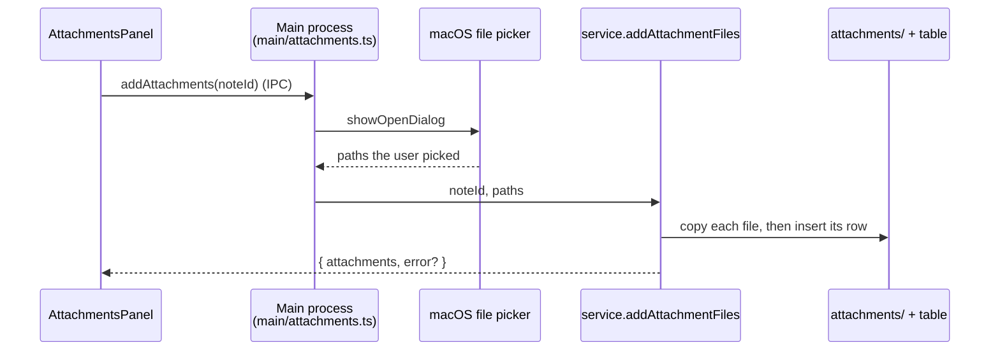

# Attachments

Source: [`attachmentsApi.ts`](../../apps/web/src/lib/composition/attachmentsApi.ts),
[`attachments.ts`](../../apps/web/src/lib/composition/attachments.ts),
[`attachmentsRepo.ts`](../../apps/web/src/lib/composition/attachmentsRepo.ts),
[`AttachmentsPanel.tsx`](../../apps/web/src/components/notes/AttachmentsPanel.tsx),
[`main/attachments.ts`](../../apps/desktop/src/main/attachments.ts)

Any type of file can be attached to a note in the **desktop app**, the **web app** and the **CLI**
(see the [feature matrix](../feature-matrix.md)).

The web app's version is the same panel, with the browser's own file picker, and a download in place
of "save a copy". Its routes are described under [In the web app](#in-the-web-app).

The CLI's version is the Attachments screen ([cli-keybindings.md](../ui/cli-keybindings.md#attachments-screen)):
the same table, with paths typed where the desktop app opens a file picker. It calls the same
`service` functions the desktop's main process does (`listAttachments`, `addAttachmentFiles`,
`findAttachmentFile`, `removeAttachment`), and writes a copy with `saveCopy` in
[`attachmentFiles.ts`](../../apps/cli/src/attachmentFiles.ts). A terminal app has no renderer to
distrust, so the "renderer never supplies a path" rule below is about the desktop app only.

An attachment is not part of the note's text. Unlike an [image](images.md), nothing in
the Markdown refers to it: the note's attachments are a list kept beside it, shown in a
table at the bottom of the note.

## What the user sees

At the bottom of each open note there is an **Attachments** bar with an **Attach files**
button. With nothing attached, that is all there is. Once the note has attachments, a table
appears under the bar:

| Name | Size | Added | |
|---|---|---|---|
| Quarterly report.pdf | 1.4 MB | Oct 1, 2026 | show in Finder · save a copy · remove |

- **Attach files** opens the macOS file picker. Several files can be chosen at once.
- **Show in Finder** reveals the stored copy.
- **Save a copy…** asks where to write one.
- **Remove** asks a second time ("Remove report.pdf?"), because it deletes the stored
  file for good.

A file that can't be attached (a folder, one over 1 GB, one that can't be read) is named
in a message above the table; the other files chosen with it are still attached.

## In the web app

The panel is the same component in both builds (`AttachmentsPanel`); what differs is
`attachmentsClient.ts`, which each build resolves to its own file (next.config.ts):

| | Web | Desktop |
|---|---|---|
| Choose files | The browser's file picker (`<input type=file>`) | The macOS picker, opened by the main process |
| Add | `POST /api/notes/<id>/attachments?name=…`, the raw bytes as the body, one request per file | IPC: the main process copies the picked paths |
| List, remove | Server Actions (`listAttachments`, `removeAttachment`) | IPC |
| Get a copy | The button is **Download**: a link to `GET /api/attachments/<id>` | **Save a copy…**: a save dialog |
| Show in Finder | Not offered (the stored copy is on the server's disk) | Offered |

Bytes go through route handlers, not Server Actions, because a file can be 1 GB: an action's body
is capped (12 MB here, for pasted images) and held in memory, while a route handler can stream the
request to a temporary file (`addStream` in [`attachments.ts`](../../apps/web/src/lib/composition/attachments.ts)),
count the bytes, and stop at the limit. The browser also refuses a file over 1 GB before uploading it.
The desktop build leaves the routes out entirely (it has no server).

Security, since a route handler gets none of the protection Server Actions have:

- **Uploads must be ours.** A request needs the `x-composition-upload: 1` header, which a page on
  another site can't add without a CORS preflight (this app never approves one), and its `Origin`, when
  present, must be this host ([`uploadGuard.ts`](../../apps/web/src/lib/composition/uploadGuard.ts)). Without this, any
  web page you visit could POST files to `localhost`.
- **Downloads are never displayed.** They are `application/octet-stream` with `Content-Disposition:
  attachment` and `nosniff`, so an attached `.html` or `.svg` can't run script on the app's origin.
  This is the web's version of "no open" in [Decisions](#decisions).
- **No paths from the page.** The upload names a note and a file name (reduced to its last segment and
  made safe, as everywhere); the download is found from the row's id.

## Where things live

```
~/.composition/
├── composition.db              attachments table: one row per attachment
└── attachments/
    └── 3f9c2a71b0de-Quarterly_report.pdf
```

```sql
CREATE TABLE attachments (
    id INTEGER PRIMARY KEY AUTOINCREMENT,
    note_id INTEGER NOT NULL,
    file_name TEXT NOT NULL,     -- the name the user attached it as, shown in the table
    stored_name TEXT NOT NULL,   -- the file's name in attachments/
    size INTEGER NOT NULL,       -- bytes
    created_at TEXT NOT NULL
);
```

The bytes are a plain file, copied at attach time (the original is left alone). The
stored name is `<12 random hex digits>-<original name made safe>`: anything outside
`A-Za-z0-9_-` becomes `_`, and the extension is kept so Finder still knows the file type.
Two attachments with the same name never collide, and no name can contain a path.

The table is created by `db.ts`, which the CLI, web and desktop apps all open the file through
([product-builds.md](../product-builds.md#what-sharing-costs-right-now) says why the schema now
lives in one place).

## How it works

The methods are a **separate contract**, `AttachmentsApi`, not part of `CompositionApi`, because
the web build can't carry file bytes in a Server Action (see [In the web app](#in-the-web-app)).
The sequence below is the desktop build's.



The renderer sends only an id. **It never supplies a path**, and file bytes never cross
the bridge. So a compromised page can't make the app read `~/.ssh/id_rsa` into a note, or
overwrite a file of its choosing: the paths come from a dialog the user is looking at, and
the stored file is found from the row, never from anything the page sent.

The panel reaches the backend through `attachmentsClient.ts`. The desktop build resolves
`attachmentsClient.desktop.ts` in its place (the same mechanism as `navLinks.desktop.ts`; see
[next.config.ts](../../apps/web/next.config.ts)), which calls `window.composition`. Both export
`attachmentCapabilities`, which tells the panel whether to offer "Show in Finder" and what to call
the copy button.

## Deleting

- **Remove** in the table deletes the row and its stored file.
- **Moving a note to the Trash Can** ([web-trash-can.md](../ui/web-trash-can.md)) keeps its
  attachments. A restored note keeps its id, so its attachment rows find it again.
- **Permanently deleting a note**, by hand or because it outlived the Trash Can's 60 days,
  deletes its attachments: rows and stored files. The service removes any attachment whose
  note is in neither `notes` nor `trashed_notes` (`removeOrphans` in
  [`attachments.ts`](../../apps/web/src/lib/composition/attachments.ts)).
A file that is already gone is never an error.

## Decisions

- **No "open".** Opening an attachment in its default app would run an attached `.command`
  script or `.app`, and a note's database can come from someone else. Showing it in Finder
  or saving a copy leaves that choice to the user.
- **1 GB per file.** The bytes are on disk, not in the database, so this is a sanity
  limit. It is `MAX_ATTACHMENT_BYTES` in
  [`attachmentNames.ts`](../../apps/web/src/lib/composition/attachmentNames.ts).
- **Not in the note's frontmatter.** The CLI rewrites frontmatter from the keys it knows,
  so an unknown key would be dropped the first time a note was edited there.

## Backups

**Settings → Backup** includes every attached file (and the `attachments` table, which is in the
database), and **Restore** brings them back; see [backup-restore.md](backup-restore.md).

## Gaps

- Attachment names and contents are not searched.
- Files are added only with the button: no drag-and-drop from Finder or the desktop, and no rename.
- A web upload has no progress bar; a very large file shows the panel busy until the server has it all.
- Changing **Application data location** points the apps at a new directory without moving
  anything. Copy `attachments/` along with `composition.db`, as with `app_data/`.
- `attachments/` is found beside the application data directory (the CLI: beside the
  database file), so a database path overridden into a different folder from it splits them.
- The web app keeps its own application data location (see [product-builds.md](../product-builds.md)), so it
  shows only the attachments of the database it opens.
