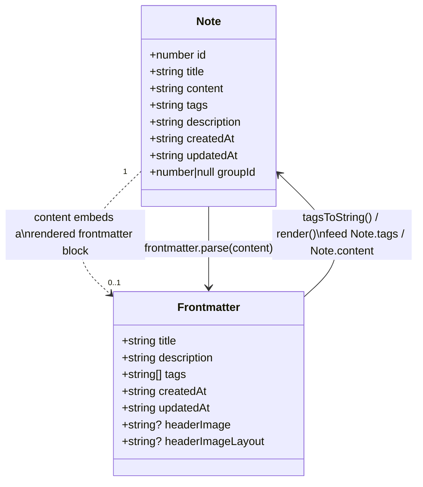

# Data model

Source: [`db.ts`](../../apps/web/src/lib/composition/db.ts),
[`notesRepo.ts`](../../apps/web/src/lib/composition/notesRepo.ts),
[`frontmatter.ts`](../../apps/web/src/lib/composition/frontmatter.ts),
[`webSettings.ts`](../../apps/web/src/lib/composition/webSettings.ts),
[`dataLocation.ts`](../../apps/cli/src/dataLocation.ts)

The terminal, web and desktop apps all open the same database through this one shared data
layer, so nothing here is specific to the terminal app. (The Python CLI that preceded it had its
own copy of the schema code; that is gone, and so is the old rule that schema changes had to
land in two languages.)

## Storage location

Notes are **not** stored as individual files on disk. Everything lives in one SQLite database
file inside the configured application data directory:

```
<application data>/composition.db
```

A note's Markdown content, including its embedded YAML frontmatter, is a single `TEXT` column in
that database. Images pasted into a note in the web and desktop apps are the exception: they are
files in an `app_data/` folder beside the database, and the note's Markdown refers to them by path
(see [images.md](images.md)). Files attached to a note in the desktop app are files in an
`attachments/` folder, described by rows of an `attachments` table (see
[attachments.md](attachments.md)). A PDF a note owns is a file in a `documents/` folder, described
by a `documents` row, with its marks and bookmarks in two more tables (see
[the PDF tables](#the-pdf-tables)). The Meilisearch data directory (`meili_data/`) and its
log and master-key files live alongside it. The search index is derived data, not a second source of
truth for the notes.

The directory defaults to `~/.composition`.

### Settings

The terminal app's settings are its own file, `~/.composition-cli/settings.json`, in the web app's
settings format: the data directory, the color scheme, the city for "follow the sun", the pinned
favorites, and the column layout (stored but not used by the terminal). It sits **outside** the data
directory on purpose, so it can say where the data directory is, and survives that directory
moving. The web and desktop apps keep theirs in their own places (see
[product-builds.md](../product-builds.md)); a setting changed in one does not change in the others.

A copy of the file is read once from `~/.composition/settings.yaml` the first time, if the Python CLI
left one there (see [startup.md](startup.md)).

### Moving the data

Changing **Application data location** in Settings stops Meilisearch, closes SQLite, moves every
managed artifact to the new folder, saves the new location, and reopens everything there. What moves:

| What | Where |
|---|---|
| The database and its `-wal`, `-shm` and `-journal` files | `composition.db` |
| The search index, its log and its master key | `meili_data/`, `meili.log`, `meili_master_key` |
| Pasted images | `app_data/` |
| Attached files | `attachments/` |
| PDFs | `documents/` |

(The folder names come from the web app's own constants, and a test pins them, because a pasted
image left behind is a broken link in every note that uses it.) If the destination already holds any
of these, nothing is moved; a destination inside the current folder, or a file, is refused; and if
anything fails halfway, whatever was moved is moved back and the old location keeps working. Web and
desktop only repoint to the new folder, they do not move files; the terminal app has always moved
them for you, and kept that.

## Schema

```sql
CREATE TABLE notes (
    id INTEGER PRIMARY KEY AUTOINCREMENT,
    title TEXT NOT NULL,
    content TEXT NOT NULL DEFAULT '',
    tags TEXT NOT NULL DEFAULT '',
    description TEXT NOT NULL DEFAULT '',
    created_at TEXT NOT NULL,
    updated_at TEXT NOT NULL,
    group_id INTEGER,
    position INTEGER,
    uuid TEXT
);

CREATE TABLE groups (
    id INTEGER PRIMARY KEY AUTOINCREMENT,
    name TEXT NOT NULL,
    parent_id INTEGER,
    created_at TEXT NOT NULL,
    updated_at TEXT NOT NULL,
    position INTEGER,
    uuid TEXT
);
```

`tags`, `description`, `group_id` and `position` were all added after the `notes` table's original
creation (`position` after `groups`' too). Rather than a migration-file system, `db.ts` runs an
`ensureColumn` check for each every time it opens the file, looking at `PRAGMA table_info(<table>)`
and issuing an additive `ALTER TABLE … ADD COLUMN` only if the column is missing: safe against both
a brand-new and a pre-existing database. `position` is the hand-set order among siblings (see
[groups.md](groups.md#ordering)); it is `NULL` until the item has been dragged into place.
Every other table is a `CREATE TABLE IF NOT EXISTS`, for the same reason. `db.test.ts` opens
databases as each earlier version created them and checks every column arrives with the data
intact.

### Identity: the `uuid` column

`notes`, `groups`, `notebooks`, `trashed_notes`, `trashed_groups`, `attachments`, `documents`,
`pdf_annotations` and `pdf_bookmarks` each carry a `uuid TEXT`: 128 random bits as 32 lowercase hex characters, the same for the life of the row. It is
the name a second device (the iPad app, a sync server) will know the row by; a per-device
`AUTOINCREMENT` id would collide there. It was added ahead of both, as the one change the others need
from the shared schema (the iPad app's design and the cross-device sync design, both still being
written, say why).

**The integer `id` stays the local handle.** Nothing that refers to a row by it changed: foreign keys
by convention (`group_id`, `parent_id`, `notebook_id`, `attachments.note_id`), the favorites list,
`note:<id>` links, the search index, the IPC methods and their validators all still speak integers.
The uuid is not in the search index, and not on the renderer-facing `Attachment` or the Trash Can
listing; on the models it is an optional `uuid` on `Note`, `Group` and `Notebook` (optional so that
fixtures and clients that predate the column still compile; it is always set on a row read from the
database) and a required one on the repo-level `StoredAttachment`.

How it gets there, all in `db.ts` and safe for every older build that opens the file:

- **Column, trigger and index** go in together, in one transaction, by the same additive rule as the
  other columns: `ensureColumn` adds the `uuid`, an `AFTER INSERT` trigger (`trg_<table>_fill_uuid`)
  fills it when it is `NULL`, and a unique index (`idx_<table>_uuid`) enforces it. The trigger uses
  built-in SQL only (`lower(hex(randomblob(16)))`), so a row inserted by an older build, which does not
  know the column and has no user-defined functions, still gets a uuid. Only that build's *Trash move*
  loses something: it does not carry the uuid, so the trashed row (and, on restore, the note) is
  issued a new one. That reads as a delete plus a create to anything that syncs, a degradation and
  not a loss.
- **Backfill.** On the first open of a database without them, the rows that have no uuid get one,
  200 rows per write transaction so the writer (a running terminal app, say) is never held for long.
  The unique index goes in *before* the backfill, so finding the rows left to fill, and learning on
  every later open that there are none, is an index lookup and not a scan of every note. An open that
  was cut short finishes the job next time, keeping the uuids already given. The second open of a
  current database writes nothing.
- **The Trash Can carries it.** `trashNote` and `trashGroup` copy the uuid into `trashed_*`, and
  `restoreNote` and `restoreGroup` put it back, so a restored note keeps its uuid (a trashed row only
  gives its uuid up if a live row already holds it, which would mean the database was swapped
  underneath the app; the trigger then issues a fresh one, as it does for a taken id). Every other
  move (to another group or notebook, a rename, a reorder) is an `UPDATE` and leaves it alone;
  `adoptOrphans` only inserts the default "Notebook", which the trigger covers.
- **Backups.** The `VACUUM INTO` snapshot is a copy of the schema as well as the rows, so a backup
  holds the column, the trigger and the index, and restoring it brings every uuid back. Restoring a
  backup made before the column existed is backfilled on the next open like any other old database.

`db.test.ts` covers each of these: a database without the column (as the build before left it, and
the oldest one), an insert that leaves the column out, a second open that changes nothing, a Trash
round trip for notes and groups, and a backup round trip in both directions.

## Notebooks

A **notebook** holds groups, sub-groups and notes; the web and desktop sidebar shows one notebook's
contents at a time (a second, slide-out sidebar beside it lists the notebooks and creates, renames, deletes and switches them).

```sql
CREATE TABLE notebooks (
    id INTEGER PRIMARY KEY AUTOINCREMENT,
    name TEXT NOT NULL,
    created_at TEXT NOT NULL,
    updated_at TEXT NOT NULL,
    uuid TEXT
);
```

`notes`, `groups`, `trashed_notes` and `trashed_groups` each gained a `notebook_id` column (added by
`ensureColumn` like the others). It is stored on **every** group and note, not derived from the top
of the tree, so listing a notebook is a plain filter. The invariant, kept by the repos: a sub-group
and a note in a group are always in their group's notebook. Moving a group to another notebook
(`moveGroupToNotebook`) makes it a top-level group there and carries its sub-groups and notes along;
reparenting a group under one in another notebook does the same.

On open, `adoptOrphans` creates a "Notebook" if there are none and gives every row with a `NULL`
`notebook_id` to the first notebook. That is how a database from before notebooks upgrades, and how
rows written since by an older CLI (which doesn't know the column) are picked up the next time the
workspace is loaded. A notebook is deleted for good (it is not trashed) and only when it has no
groups or notes; the last notebook cannot be deleted. Restoring a trashed item puts it back in its
group's notebook, else the one it came from, else the first notebook. Ordering among top-level
siblings is per notebook. Which notebook was open last is remembered in the browser's
`localStorage`, not the database.

Write-ahead logging is switched on when the file is opened. It is stored in the file itself, so it
covers every app that opens it, and lets the terminal, web and desktop apps run side by side on one
database.

Three more groups of tables belong to features the older apps never had:

```sql
-- the Trash Can: the same columns as notes and groups, plus when it was deleted
CREATE TABLE trashed_notes  (id INTEGER PRIMARY KEY, title TEXT NOT NULL, content TEXT NOT NULL DEFAULT '', tags TEXT NOT NULL DEFAULT '', description TEXT NOT NULL DEFAULT '', created_at TEXT NOT NULL, updated_at TEXT NOT NULL, group_id INTEGER, deleted_at TEXT NOT NULL, uuid TEXT);
CREATE TABLE trashed_groups (id INTEGER PRIMARY KEY, name TEXT NOT NULL, parent_id INTEGER, created_at TEXT NOT NULL, updated_at TEXT NOT NULL, deleted_at TEXT NOT NULL, uuid TEXT);

-- files attached to a note (desktop only)
CREATE TABLE attachments (
    id INTEGER PRIMARY KEY AUTOINCREMENT,
    note_id INTEGER NOT NULL,
    file_name TEXT NOT NULL,
    stored_name TEXT NOT NULL,
    size INTEGER NOT NULL,
    created_at TEXT NOT NULL,
    uuid TEXT
);
```

`trashed_notes` and `trashed_groups` hold what was deleted, keeping the original ids, until it is
restored or permanently deleted after 60 days (see [web-trash-can.md](../ui/web-trash-can.md)). They
are separate tables rather than a flag on `notes` and `groups` so that an app that has not heard of
the Trash Can never lists a deleted note. The terminal app now has the Trash Can too, like web and
desktop. It still never shows or adds **attachments**, but it leaves them alone: a note in the Trash
Can keeps its attachments until it is permanently deleted.

### The PDF tables

A note can own one PDF (the [PDF reader plan](../pdf-markup-plan.md)). Three tables, created like
every other table (`CREATE TABLE IF NOT EXISTS`, so an older build that opens the file ignores
them), each with a `uuid`, its fill trigger and its unique index:

```sql
CREATE TABLE documents (          -- the PDF, one per owner note
    id INTEGER PRIMARY KEY AUTOINCREMENT,
    note_id INTEGER NOT NULL,     -- the owner note, live or in the Trash Can (unique index)
    file_name TEXT NOT NULL,      -- the name it was imported as
    stored_name TEXT NOT NULL,    -- the file's name in documents/
    sha256 TEXT NOT NULL,         -- of the bytes: a second import of the same file is spotted by it
    size INTEGER NOT NULL,
    page_count INTEGER NOT NULL,  -- 0 until the reader has counted them
    view_state TEXT,              -- JSON: reading position, zoom, dark pages
    created_at TEXT NOT NULL,
    uuid TEXT
);
CREATE TABLE pdf_annotations (    -- one mark on one page
    id INTEGER PRIMARY KEY AUTOINCREMENT,
    document_id INTEGER NOT NULL,
    page INTEGER NOT NULL,        -- 0-based
    kind TEXT NOT NULL,           -- highlight | underline | strikethrough | text | ink
    color TEXT NOT NULL,          -- one of the five <Mark> names for a text mark
    rects TEXT,                   -- JSON: the marked lines, in raw PDF user space
    quote TEXT NOT NULL DEFAULT '',
    comment TEXT NOT NULL DEFAULT '',
    body TEXT,                    -- JSON: a text note's box and text; an ink page's strokes
    group_uuid TEXT,              -- ties the per-page records of one selection that crossed pages
    created_at TEXT NOT NULL,
    updated_at TEXT NOT NULL,
    uuid TEXT
);
CREATE TABLE pdf_bookmarks (
    id INTEGER PRIMARY KEY AUTOINCREMENT,
    document_id INTEGER NOT NULL,
    page INTEGER NOT NULL,
    label TEXT NOT NULL DEFAULT '',
    created_at TEXT NOT NULL,
    uuid TEXT
);
```

(Each table's `uuid TEXT` is added by `ALTER TABLE`, like every other table's, so the stored SQL
ends with it; the conformance fixture holds the text exactly.) What the rows mean, in the code:

- **Ownership.** `documents.note_id` points at a note in `notes` or `trashed_notes`, so a PDF follows
  its note through the Trash Can the way an attachment does. A PDF is given only to a live note, and
  a note owns at most one (`documentsRepo.addDocument`). Deleting a PDF deletes its marks and
  bookmarks in one transaction; no foreign key is declared, for the reason the attachments table
  gives. `documents.removeOrphans`, run beside the attachments' one after a permanent delete and
  after the Trash Can's expiry sweep, deletes the PDFs, marks, bookmarks and stored files of notes
  that are gone for good, and any marks whose PDF row is already gone.
- **Marks** are checked before they are stored (`pdfMarkup.ts`): the kind and color, rectangles that
  are four finite numbers with an area (put in order and rounded to a thousandth of a point), a
  one-line comment of at most 500 characters, a text note's box and text, ink's strokes as JSON, and a
  page that exists once the PDF's pages are counted. Every rectangle is in raw PDF user space (the
  numbers a PDF's own `/Rect` uses), which pdf.js and PDFKit draw in the same place on rotated and
  cropped pages. A selection across pages is one record per page sharing a `group_uuid`, and deleting
  one deletes them all.
- **Shared with the Swift core.** The tables and the rules above are pinned by the conformance
  fixtures in [`fixtures/conformance/pdf`](../../fixtures/conformance/README.md), which the iPad's
  core replays.

Source: [`documentsRepo.ts`](../../apps/web/src/lib/composition/documentsRepo.ts),
[`pdfMarkupRepo.ts`](../../apps/web/src/lib/composition/pdfMarkupRepo.ts),
[`documents.ts`](../../apps/web/src/lib/composition/documents.ts),
[`pdfMarkup.ts`](../../apps/web/src/lib/composition/pdfMarkup.ts).

Favorites are not in the database. They are a list in the settings file, so a new column could not
break an app that builds its models straight from `SELECT *` (see [groups.md](groups.md)).

See [groups.md](groups.md) for how `notes.group_id` and `groups.parent_id` relate to each other
and how they are shown as a tree.

## Two representations of the same metadata



- **`Note`** is the row-shaped, persisted model (`notesRepo.ts`). `tags` is a flat comma-joined
  string, matching the SQLite column, and `content` is the full raw text the editor shows,
  frontmatter block included.
- **`Frontmatter`** is a transient, in-memory representation used only while parsing or rendering:
  `tags` is a real `string[]`, and there is no `id`. It is never persisted on its own, only
  serialized into `Note.content`.
- `frontmatter.tagsToString` and `tagsFromString` are the two converters that keep the flat string
  and the list in sync.

Unlike `tags`, `description` and `title`, `groupId` has **no** frontmatter representation: group
membership is database-only and never round-trips through the YAML block. See
[groups.md](groups.md) for why.

## On-disk note content format

```
---
title: Grocery List
description: ''
tags:
- kitchen
- errands
createdAt: '2026-09-01T12:00:00+00:00'
updatedAt: '2026-09-14T08:30:00+00:00'
---
- [ ] Milk
- [ ] Eggs
```

Frontmatter keys are camelCase (`createdAt`, `updatedAt`) in the YAML text, matching
Markdown-frontmatter convention; the database columns are snake_case (`created_at`, `updated_at`),
and `frontmatter.ts` and the repos are the only places that translate between the two. Key order is
fixed (`title`, `description`, `tags`, `createdAt`, `updatedAt`), and the exact format, including
the unindented list of tags, is pinned by `frontmatter.test.ts`, because every note already stored
was written in it and must stay readable.

Two optional keys follow those, written only for a note that has a header image, so every other note
is serialized exactly as before:

```
headerImage: app_data/trip-plan-route-map-3f9c2a71b0de.png
headerImageLayout: centered
```

`headerImage` is a stored image's `app_data/<name>` path or an `https://` address; `headerImageLayout`
is `full` (a banner across the note, cropped) or `centered` (the whole picture at its own size), and
anything else reads as `full`. They live in the frontmatter, not in a column, so they travel with the
note's text in a backup. The pane's **Header image** button sets them from the stored images, and they
can be typed by hand. The preview draws the picture above the title (see
[images.md](images.md#header-image)). The terminal app keeps the keys when it saves but doesn't draw the picture.

`frontmatter.parse` is designed to never throw: a note with no leading `---` block, a non-mapping
YAML document, or invalid YAML simply parses to `[null, original content]`. This is what lets
[the autosave flow](note-lifecycle.md) fall back to a raw content save instead of failing whenever
the user is mid-edit of the metadata block. The preview uses the same parser to drop the block, so
it shows a clean note body without the YAML.
