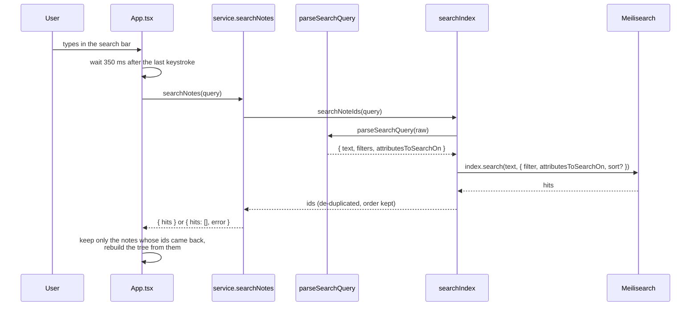
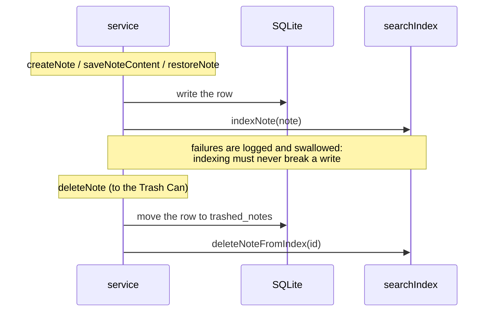

# Search

Source: [`searchQuery.ts`](../../apps/web/src/lib/composition/searchQuery.ts),
[`searchIndex.ts`](../../apps/web/src/lib/composition/searchIndex.ts),
[`service.ts`](../../apps/web/src/lib/composition/service.ts) (`searchNotes`),
[`App.tsx`](../../apps/cli/src/App.tsx) (the terminal app's search bar),
[`runtime.ts`](../../apps/cli/src/runtime.ts) (starting Meilisearch),
[`meili.ts`](../../apps/desktop/src/main/meili.ts) (the process)

Search is fuzzy full-text search over titles, descriptions and content, plus structured filter
tokens (`tag:`, `title:`, `created:` …), served by a local Meilisearch index that is kept in sync
with SQLite on every write. The terminal, web and desktop apps all use the same query parser,
index shape and `searchNotes` function; they differ in who starts Meilisearch (below).

## Query flow (terminal app)

A search never throws into the UI. If Meilisearch is down or was never started, `searchNotes`
returns `{ hits: [], error }` with the reason (for instance, that the binary wasn't found), the
terminal app shows it in its header and leaves the tree as it was. A search that is
still waiting when a newer one starts is discarded when it comes back, so slow answers cannot
overwrite fast ones.

While a search is filtering the tree, groups with no matching note below them are left out and
the Favorites section is hidden; with no match at all the tree says `No notes match.` An empty
search bar lists everything from SQLite, most recently edited first, without asking Meilisearch.

## Query syntax

`parseSearchQuery` is a pure function (no network), so it is safe to run on every debounced
keystroke. It recognizes `field: value` anywhere in the query, case-insensitive field names, space
after the colon optional, and treats everything else as free text:

| Field | Example | Matches |
|---|---|---|
| `tags:` / `tag:` | `tags: web development` | notes with exactly that tag (tag matching ignores case) |
| `title:` | `title: routng` | typo-tolerant search over titles only |
| `description:` | `description: ownership` | typo-tolerant search over descriptions only |
| `created:` / `createdAt:` / `createdOn:` | `created: >=2026-05-30` | creation date; operators `>`, `>=`, `<`, `<=`, `=` (default `=`, the whole UTC day) |
| `updated:` / `updatedAt:` / `updatedOn:` | `updated: <2026-01-01` | same, for the last-modified date |

- An unquoted value runs up to the next `field:` or the end of the query, so `tags: web development`
  is the one tag "web development". To follow a value with free text, put the text first
  (`async tags: web development`) or quote the value (`tags:"web development" async`).
- Repeating a field, or combining fields, ANDs them. `title:` and `description:` are the
  exception: Meilisearch can't scope individual words to an attribute, so their values and any
  free text are joined into one query over the named attributes.
- A field with no value yet (`tags:`) is ignored. A malformed date stays as literal text, so it
  finds nothing instead of silently dropping the constraint, and a half-typed date degrades to "no
  matches" rather than breaking the handler mid-keystroke.
- Results are capped at 50. A query with filters but no text lists matches newest first
  (`updated_at_ts:desc`).

(The Python CLI that preceded the terminal app understood only `tag:`, `title:` and `createdOn:`.)

## The index

One Meilisearch index, `notes`, with the note id as primary key and the title, description,
content, tags and creation and update times as documents. Title, content and description are
searchable; tags and the timestamps are filterable; the update time is sortable.

SQLite is the source of truth and the index is derived, so it can be thrown away and rebuilt at any
time:

- `searchIndex.reindexAll(notes)` empties it and re-adds every note. The terminal app does this
  in the background at every start (`SearchSidecar.start`, see [startup.md](startup.md)), and again
  after the data location changes.
- If the index has no documents, or the server was started fresh, the first search of a run
  rebuilds it, so a stale or empty index is never shown as "no matches". A document shape change
  (the `description` field was added) is handled the same way.

A note that owns a PDF is indexed with one more thing: the words of its PDF's marks (their quotes, comments and text notes) and its bookmarks' labels,
appended to its content (`marksSearchText`, [pdf.md](pdf.md#search)). A search returns ids only, so the added words are never shown; they only make
the note findable. A change to a mark or bookmark re-indexes the owner note afterwards, in the background; `reindexAll` adds them for every owner note
in one query. The text of the PDF itself is indexed separately, a page at a time ([below](#the-text-of-a-pdf)).

## The text of a PDF

**On the desktop and on the iPad** (the iPad built 2026-11-12, the desktop 2026-11-13). A word that is only in a PDF's own pages, never marked,
finds the note that owns the PDF, and says on which page. Both apps index the same text and answer a query the same way; two committed oracles
hold them to it.

- **What is indexed.** Every page of every PDF a note owns. The desktop reads it with pdf.js (`readPdfText` in
  [`pdfText.ts`](../../apps/web/src/lib/composition/pdfText.ts): `getTextContent` per page, `pageTextFromItems`), the iPad with PDFKit
  (`PdfTextExtractor` in `CompositionPDF`, `PDFPage.string`). Both put each page through one rule, `pageSearchText` (ported as `PdfSearchText`).
  Line breaks become `\n`; compatibility forms become plain letters (NFKC: `fi` is `fi`, full-width letters are letters); lines are trimmed and
  empty ones dropped; a soft hyphen is dropped except at a line's end; and a word broken over two lines with a hyphen (`extrac-` / `tion`, the
  next line starting in lower case) is also added whole, so `extraction` finds it (the halves still do too). A page's printed label is kept when
  the PDF has one that is not simply its number.
- **The oracles.**
  - *The text:* `fixtures/conformance/pdf-text.pdf` (eight awkward pages, made by `apps/ios/scripts/make-pdf-text-fixture.swift` with CoreText:
    ligature glyphs, hyphenation, accents, Greek and Cyrillic, full-width letters, two columns, a turned page, a page with no text, punctuation)
    is read by the desktop's own `readPdfText`; `apps/ios/scripts/pdf-text-oracle.mjs` writes what comes out to `fixtures/conformance/pdf-text.json`,
    with 55 more raw texts and what the rule makes of each. The Swift side must make the same text of every case exactly
    (`PdfTextConformanceTests`), PDFKit must find the same words on every page as pdf.js (`PdfTextExtractionTests`), and every one of those words
    must find the note at the first page it is on. `conformance.sh` checks the file is still what the desktop makes.
  - *The answers:* `fixtures/conformance/pdf-text-search.json` holds six notes (one in the Trash Can), four PDFs (the fixture, a small book with
    roman-numeral labels, a scan, the trashed note's) and 47 queries, with what a real Meilisearch answered through the desktop's `searchIndex.ts`
    (`apps/web/src/lib/composition/pdfTextSearch.test.ts`: runs when a Meilisearch binary is on the `PATH` or in `COMPOSITION_MEILI_BIN`, and
    `UPDATE_FIXTURES=1` rewrites the file). The iPad's FTS5 search replays it and must find the same notes, in the same order, at the same pages
    (`PdfTextSearchConformanceTests`).
- **How a search uses it.** After the notes' own text: a note found by its title, text, description or its marks comes first, as before, and is
  listed once, without a page. Then the notes whose PDF has **every word of the query on one page** (the last word also as the start of a word,
  a quoted phrase as a phrase), most recently updated first, each with the first such page. There is **no typo tolerance** in a PDF's text. `tag:`
  and date filters apply; `title:` and `description:` searches leave PDFs' text out; a note in the Trash Can is not found by its PDF.
- **How it is shown.** The result says *In the PDF, p. 212* (the printed label when the PDF has one, else the page's number). Opening it opens
  the PDF at that page with the reader's find bar looking for the query's words (its first quoted phrase, or else its longest word:
  `findTextForQuery` in `searchQuery.ts`, `PdfSearchText.findText` on the iPad), for going on to the next. On the iPad the matches on that page
  are also marked.
- **States.** `indexed`; `noText` when no page had text, which is a scan (OCR is not built: the reader's outline or Contents says *No searchable
  text (scanned)*, and only the PDF's marks and bookmarks find it); `locked` for a PDF that asks for a password, read the next time it is unlocked
  in the reader, with the password used for that reading only and never kept (the words are then in the index, which has no protection of its
  own beyond the computer's or the iPad's); `unreadable` when the PDF cannot be opened, not tried again until the file changes.
- **When it is read.** In the background, one PDF at a time, after anything already queued: when search is ready (at launch, after a change of
  data location), after an import, after a note is deleted for good (only what is gone is forgotten), and after a protected PDF is unlocked.
  Each time, what is kept is compared with the `documents` table: a PDF that is gone, or whose file changed (its SHA-256), is forgotten; a PDF never
  read is read. Rebuilding the notes' index does not throw the PDFs' text away. On the iPad a search that is showing runs again when a PDF has been
  read; on the desktop the next search finds it.

### On the desktop

- **Where it is kept.** Two more indexes in the app's own Meilisearch: `pdf_pages`, one document a page with text (`id` `<document>-<page>`,
  `document_id`, `note_id`, `page`, `label`, `text`), because Meilisearch ignores every word past position 65,535 of a field and a long book has
  several hundred thousand; and `pdf_files`, one document a PDF (`id` the document's, `note_id`, `sha256`, `state`, `pages`, `characters`).
  `pdf_pages` searches `text` only, has typo tolerance off, and ranks by `page` first (`rankingRules` starts with `sort`), so that with
  `matchingStrategy: "all"`, `sort: ["page:asc"]` and `distinct: "note_id"` each note comes back once, at the first page that has every word.
  The notes those pages belong to are then put through the query's filters, the Trash Can and the order in one more query of the notes' index
  (`id IN [...]`, sorted by `updated_at_ts:desc`), which is why `id` is a filterable attribute there.
- **Who reads.** `PdfTextIndexer` (`apps/desktop/src/main/pdfText.ts`) in the main process keeps the queue; each PDF is read in a utility
  process of its own (`worker/pdfTextWorker.ts`, bundled with pdf.js into `dist/pdf-text-worker.js`, unpacked beside the archive when packaged),
  so the main process never parses a PDF. pdf.js takes a utility process for a browser (its check looks at Electron's `process.type`), where a
  path cannot be opened, so the worker gives it the file a range at a time (`PDFDataRangeTransport` over `fs.read`, 64 KB chunks, no auto-fetch)
  and its CMaps and standard fonts through a `BinaryDataFactory` that reads files (the renderer's copy, `dist/renderer/pdfjs`). A process that
  ends without answering (out of memory) or takes more than five minutes records nothing, and the PDF is tried again the next time. The web
  app and the CLI share `searchIndex.ts` but read no PDFs: their `pdf_pages` index stays empty and adds nothing to a search. The
  reader asks where a PDF's text is (`pdfTextState`) and hands over a password it has just used (`readUnlockedPdfText`, through the documents
  store's `rememberPassword`); those are the only two new methods on the bridge.
- **What it costs.** The 600-page filler book (1.28 million characters) was read in 0.52 s by the bundled worker, the whole process at 188 MB;
  its pages are one `addDocuments` task. A query that reaches PDFs' text costs two more Meilisearch queries.

### On the iPad

- **Where it is kept.** In the iPad's own index file, `search.db`, never in `composition.db` or a backup: it is derived from the files and
  can be read again. Three tables of its own: `pdf_files` (one row a PDF: its note, its file's SHA-256 and a state), `pdf_pages` (one row a
  page with text, with the printed page label when the PDF has its own) and `pdf_text_fts`, a contentless FTS5 table (`content=''`,
  `contentless_delete=1`, SQLite 3.43, so iOS 17) of the pages' text: the text is never read back, so it is not stored twice. The text is folded
  as a query is (case and accents, `Typo.fold`) before it goes in, because FTS5's `remove_diacritics` only takes accents off Latin letters
  (`Ζεύς` would not be found by `Ζεύς` otherwise; a note's own Greek or Cyrillic text has that problem today, which is a separate fix). Its words
  are kept out of the vocabulary the typo search reads on every keystroke, which a library of books would make hundreds of thousands of words long.
- **Searching.** `searchHits` returns the page; `search` still returns ids, so the conformance tests against Meilisearch are unchanged.
- **What it costs.** The same 600-page book was read in 0.68 s and indexed in 0.19 s on a Mac, and grew the index by 387 KB; filler has a small
  vocabulary, so a real book's index is larger (more distinct words). Not yet measured on an iPad. A query that reaches the PDFs' text costs one
  more FTS5 query.

## Who runs Meilisearch

Each product keeps its own index, and none shares a Meilisearch data directory with another, so two
server processes never fight over one index:

| | Terminal app | Web app | Desktop app |
|---|---|---|---|
| Meilisearch | spawned by the app (`MeiliProcessManager`), random port | started by hand, `pnpm meili`, port 7700 | spawned by the app, bundled binary, random port |
| Binary | `meilisearch` on the `PATH`, or `COMPOSITION_MEILI_BIN` | the same, run by hand | bundled in the app |
| Data | `<app data>/meili_data` (default `~/.composition/meili_data`) | `~/.composition-web/meili_data` | under the app's own data folder |

The web app connects to `MEILI_URL` (default `http://127.0.0.1:7700`) with `MEILI_MASTER_KEY` or the
key file at `~/.composition/meili_master_key`. A search that can't reach Meilisearch comes back as an
error the UI shows, never as "No matches".

Developer tools for trying search against a throwaway index: `pnpm search:playground` in
`apps/cli` loads 100 dummy notes into a temporary database and Meilisearch of its own, and gives a
`search>` prompt; `pnpm seed` writes the same dummy notes into a scratch home you can open with
`COMPOSITION_DEV_HOME=<folder> pnpm dev`.
