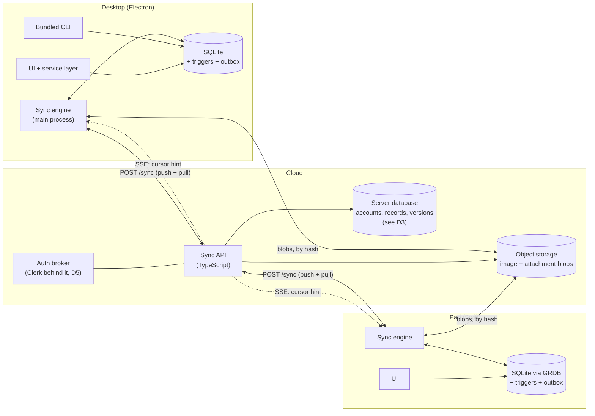
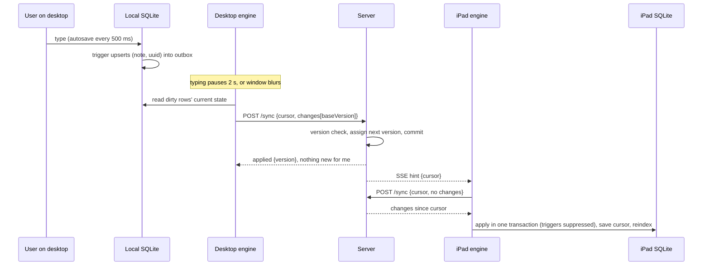
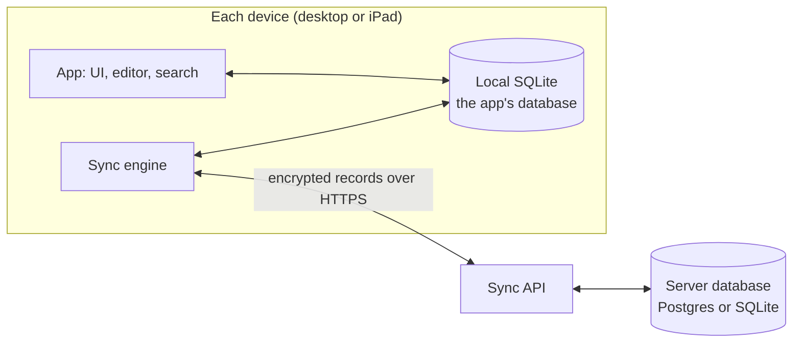
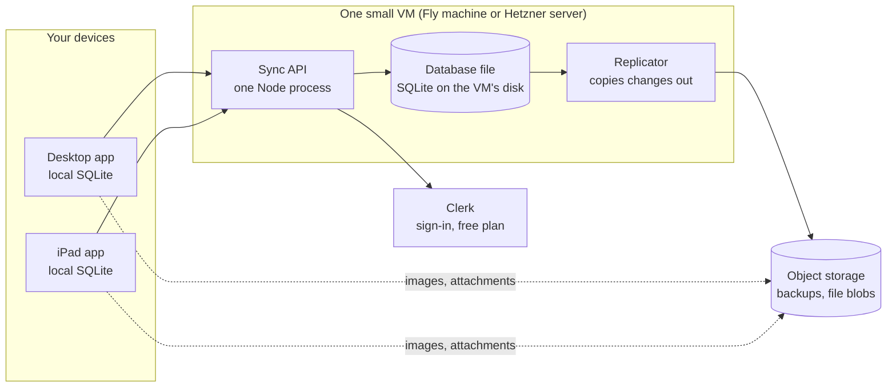
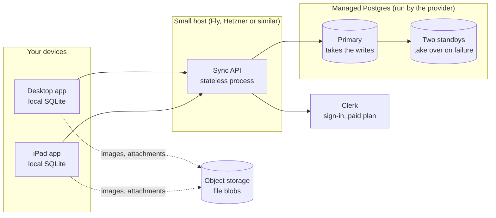
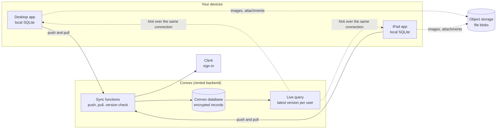

# Cross-device sync: design

Sign in to a Composition account on the desktop app or the iPad app, and your notes follow you. This page is
the design: what is proposed, what each choice costs, and what needs your decision.
**Design only: no code is written, and nothing here has been tried.** Dates are 2026-11-05.

It resolves the open question [D8 in the iPad design](ipad-app-design.md) (sync) in favour of **our own
account-based, record-level sync service**, and it changes the schema the iPad's data layer must start from
(see [Order of work](#order-of-work)).

## Summary

- **The assumption is the design's best lever.** Edits on the two platforms are at least 20 s apart. Read as a
  **deadline, not an interval**: an edit must reach every other online device in under 20 s (target p95 ≤ 10 s).
  Then the other device already has it by the time you pick it up, and there is no real-time collaboration to
  build: no CRDT, no operational transform, no sub-second presence. See [The assumption](#the-assumption).
- **Language: TypeScript** on Node. The server is I/O-bound and small, so language is the least consequential
  choice. What matters is that two of three clients are TypeScript, so the protocol types, the trigger SQL and the
  test harness are shared. The rule that matters more: **the server never understands a note.** It stores opaque
  records, so it never becomes a third implementation of the notes rules ([C3 in the iPad design](ipad-app-design.md#compromise-register)).
- **Database: every device keeps its own SQLite (unchanged).** A SQLite file cannot be hosted and shared; what syncs
  is **rows**, not files. Details, and why Turso, PowerSync, cr-sqlite and SQLite's session extension were each
  rejected, in [Can a hosted SQLite sync?](#can-a-hosted-sqlite-sync). For the **server** the choice is still open
  ([D3](#decisions), with a [side-by-side](#what-the-server-should-use)): I now lean **managed Postgres for the
  hosted service and SQLite for the self-hosted one**, behind one storage interface.
- **Sync model:** state-based records with a server-assigned version, optimistic concurrency (`baseVersion`),
  tombstones, and **keep-both on a content conflict**. Changes are captured by **SQLite triggers into an outbox**,
  because the CLI writes the same file from another process.
- **The first thing to build is not the server.** Notes need a stable `uuid` (integer ids collide across devices),
  the capture triggers, and a one-time migration of `note:<id>` links to `note:<uuid>`. That lands in the desktop schema **before** the iPad
  data layer, so the "identical schema" rule holds.
- **Decided (2026-11-05):** the 20 s assumption is a **deadline** (D1); notes are **end-to-end encrypted** (D4); the
  hosted service signs users in with **Clerk, behind our server**, and the self-hosted server will have its own
  sign-in on an adopted library, as **separate products** whose accounts do not move between them (D5); the sync
  server is **hosted first and self-hostable later** (D6); note links are **migrated once** to `note:<uuid>` (D7); the
  desktop app **syncs the CLI's edits** (D9); and **attachments, to-do, Reading List and RSS are a fast follow that
  must be syncing before release to other users** (D10). See [Using Clerk](#using-clerk),
  [End-to-end encryption](#end-to-end-encryption), [Hosted now, self-hosted later](#hosted-now-self-hosted-later) and
  [Fast follow](#fast-follow-attachments-and-plugin-data).
- **Revised (2026-11-07): self-hosted first.** Sync will be user-run until the product has a user base, so the order in D6 is
  reversed, **D20 (the lean SQLite server) is decided**, and **D3 (the hosted service's database) is deferred**, not open and
  not blocking. The lean server exists as a container for a personal server (`spikes/sync-hosting/selfhost/`).

## The assumption

> A user is on one platform at a time. They may be signed in on both, but edits on either are no closer than
> 20 seconds apart.

**Decided (D1, 2026-11-05): a deadline.** The assumption describes *who writes when*, not a limit on sync. Compare the two
readings, with an edit on the desktop at 0:00 and the iPad picked up at 0:25:

| | A **deadline** (chosen) | A **throttle** |
|---|---|---|
| What it means | Sync promises: *a change reaches your other device within 20 s.* | Sync limits itself: *a device may talk to the server at most once per 20 s.* |
| What the desktop does | Sends about 2 s after you stop typing. | May wait up to 20 s before sending. |
| What the iPad does | Is told at once by a live connection, and pulls. | May wait up to 20 s before checking. |
| When the iPad has the change | About 0:04. | Anywhere up to about 0:40. |
| At 0:25 on the iPad | Up to date. | Possibly stale: the problem the assumption was meant to avoid. |
| What 20 s is | The line at which we call it a bug. | The pace of the system. |

If the real worry is server load or cost, a throttle is the wrong tool: batching already means at most one request
per 2–10 s while typing and none while idle.

| What the assumption buys | What it does not buy |
|---|---|
| No concurrent-editing machinery. Whole-record sync, no merge algorithm on the hot path. | Correctness when it is false. It will be: offline on a plane with both devices edited, a device that was asleep, a slow network, a restore. |
| Coarse batching: push a few seconds after typing stops, one request per cycle. | A reason to drop conflict handling. The unhappy path must **lose nothing**, even if it is clumsy. |
| Per-user serialization on the server is free (no contention to engineer around). | Trust in client clocks. Order comes from the server, never from `updated_at`. |
| No push notifications needed in v1: **pull on foreground** is deterministic on the iPad. | |

**The latency budget** (the autosave delay is 500 ms today, `AUTOSAVE_DELAY_MS`; the rest are proposals):

| Step | Budget |
|---|---|
| Autosave debounce (exists) | 0.5 s |
| Push debounce: wait for typing to pause (max wait 10 s so a long session still syncs) | 2 s |
| Request, server write, response | 0.2–0.5 s |
| Hint reaches the other device (live connection), then its pull | 0.3–1 s |
| **Typical total** | **about 3–4 s** |
| Target p95 / hard ceiling | ≤ 10 s / 20 s |

Two mechanisms make the assumption safe rather than hopeful:

1. **Flush on blur.** Window loses focus or the iPad scene resigns active: push now, don't wait for the debounce.
2. **Pull on focus.** Window gains focus or the scene becomes active: pull first, and don't let an edit start on a
   note that changed until the pull lands (normally under a second, and invisible).

The **conflict rate** is the tripwire: if real use produces conflicts at more than a trace level, the assumption
is wrong and the design needs revisiting ([Observability](#observability)).

## What the app is today

Facts that drive the design, checked against `main`.

| Fact | What it means for sync | Source |
|---|---|---|
| **Ids are `INTEGER PRIMARY KEY AUTOINCREMENT`** on notes, groups, notebooks, trash and attachments. | Two devices both create "note 57". Needs a global id before any record-level sync. | [db.ts](../apps/web/src/lib/composition/db.ts) |
| **Notes link as `[text](note:42)`** by integer id. | The same text means a different note on another device. Links must move to global ids ([Note links](#note-links)). | [noteRefs.ts](../apps/web/src/lib/composition/noteRefs.ts) |
| **Several processes write one SQLite file:** the desktop app, the bundled CLI, and the web app in development. WAL is on. | Capturing changes in the service layer would miss the CLI's. Capture must live **in the database** (triggers). | [product-builds.md](product-builds.md#what-sharing-costs-right-now) |
| **Schema changes are additive `ensureColumn` checks,** and old builds keep opening the file. | Triggers must use built-in SQL only (an old build has none of our functions), and a row inserted by an old build has no `uuid` until a trigger gives it one. | [db.ts](../apps/web/src/lib/composition/db.ts) |
| **Deleting moves a row to `trashed_notes` / `trashed_groups`** with the same id; permanent deletion is after 60 days. | A move between tables is not a delete. The engine must classify a uuid by where it is *now* (live, trashed, gone). | [data-model.md](architecture/data-model.md) |
| **`position` is dense and renumbered:** `placeNote` rewrites the position of every sibling on a drag. | If a note were one record, one drag would push every sibling's full text. Content and placement must be separate records. | [notesRepo.ts](../apps/web/src/lib/composition/notesRepo.ts) |
| **Image files are named with a content hash** (`trip-plan-map-3f9c2a71b0de.png`). | Merge-safe and dedupe-friendly: blobs can be content-addressed, uploaded once, and fetched lazily. | [images.ts](../apps/web/src/lib/composition/images.ts) |
| **Favorites, colour scheme and AI settings live in a settings file,** not the database. | Not synced in v1. Favorites hold integer ids, which differ per device. | [favorites.ts](../apps/web/src/lib/composition/favorites.ts) |
| **Search is a derived, per-device index** (Meilisearch on desktop, FTS5 on the iPad). | The server needs no search. Applying a remote change must update the local index like a local edit does. | [search.md](architecture/search.md) |
| **Backup and restore replace the whole database,** images and attachments. | A restore on a signed-in device is a time machine. It needs an explicit rule. | [backup.ts](../apps/web/src/lib/composition/backup.ts) |
| **The iPad is native Swift on GRDB with the same schema** and its own conformance corpus. | Every sync rule (triggers, link migration, conflict policy) exists twice. The corpus must cover sync. | [ipad-app-design.md](ipad-app-design.md) |
| **No account, auth or credential storage exists** for Composition itself. The ChatGPT sign-in spike is a provider login for the AI helper. | The account system is new. | [chatgpt sign-in notes](ui/ai-helper.md) |

## Goals and non-goals

**Goals** (proposed)

1. Sign in on the desktop or iPad app and see the same notebooks, groups, notes, Trash Can and images.
2. **Local-first:** every read and write is against the local SQLite. Sync is background. Offline works indefinitely.
3. **Fast:** an edit is visible on the other device in about 3–4 s typically, within 20 s always (online).
4. **Never lose text.** Any conflict keeps both sides.
5. **A cheap server,** for outside users too: one small service and managed storage, run by one person, with the monthly
   bill kept as low as possible ([Hosting it cheaply](#hosting-it-cheaply)).
6. **End-to-end encryption:** the server can never read a note, a title, a tag or an image ([D4](#decisions), decided).

**Non-goals for v1**

- Real-time co-editing, presence or sharing a note with another person.
- Syncing settings. (Attachments and plugin data are **not** a non-goal: they are the fast follow, complete before
  release to other users, see [What syncs](#what-syncs-in-v1).)
- The CLI syncing on its own, without the desktop app ([D9](#decisions)).
- A hosted web client. Ruled out for now (2026-11-05: too much complexity and cost); it would decrypt in the browser.
- Anything that needs the server to read a note: server-side search, AI over your notes, email digests.
- A self-hosted server (D6). Only the preparation is in scope, see [below](#hosted-now-self-hosted-later).
- Merging text automatically (a three-way merge). Designed for, not built.

## What syncs in v1

(D10, decided 2026-11-05.) The app holds several kinds of data. Each is either carried by sync or stays on its device.

| Data | v1 | Why |
|---|---|---|
| Notes (text, title, tags, description) | **Yes** | The point. |
| Groups, notebooks, and where each note sits and in what order | **Yes** | A library that arrives flat is not the same library. |
| The Trash Can | **Yes** | Delete on one device, restore on the other. |
| Images in notes (`app_data/`) | **Yes** | A note without its pictures is broken. |
| Attachments (files attached to a note) | **Fast follow** | Desktop only today; up to 1 GB each, so they need quotas, chunked upload and download on demand. |
| To-do (with its weekly cycle), Reading List, RSS Reader | **Fast follow** | The iPad has none of the plugins in v1, but desktops share them. The weekly cycle needs rules so two devices don't both close a week. |
| Settings: colour scheme, fonts, city, window layout | **No** | Per device on purpose. |
| Favorites | Later | They hold device-local integer ids today. |
| AI helper keys and sign-in tokens | **Never** | Secrets stay on the device. |
| The search index | **Never** | Derived data; each device rebuilds its own. |

**The fast follow is a release gate.** Attachments, to-do, Reading List and RSS are not in the first build, but the
capability is not released to other users until they sync too. The first build must not make them harder: every table
that will sync gets its `uuid` in the same schema step (P1). What I found in the code, and the hazards, are in
[Fast follow](#fast-follow-attachments-and-plugin-data).

## Architecture

One cycle, on the happy path:

## Language

**Recommendation: TypeScript on Node (current LTS), with a small HTTP framework. Revisit only for a measured reason.**

| Option | For | Against |
|---|---|---|
| **TypeScript / Node** | Desktop and CLI are TypeScript: share the protocol types and validators, the trigger SQL, the test harness, and run server plus two real engines in one test process. One fewer toolchain for a solo maintainer already carrying Swift. Idle SSE connections are cheap. | One thread per process (scale out by running more); more memory per connection than Go. Neither matters at this scale. |
| Go | Static binary, excellent for many connections, tiny memory. | A fourth language in the repo, nothing shared with the clients. |
| Swift on the server | Could share the iPad's `CompositionCore` sync engine. | Only one of three clients benefits; small server ecosystem. |
| Rust | Fastest, safest. | Overkill for a few thousand lines of I/O-bound code; slowest to change. |

Why this is not a performance question (estimates, to be measured in [S3](#spikes-and-gates)): a note is about 4 KB,
a push is one to three records, and a request is a single small database transaction. 1,000 users all actively
typing at once is on the order of 200 requests a second, well inside one small Node process and one managed
database. Network round trip (50–150 ms) dominates the database round trip (about 1 ms in one region, less for an embedded one).

**The escape hatch is the protocol, not the language.** The server is a few thousand lines behind an HTTP+JSON
contract. If it ever needed rewriting, that is days. The clients are the expensive part.

**The rule that must hold:** the server treats a record as `(entity, uuid, version, deleted, schemaVersion,
payload bytes)`. It never parses frontmatter, MDX, links or group trees. That keeps it from becoming a third copy
of the notes rules, and, since D4, it is simply a fact: the payload is ciphertext the server cannot read.

## Database

### Can a hosted SQLite sync?

Not as a hosted file. SQLite is a library with no network protocol, so "one SQLite instance that every device
uses" means one of three things, and none fits:

| Idea | Why not |
|---|---|
| **Share the file** (iCloud Drive, Dropbox, a network share) | WAL's sidecar files can be delivered out of order and corrupt the database; locking on network filesystems is unreliable ([SQLite forum](https://sqlite.org/forum/info/47107ab818977549?t=h), [How To Corrupt](https://www.sqlite.org/howtocorrupt.html)). Already rejected in the iPad design. |
| **A remote SQLite** (Turso/libSQL, D1, rqlite): the device reads and writes over the network | Every 500 ms autosave becomes a network write, and the iPad has no offline mode. Turso's embedded replicas read locally but **writes go to the cloud primary** ([TS docs](https://docs.turso.tech/sdk/ts/reference.md)). Its offline-write sync is a separate, newer path whose beta announcement said conflict resolution was not yet implemented ([Turso](https://turso.tech/blog/turso-offline-sync-public-beta)); I did not find that it has shipped. It also means libSQL builds on the iPad instead of GRDB on system SQLite. |
| **A sync layer built on SQLite itself** | See the next table. |

| Library | Verdict |
|---|---|
| **PowerSync** | Its default stores synced data as JSON in generic tables and exposes your schema as *views*; the raw-tables route is marked experimental ([PowerSync](https://docs.powersync.com/architecture/client-architecture.md)). That fights "schema identical to the desktop", and the CLI and old builds read the same file. |
| **cr-sqlite** | A loadable extension every connection must load, including the CLI's and GRDB's; its maintenance status was unclear in my search ([repo](https://github.com/vlcn-io/cr-sqlite)). CRDT overhead for a problem the assumption removes. |
| **SQLite session extension** (changesets) | Compile-time option, off by default ([SQLite](https://www3.sqlite.org/sessionintro.html)); the official `better-sqlite3` does not enable it (a community fork does), and I could not confirm Apple's system SQLite does. Changesets are keyed by primary key, which is the integer-id problem again. |
| **CloudKit** (`CKSyncEngine`) | Natural for iPad, but Apple-only: it does not reach the desktop on Linux or Windows. Rejected by choosing accounts. |
| **A hand-written sync layer** | **Chosen.** The data is small, the model is simple under the assumption, and it is the only option that keeps the schema, the CLI and GRDB untouched. |

**So the answer:** there is no single hosted SQLite that syncs. There are **N local SQLites** (one per device,
exactly as today) and a **server that holds the records**. What moves between them is rows.

### How the local databases and the server database relate

Choosing Postgres (or SQLite) for the server does not change how the apps work. **The server's database is not an app
database.** No app opens a connection to it, and no database credentials ever reach a device. Each device keeps its own
SQLite and works only from that; the sync service exists to keep the devices in step.

1. **You edit.** The app writes to its local SQLite immediately, as it does today, and a trigger notes the change in a
   small outbox table.
2. **The sync engine pushes.** A couple of seconds after you pause, it reads the changed rows from local SQLite, encrypts
   them and sends them to the sync API over HTTPS.
3. **The server stores them.** The API gives each record a version number and stores the encrypted record in its database.
4. **The other device pulls.** A hint tells it something changed; it fetches the new records, decrypts them and applies
   them to its own local SQLite.

The UI only ever reads and writes the local SQLite. Only the sync API talks to the server's database.

**Why the two engines do not have to match.** The server does not mirror the local tables. A record travels as
`(entity, uuid, version, deleted, schemaVersion, encrypted payload)`, and that record format is the contract between a
device and the server. The server stores the same opaque records in SQLite or in Postgres, and because the notes are
encrypted it could not query them either way.

| | Local SQLite (each device) | Server database |
|---|---|---|
| **Holds** | The whole library in plain text, the search index's source data, the outbox and the sync bookkeeping | Per user: the latest encrypted version of each record, a version counter, retry records, device sessions, and the registry of file blobs (the bytes live in object storage) |
| **Used for** | Everything the app does: reading, editing, search, links, the CLI | Ordering, storing and handing back records, and nothing else |
| **Needed for the app to work?** | Always | Only to sync |

**When the server or the network is down,** the app works as normal: it never needs the server to open a note or save an
edit. Changes queue in the outbox and go out on reconnect. A server outage delays sync; it does not stop anyone writing.
Every device holds a full copy, so the server is a replica of the library, not its only home.

The server's database is invisible to the apps, because every server speaks the same protocol. That is what lets a
self-hosted server use SQLite while the hosted one uses Postgres ([D3](#decisions)) with no client change.

### What the server should use

**Open (D3).** Two things have changed since the first version of this section, and they pull in opposite directions:

- **Toward SQLite:** end-to-end encryption (D4) means the server holds only opaque records, version counters and blobs,
  so it is far simpler than I first assumed.
- **Toward Postgres:** you clarified (D5) that the hosted and self-hosted servers are **separate products, not
  interchangeable**. My case for SQLite was that both would run the same code. That is no longer a goal, so the hosted
  service can use whatever suits a hosted service best.

Either way, blobs go to S3-compatible object storage, and the server's storage sits behind a narrow interface (append a
batch, pull since a cursor, look up a batch, register a blob). The records are opaque and the server's schema is tiny, so
switching engine later is a copy of a few tables, in either direction. That makes D3 cheap to reverse.

| | Postgres (managed) | SQLite on the server (a database file replicated to object storage) |
|---|---|---|
| **Durability when a push is acknowledged** | Acknowledged after the commit is durable on the database host. No loss window. | Acknowledged before replication catches up, so losing the node can drop the last seconds. Clients re-push (below), so it is repairable, not zero. |
| **Failover and deploys** | Managed failover; stateless app nodes; zero-downtime deploys. | One node owns the file. A deploy or crash is a short outage and a lost node is a restore. Clients are offline-first, so an outage delays sync rather than blocking work. |
| **Backups and point-in-time restore** | Provided by the host. | Ours to run and to rehearse, with a continuous-replication tool (Litestream's 0.5 series is actively released but pre-1.0; see S6). |
| **Work for one person to run** | A bill and a connection string. | One VM, a disk and a replication sidecar. Cheap, but the runbook is yours. |
| **Cost** | A standing monthly cost for the database. | The cheapest: a small VM and object storage. |
| **Speed per operation** | An extra network hop, typically about a millisecond within a region (estimate). | In-process, microseconds. Neither matters next to a 2 s push debounce and a 20 s deadline. |
| **Gap-free version order per user** | A counter row, locked by each push. Simple, but ours to get right. | The single writer gives it for free. |
| **Parallel writes** | Many writers at once; read replicas. | One writer per file: fine for one user's trickle of writes. `better-sqlite3` is synchronous, so the server keeps queries tiny. Everyone in one file would share one writer. |
| **Growing past one machine** | Add app nodes freely; the database scales up a long way. | Shard users across nodes, which needs a user-to-node map we would build. |
| **Tenant isolation, export, delete** | By convention (`WHERE user_id`), with row-level security as a second layer. Deleting an account is a few queries. | By convention (`WHERE user_id`) with one database file; a file per user would isolate physically, at the cost of migrating and replicating every file. Deleting an account is a few queries. |
| **Cross-user questions** (usage, quotas, billing, admin) | Plain SQL. | A separate accounts database plus jobs that visit every file. |
| **Tests and development** | Needs a Postgres in CI (a container). | An in-memory database; the fastest tests. |
| **Where it can run** | Any platform. | A host with a persistent local disk, so not a serverless function. |
| **Self-hosting** | Every self-hoster runs a second service. | One container and a volume. |

**Recommendation (updated 2026-11-05): managed Postgres for the hosted service, and SQLite for the self-hosted server
when it is built, behind one storage interface and one contract suite.**

- It matches the split you chose for sign-in: **buy** the boring parts of the hosted service (Clerk, managed Postgres)
  and **adopt** the light ones for self-hosting (a sign-in library, SQLite).
- The hosted service is the one other people will depend on. Postgres turns durability, failover and restores into
  things we buy, and billing and quota queries are plain SQL.
- The SQLite adapter is written when self-hosting is, not now. The cost is a second storage implementation to keep
  correct (version order is guaranteed differently in each), which the contract suite and the simulation test must
  cover; and hosted traffic will not exercise the SQLite path.
- **What would change my mind:** if you would rather run the hosted service on one small machine for its first year at
  near-zero cost, SQLite with continuous replication is sound for this workload, because every device holds a full copy
  and the server is a replica, not the only home. Then choose it now and keep the interface so Postgres can follow.

**Either choice needs a server `epoch`.** When a server is restored from a backup (a SQLite replica or a Postgres
point-in-time restore) it can hand out version numbers it already gave to different records. A device whose cursor is
*ahead* of the server would notice; a device whose cursor the new history has already caught up to would not, and would
silently miss records. So every response carries an `epoch`, a random id that changes whenever history is restored or
rebuilt, and a device that sees a new epoch does a full resync and re-pushes what the server lacks (details in S3).

### What deploying it looks like

Three ways of running the hosted service are drawn here; the first two are compared in [the pricing report](cross-device-sync-pricing.md).
**Lean** is stack A in [Hosting it cheaply](#hosting-it-cheaply) below: one small VM that runs the sync API and holds the
database as a SQLite file. It is also the likely shape of the self-hosted server ([D20](#decisions)).
**Comfortable** is stack C: a stateless sync API plus a managed Postgres run by a provider (stack B looks like it, with one
serverless Postgres in place of the primary and standbys). **Convex** is a hosted backend with nothing for us to run
([below](#convex-as-the-hosted-server)). In all three, the apps are unchanged: each device works from its own local SQLite.

**Lean: one machine to run.**

**Comfortable: a stateless service and a rented database.**

**Convex: nothing to run.**

The table below compares lean and comfortable. With Convex, failure handling is the provider's; see
[Convex as the hosted server](#convex-as-the-hosted-server).

| Failure | Lean | Comfortable |
|---|---|---|
| **The machine running the sync API dies** | Start a new VM and restore the database file from object storage. Sync pauses meanwhile; devices keep working offline. | Start the API on a new host. Nothing to restore, because it holds no data. |
| **The database fails** | The same, because the database is on that machine. | The provider promotes a standby, with no restore step. |
| **Data lost in a failure** | The last few seconds before the failure may not have been copied out. Devices re-push what is missing, and the server `epoch` tells them to resync. | A push is acknowledged only after the primary's commit is durable. |

- **Files bypass the API.** The API hands a device an upload link and the device sends the file straight to object storage,
  so storage and bandwidth do not load the API host.
- **Clerk is used only at sign-in.** After that, devices talk to the API with our own sessions
  ([Using Clerk](#using-clerk)).
- **Both assume one API process.** That is what lets the API answer "anything new?" from memory without touching the
  database ([Hosting it cheaply](#hosting-it-cheaply)).

### How the lean setup works

Lean drops Postgres and uses SQLite on the server. That is a different database from the one on each device: devices hold
plain-text notes in the app's schema, and the server holds encrypted opaque records, version numbers, sessions and a retry log.

**What runs on the one VM:** the sync API (one Node process); the database, a SQLite file on the VM's disk; and
[Litestream](https://litestream.io/how-it-works/) or a similar tool, which copies the database's changes to object storage. By
its documentation Litestream syncs every second by default, takes a full snapshot every 24 hours, keeps 24 hours of history,
and can replicate a whole directory of databases.

**A push**

1. A device sends a batch of encrypted records to the API over HTTPS.
2. The API opens one write transaction, checks each record's `baseVersion`, and assigns the next version numbers. SQLite allows
   one writer at a time, so versions come out gap-free without a lock.
3. The API commits and answers with the applied versions and anything new since the device's cursor.
4. The API sends a hint over SSE to that user's other devices.
5. Litestream uploads the new changes to object storage, typically within about a second (not measured).

The device is told "done" at step 3, before step 5. If the VM dies in between, the last second or so of writes is missing from
the server. Devices still hold them and re-push after the restore.

**A pull.** Another device gets the hint and asks for everything after its cursor. The API reads records in version order. In
WAL mode, reads do not block writes.

**If the VM dies.** Start a new VM, restore from object storage (the latest snapshot plus the changes after it), and start the
API with a new `epoch`. Devices see the new epoch, resync, and re-push what the restored server lacks. Meanwhile they work
offline. Restore time is not measured.

**One database file or a file per user.** At the expected scale, use **one database file**: it is simpler to replicate, migrate
and query for usage and quotas, and one writer is ample for small, infrequent pushes. A file per user isolates physically and
deletes by file, but every file must be migrated and replicated.

**What you take on:** patching the VM, watching disk space, watching that replication is still running (a silent failure
leaves the backups stale, R19), and an occasional restore drill. Litestream is pre-1.0: its 0.5.0 release had bugs fixed in
patch releases, and the latest release I saw was 0.5.18 (2026-11-03).

**Status (2026-11-07).** Lean is now the chosen shape of the self-hosted server (D20) and has a prototype container
(`spikes/sync-hosting/selfhost/`). It was kept as a spike ([S6](#spikes-and-gates)) and is the likely shape of the self-hosted server
([D20](#decisions)): one container, one volume, nothing else to run.

### Moving from lean to hosted Postgres

Changing the server's database later is a copy of a few tables: the server stores opaque records with a tiny schema, and every
device holds a full copy.

**Keep three things true from the start so the move stays small**

1. The server's storage sits behind one interface (append a batch, pull since a cursor, look up a batch, register a blob), with
   a SQLite adapter, a Postgres adapter and one contract test suite.
2. Blobs live in object storage from day one, never on the VM's disk, so a move never touches files.
3. The server schema stays plain: integer versions, text ids and byte payloads, with no SQLite-only features.

**The move, step by step**

1. **Rehearse on a copy** ([S9](#spikes-and-gates)): restore the replica to a scratch machine, run the copy into a scratch
   Postgres, point a test API at it, and let two test devices sync.
2. **Open a short maintenance window.** The API answers pushes with a retry-later response; devices keep working offline and
   queue their changes.
3. **Take the final copy:** stop the API, let replication catch up, and snapshot the SQLite file.
4. **Copy through the interface:** read every table through the SQLite adapter and write it through the Postgres adapter,
   keeping each record's version number, each user's counter, the devices and sessions, and the Clerk identities. Keeping the
   versions keeps every device's cursor valid.
5. **Check:** per-user record counts, highest versions and a checksum of the payloads match.
6. **Start the Postgres-backed API** at the same address, with the same `epoch` because history was copied intact. Devices
   reconnect and carry on; nothing is re-uploaded.
7. **Keep the SQLite file and replica for a few weeks** as a rollback.

**Fallback: let the devices rebuild it.** Start an empty Postgres-backed server with a new `epoch` and have each user sign in
again, so every device re-pushes its full library. It costs a re-upload and a re-sign-in for every user and loses nothing a
device still holds. It is the safety net, not the plan.

Expected downtime for the planned move is minutes at the sizes in the pricing report (not measured). The same procedure works in
the other direction.

**If running lean is what you would rather avoid,** start the hosted service on a managed database from the beginning. Neon's
free plan costs the database $0 at these sizes ([Hosting it cheaply](#hosting-it-cheaply)), and lean stays as the self-hosted
product. Then there is no move to make.

### Convex as the hosted server

[Convex](https://www.convex.dev) is a hosted backend: TypeScript functions, a built-in database and live queries pushed over a
WebSocket. On the hosted side it could replace the sync API host, the database and the SSE hints. It does **not** replace the
local-first part (the outbox, conflict copies, encryption and the device engines): Convex does not sync offline writes, and its
Swift client has no offline cache.

| Our piece | On Convex |
|---|---|
| Sync API and the host it runs on | Convex functions; no machine to run |
| Database (Postgres or SQLite) | Convex's built-in database |
| SSE hints | A live query on the user's latest version, pushed over a WebSocket |
| Sign-in | Clerk is supported, including a [Swift library](https://docs.convex.dev/client/swift) |
| File blobs | Convex file storage, or keep R2 (cheaper: below) |
| Outbox, conflicts, encryption, device engines | Unchanged |

**Cost (rough estimate).** The Starter plan is pay-as-you-go ([pricing](https://www.convex.dev/pricing)): 1 million function
calls, 0.5 GB of database storage, 1 GB of file storage and 1 GB of bandwidth a month are included, then $2.20 per million
calls, $0.22 per GB stored and $0.132 per GB of bandwidth. Assuming about 3,000 calls, 10 MB of records and 20 MB of bandwidth
per user a month, the usage bill is about $0.25 a month at 100 users and about $9 at 1,000. Blobs stay on R2: Convex file
storage is $0.033 per GB against R2's $0.015 with free downloads. Professional is $25 per developer a month. See
[the pricing report](cross-device-sync-pricing.md) for the full comparison.

**Limits that matter** ([limits](https://docs.convex.dev/production/state/limits)): 1 MiB per document, 16 MiB read or written
per transaction, 16,000 documents written per transaction and 1 second of function time. Each encrypted record therefore needs a
size cap, and large uploads page, as the protocol already does. Concurrent connections are capped per deployment size (1,000 on
the smallest size listed).

**Open concerns**

- **Backups (read from the docs, 2026-11-06; details in `spikes/sync-hosting/convex/FINDINGS.md`).** Manual backups are kept 7
  days and Free or Starter hold at most two per deployment. **Daily and weekly backups need the Professional plan** ($25 per
  developer a month). `npx convex export` and `npx convex import --replace-all` work with a deploy key, so a restore can be
  scripted, but on Starter there is no scheduled backup, so Starter cannot be the only copy of the server's data unless the
  clients' full copies are the backstop (they are, by design, through the `epoch` and re-push).
- **Regions:** US East (N. Virginia) at the standard price, plus EU West, Sydney and Canada Central. A deployment's region
  cannot be changed (move by export and import).
- **Production terms are still unresolved.** The pricing FAQ and the limits page say nothing that forbids production use on
  Starter, and give no SLA or support terms; the Terms of Service text did not load. Read it before relying on Starter.
- **Serializability is confirmed in the docs:** Convex "provides true serializability" with optimistic concurrency control, so a
  mutation that reads and writes the user's counter row is retried until it commits. A hot counter row does mean concurrent
  pushes from one user retry and, at eight at once, occasionally exhaust the retries (the spike saw this and the client's
  retry recovered every time).
- **Mutation write throughput is capped at 4 MiB on Starter** (8 MiB on Professional): a 10 MB first sync is at the limit and a
  large restore import can be refused for a moment.
- It is a third vendor dependency beside Clerk and the payment provider (R20).
- The backend can be self-hosted under a "fair source" license ([self-hosting](https://docs.convex.dev/self-hosting)), but that
  is heavier for a self-hoster than the lean setup.
- Using its client libraries ties the protocol to them. Wrapping sync in plain HTTP actions avoids that.

**Status.** A candidate for the hosted service, kept as a spike ([S8](#spikes-and-gates)) beside managed Postgres.

### Hosting it cheaply

You want to offer the hosted service to outside users with the monthly bill kept as low as possible (goal 5). Prices
below are from each vendor's own pricing page, read on 2026-11-05. They change, and none has been tried under load, so
treat them as a starting point and check before committing.

**The database is the small cost.** The server keeps only the latest encrypted version of each record, so a library is
megabytes. What can grow is the blobs (images and attachments of up to 1 GB each, D10). Those go to object storage, where
the price that matters is data leaving it. Per-account quotas (D16) are the real cost control.

| Piece | Options (USD a month unless noted) | Notes |
|---|---|---|
| **Object storage** (blobs, backups) | **Cloudflare R2:** $0.015 per GB, the first 10 GB free, no fee for data served out through R2's own APIs. | Free egress matters when large attachments are downloaded on demand. |
| **Sync API host** (a long-lived Node process holding SSE connections) | **Fly.io Machines:** shared-cpu-1x with 256 MB $2.19, shared-cpu-2x with 512 MB $4.39, billed per second; volumes $0.15 per GB. Its page also says invoices under $5 are waived. **Hetzner Cloud:** CX23 (2 vCPU, 4 GB, 40 GB disk, 20 TB traffic) €5.99 excluding VAT; only EU locations are listed, and the page marks every type "currently unavailable", so confirm. **Railway:** Hobby $5 with $5 of usage included, then about $20 per vCPU-month and $10 per GB-month. | A scale-to-zero serverless host fits poorly: an open SSE connection keeps the process alive anyway. |
| **Managed Postgres** | **Neon:** Free $0 (1 GB per project, 100 compute-hours, sleeps after 5 minutes, 6-hour restore window); Launch is pay-per-use at $0.106 per compute-hour and $0.35 per GB, with up to 7 days of restore. **PlanetScale:** a single node from $5 (PS-5: 1/16 vCPU, 512 MiB RAM); three-node high availability from $15. **Supabase:** Free pauses after a week of inactivity and has no backups; Pro starts at $25. **Fly Managed Postgres:** from $38 plus $0.28 per GB. | An always-on compute at Neon's Launch rate would be about $77 a month per full compute unit, so the saving comes from sleeping. Supabase Free and Fly Managed Postgres do not fit a low-cost sync service. |
| **One small VM instead** (SQLite, replicated continuously to R2) | About €6 on Hetzner, or $2 to $5 on Fly, plus R2 (inside its free 10 GB at first). | The low-cost path that [D3](#decisions) allows. |

Three realistic stacks, using those numbers:

| Stack | Rough bill | Trade |
|---|---|---|
| **A. One VM, SQLite replicated to R2** | About $3 to $7 | Cheapest and fastest to build. One node; we run and rehearse the restore. |
| **B. Small Fly machine, Neon Free then Launch** | About $2 to $5 for the host, and $0 for the database at first | The database sleeps when idle, so the first sync after a quiet spell waits for it to wake (not measured; S6). The free tier is 1 GB per project. |
| **C. Small Fly machine, PlanetScale three-node high availability** | About $17 to $20 | Flat price, managed failover, no sleeping. The smallest instance is very small; S6 must show it keeps up. |

**Cheaper managed Postgres options.** Prices are from each vendor's page on 2026-11-05 unless marked.

| Option | Cheapest tier | What you get | The catch |
|---|---|---|---|
| **Neon** | Free, $0 | 1 GB per project, sleeps after 5 minutes idle, 6-hour restore window | The first sync after idle waits for a wake-up, and 6 hours of history is thin. Launch is pay-per-use with up to 7 days of restore. |
| **Aiven** | Free, $0; Developer, $5 | Free: 1 CPU, 1 GB RAM, 1 GB storage. Developer: 8 GB storage | A single backup for disaster recovery, no choice of region, and Aiven may shut down services left unused for an extended period. |
| **Prisma Postgres** | Free, $0; Starter, $10 | Free: 2 GB, 200,000 operations a month, no backups. Starter: 1 million operations, 10 GB, daily backups kept 7 days | Billed per operation ($8 per extra million), so the bill depends on how many queries the API runs. |
| **Heroku** | Essential-0, $5 | 1 GB disk, 20 connections (Essential-1: $9, 10 GB) | Up to 4 hours of downtime a month, and no rollback or high availability listed. |
| **PlanetScale** | $5 single node; $15 three-node high availability | 512 MiB RAM and 1/16 vCPU on the smallest size | The single node has no failover. Its storage price is not on the pricing page. |
| **DigitalOcean** | $15.15 | 1 GiB RAM, 1 vCPU, 10 to 30 GiB storage | Backups and standby pricing are not on the page I read. |
| **Railway** | Usage-based (Hobby plan $5 with $5 of usage) | About $10 per GB of memory and $20 per vCPU-month | My estimate for a small Postgres is $5 to $10 a month. Backups and high availability are unverified. |
| **Render** | About $7 (from a third-party guide) | Not verified | I could not read Render's own pricing page; the same guide says its free Postgres is deleted after a period. |
| **Postgres on a VM you run** | About €6 (Hetzner CX23) | A whole server, plus object storage for backups | You run backups, upgrades and restores. It is the lean setup with Postgres in place of SQLite. |

Not cheaper: Supabase (Free pauses after a week of inactivity and has no backups; Pro starts at $25) and Fly Managed
Postgres ($38 plus storage).

**What matters for this workload.** The data is tiny and the writes are few, so almost any tier has the capacity. What
separates them is how good the backups are and whether the database sleeps or pauses. The cheapest with real backups is
Neon Launch, or Prisma Starter if the operation count works out. The cheapest with failover is PlanetScale at $15;
swapping it for a $5 single node saves about $10 a month. Neon Free and Aiven Free suit development and your own use, not
paying users on a single backup or a 6-hour restore window. While every user keeps a full copy on a device, losing recent
server data is repairable by re-pushing, so weaker backups are more tolerable here than for most apps, though still a risk.

What a subscription price would have to cover, with profit and loss at 50, 100 and 1,000 subscribers, is in
[cross-device-sync-pricing.md](cross-device-sync-pricing.md).

Cost does not decide D3 on its own: A and C are within roughly $15 a month of each other. Two other bills are larger
risks than the database. One is object storage and bandwidth if quotas are loose. The other is **Clerk**, which charges
by user beyond a free allowance, and whose pricing sources disagree (see [Using Clerk](#using-clerk)).

**Design choices that keep the bill down**

- **Answer "anything new?" from memory.** With a single API process (the P2 plan), the API can hold each connected user's
  latest version in memory, updated on every push, so an idle device's poll never touches the database. That is what
  lets a scale-to-zero database actually sleep. A second API process would need a shared signal (such as Postgres
  `LISTEN/NOTIFY`), which keeps the database awake.
- Latest state only, tombstones dropped after about 90 days (D16), and per-account record and storage quotas.
- Blobs are stored once, by keyed hash, and moved straight to and from object storage.

The server's tables (conceptual):

| Table | Holds |
|---|---|
| `users`, `devices`, `sessions` | Account, a row per signed-in device (name, platform, last seen), refresh-token families that can be revoked. |
| `records` | `(user_id, entity, uuid)` as the key: `version`, `deleted`, `schema_version`, `payload`, `size`, `updated_at`. **Latest state only**, no history. |
| `user_seq` | One counter per user. A push locks the row, hands out consecutive versions, and commits. |
| `batches` | `batch_id` and its stored response, for retries (expires after a day). |
| `blobs` | `(user_id, sha256)`, size, created. The bytes are in object storage. |

**Why a counter row and not a Postgres sequence:** a pull cursor ("everything after version N") is only correct if
versions become visible in order. A transaction can take version 5, a later one take 6 and commit first, and a
device that has read 6 would never see 5. Locking one row per user serializes that user's writes, and the
assumption makes the lock free of contention. On SQLite the single writer gives this for free.

## The sync model

**State-based records with a server version**, not an operation log, not a CRDT.

- The server keeps the **latest state** of each record with a monotonically increasing **per-user version**.
  Pull is "records with version > my cursor". Compaction is built in, because an edited record overwrites itself.
- Push says "here is the new state, based on version B". The server accepts only if B is the record's current
  version (optimistic concurrency). Otherwise it returns the current record and the client resolves.
- Deletes are **tombstones** (`deleted = true`, kept for a retention window).
- No client clock is used for ordering. `updated_at` stays a display value.

Why not the alternatives: an **operation log** needs replay, ordering and compaction for no gain over latest-state;
a **CRDT** buys concurrent text merging, which the assumption says we do not need, and adds history growth and a
second format in two languages ([cr-sqlite above](#can-a-hosted-sqlite-sync)).

### Records

A note is **two** records, so that moving or reordering never re-sends text:

| Entity | Fields | Changes when |
|---|---|---|
| `notebook` | name, position | Create, rename, reorder |
| `group` | name, parent (uuid), notebook (uuid), position | Create, rename, move, reorder |
| `note` | title, content, tags, description, createdAt, updatedAt | The text or metadata is edited |
| `placement` (one per note) | group (uuid), notebook (uuid), position, trashed-at | Move, reorder, trash, restore |
| `blob` | not a record: a content-addressed file, see [Images](#images-and-attachments) | |

A drag in a 200-note group sends 200 placement records (about 100 bytes each), not 200 notes. Editing text
conflicts with moving the note never, because they are different records. Trash and restore are placement
changes, so a Trash Can round trip is cheap and does not touch the body.

Permanent deletion tombstones both records.

### Identity: keep the integers, add a uuid

- Add a `uuid` column (random 128 bits, hex) to notes, groups, notebooks, `trashed_*` and attachments, by the
  existing additive `ensureColumn` rule, backfilled on first open, with a unique index.
- **The integer ids stay.** They are the local handle: foreign keys by convention, search-index document ids, the
  favorites list, `todo_reports.note_id`, every test, and the iPad's "identical schema". Replacing them is a huge
  change for no benefit. The wire speaks uuids; the apply path looks up the local integer.
- An `AFTER INSERT` trigger fills `uuid` when it is NULL, so a row written by an **older build** (which doesn't know
  the column) still gets one.
- The Trash Can code must **carry the uuid** into and out of `trashed_*`. A build that doesn't will give a restored
  note a new uuid, which looks like a delete plus a create: a degradation, not a loss.

### Note links

Today a link is `[text](note:42)`, where 42 is a number only this database knows. **Proposed (D7, revised 2026-11-05):
migrate once to `note:<uuid>`.** From then on a note's text is identical on every device and nothing translates links
during sync.

- **The migration** runs once per database, on open, right after the `uuid` backfill, in one transaction: for every note,
  rewrite each link destination `](note:<int>)` whose target exists to `](note:<uuid>)`. A link whose target is gone is
  left alone (it was already broken). It does not touch `updated_at` or the frontmatter `updatedAt`, so list order and
  dates don't move. A backup is taken first. It is idempotent: a second run finds nothing to do.
- **After it,** the app writes `note:<uuid>` for every new link. The link picker, the renderers, `noteRefs.ts`, the CLI and
  the iPad speak uuid only. A link to a note that hasn't arrived on this device yet shows as "not synced yet" and
  resolves when it does.
- **It stays in the code as a rule, not a step,** like `ensureColumn`: a database can come from an old backup. Restoring a
  backup made before the migration runs it again on open, and the iPad needs it for the same reason (a small, rare path,
  instead of translation on every push and pull).
- **Stragglers.** An old build, or text pasted from an old note, can still produce `note:<int>`. A small normalizer runs
  over the notes about to be pushed and rewrites any it finds. A safety net for notes that changed, not a translation of
  every note.
- **Why I changed my recommendation.** I first said to translate on the wire, because it leaves stored notes alone. Two
  things tip it: you are the only user so far, so the migration is cheapest now and riskier once other people have
  libraries; and translation would sit on the hot path of every push and pull, in two languages, forever.
- **The cost.** Every reader of links changes together (`noteRefs.ts`, the editors' link picker, the previews, the CLI). A
  build from before the migration shows migrated links as unresolved, not corrupt. The desktop app bundles the CLI and
  updates itself, and sync refuses clients that are too old anyway
  ([compatibility](#compatibility-between-app-versions)).

### Capturing changes: triggers and an outbox

All three products write the same file, and the CLI is a separate process. So change capture lives in **SQLite
triggers**, which fire for every writer, including old builds and the iPad's GRDB.

- Column-scoped `AFTER UPDATE OF` triggers map writes to records: a write to `content`, `title`, `tags` or
  `description` queues the `note` record; a write to `group_id`, `notebook_id` or `position` queues `placement`.
  This matches how the repos already write (`setNoteGroup`, `placeNote` and `updateNote` touch disjoint columns).
  Insert and delete triggers queue both records of the note; a row's `uuid` is the key throughout.
- The outbox is `sync_outbox(entity, uuid, queued_at)` with `(entity, uuid)` as the key, so ten minutes of typing
  is one row. **The outbox records *that* something changed, not what.** At push time the engine reads the row's
  current state; if the uuid is in `notes` it is live, if in `trashed_notes` it is trashed, if in neither it is gone.
  That makes a trash move (a delete plus an insert) correct without special cases.
- **Applying a remote change must not re-queue it.** A one-row `sync_state.applying` flag is set and cleared
  **inside the apply transaction**. Other connections only see committed data, so they never see it set. (A
  user-defined function would be cleaner but an old build opening the file has no such function and its writes
  would fail. Triggers use built-in SQL only.)
- Bookkeeping lives in **sync-owned tables**, not new columns on `notes`: `sync_records(entity, uuid,
  server_version, payload_hash)`, `sync_meta(account, device, cursor, schema)`. The CLI builds models with
  `SELECT *`, so every column added to `notes` is visible to it; the only addition there is `uuid`.
- A write whose payload hash equals the last synced hash is dropped at push time (autosave writing identical
  text).
- The cost is one upsert per write, negligible next to a 500 ms autosave.

### Where the engine runs

**In the desktop app's main process (or a utility process), and in the iPad app. Not in the CLI.**

- Two engines on one file would race. The CLI is a *writer*: its edits are captured by the triggers and pushed by the
  desktop app. It must also be noticed: poll `PRAGMA data_version` (the product doc already proposes this for search
  drift) and check the outbox each tick.
- A CLI used on its own, without the desktop app, does not sync in v1 ([D9](#decisions)). From source on Linux it
  would need its own engine and a lease so only one runs.
- Initial sync and big pulls are applied in **small transactions** (a few hundred rows) so they never hold the
  writer long enough to stall the UI. `better-sqlite3` waits up to five seconds for a lock by default.
- After applying, the engine calls the same index hooks the service uses (`indexNote`, `removeNote`), so desktop
  search stays right. The iPad's FTS5 is updated by its store.

## The protocol

HTTP over TLS, JSON, gzip. **One request does push and pull together.**

| Endpoint | Purpose |
|---|---|
| `POST /v1/sync` | Request: protocol version, device id, `batchId`, `cursor`, `changes[]` of `{entity, uuid, baseVersion, deleted, schemaVersion, payload}`. Response: `applied[]` (uuid, new version), `conflicts[]` (the current server record), `changes[]` since the cursor, the new `cursor`, `more`, the server `epoch`, and `resync` if the cursor predates the tombstone horizon. |
| `GET /v1/events` | Server-sent events carrying `{cursor}` hints plus a heartbeat. The device then calls `/sync`. Falls back to a 30–60 s poll. |
| `HEAD/PUT/GET /v1/blobs/{blobId}` and a batched "which of these do you have?" | Encrypted blobs addressed by a keyed hash of their contents ([Encryption](#end-to-end-encryption)). Large files go straight to object storage by pre-signed URL when hosted, or to disk when self-hosted. |
| Auth endpoints | Sign in, refresh, list and revoke devices, delete account, export. |

Why this shape:

- **One round trip** per cycle, not push then pull.
- **Idempotent.** A retry carries the same `batchId`, and the server returns the stored response. Safe on flaky
  mobile networks and after a lost response.
- **Initial sync is the same call** with `cursor = 0`, paged by `more`. No second code path.
- **The pull half omits what the same request just applied, and nothing else.** The device sent those records and
  already holds them; returning them doubles a push's data (a whole note re-downloaded on every autosave, which a
  hotspot feels). Matching is by record version in that one response, never by device id: device ids are informational
  only, and a cloned machine or a restored backup would share an id and starve itself if the id were used to suppress
  echoes. The cursor still moves past them. The client still skips any record whose version it already holds.
- **SSE and not WebSocket:** one direction is all that's needed, it passes proxies, and `URLSession` and
  Electron's `fetch` both stream it. A hint only says "go pull", so a missed hint costs one poll interval.
- **No APNs in v1.** An iPad in the background cannot hold a connection, but it doesn't need one: it pulls when it
  becomes active.
- **Versioned.** `protocolVersion` in the request and `schemaVersion` on each payload (next section).
- JSON, not a binary format, until a profile says otherwise. Whole records: note text is small, and a delta
  protocol would need the server to apply patches, which an opaque payload rules out.

### When the engine runs

| Trigger | Action |
|---|---|
| Outbox non-empty | Push after 2 s without a write, or 10 s since the first unsent write. |
| Window blur / scene resigns active | Push now. On iOS, inside a background task. |
| Window focus / scene becomes active | Pull now, before an edit starts on a changed note. |
| SSE hint | Pull. |
| Network regained | Push and pull. |
| Everything quiet, SSE down | Poll every 30–60 s while a window is open. |
| Failure | Exponential backoff with jitter; never a tight loop; surface "paused" in the UI after a few minutes. |

### Compatibility between app versions

The desktop auto-updates; the iPad updates through the App Store. They **will** disagree.

- A payload carries `schemaVersion`. A client that sees a **newer** version than it understands **stops pulling that
  entity and shows "update required"**. It does not drop or rewrite the record, and it keeps pushing what it
  understands.
- Unknown fields in a known version are preserved on edit (round-tripped), not dropped.
- The server rejects clients under a minimum `protocolVersion` with a clear error.
- This is the same rule as backups ("made by a newer version; update to restore").

## Conflicts

A conflict is rare (it needs the assumption to be false) and must never lose text.

The server decides **who reaches it first**. The second pusher is told the record moved, and resolves locally:

| Case | Rule |
|---|---|
| **`note` content, both changed** | The first to reach the server wins. The loser's text is saved as a **conflict copy**: a new note beside the original, title suffixed with the device and time, tagged `conflict`, and pushed as a new record. Both devices converge and nothing is lost. A Conflicts view and a one-time notice make it findable. |
| `note` content: local edit, remote **permanent delete** | **The edit wins.** The record is re-pushed as an undelete on top of the tombstone. Deleting what someone just edited is the worse mistake. |
| `placement`, `group`, `notebook` (name, position, parent), both changed | **Last writer to reach the server wins.** The client rebases its change onto the current version and pushes again. Losing a rename is cheap; a wrong order is a drag away. |
| Body edited here, **trashed** there | Not a conflict. They are different records. The note stays in the Trash Can with the new text. |
| Parent group or notebook missing on apply | Place at the notebook's top level (else the first notebook). Deterministic, so both devices land the same way. |
| Same content on both sides | Not a conflict. Accept the remote version number. |

**Later (v1.1):** keep the last-synced payload for rows that are dirty and do a three-way text merge when hunks
don't overlap, falling back to the conflict copy. This needs the base snapshot, which doubles storage for dirty
rows only.

**On the open note.** A remote change to a note that is open **and not locally dirty** replaces the buffer in
place, keeping the caret and scroll. If it **is** dirty (typed in the last half second), the conflict rule above
applies.

## Images and attachments

- Images are already content-hashed (`<slug>-<sha256[:12]>.<ext>`). Treat each **file as an encrypted blob whose id is
  a keyed hash (HMAC) of its bytes**, under a key derived from the vault key. A plain SHA-256 id would let the server
  confirm that you hold a known image. The 12-hex-digit suffix in the file name is a convenience, not an identity.
- **Upload before the note that references it,** so no other device ever sees a broken image. Before pushing a note,
  the engine finds the `app_data/…` paths in its text, asks the server which hashes it lacks, uploads them, then
  pushes. A pulled note whose image is missing shows a placeholder, and the engine fetches it.
- Attachments (desktop only today) and ink PNGs can be large: pre-signed direct upload, resumable, with a
  per-account quota. Show progress; never block a note on a big file.
- **Garbage collection:** v1 keeps blobs until the account is deleted. The server can't tell what is referenced if
  payloads are opaque. A client-driven "delete unused" (the Images page already finds unused images) can tombstone
  blobs later.
- The engine needs file name to blob id. Hash the file on first sight and cache the result by path, size and
  modified time in a sync table, so a large library is not re-hashed every cycle. Settle in [S2](#spikes-and-gates).

## First sign-in, switching accounts, restore

| Situation | Behaviour |
|---|---|
| **New account, this device has data** | Upload everything: chunked, resumable, with progress. An automatic **pre-sync backup** is taken first (the app already makes `pre-restore` backups). |
| **Existing account, empty device** | Sign in, **unlock** with the encryption passphrase or the recovery key ([flows](#end-to-end-encryption)), then pull from cursor 0, paged. The iPad's first run. |
| **Both sides have data that never met** (an iPad used alone, then signed in) | Union: nothing is overwritten or deleted. Each side's records are new to the other. Empty default notebooks named "Notebook" (created by `adoptOrphans`) are merged into the existing one rather than duplicated. A summary is shown. |
| **Signing out** | Local data stays, marked as belonging to the old account (`sync_meta.account`). |
| **Signing in to a *different* account on a device with local data** | Stop and ask: keep as local-only, wipe, or **merge into the new account**. Never silently upload account A's notes to account B. |
| **Restore a backup while signed in** | The restored database is treated as **new local edits**: rows that differ from the server are pushed on top of the current version; rows missing from the backup are **not** deleted on the server unless the user chooses "make the cloud match this backup" (destructive, confirmed, itself preceded by a backup). Restoring would otherwise either resurrect deleted notes or wipe the account. |
| **Moving the data folder / cloning the machine** | Safe: the protocol is cursor-and-version based, and device ids are informational. |
| **Offline longer than the tombstone retention** (proposed 90 days) | The server answers `resync`. The device rebuilds from a snapshot and keeps its unsynced edits as new records or conflict copies. |

## Accounts and security

### Accounts

**Build, adopt or buy (D5).** "Sign-in" is the whole account system: who users are, how they prove it, the tokens that
let a device talk to the server, recovery, revoking a device, deleting an account, and sending email.

| | What it means | For | Against |
|---|---|---|---|
| **Build** | Write all of it | Full control | The easiest place to ship a security bug; weeks of work that does not differentiate the product |
| **Adopt** | An open-source library that runs inside your server, with its data in your database | Free; works the same hosted and self-hosted; no third party holds your users | You still run email delivery and keep the library updated |
| **Buy** | A hosted provider stores the users and runs login pages, email and passkeys; you receive tokens | Fastest start; they handle abuse | A per-user bill; your user list lives with them; **a self-hosted server cannot depend on them** |

**Decided (D5, 2026-11-05): buy for the hosted service, adopt for the self-hosted one.** The hosted service signs users
in with **Clerk**. The self-hosted server will have its own sign-in, built on an adopted open-source library (chosen
when self-hosting is built; none is named yet). The two are **separate products, not interchangeable:** an account, its
sessions and its stored data live on one and do not move to the other. Changing from one to the other is signing in to
a different account there ([switching accounts](#first-sign-in-switching-accounts-restore)); the vault is yours, so the
local data can be uploaded again, but nothing is transferred between servers.

#### Using Clerk

**Yes, with one condition: Clerk sits behind our server, not in front of every client.** Three reasons, the first two
from Clerk's own docs (checked 2026-11-05, see Sources):

- Its session tokens live about **60 seconds** and are renewed by Clerk's own SDK; its OAuth refresh tokens last **3 days**.
  An offline-first app has to keep syncing after a week on a plane, and the sync engine should not need Clerk's SDK
  running.
- The **Electron SDK is in beta,** and the iOS SDK says minor breaking changes can be expected before 1.0. Two SDKs, in two
  languages, is the opposite of a small client.
- Hosted and self-hosted sign-in will differ (Clerk versus an adopted library), but the apps should have **one sign-in
  flow and one kind of token.** With our own device sessions the sync protocol only ever sees those, whichever server
  issued them.

**Design: our server is the broker, and Clerk is one way to prove identity.**

1. The app opens the system browser at a small sign-in page that we host, which uses Clerk's components (email code,
   passkeys, Sign in with Apple and so on). Desktop returns by deep link; the iPad uses `ASWebAuthenticationSession`.
   Both use PKCE.
2. After sign-in, that page hands Clerk's token to our server. The server checks it against Clerk's published keys,
   finds or creates our user from the `(issuer, subject)` pair, and returns a one-time code to the app.
3. The app swaps the code for **our own device session:** a short-lived access token and a long-lived (say 90 days)
   rotating refresh token, one per device, kept in the Keychain. From then on Clerk plays no part in sync.

What follows from it:

- **A Clerk outage** stops a *new* sign-in, not the devices already signed in.
- **The hosted server's identity check is Clerk's verifier.** A self-hosted server uses another, built on its adopted
  library, with no client change, because the protocol only sees our device sessions. Clerk's ids appear in one table,
  `identities(issuer, subject, user)`. The seam separates two products; it is not a promise that accounts can move.
- **Revoking a device is ours,** not Clerk's 60-second window.
- **What Clerk sees:** the email address, the sign-in method and its metadata, IP addresses. Never notes, the
  encryption passphrase or any key. Deleting an account must delete it in Clerk as well (its backend API), which
  also meets the App Store's in-app deletion rule.
- **Cost:** the sources I found disagree (a free tier of 10,000 monthly active users in older ones, 50,000 retained users
  in 2026 ones; a Pro plan around $20 to $25 a month). Check the pricing page before relying on either.
- **Alternative:** use Clerk's native SDKs on each client. Faster to a first demo, but each client is then bound to a
  beta or pre-1.0 SDK. Spike S4 builds the broker flow and compares.

**Status: decided (D5, 2026-11-05).** Clerk for the hosted service, behind our server. Spike S4 still compares the broker
with Clerk's native SDKs before the flow is built.

- **Prefer no passwords:** passkeys, an emailed one-time code, and **Sign in with Apple** on the iPad. If other
  third-party sign-ins are offered, the App Store requires an equivalent privacy-preserving option; and an app that
  creates accounts must let the user **delete the account in the app** (confirm both against current App Store
  Review Guidelines before submission).
- **The sign-in credential is not the encryption secret.** Passkeys, emailed codes and Sign in with Apple give nothing to
  derive a key from, so the user also sets an encryption passphrase ([below](#end-to-end-encryption)).
- **Desktop sign-in:** the system browser with PKCE and a loopback or custom-scheme redirect, as the ChatGPT spike
  already does for the AI helper. **iPad:** `ASWebAuthenticationSession`.
- **Tokens:** short-lived access token (about 15 minutes) and a **rotating** refresh token, stored in the macOS
  Keychain via Electron's `safeStorage` / the iOS Keychain. **Never in `settings.json`.** Revoke per device from a
  device list. The CLI, if it ever needs one, uses the device-code flow.

### Security and privacy

| Item | Proposal |
|---|---|
| Transport | TLS 1.3 only. |
| Tenant isolation | Every query scoped by the user id from the token, in one place. On Postgres (D3), row-level security is a second layer; a SQLite server isolates by query, or physically with a file per user (see [How the lean setup works](#how-the-lean-setup-works)). |
| At rest | Provider encryption for database and object storage. |
| **End-to-end encryption** | Decided (D4). See [below](#end-to-end-encryption). |
| Logging | Never log payloads, titles, tags or file names. IDs, sizes and timings only. |
| Abuse and cost | Per-account quotas (records, storage), per-request size cap, rate limits per user and per IP. |
| Account deletion and export | Delete rows and blobs on request, within a stated time. Export as a backup the desktop can restore, so leaving is easy. |
| Secrets | AI provider tokens and keys in settings are **never** synced. |
| Supply chain | The server's deploy workflow follows the repo rule: every `uses:` pinned to a commit SHA; run `pnpm lint:actions`. |

### End-to-end encryption

**Decided (D4, 2026-11-05): notes are end-to-end encrypted in v1.** The server stores ciphertext it cannot read. The
design below is proposed; the choices marked *S5* are settled by a spike before anything ships.

**What the server can and cannot see**

| Cannot see | Can see |
|---|---|
| Note text, titles, tags, descriptions; group and notebook names; which group a note is in; the contents and names of images and attachments | That the account exists and its email; the device list and when each was last seen; IP addresses |
| | How many records of each type there are, roughly how large each is (so roughly how long a note is), and when each changed |

Hiding the record type too is possible (a keyed record id) at the cost of a more awkward protocol; not proposed for
v1. Padding sizes is also left out of v1.

**Keys**

| Key | What it is | Where it lives |
|---|---|---|
| **Vault key** | Random 256 bits, made on the first device when the account is created. Encrypts everything. | In the OS secure store (Keychain) on each unlocked device. On the server only in **wrapped** form. |
| **Passphrase key** | Derived from the user's **encryption passphrase** with Argon2id; wraps one copy of the vault key. | Never stored. Derived at unlock. |
| **Recovery key** | Random 256 bits, shown once as text or a QR code; wraps a second copy of the vault key. | With the user (printed, a password manager). Never on the server. |

- **Records.** Each payload is encrypted with authenticated encryption (AEAD) under a key derived from the vault key and
  the record id, with the record id, entity and `schemaVersion` bound in as associated data, so the server cannot swap
  one record's ciphertext for another's. Link normalization, payload hashing for no-op pushes and conflict copies all
  happen on the plaintext, on the device, before encryption.
- **Cipher.** Proposed **AES-256-GCM**: it is in Node's crypto, in Apple's CryptoKit (which also has ChaCha20-Poly1305,
  both with associated data) and in the browser's WebCrypto, which matters if a hosted web client is ever built.
  Settled in *S5*.
- **Passphrase hashing.** Argon2id. Node 24.7 and later has `crypto.argon2` built in. I found no Argon2 in CryptoKit, so
  the iPad needs a vetted library or a small C implementation (*S5*). The parameters are stored beside the wrapped key
  so they can be raised later.
- **Blobs.** Whole files are encrypted in chunks (each with its index in the associated data) so uploads resume and large
  files stream. Their id is an HMAC of the plaintext under a vault-derived key, not a plain SHA-256: a plain hash would
  let the server confirm you hold a known image.
- **Sign-in is separate from the passphrase.** The user sets an **encryption passphrase** at sign-up and is shown a
  recovery key. This is what lets D5 stay passwordless.

**Flows**

| Flow | Behaviour |
|---|---|
| **First device** | Create the account, generate the vault key, choose a passphrase, save the recovery key (the app makes the user confirm they did), upload the two wrapped copies, then sync. |
| **New device** | Sign in, then **unlock** with the passphrase or the recovery key, then pull. Pairing by QR from an already-unlocked device is a convenience for v1.1. |
| **Change passphrase** | Rewrap the vault key; nothing is re-encrypted. |
| **Lose a device** | Revoke it on the server. The vault key is still on it, so for a real compromise use **rotate**: a new vault key and a re-encryption of everything. Rare and heavy; later. |
| **Forget the passphrase, have the recovery key** | Unlock with it, set a new passphrase. |
| **Forget both** | The server's copy is **unrecoverable, by design.** If any device is still unlocked it still has everything: "reset encryption" makes a new vault, re-uploads from that device and deletes the old server data. If none is, the data is gone. The sign-up flow must say this plainly. |

**What it costs**

- No server-side search, AI over notes, email digests or previews. (Search was already local on both clients.)
- A hosted web client would have to decrypt in the browser.
- The server's export is ciphertext; "export my data" is done in the app, and the existing backup file stays a plaintext
  archive on the user's disk.
- **Integrity, not freshness.** Encryption stops the server reading or altering a record undetected; it cannot stop a
  malicious server withholding or rolling back records. A benign rollback (the server restored from a backup) looks the
  same, and one remedy heals both: a device whose cursor is ahead of the server re-pushes what the server lacks. A
  restore can also reissue version numbers to different records, so every response carries a server `epoch` that
  changes when history is restored, and a device that sees a new epoch does a full resync (protocol rules to design
  in *S3*).
- Two more secrets for the user to keep, and key loss is data loss. This is the real product cost of D4.

## Hosted now, self-hosted later

> **Revised 2026-11-07, by you: the order is reversed.** Sync is **self-hosted first** (you, and any customer, run the server);
> a hosted service waits until there is a user base. The 2026-11-05 text below says "hosted now, self-hosted later" and is kept
> for the record; read "self-hostable" as "the first thing built" and treat the hosted-only parts as later. A prototype container
> exists (`spikes/sync-hosting/selfhost/`: compose file, device tokens, backup to a folder or a bucket, optional HTTPS proxy).

**Decided (D6, 2026-11-05):** the first sync server is hosted by us. A self-hosted server comes later, and users will
choose which to use. Nothing about self-hosting is built now, but a few cheap choices keep it open:

1. **The server address is a setting from the first release** (default: the hosted one). No client code assumes a host.
   Switching servers is signing out and in, and the account in `sync_meta` includes the server address.
2. **The protocol is a public, versioned contract,** with a description and a contract test suite any server must pass.
   A `GET /v1/info` reports the protocol version, limits and available sign-in methods, so a client adapts to a server
   instead of assuming it.
3. **The self-hosted server is one process with few dependencies,** configured by environment, with a local-disk or
   S3-compatible blob store behind an interface. That is why it would use SQLite ([D20](#decisions)).
4. **The self-hosted server's sign-in does not depend on a service we run** (D5): it uses an adopted library, with its
   data in the server's own storage. The hosted service uses Clerk.
5. **Hosted-only parts stay outside the core:** plans and quotas, billing, abuse protection, Sign in with Apple
   configuration, email deliverability.
6. **Hosted and self-hosted are separate (D5).** Accounts, sessions and stored data do not move between them. A user who
   wants to change points a device at the other server, signs in to an account there and uploads the local data.
   Record ids are our own uuids, not the server's, and everything is encrypted under a vault the user holds, so nothing
   depends on which server held it.

Not decided: packaging (a container image), how a self-hoster upgrades and backs up, who supports it.

## Running it in production

Most of the ongoing cost of an outside-user service is not servers but chores: payments, abuse, customer requests, security and
vendor upkeep. They are listed, with what is worth automating, in
[cross-device-sync-operations.md](cross-device-sync-operations.md). They add a few things the service itself needs, none of them
built yet:

- an **entitlement** record per account (plan, state, source: Apple, Paddle or Stripe), kept current by webhooks, with a lapse
  lifecycle (grace period, paused sync, retention, deletion warnings);
- an **account deletion pipeline** that removes the account's records, blobs and Clerk user, and an **export** of what the server
  holds;
- a **support console** showing read-only account metadata (plan, devices, storage, last sync, error counts), never note
  content, with an audit log of every action taken in it;
- an in-app **diagnostics bundle** (versions, cursor, epoch, last error; no content) that a user can send;
- **rate limits and quotas** per account and per device, with alerts on outliers;
- scheduled **hygiene jobs** (expired retry records and sessions, tombstone compaction, orphaned blobs).

## Observability

The server and the clients report, without content:

| Signal | Why |
|---|---|
| **Propagation latency** (push accepted to applied on another device), p50 / p95 / p99 | The SLO: p95 ≤ 10 s, ceiling 20 s. |
| **Conflict rate** | The tripwire for the single-active-device assumption. Near zero is healthy. |
| `resync` rate, retry rate, 4xx/5xx, payload sizes, SSE connection count | Health and capacity. |
| A sync status in the UI | Last synced, count waiting, errors, "update required", "paused". |
| A diagnostic export | Event log with no content, for support. |
| A "force full resync" and "export" escape hatch | The user is never stuck. |

## Testing

Sync bugs are data-loss bugs. The strategy is weighted accordingly.

1. **A deterministic simulation.** Two or more virtual clients and a fake transport that can drop, duplicate, delay
   and reorder messages, and crash between steps. Random operations: create, edit, move, reorder, trash, restore,
   delete, link, add an image, and (fast follow) close a week. After quiescence assert: all replicas and the server agree (modulo local integer
   ids), and **every edited text survives** somewhere, as the winner or a conflict copy. Crash points include
   "after apply, before cursor saved" (apply and cursor are one transaction, so it must be a no-op).
2. **Conformance corpus, extended to sync.** Outbox contents after the operation scripts; the result of applying
   recorded server responses; link-migration vectors; payload fixtures per `schemaVersion`. The same files run in
   TypeScript tests and XCTest ([the existing guard against drift](ipad-app-design.md#keeping-two-implementations-honest)).
3. **Migration tests,** in the style of `db.test.ts`: databases as each earlier version created them gain `uuid` and
   triggers with data intact; **simulate an old build writing** (insert without a uuid) and check a trigger fills it
   and queues it; check the CLI's own tests still pass.
4. **Protocol contract tests** against the real server, run in CI.
5. **A manual test page** (`docs/manual-tests/sync.md`) for the desktop and iPad together: alternate edits, airplane
   mode on one side, edit both, restore a backup, sign out and in, measure how long a change takes to appear.

## Order of work

The point of ordering is that **the first two steps are invisible to users and unblock the iPad**.

| Phase | What | Notes |
|---|---|---|
| **P0 Spikes** | S1–S4 below | Before any code is kept |
| **P1 Local prerequisites** | `uuid` column (on every table that will sync, the fast-follow ones included) + backfill + insert trigger; capture triggers and outbox; `sync_*` tables; Trash Can carries the uuid; the link migration; conformance fixtures | Ships alone, changes nothing a user can see. **Must land before the iPad's Gate A**, because the iPad's schema is "identical". |
| **P2 Server MVP** | Accounts, `/sync`, `/events`, `/info`, encrypted blobs, one region, one instance | Contract tests in CI; the same suite becomes the self-host conformance suite |
| **P3 Desktop engine and UI** | Sign-in, **encryption setup and recovery key**, unlock on a new device, status, conflicts view, settings (including the server address) | Behind a flag first |
| **P4 iPad engine** | Swift engine against the same corpus | Needs the iPad core to exist |
| **P5 Fast follow** | Attachments, to-do and its weekly cycle, Reading List, RSS ([Fast follow](#fast-follow-attachments-and-plugin-data)) | **Required before release to other users** (Gate D) |
| **P6 Hardening** | Tombstone compaction, `resync`, quotas, key rotation | |

## Fast follow: attachments and plugin data

(D10.) Not in the first build, but **all of it must be syncing before the capability is released to other users.** Each item
needs a short plan of its own before it is built; this section is what I found in the code and the hazards to design
around. The schema step is done once, in P1: every table below gets its `uuid` then.

| Data | Record | Merge rule | Hazards |
|---|---|---|---|
| **Attachments** (`attachments` table and `attachments/` files, up to **1 GB each**) | `attachment {noteUuid, fileName, blobId, size, createdAt}`; the bytes are an encrypted, chunked blob | Union; delete is a tombstone | Size: a per-account quota, resumable chunked upload, and **download on demand** (a "stored in the cloud" state, not eager download to every device). `stored_name` is device-local, so each device picks its own. Orphan cleanup must not delete a blob another device still references. |
| **To-do items** (`todos`) | `todo {parent uuid, title, status, done, archive and roll fields, position, priority}`; the tree by uuid | Last writer wins per item (rebase), as for placement | Deleting an item deletes its sub-items and its log rows: each becomes a tombstone. |
| **To-do activity log** (`todo_events`) | One append-only record per event | Union; never edited | The log is replayed (`statusAsOf`), so a union of two devices' events replays to the same state. |
| **Weekly cycle state** (`todo_closed`, `todo_reports`, `todo_places`) | Keyed by natural keys: `(kind, period_start)`, `place` | Union; on a natural-key clash the first to the server wins and the other adopts | The cycle runs **on every device** (before the first window opens, then hourly). See below. |
| **Reading List** (`reading_list`) | `{url, title, read, createdAt, updatedAt}` | **Natural key is the URL:** the same URL on two devices merges; `read` is true if either; a non-empty title wins | `url` is `UNIQUE` locally, so a pulled duplicate must merge, not fail. |
| **RSS subscriptions** (`feeds`) | `{url, title, siteUrl, createdAt}` | Natural key is the URL; merge | Per-device fetch state (`etag`, `last_modified`, `last_fetched_at`, `last_error`) does **not** sync. |
| **RSS read state** | `{feedUrl, guid, read}` | Union; read wins | Entries (`feed_items`) are **fetched from the network by each device** and not synced: a device that was offline while an old entry left the feed won't have it. Tell me if you want full entry-history parity. |

**The weekly cycle on two devices** is the hard one. `runCycle` closes weeks, rolls unfinished items, writes report notes and
purges old archives, once before the first window opens and every hour. Two devices that sync can each do all of it.
Proposed rules:

1. **Run after the first pull,** not before the first window. If the device is signed in and can't reach the server
   within a few seconds, it **defers closing weeks** (not the app). Safe, because the sweep already replays the event log,
   judges each week "as it stood at the end of its last day", and closes oldest first, so it is built to run late.
2. **Every decision is a function of the synced event log and item state,** so two devices with the same data decide the
   same. `roll_count` is derived from the log (or set, never incremented), so a double close cannot double count.
3. **Reports are keyed by `(kind, period)`.** After a pull, a device that finds a report for the period makes no second one.
   If both made one while offline, **keep both**: they're ordinary notes and the user deletes one. This follows the
   rule that nothing is lost.
4. **`todo_places`:** the first to reach the server wins; the other device moves its report notes into the winner's
   notebook and groups, then removes its own empty ones.
5. **Purge** produces tombstones and is idempotent, so a double purge is harmless.

The simulation test gets a "two devices across a week boundary, online and offline" scenario before this ships
([Testing](#testing)).

### Later (not required for release)

- Favorites and settings that should follow you: a `preferences` record, favorites keyed by uuid.
- Server-side version history of note bodies (as ciphertext), which would give an "undo a bad sync".
- Fractional ordering (a string position that never needs renumbering siblings) to shrink drag traffic and concurrent
  reorder conflicts.

## Spikes and gates

| # | Spike | Answers | Exit criteria |
|---|---|---|---|
| **S1** | **Schema on a real database.** Add `uuid`, backfill, triggers and outbox to a copy of your real `composition.db`. Open it with the CLI and the current desktop app. Run the existing test suites. Open it in GRDB in the Simulator. | R1, R6; D12, D13 | CLI and desktop behave as before; an old-build insert gets a uuid and an outbox row; GRDB opens it |
| **S2** | **Links and blobs.** Run the link migration over a copy of your whole library; check that every link opens the same note before and after. List the `app_data/` references. | R2, D7 | Every link resolves to the same note; a list of unusual references |
| **S3** | **Protocol and latency on a stub server.** In-process server, two desktop engines, fault-injecting transport; then a real network. Measure typical and p95 propagation. | The 20 s budget, the napkin numbers, R3 | p95 ≤ 10 s; the simulation converges |
| **S4** | **Sign-in broker.** Our sign-in page with Clerk's components; the desktop (deep link, PKCE) and the iPad (`ASWebAuthenticationSession`) swap a one-time code for a device session; token storage in the Keychain; revoke a device. Compare with using Clerk's Electron and iOS SDKs directly. | D5, R7, R18 | Both sign in, refresh after a week offline, and revoke; the verifier is swappable |
| **S5** | **Encryption.** One set of test vectors that Node and Swift both encrypt, decrypt and unwrap: AEAD records, chunked blobs, Argon2id wrapping, the recovery key. Pick the cipher and the iPad's Argon2 source. Time unlock on the M2 iPad and a laptop. | D18, R13, R14 | Both sides decrypt each other's data; unlock under about a second on both |
| **S6** | **Lean server (the self-hosted candidate).** One node with SQLite and continuous replication: load test the push path, restart under load, restore from the replica and time it, and check that the `epoch` makes devices resync and re-push. Check the current replication tool, and settle one database file or a file per user. S8 runs this same setup beside the other two. **Partly done in the S8 prototype:** restore from the replica with the epoch healing the devices works locally against an S3 mock; load, R2 and the real loss window are pending. | D3, D20, R15, R19 | Latency and durability numbers; a restored server heals from the clients |
| **S7** | **The weekly cycle on two devices.** Two databases across a week boundary, online and offline, then synced. | D19, R16 | Same closed weeks, same roll counts, no unintended duplicates |
| **S8** | **All three hosted candidates, side by side.** Build one thin prototype of the protocol (push, pull, hint) behind the storage interface and deploy it three ways: the lean setup (SQLite on one VM), managed Postgres (Neon, and PlanetScale if the free tier is too limited) and Convex, reached through HTTP actions so the same test client and contract suite run against all three. Fill in [the scorecard](#comparing-the-three-by-hand); until the app has a server-address setting, a two-device harness stands in for pointing the app at each in turn. For Convex, first resolve backups, export, regions and production terms, and confirm its mutations are serializable. **May start before Gate B, on a draft protocol subset:** its findings feed S3 and Gate B (record shapes, limits, the `epoch` and resync rules), not the other way round. | D3, D20, R7, R20 | The scorecard filled in for all three, and a recommendation for D3 |
| **S9** | **Lean to Postgres move.** Rehearse [the move](#moving-from-lean-to-hosted-postgres) on a copy: restore, copy through the storage interface, check, switch two test devices over. | D3, D20 | Devices carry on with no re-upload; time and steps recorded |

**Gate A** (after S1 and S2): commit to `uuid` + triggers + outbox; tell the iPad design its schema. **Gate B**
(after S3): freeze the protocol and record shapes; start the server. **Gate C** (before any user data leaves the
machine): S5 passes, D5 is settled and the privacy policy is written. **Gate D** (before release to other users): the fast follow is complete and has passed the same simulation tests.

### Comparing the three by hand

The point of S8 is to run all three and judge them with your own hands, not from vendor claims. It is possible because each
candidate is a thin implementation of the same few operations, so one test client and one contract suite run against all of
them. That needs a *draft* of the protocol and the storage interface, not the frozen one: S8 starts before Gate B on a draft
subset and its findings feed S3 and Gate B.

**Status (2026-11-06): built as a throwaway prototype, not merged.** It lives in `spikes/sync-hosting/` on the draft PR
branch `claude/quirky-khayyam-837226` (it is deleted once D3 is decided, and does not touch `apps/`). It holds the draft
protocol, the shared Node core, the three candidates, a 30-test HTTP contract suite, a simulated two-device client with fault
injection, the scenarios below, a two-device harness page, and the wizard, deploy, drill and teardown scripts. All three pass the
contract suite and every scenario **on a laptop**. The real-host column below is empty, and **parked since 2026-11-07**: it needs
your accounts (the wizard asks for them) and is only worth doing when a hosted service is wanted again. Records are random bytes (encryption is S5), devices use static dev tokens (sign-in is S4), and the harness is
not the desktop app, which has no server-address setting or sync engine yet.

**How the comparison works**

1. One scripted client drives every candidate through the same scenarios: two simulated devices making normal edits, a burst of
   500 edits, a first sync of a 10 MB library, and faults (kill the API, kill the database, restore from a backup).
2. The app's server address is a setting from the first release (D6), so a development build can be pointed at each candidate in
   turn and used by hand: edit on the desktop and watch a second window or the iPad simulator. **Until that exists,** the
   spike's harness (`pnpm harness`, a local page with two simulated devices, a timing readout, offline switches and a switch
   for which candidate) does the same job.
3. Each candidate runs on its real host (a VM, Neon, Convex), not on a laptop, so latency and wake-up delays are real.
4. Fill in the scorecard as you go.

Running all three costs little: free tiers cover Neon, Convex Starter and the first 10 GB of R2, plus a small VM (about $2 to $5
a month on Fly at the prices in [Hosting it cheaply](#hosting-it-cheaply)).

**How to read the cells.** *local* means measured on one laptop with everything on it (the real image and entrypoint for lean,
a Postgres container, Convex's local backend), so it shows what the software adds and none of the network, the host or the
provider. *Pending* means it needs the deployed hosts and has not been run: it needs your accounts (`spikes/sync-hosting/scripts/wizard.sh`),
then `scripts/deploy-all.sh` and `scripts/run-all.sh real`. *Yours* is a judgement left for you. Raw numbers are in
`spikes/sync-hosting/results/`.

| Question | How to measure | Lean | Managed Postgres | Convex |
|---|---|---|---|---|
| Push latency (typical and p95) | Local save to the server's acknowledgement | Pending. local: 12 / 75 ms | Pending. local: 20 / 26 ms | Pending. local: 24 / 28 ms |
| Propagation to the other device | Save on one, time until the other shows it | Pending. local: 17 / 89 ms (SSE hint) | Pending. local: 24 / 31 ms (SSE hint) | Pending. local: 27 / 34 ms (live-query hint) |
| First sync after idle | Leave it 10 minutes, then push | Pending. (local, 20 s idle: no effect) | Pending. This is the Neon wake-up row. | Pending. |
| First sync of a 10 MB library | Paged initial pull on an empty device | Pending. local: upload 0.42 s, pull 0.33 s | Pending. local: upload 0.55 s, pull 0.27 s | Pending. local: upload 3.5 s, pull 1.9 s. Documented write cap of 4 MiB/s on Starter means about 2.5 s at best. |
| Gap-free versions under concurrent pushes | Two clients pushing at once; look for gaps and duplicates | **Pass (local).** 8 devices x 40 pushes: versions exactly 1..head, none repeated, 0 retries. One writer, no lock to engineer. | **Pass (local).** Same, 0 retries, p95 33 ms (the per-user row lock serializes them). | **Pass (local)**, but 1 to 6 of 320 contended pushes (it varies by run) ran out of optimistic-concurrency retries (a 503); the client's same-`batchId` retry fixed each one, slowest 1.2 to 1.5 s. Only under the unhappy path: one user's devices pushing at once. |
| Kill the API | Time to recover, and what devices see | Pending (Fly restart time). local: 0 edits lost, longest sync pause 15.8 s around a 10 s outage. | Pending. local: 0 lost, 11.2 s pause. | **Not drillable:** Convex runs the API. |
| Lose the database | Restore from backup: time, steps, and whether the `epoch` heals the devices | Local (S3 mock, **not R2**): destroy the disk, start empty, the entrypoint restores from the replica and **rotates the epoch by itself**; both devices noticed in 0.1 s and healed. Real R2 restore: pending. | Local `pg_restore` passes and devices heal in 0.1 s, but **rotating the epoch is a manual step** (the restored DB carries the old one): forgetting it is the risk. Neon branch restore: pending, untested. | Local export then `import --replace-all` passes and devices heal; **epoch rotation is also manual**. Starter has no scheduled backup (Pro only) and keeps two manual ones. |
| Data lost in a failure | Records missing after the drill | **Measured (local):** 0 when replication had caught up; **the last transaction (70 records) when the disk was destroyed right after a write**, i.e. inside Litestream's ~1 s interval. The devices re-pushed all 70: 0 lost for good. The R2 window: pending. | Not measurable by drill: the restore goes to a point chosen 70 writes back, so the loss is by construction and the row tests healing (0 lost for good). Neon's durability for an acknowledged write is the provider's claim, not tested. | Same as Postgres. The Convex FAQ says it never deletes a record from a successful mutation; not tested. |
| Monthly cost at 100 users | The real bill, extrapolated | Pending. Estimate from prices read 2026-11-05: about $2 to $5. | Pending. Estimate: Fly API about $2 to $5, Neon Free $0. | Pending. Estimate: about $0.25 of usage. |
| Setup effort | Steps and time from nothing to a working server | Your steps: 2 accounts (Fly, R2); an app, a volume, a bucket and a token; 7 secrets. Time: *yours*. | Your steps: 2 accounts (Fly, Neon); an app and a project; 3 secrets. Time: *yours*. | Your steps: 1 account; a project and a production deploy key; 2 env vars. Time: *yours*. |
| Monthly chores | What you would do each month ([production chores](cross-device-sync-operations.md)) | *Yours.* | *Yours.* | *Yours.* |
| Local development and tests | Can it run on a laptop and in CI? | Yes: `node:sqlite` in process, no dependencies. CI needs nothing. | Yes with a Postgres container, locally and as a CI service. | Yes with caveats: a local anonymous backend (the CLI downloads its binary on first use, and `convex dev` must stay running). 30 of 30 pass on it. |
| Cost to leave | Effort to move to another candidate (S9) | *Yours.* S9 is not run. Input: the protocol is plain HTTP and records are opaque, so lean and Postgres swap behind the storage interface with no client change. | *Yours.* Same input. | *Yours.* Input: devices need Convex's client library for the live-query hint (polling works without), and the move is an export of JSONL. |
| Unknowns resolved | Backups, export, regions and terms (Convex); replication monitoring (lean) | Replication monitoring is **not built**; the spike only read Litestream's own log lines. A silent stop (R19) is still an open chore. | Neon's restore call and restore window: pending, untested. | Backups, export, regions and serializability **resolved** (`spikes/sync-hosting/convex/FINDINGS.md`). **Production terms still unresolved:** the Terms of Service text did not load. |

### What building them taught (feeds S3 and Gate B)

These are findings from the prototype, not decisions. Each says what the protocol or engine should do about it.

- **The contract suite earns its keep.** On its first run against Postgres it caught a real disagreement with the SQLite adapter (a
  pull page stopped *after* the record that crossed the byte cap instead of before). Convex, a second implementation of the contract,
  then passed 30 of 30 unchanged, which is the evidence that the protocol, not an implementation, is the contract.
- **"Gap-free" has to be defined as versions handed out, not versions stored.** Only the latest state of each record is kept, so a pull
  shows holes where records were superseded. The check that holds is: the versions returned by every push are exactly `1..head`, each once.
- **The epoch is the part most likely to be forgotten.** Only the lean entrypoint rotates it on restore. After a Neon restore or a Convex
  import, someone has to call rotate-epoch, and until they do, a device whose cursor the restored history has caught up with would silently miss
  records. For hosted Postgres and Convex this wants automating (the API can notice its own remembered head exceeding the database's) or a
  runbook line (R15, R19). With the epoch rotated, returning devices noticed within 0.1 s of reconnecting and had healed the server within 0.4 s.
- **An outage can look like a hang, not an error.** Against a local Docker port proxy, requests sent while the server was down were
  queued instead of refused, so a device saw no failure at all for several seconds. The engine needs a request timeout shorter than the
  45 s the spike uses (10 to 15 s), and "sync paused" should be judged by time since the last acknowledgement, not by the last error.
- **Retries must reuse the `batchId`, and the server must be idempotent.** The fault scenario's solo phase (duplicated and lost-response pushes
  from one device) sees zero conflicts only because a repeated batch returns its stored answer. Without that, every lost response would
  become a false conflict copy.
- **A push's response must not hand the device its own writes back.** The first draft did, and a simulated typing session on the iPad
  downloaded 615 KB while uploading 612 KB. The draft now omits records the same request applied (see
  [The protocol](#the-protocol)); `pullLimit: 0` stays for bulk uploads, and the engine advances its cursor past its own writes when
  they are the next consecutive versions.
- **The request budget on a hotspot was three defects in the first draft, not a limit of the design.** The scenario `typing` models the iPad on a mobile hotspot
  (100 to 300 ms added to every request, 1% of requests and responses lost): autosave every 500 ms in bursts of 10 to 25 s, 4 to 10 s
  thinking pauses, the design's 2 s push debounce, a second device idle and told by hints. Same seeded 98-second session, 121 autosaves:

  | | First engine | After the three fixes |
  |---|---|---|
  | iPad requests (lean / Postgres) | 56 / 113 (34 / 69 a minute) | **9 (5.5 a minute)** |
  | iPad data up / down | 612 / 615 KB (Postgres: 793 / 796 KB) | **109 KB / 2 KB** |
  | Desktop requests, of which no-ops | 56, 15 (Postgres: 70, 12) | **9, 0** |
  | Last autosave until the desktop holds it, median | 2.0 s (Postgres: 1.3 s) | 2.5 s |

  The causes: **(1)** the "debounce" was a throttle, so the engine pushed every 2 s for as long as the person typed (it now restarts on
  every write, with the design's 10 s maximum wait); **(2)** a push's own hint arrived before its response was processed and left a stale
  "something is new" flag, so a device asked a question the response had already answered (worse on the slower backend: 44 of 113 iPad
  requests on Postgres); **(3)** the echo of a push's own writes, above. The cost is real and small: the other device now has the final
  text about 2.5 s after the last autosave instead of 1.3 to 2.0 s, inside the 3 to 4 s typical budget. Not measured: a real cellular
  radio (battery and the cost of waking it), a cold connection, and whether a URLSession shares one HTTP/2 connection between the event
  stream and sync requests on the same host. **Options not built:** carry a small change inside the hint so the receiving device makes no
  request at all; compress the plaintext before encrypting it (ciphertext does not compress, and base64 adds a third); lengthen the
  15 s event-stream heartbeat (it keeps a cellular radio awake; the proxy's idle limit is unverified); and a 10 to 15 s request timeout.
- **Convex's hot counter row is a hot document.** Concurrent pushes from one user retry, and rarely exhaust the retries (a 503, then a
  successful client retry). Its change hint is a live query over its WebSocket, because an HTTP action cannot hold a stream open
  cheaply, so the Convex client library ends up in each app (R20), and its 4 MiB/s write cap shapes first sync and restores.
- **Postgres takes up to seven round trips per push** (begin, lock the counter row and read the head, batch lookup, existing records, upsert,
  update the head and store the batch, commit). Fine inside one region; it is the number to watch if Neon sits far from the API.
- **The change hint has to be a per-candidate mechanism advertised in `GET /v1/info`.** SSE for lean and Postgres, a live query for Convex, polling
  for all. D17's "a client adapts to a server" is not optional.
- **The first-sync-after-idle row is only honest if nothing else touches the host.** The scenario runner idles all three candidates
  together and runs everything else afterwards; running it beside other traffic would keep a Neon database awake and hide the wake-up.

## Decisions

Recommendations are proposals until the status says *Decided*. **Nothing is waiting on you:** D3 (the hosted server's database) is deferred (2026-11-07).

| Id | Decision | Recommendation | Status |
|---|---|---|:-:|
| D1 | How to read the 20 s assumption. | A propagation deadline, not a sync interval ([The assumption](#the-assumption)). | **Decided** (you) |
| D2 | Server language. | TypeScript on Node. The server never parses notes. | Proposed |
| D3 | **Hosted server's database.** Re-opened by D4 and D6; reweighed after D5. | **Managed Postgres,** behind one storage interface ([side-by-side](#what-the-server-should-use)). All three (managed Postgres, lean and Convex) are prototyped side by side in S8 (built; local results in, real-host results pending), with a scorecard to fill in by hand ([how](#comparing-the-three-by-hand)). A close call: lean is sound if you prefer near-zero cost first, but the gap to a cheap managed Postgres is small ([Hosting it cheaply](#hosting-it-cheaply)). The move from lean to Postgres is small ([how](#moving-from-lean-to-hosted-postgres)). Clients stay SQLite. **Deferred (you, 2026-11-07):** no hosted service until there is a user base. The S8 prototypes and local results stay as the starting point; the real-host run (wizard, deploys, scorecard) is parked. | **Deferred** (you) |
| D4 | End-to-end encryption. | Yes, in v1. Design in [End-to-end encryption](#end-to-end-encryption); details settled in S5. | **Decided** (you) |
| D5 | **Sign-in.** | **Hosted: Clerk, behind our server** ([Using Clerk](#using-clerk)): our own device sessions, Clerk only for the sign-in step. **Self-hosted: its own sign-in on an adopted library.** Separate products; accounts do not move between them. | **Decided** (you) |
| D6 | Hosted or self-hosted. | **Self-hosted first (revised 2026-11-07); hosted later, once there is a user base.** Originally hosted first; self-hostable later. Preparation: [Hosted now, self-hosted later](#hosted-now-self-hosted-later). | **Decided** (you), revised |
| D7 | **Note links.** | **Migrate once to `note:<uuid>`** ([Note links](#note-links)); a small normalizer for stragglers. Revised from "translate" because the migration is cheapest now and keeps the sync path simple. | **Decided** (you) |
| D8 | Sync model. | State-based records + server version + tombstones. Keep-both on content conflict. No CRDT. | Proposed |
| D9 | Does the CLI sync on its own? | No. It writes; the desktop app syncs its edits. A standalone CLI waits. | **Decided** (you) |
| D10 | What syncs. | v1: notebooks, groups, notes, placement, Trash Can, images. **Fast follow, required before release to other users:** attachments, to-do, Reading List, RSS ([table](#what-syncs-in-v1)). Settings stay per device. | **Decided** (you) |
| D11 | Restore while signed in. | Treat the backup as new local edits; never delete cloud data without an explicit, backed-up choice. | Proposed |
| D12 | Capture mechanism. | SQLite triggers + outbox, built-in SQL only. | Proposed |
| D13 | Identity. | Keep local integer ids; add `uuid`; the wire uses uuids. | Proposed |
| D14 | Transport. | HTTPS + JSON + gzip; one `POST /sync`; SSE hints; no APNs in v1. | Proposed |
| D15 | Where the engine runs. | Desktop main process (or a utility process) and the iPad app. | Proposed |
| D16 | Tombstone retention and quotas. | 90 days; record and storage quotas per account. Numbers to be set from usage. | Proposed |
| D17 | Self-hosting preparation. | Server address as a setting; the protocol as a public, versioned contract with a contract suite; `GET /v1/info`; few server dependencies. | Proposed |
| D18 | Encryption design. | Random vault key wrapped by an Argon2id passphrase key and a recovery key; AEAD per record (AES-256-GCM proposed); keyed-hash blob ids; sign-in separate from the passphrase. | Proposed; settled in S5 |
| D19 | Weekly cycle across devices. | Runs after the first pull; deferred if offline; decisions derived from the synced log; one report per period (keep both on a clash); first to the server wins `todo_places`. | Proposed |
| D20 | **Self-hosted server's storage.** | The lean setup: SQLite with continuous replication, one container and a volume ([how it works](#how-the-lean-setup-works)). Prototype container built (`spikes/sync-hosting/selfhost/`). | **Decided** (you, 2026-11-07) |

## Risks

| Id | Risk | Chance and impact | Mitigation |
|---|---|---|---|
| R1 | The `uuid` column or triggers break the CLI or an older build sharing the file. | Medium, high | S1 against a real database; migration tests including an old-build writer. |
| R2 | The link rewrite corrupts a note (code samples, edge syntax). | Medium, high | S2 over the whole library; conformance vectors in both languages; a pre-sync backup. |
| R3 | A sync bug loses text. | Low–medium, critical | The simulation test; keep-both rule; pre-sync and pre-resync backups; "force resync" and export. |
| R4 | TypeScript and Swift engines drift. | High, high | The sync conformance corpus; the server accepts only what the contract allows. |
| R5 | The single-active-device assumption is false in practice. | Medium, medium | Conflict rate metric; the keep-both rule means it degrades gracefully. |
| R6 | A synced database is bigger or slower to open (triggers, outbox). | Low, low | Measure in S1; the cost is one upsert per write. |
| R7 | Running accounts, storage and a public service falls on one person. | High, medium | Managed object storage and database; Clerk for sign-in; one region; small surface. |
| R8 | Hosting personal notes brings legal and trust obligations (privacy policy, deletion, breach duty). | High, high | D4; account deletion and export from day one; never log content. |
| R9 | iOS suspends the app before a flush completes. | Medium, low | Flush inside a background task on resign; pull on foreground; the outbox survives. |
| R10 | Two writers on one file: a big pull stalls the UI or the CLI. | Medium, low | Small apply transactions; the default lock wait; test with the CLI open. |
| R11 | Apple review friction (account creation, login options). | Medium, medium | Sign in with Apple, in-app deletion; check the current guidelines before submitting. |
| R12 | The iPad schema is built before `uuid` exists. | Medium, high | [Order of work](#order-of-work): P1 first. |
| R13 | A user loses both passphrase and recovery key, and so their cloud data. | Medium, high | Make the user confirm the recovery key at sign-up; "reset encryption" from any still-unlocked device; say it plainly in the UI. |
| R14 | The TypeScript and Swift encryption disagree (cipher parameters, key derivation, chunking), so one side can't read the other's data. | Medium, critical | S5 test vectors in the conformance corpus; one documented format; never a custom construction. |
| R15 | The sync server has an outage, or is restored from a backup and loses recent writes. | Medium, medium | Offline-first clients keep working; clients hold full copies and re-push; the server `epoch` makes a restore detectable; managed Postgres on the hosted service (D3). |
| R16 | The weekly cycle runs on two devices and double-closes a week, double-counts rolls, or makes duplicate reports. | High, medium | The D19 rules; scenario in the simulation; S7. |
| R17 | Attachments (up to 1 GB each) inflate storage, bandwidth and sync time. | High, medium | Per-account quota; resumable chunked upload; download on demand; show progress and never block a note on a file. |
| R18 | Depending on Clerk: price changes, outages, beta or pre-1.0 SDKs, a different verifier needed for self-hosting. | Medium, medium | The broker design (our device sessions, one `identities` table, a swappable verifier); no Clerk SDK on the sync path; S4. |
| R19 | Replication to object storage stops silently and the backups go stale (lean setup). | Medium, high | Alert on replication lag; a scheduled restore drill; the server `epoch` and device re-push as a backstop. |
| R20 | Depending on Convex, if chosen: an outage, a price or terms change, unconfirmed backups and export, and ties to its client libraries. | Medium, medium | Spike S8 first; keep the protocol a plain HTTP contract; records stay opaque, so the data can move. |

## Docs to change when this is agreed

- [ipad-app-design.md](ipad-app-design.md): D8 becomes decided; **C2** (own database, no live sharing) and **C14**
  (backup by hand) change; the "Sync and portability" tracker rows move; the schema section gains `uuid` and the
  sync tables.
- [product-builds.md](product-builds.md): "whether the two databases ever sync" is answered; add a decision-log entry.
- [desktop-app-plan.md](desktop-app-plan.md): sync is no longer a non-goal.
- [architecture/data-model.md](architecture/data-model.md): `uuid`, the triggers, the `sync_*` tables.
- [architecture/search.md](architecture/search.md): applying a remote change updates the index.
- New: `docs/architecture/sync.md` (as built), `docs/manual-tests/sync.md`, and a server README.

## Sources

- Rejected SQLite options: [Turso offline sync beta](https://turso.tech/blog/turso-offline-sync-public-beta), [Turso embedded replicas GA](https://turso.tech/blog/embedded-replicas-go-ga-with-production-friendly-upgrades), [Turso TypeScript reference](https://docs.turso.tech/sdk/ts/reference.md), [PowerSync client architecture](https://docs.powersync.com/architecture/client-architecture.md), [PowerSync Node SDK](https://docs.powersync.com/client-sdks/reference/node.md), [cr-sqlite](https://github.com/vlcn-io/cr-sqlite), [SQLite session extension](https://www3.sqlite.org/sessionintro.html), [Node `node:sqlite` session support](https://github.com/nodejs/node/commit/710b8fc6ed), [community better-sqlite3 build with sessions](https://github.com/BarakXYZ/better-sqlite3/releases/tag/v12.6.2)
- SQLite and shared files: [SQLite forum thread on WAL and cloud sync](https://sqlite.org/forum/info/47107ab818977549?t=h), [How To Corrupt An SQLite Database File](https://www.sqlite.org/howtocorrupt.html)
- Repo: [ipad-app-design.md](ipad-app-design.md), [product-builds.md](product-builds.md), [data-model.md](architecture/data-model.md)
- Encryption: [Node.js argon2 commit](https://github.com/nodejs/node/commit/5402b5e) (the search result said `crypto.argon2` was added in v24.7.0 and later marked stable)
- Clerk: [Electron overview (beta)](https://clerk.com/docs/reference/electron/overview), [OAuth and SSO deep links for Electron](https://clerk.com/docs/guides/configure/auth-strategies/oauth-deep-links), [iOS authentication flows](https://clerk.com/docs/ios/reference/native-mobile/auth), [Sign in with Apple on iOS](https://clerk.com/docs/ios/guides/configure/auth-strategies/sign-in-with-apple.md), [Clerk as an OAuth/OIDC identity provider](https://clerk.com/docs/advanced-usage/clerk-idp), [how Clerk rolls sessions](https://clerk.com/blog/how-we-roll-sessions), pricing: [Clerk](https://clerk.com/blog/new-pricing-plans) and [a 2026 third-party summary](https://supertokens.com/blog/clerk-pricing-the-complete-guide)
- Server storage: [SQLite WAL (one writer at a time)](https://www.sqlite.org/wal.html), [Litestream releases](https://github.com/benbjohnson/litestream/releases) (v0.5.18 dated 2026-11-03), [Fly.io on Litestream 0.5.1](https://community.fly.io/t/litestream-v0-5-1-released/26176) (0.5.0 had bugs the patch releases fixed)
- Hosting prices (read 2026-11-05): [Cloudflare R2](https://developers.cloudflare.com/r2/pricing/), [Fly.io](https://fly.io/pricing.md), [Hetzner Cost-Optimized](https://www.hetzner.com/cloud/cost-optimized/), [Railway](https://railway.com/pricing), [Neon](https://neon.com/pricing), [PlanetScale](https://planetscale.com/pricing), [Supabase](https://supabase.com/pricing)
- Postgres hosting prices (read 2026-11-05): [Heroku](https://www.heroku.com/pricing/), [DigitalOcean](https://www.digitalocean.com/pricing/managed-databases), [Aiven](https://aiven.io/pricing?product=pg), [Prisma](https://www.prisma.io/pricing); Render's figure is from a [third-party comparison](https://dev.to/selfhost/managed-postgresql-comparison-2026-0-to-475month-1g1b)
- Convex (read 2026-11-05): [pricing](https://www.convex.dev/pricing), [limits](https://docs.convex.dev/production/state/limits), [self-hosting](https://docs.convex.dev/self-hosting), [Swift client](https://docs.convex.dev/client/swift); read 2026-11-06 for S8: [backups](https://docs.convex.dev/database/backup-restore), [optimistic concurrency control](https://docs.convex.dev/database/advanced/occ), [regions](https://docs.convex.dev/production/regions), [pricing FAQ](https://www.convex.dev/pricing/faq), [HTTP actions](https://docs.convex.dev/functions/http-actions). Litestream: [how it works](https://litestream.io/how-it-works/), [configuration](https://litestream.io/reference/config/)
- Repo (fast follow): `todoCycle.ts`, `todosRepo.ts`, `feedsRepo.ts`, `readingListRepo.ts`, `attachmentsRepo.ts` in `apps/web/src/lib/composition/`, and [architecture/todo-weekly-cycle.md](architecture/todo-weekly-cycle.md)

**Unverified:** Apple's system SQLite and the session extension; whether Turso's offline-write sync has since shipped
conflict resolution; cr-sqlite's current maintenance; current App Store guideline numbers; every latency and load
figure above (estimates until S3); that Apple has no built-in Argon2 and which library to use there; the choice of
continuous-replication tool for SQLite; Clerk's current pricing, token lifetimes and SDK maturity; and whether
Clerk's OAuth tokens can be validated by a custom backend (its docs call resource-server support a feature request). Hosting prices change, and none has been tried under load;
Hetzner's availability is unclear on its page; Render's own prices did not load, so its figure is from a third-party guide, and Railway's Postgres cost is my estimate; and Neon's wake-up
delay after idle is not measured. Litestream's data-loss window and restore time: **measured locally only** (S3 mock, not R2; see
[the S8 results](#comparing-the-three-by-hand)). Convex's backups, export, regions and mutation serializability are now read from
its docs (above); its **production terms** and the Terms of Service text are still unread.

## Change log

- 2026-11-05: first version. Resolves the iPad design's D8 toward an account-based sync service; proposes
  TypeScript + Postgres on the server, local SQLite unchanged, triggers and an outbox for capture, and keep-both
  conflicts. Nothing is built.
- 2026-11-05: **decisions.** D4 end-to-end encryption in v1; D6 hosted first, self-hostable later; D9 the desktop app
  syncs the CLI's edits. Added the encryption design, the self-hosting preparation, the "What syncs" table, the
  deadline-versus-throttle comparison and the build/adopt/buy table. **D3 re-opened:** now leaning SQLite on the
  server. Added S5 (encryption), S6 (server storage), D17, D18 and R13 to R15.
- 2026-11-05: **decisions, round two.** D1 a deadline. D10 attachments, to-do, Reading List and RSS are a fast follow and a
  release gate (new "Fast follow" section, P5, Gate D, D19, R16 to R18, S7). D5 re-worked around Clerk, behind our server
  as a broker (new "Using Clerk"). D7 recommendation **changed from translating links to migrating them once**.
- 2026-11-05: **decisions, round three.** D5 decided and narrowed: hosted uses Clerk behind our server; the self-hosted
  server will use its own sign-in on an adopted library; the two are separate products and accounts do not move between
  them. D7 and D10 confirmed. **D3 reweighed:** added a side-by-side of Postgres and SQLite and moved my recommendation
  to managed Postgres for hosted and SQLite for self-hosted (the one-code-path argument no longer applies). Added a
  server `epoch` so a restored server cannot silently reissue version numbers.
- 2026-11-05: **explanation and cost.** Added "How the local databases and the server database relate" (the apps never
  touch the server's database; the record format is the contract) and "Hosting it cheaply" (a price table read from
  vendor pages, three stacks, and cost-saving design choices). Goal 5 now covers outside users.
- 2026-11-05: **pricing.** New [cross-device-sync-pricing.md](cross-device-sync-pricing.md): what Obsidian and Bear charge,
  fixed and per-subscriber costs including Clerk and payment fees, and profit or loss at 50, 100 and 1,000 subscribers.
- 2026-11-05: **deployment diagrams.** Added "What deploying it looks like": the lean (one VM, SQLite file) and comfortable
  (stateless API, managed Postgres) setups as diagrams, with what happens when each part fails.
- 2026-11-05: **cheaper Postgres.** Added a table of cheaper managed Postgres options (Neon, Aiven, Prisma, Heroku,
  PlanetScale, DigitalOcean, Railway, Render, a VM you run) to "Hosting it cheaply", with what each gives up.
- 2026-11-05: **lean, Convex and the move.** Added "How the lean setup works", "Moving from lean to hosted Postgres" and
  "Convex as the hosted server", and a Convex diagram beside the other two. Lean is kept as a spike (S6) and is the likely
  self-hosted shape (D20). New spikes S8 (hosted candidates) and S9 (the move), and risks R19 and R20. Lean now uses one
  database file rather than a file per user. The hosted web client is ruled out for now.
- 2026-11-05: **comparison and chores.** S8 now prototypes all three hosted candidates (lean, managed Postgres, Convex) side by
  side, with a scorecard to fill in by hand. New [cross-device-sync-operations.md](cross-device-sync-operations.md) lists the
  production chores (payments, abuse, customer requests, operations, security, legal and finance), and a new "Running it in
  production" section lists what the service needs to support them.
- 2026-11-06: **S8 prototypes built (throwaway, not merged).** The three hosted candidates exist in `spikes/sync-hosting/` on a draft PR
  branch, with a draft protocol, a 30-test HTTP contract suite that all three pass, scenarios, drills, a two-device harness, a wizard and a
  teardown script. S8 may now start before Gate B on a draft protocol subset and feeds S3 and Gate B. Convex's backups, export, regions and
  serializability were resolved from its docs (production terms were not). The scorecard has local numbers and the judgement cells marked;
  the real-host column waits for your accounts.
- 2026-11-07: **fewer requests on a hotspot.** A simulated iPad typing session on a mobile hotspot (new scenario `typing`) showed the first
  engine and draft protocol making 56 to 113 requests and downloading as much as it uploaded. Three fixes cut it to 9 requests and 2 KB
  down (a true restart-on-write debounce with a 10 s maximum wait, no stale "something is new" flag after a hint, and a push response that
  omits the records the same push applied). The protocol's pull rule changed accordingly, all three candidates pass the updated 30-test
  suite, and the local baseline was re-run. See "What building them taught".
- 2026-11-07: **self-hosted first (your decision).** Sync will be user-run until the product has a user base: D6 is reversed (self-hosted
  first, hosted later), D20 (the lean SQLite server) is decided, and D3 (the hosted service's database) is deferred; the S8 real-host run is
  parked. The lean server is now a container for a personal server (`spikes/sync-hosting/selfhost/`): device tokens kept hashed in its own
  SQLite file, backup to a folder or an S3-compatible bucket with restore on an empty disk, an optional HTTPS proxy, a healthcheck and a
  guide. Its smoke test (token, restart, lose the disk and restore, revoke) and the 27 non-admin contract tests pass against the container;
  the arm64 image builds and starts under emulation. Not built: real sign-in, blobs, quotas, a published image.
