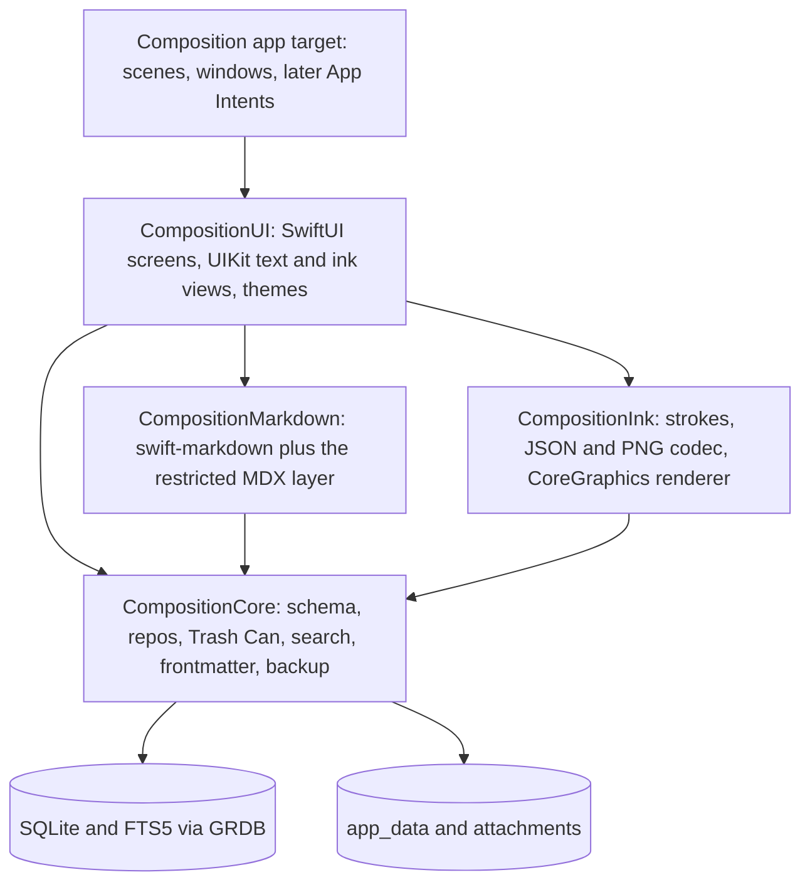

# iPad app: native design, feature tracker and compromises

A native iPad app for Composition, written in Swift (with Objective-C, C and C++ only where something needs
them), with Apple Pencil support. This page is the one place for the design, for which features work (or are
expected to) on the iPad, and for every compromise made to get it running.
**Design, spikes S1 and S2, the parse-and-draw half of S4, the Simulator half of S3, and a prototype app** (`apps/ios/CompositionCore`: the data layer, backup,
the Trash Can, search, the Markdown and MDX layer, and (build plan Steps 1 to 3) settings and favorites, frontmatter and the store operations for notes, groups and notebooks, with their tests; `apps/ios/Composition`: a viewer on it; see [S1 status](#s1-status),
[S2 status](#s2-status), [S3 status](#s3-status), [S4 status](#s4-status) and [The first app](#the-first-app)). **On a device:** you reported on 2026-11-06 that
the prototype runs on your iPad with a backup of your real notes and works as expected for where it was; the preview (S4) and the editor
lab (S3), added after that, have run in the iPad Simulator only. Dates are 2026-11-05 and 2026-11-06.

**Direction (changed 2026-11-05).** The two earlier research sessions leaned towards the existing web UI in a
`WKWebView` shell with a native PencilKit plugin. You then asked for the app to feel **as native as possible**,
in native languages. That is a requirement, not a Pencil feature, so it changes the weights: this page now
designs a native app. The web-shell route stays as a fallback and a possible bring-up scaffold (O2 below).

It consolidates *iPad app feasibility* (2026-11-01) and *iPad app and Apple Pencil feasibility* (2026-11-03, with
its addendum on a native Swift rewrite), re-checked against `main` as of today. Where `main` has moved on or the
chats differ, see [What this page corrects](#what-this-page-corrects).

## How to read this page

Three things are tracked, each in its own section:

- the [**feature tracker**](#feature-tracker): every feature, what kind of work it is, whether it is in v1, and how far along it is;
- the [**compromise register**](#compromise-register): what we give up on the iPad, why, and what would make us revisit it;
- the [**decision log**](#decisions): what is decided, what is proposed, and what needs your input.

Legend for the tracker:

| | Meaning |
|---|---|
| **Kind** | What sort of work the row is. A prediction until Status says otherwise. |
| 🔁 | **Port:** the behaviour exists in the TypeScript app and is rewritten in Swift. The rules must match ([conformance](#keeping-two-implementations-honest)). |
| ⭐ | **Native upgrade:** the platform gives something better than the web version for free or cheaply. |
| 🆕 | **New** on the iPad |
| ⚠️ | **Risky:** unknown until tried on a device |
| ❌ | Not on the iPad |
| **Plan** | **M1**, **M2** or **M3†**: the [milestone](#v1-scope-and-milestones) that builds it (**†** is release polish, first to drop from v1) · **Later** · **Parked** (deliberately not planned for now, and to be discussed; see the decision) · **Never** (a deliberate decision, see the compromise) |
| **Status** | ⬜ not started · 🔬 spiked (answer found, not built) · 🔨 built · 📱 verified on the iPad · ⛔ dropped |

**Marked 📱 today: nothing, yet.** A row only gets 📱 after a person has used it on the iPad. You told me on 2026-11-06 that the prototype works as expected on your iPad with your own notes, but not which of the [manual-test](manual-tests/ipad.md) items you ran, so I have not turned any row to 📱 on that; say which and I will. The preview (S4) is untried on the device.

## Summary

- **Feasible, and the native route is the more expensive one.** The whole notes UI (about 12,000 lines of
  TypeScript, measured 2026-11-03) and the notes logic it sits on are rewritten, not reused. In return the app can
  use the system text engine, Scribble, PencilKit, drag and drop, windows and Spotlight directly, and a whole
  class of web-on-touch problems (hover-only controls, right-click, keyboard-only features) disappears.
- **Recommended shape** (proposed, settled by spikes): SwiftUI for screens and navigation; UIKit's `UITextView`
  on TextKit 2 for the editor and the preview; **GRDB over SQLite with the schema kept identical to the desktop's**,
  so a backup restores in either direction; **FTS5** for search; **swift-markdown** (cmark-gfm) plus a small
  restricted MDX layer of our own, drawing the ten components as native views; **PencilKit** for ink, stored as a
  PNG that carries its own stroke data. Handwriting is an `<Ink>` MDX component, so a note stays Markdown.
- **Languages:** Swift by default. C arrives through packages and the system (SQLite, zlib, cmark-gfm). Objective-C
  and C++ are **not needed anywhere in the plan yet**; each use must be earned by a spike and recorded
  ([Languages](#languages-and-dependencies)).
- **The costs that matter most:** two implementations of the notes rules to keep in step
  ([C3](#compromise-register)), search stops being typo-tolerant ([C1](#compromise-register)), the iPad has its
  own database with no live sharing ([C2](#compromise-register)), the plugins wait ([C6](#compromise-register)),
  and the Live tab, which is in v1 (you, 2026-11-08) but is the riskiest piece ([C12](#compromise-register)).
- **The risks that decide the design:** whether TextKit 2 can hide Markdown marks away from the caret for the
  Live tab, and whether view-based attachments are solid enough to hold images, charts and ink in the text
  ([S3](#spikes-and-gates)).
- **Sync is decided for v1 (D8):** the iPad ships with backup and restore, built **sync-ready**, and does not wait
  for the sync service. Syncing with the Mac, Windows and Linux desktop apps comes later from a separate design.
  The `uuid` column the shared schema needed first has landed on the desktop (2026-11-05). The change-capture
  triggers and the outbox have not, so the decided fallback is the working plan ([Sync](#sync-and-the-data-model)).
- **Nothing is waiting on you.** Every decision in the [log](#decisions) is decided or a proposal that its gate settles.

## Goals and non-goals

**Goals** (proposed)

1. Read and write notes on the iPad, in the same Markdown and with the same MDX components as the other products.
2. **Feel native** ([the native bar](#the-native-bar)): system text editing, navigation, windows, accessibility, drag and drop.
3. Local-first and offline, like the desktop app.
4. Apple Pencil: handwrite into the editor (Scribble), and draw or handwrite notes (`<Ink>`).
5. Move data to and from the desktop app without loss, at minimum through backup and restore.
6. **One note format and one schema.** The iPad does not invent its own.

**Non-goals for v1**

- The sync engine, sign-in and server ([D8](#decisions): later, designed separately), and ink *editing* on Windows ([D11](#decisions)).
- The To-do, RSS Reader and Reading List plugins ([C6](#compromise-register)).
- **No AI helper in the iPad app at all, neither the local one (Ollama) nor the ChatGPT one** ([D19](#decisions); decided by you on 2026-11-06,
  and to be discussed later). It is not "later": nothing for it is planned, designed or spiked until you raise it.
- The terminal app, the panel grid and pop-out windows ([C5](#compromise-register), [C7](#compromise-register)).
- iPhone, macOS (Catalyst) and Android. The core package is kept free of UIKit so it *could* be reused; that is not a goal.
- Apple Pencil Pro features (squeeze, barrel roll). The test iPad does not support that Pencil.

**Already decided by you**

| | |
|---|---|
| Design before code | Nothing is built until this page is agreed. |
| **Native, in Swift and Objective-C, with C and C++ where necessary** | Stated 2026-11-05. Reflected in [Languages](#languages-and-dependencies). |
| Test hardware | iPad Pro with the M2 chip and a wireless-charging Apple Pencil. Assumed to be the **2nd generation**, since Apple lists the Pencil Pro only for M4/M5 iPad Pro and M2-and-later iPad Air ([Apple](https://support.apple.com/guide/ipad/aside/ipad47ee2e98/ipados)). It has hover and double-tap and no squeeze or barrel roll. The iPad is on **iPadOS 27.0.1** (you, 2026-11-06); the screen size is not recorded. |
| **Orientation: both, mostly landscape** | You hold the iPad **mostly in landscape** and sometimes in portrait (you, 2026-11-06). Both work in every screen from the first build; landscape is the one to get right first, portrait must not break. See [App structure](#app-structure-windows-and-themes) and N3. |
| A handwritten note may depart from "Markdown only" on the iPad | Stated as acceptable. The design below keeps it Markdown anyway. |

## What the app is today

Facts that drive the design, checked against `main`.

| Fact | What it means for a native app | Source |
|---|---|---|
| **A note is Markdown text in a SQLite row** (`notes.content`, frontmatter included). It is not a file. Images and diagrams are files in `app_data/`, which the Markdown refers to by path. | The iPad keeps the same model. A handwritten note is a smaller departure than it feels: "Markdown that points at a binary side-asset" is how images and `<Drawio>` already work. | [data-model.md](architecture/data-model.md), [images.md](architecture/images.md) |
| **Ids are `INTEGER PRIMARY KEY AUTOINCREMENT`**, and notes link as `[text](note:id)`. Since 2026-11-05 every note, group, notebook, trashed item and attachment **also carries a `uuid`**: 32 lowercase hex characters, the same for the life of the row, kept by the Trash Can and by backups. | Two devices would both create "note 57", which blocks record-level sync on integer ids alone. The `uuid` is the name a second device knows a row by. The integer id stays the **local handle**, so favorites, `note:<id>` links and the search index are unchanged. The Swift core must keep the column, its trigger and its index ([Sync](#sync-and-the-data-model)). The earlier chats did not raise any of this. | [data-model.md](architecture/data-model.md#identity-the-uuid-column), [note-links.md](ui/note-links.md) |
| **Schema changes are additive `ensureColumn` checks** (`PRAGMA table_info`, then `ALTER TABLE … ADD COLUMN`), not numbered migrations. `db.ts` turns WAL on. | The Swift core must migrate the same way, so a database either side has touched is a no-op for the other. Not GRDB's `DatabaseMigrator`, whose bookkeeping table the desktop would not know. The `uuid` pass (`ensureUuids`) is the newest of these and adds a trigger and an index as well as a column, so the Swift core must reproduce it exactly. | [data-model.md](architecture/data-model.md), [db.ts](../apps/web/src/lib/composition/db.ts) |
| **The preview parses MDX at run time** with a restricted layer: tags from an allowlist of ten (`Info`, `Warning`, `Image`, `Drawio`, `Toc`, `Mark`, `Footnotes`, `YouTube`, `Repo`, `Chart`), with string or bare attributes only. `{expressions}`, `import`/`export` and fragments are rejected. Only notes that mention a component are parsed as MDX; the rest stay plain Markdown. | The Swift side needs its own small parser for exactly this subset. **No MDX parser for Swift was found**, but the subset is small. | [remarkRestrictMdx.ts](../apps/web/src/components/notes/mdx/remarkRestrictMdx.ts), [components.ts](../apps/web/src/components/notes/mdx/components.ts) |
| **There are two writing surfaces.** The Markdown tab is a `<textarea>` with a colour overlay. The Live tab is CodeMirror 6, drawing the note as it will read with the syntax shown only at the caret. Both go through one `EditorSurface`. | A native editor does not need the overlay (attributed text colours directly). The Live tab's behaviour, written down in [live-editor.md](ui/live-editor.md), is the spec to port, and it is the hardest part. | [MarkdownEditor.tsx](../apps/web/src/components/notes/MarkdownEditor.tsx), [LiveEditor.tsx](../apps/web/src/components/notes/LiveEditor.tsx) |
| **The UI reaches its backend through one contract.** `CompositionApi` has 42 methods (`API_METHODS`); desktop adds nine more groups (attachments, backup, panels, to-dos, Reading List, feeds, updates, window, AI stream). | In Swift this becomes the public surface of the core package. The v1 subset excludes the AI and data-location methods, plus the plugin groups. | [api.ts](../apps/web/src/lib/composition/api.ts), [desktopBridge.ts](../apps/web/src/lib/composition/desktopBridge.ts) |
| **The data layer is synchronous and Node-bound:** `better-sqlite3` in `db.ts`, `backup.ts`, `groupsRepo.ts`, `todosRepo.ts`; 13 files in `lib/composition` import `node:` modules. Backup is tar and gzip over `node:zlib`. | Nothing here is reused as code. The SQL, the rules and the file formats are the spec. | [service.ts](../apps/web/src/lib/composition/service.ts), [tarArchive.ts](../apps/web/src/lib/composition/tarArchive.ts) |
| **Frontmatter is parsed with `js-yaml`** (YAML 1.1 rules; unquoted dates become dates and are un-quoted again on write). | Swift's YAML options resolve some scalars differently. This is a classic drift spot; it needs fixtures. | [frontmatter.ts](../apps/web/src/lib/composition/frontmatter.ts) |
| **Search is a Meilisearch child process.** Only the query parser (`parseSearchQuery`) and the index shape carry over. | iOS apps cannot spawn bundled executables. The index is derived data. | [search.md](architecture/search.md) |
| **Size** (measured 2026-11-03): `apps/web/src` about 36,000 non-test lines; notes UI and MDX about 12,000; `lib/composition` about 13,000. **S1 measured the data layer (2026-11-05):** of its 9,914 code lines, v1 needs at most 2,818 (28%), 989 of them already ported ([S1 status](#s1-status)). | Sets the scale of the rewrite. The data layer is the small part; the notes UI and editor logic (`components/notes`, about 10,700 code lines) is the large one. | earlier session; `measure-logic-subset.mjs` |
| **Already iPad-aware:** `useIsMac` counts iPad as a Mac. Fonts are open-source families bundled by `next/font`. | Nothing to port; the font files can be bundled in the app if you want the same choices. | [useIsMac.ts](../apps/web/src/components/shortcuts/useIsMac.ts), [editorFonts.ts](../apps/web/src/lib/composition/editorFonts.ts) |

## Options considered

| | Option | Verdict |
|---|---|---|
| O1 | **Thin client to the web build** (open the Next server from the iPad) | Not offline, not local-first, not native. Whether the web app has any authentication was not checked. **Rejected.** |
| O2 | **Web UI in a `WKWebView` shell** (Capacitor or Tauri 2) with a native PencilKit plugin and a new iOS data backend | The earlier lean. Reuses the UI, MDX stack, themes and tests, but the editor, hover controls, right-click and shortcuts all stay web behaviours on touch. Fails the native requirement. **Kept as a fallback** and for the one scaffold allowed in [D6](#decisions). Capacitor led Tauri 2 on fit (Tauri adds a Rust toolchain), not on evidence. |
| O3 | **Fully native:** SwiftUI and UIKit, TextKit 2, GRDB, PencilKit, our own MDX layer | Meets the requirement. The most work, and two implementations of the rules. **Recommended.** |
| O4 | **Native shell, web preview:** native data, editor and ink, with the existing MDX renderer in a `WKWebView` for the preview pane only | Keeps the ten components, themes and tests. Not "as native as possible". **Allowed only as a temporary scaffold** until the native renderer passes the fixtures ([D6](#decisions)). |
| O5 | React Native, Flutter, or other cross-platform toolkits | Not researched. They do not meet the stated Swift, Objective-C, C and C++ direction. |

## Languages and dependencies

Native feel comes from using Apple's frameworks, not from the choice of language, so the policy is: **the
newest language that reaches the API, and no more.**

| Language | Use | Where, today |
|---|---|---|
| **Swift 6** (strict concurrency) | Everything by default | Core packages, UI, app target |
| **SwiftUI** | Screens, navigation, lists, settings, the To-do board later | `CompositionUI` |
| **UIKit** | Where SwiftUI falls short, wrapped in `UIViewRepresentable`: the text editor and preview (`UITextView`, TextKit 2), the ink canvas (`PKCanvasView`), key commands, Pencil interactions, fine drag and drop | `CompositionUI`, `CompositionInk` |
| **Objective-C** | **Not planned.** Only if a spike finds an Apple API with no Swift surface, or a C++ library needs an Objective-C++ wrapper. | none |
| **C** | Reached through packages and the system, not hand-written: SQLite (inside GRDB, or the `sqlite3` C API), **zlib for gzip** (below), cmark-gfm (inside swift-markdown), libyaml (inside Yams, if used). A bridging module map where a system library has none (zlib did not need one, below). | `CompositionCore`, `CompositionMarkdown` |
| **C++** | **Not planned.** Only for a measured hot path (for example edit-distance matching over a large search vocabulary, or processing very large ink strokes), through Swift's C++ interoperability first and Objective-C++ second. | none |

Why zlib is the first honest C use: Apple's Compression framework's `COMPRESSION_ZLIB` produces **raw DEFLATE**,
without a zlib or gzip header ([Apple](https://developer.apple.com/documentation/compression/compression_zlib.md)),
and backups are `.tar.gz`. Either the gzip header and CRC-32 trailer are written by hand in Swift around the
Compression framework, or the system zlib is linked from C. **Decided in S1 (2026-11-05): the system zlib.** The SDK
already exposes it as a Swift module, so `import zlib` is all it takes: no C shim and no module map of ours, on the
Mac and in the iPad Simulator SDK alike. zlib writes and checks the gzip header (with its optional name, comment and
extra fields) and the CRC-32 and length trailer itself. I did not build the Compression-framework route to compare, so
this was decided by what that route would have to add, not by trying both; it stays open if a system library ever
causes trouble in the app target.

**Dependencies.** Apple frameworks first, then a short list of well-known Swift packages. Each gets a row here
before it is added, pinned to an exact version, with `Package.resolved` checked in, in line with the repo's
supply-chain posture ([SECURITY.md](../SECURITY.md), Dependabot, pinned Actions).

| Package | For | Licence (confirm at adoption) | Why not Apple's |
|---|---|---|---|
| [GRDB.swift](https://github.com/groue/GRDB.swift) | SQLite, FTS5, observation | MIT | Core Data and SwiftData hide the store, cannot keep our schema identical, and give no control over FTS5. |
| [swift-markdown](https://github.com/apple/swift-markdown) | CommonMark and GFM parsing (cmark-gfm) | Apache-2.0 | No Markdown parser in the SDK suited to a syntax tree with source ranges. |
| ~~Yams (or a hand parser)~~ | ~~Frontmatter YAML~~ | | **Not needed (2026-11-06).** The frontmatter fixtures showed the details that matter are js-yaml's, so the core ports its loader and dumper (`YAML/`) instead of adding a dependency. |

## Proposed architecture



**Layout (proposed):** `apps/ios/`, beside `apps/cli`, `apps/desktop` and `apps/web`, as Swift packages with a
thin Xcode app project. `CompositionCore` imports Foundation and GRDB only, never UIKit, so it builds and tests on
a Mac without a simulator, and could be reused beyond the iPad.

### Data: GRDB over the same schema

- GRDB on SQLite, with the schema, the `ensureColumn` rule, the Trash tables, notebooks and `adoptOrphans`
  behaviour copied exactly (see [data-model.md](architecture/data-model.md)). **Not Core Data or SwiftData**:
  their stores are opaque and cannot be made identical to the desktop's.
- A `DatabasePool` (WAL, concurrent readers, one writer), `ValueObservation` to drive lists, and a store actor so
  the UI never touches the database on the main thread.
- **Autosave, and iOS ending the app.** Debounce as today, and flush when the scene leaves the foreground
  (`scenePhase`, `UIApplication.willResignActive`) inside `beginBackgroundTask`. Everything that matters is in
  SQLite, never only in memory. `@SceneStorage` restores the selected note and caret.
- Images and attachments live in the app container (`app_data/`, `attachments/`) as on desktop. Content-hashed
  file names (`trip-plan-route-map-3f9c2a71b0de.png`) make image files merge-safe across devices. The system's
  device backup already includes the container, a safety net that is not sync.

### Keeping two implementations honest

Native means the notes rules (ordering, Trash Can, notebook invariants, frontmatter, backup, search parsing,
MDX parsing) exist **twice**: TypeScript and Swift. The old Python CLI showed what drift costs
([data-model.md](architecture/data-model.md)). The guard is a shared **conformance corpus** (proposed):

1. Database snapshots as each earlier schema version created them, opened by both implementations.
2. Operation scripts (create, move, reorder, delete, restore, move between notebooks) with the expected end
   state, generated from the TypeScript code and replayed in XCTest.
3. Frontmatter round-trip, `parseSearchQuery` and MDX-parse vectors.
4. A backup `.tar.gz` made by each side and restored by the other.

The corpus lives in the repo (for example `fixtures/conformance/`) and the TypeScript tests read it too, so a
change to the TypeScript behaviour fails until the fixtures and the Swift side are updated together.

**Status (2026-11-06):** built under `apps/ios/conformance/` and run by `apps/ios/scripts/conformance.sh` for the schema, backups both ways (now with settings
and about a hundred store operations in the round trip), the Trash Can, search, MDX and the component helpers, settings, frontmatter, and the store script
(notes, groups, notebooks). The detail is in the [build plan](ipad-build-plan.md).

### Markdown and MDX

- **Parse:** swift-markdown for the CommonMark and GFM layer. A small restricted-MDX scanner of our own handles
  the allowlisted tags (string attributes, flow and inline), rejects what `remarkRestrictMdx` rejects, and, like
  `usesMdxComponent`, only runs on notes that mention a component. **Measured (S4): swift-markdown 0.9.0 has no footnotes** (`[^1]`
  stays text and `[^1]: text` is a paragraph), so the scanner reads them itself, and it leaves a note's tags as raw HTML, so the scanner
  also finds the tags, over the note's own text, before swift-markdown sees the rest ([S4 status](#s4-status)).
- **Draw:** one read-only `UITextView` for the preview, with the non-text blocks as view-based attachments, so
  text selection works across blocks (the preview's highlight menu needs it). The same engine, made editable,
  is the Live tab.
- **A TextKit 2 rule:** never touch `textView.layoutManager`. That forces a fallback to TextKit 1, where
  view-based attachments disappear (reported by developers; the iOS 16 view-provider behaviour is partly
  undocumented, [Apple forums](https://developer.apple.com/forums/thread/697381)).

| Component | Native drawing |
|---|---|
| `<Info>`, `<Warning>` | A tinted panel with an icon (SwiftUI hosted in an attachment) |
| `<Toc>` | Generated from the headings; tap to scroll |
| `<Mark>` | Background-colour attribute in five colours; port `markContrast` so text stays legible |
| `<Footnotes>` | Superscript citations and a list, numbered by where they are cited |
| `<Image>`, header image | `UIImage` from `app_data/`, at the `width` the tag asks for |
| `<Chart>` | **Swift Charts**, from the same CSV-in-a-block spec; series colours from theme tokens |
| `<Repo>` | A card drawn from the address alone; opens in `SFSafariViewController` |
| `<Drawio>` | The PNG, drawn as an image. Editing: [C9](#compromise-register) |
| `<YouTube>` | **A `WKWebView`** of the privacy-enhanced player, or a thumbnail that opens YouTube. A listed exception ([C8](#compromise-register)); the player's Referer rules are **unverified** in a native web view. |
| `<Ink>` | The strokes drawn by CoreGraphics; tap to edit in PencilKit |

### The editor

`UITextView` on TextKit 2, wrapped for SwiftUI. What it gives for free: the selection loupe, spelling and
autocorrect, dictation, **Scribble**, Writing Tools where available, Dynamic Type, system edit menus, and the
system find bar (`isFindInteractionEnabled`, `UIFindInteraction`, iOS 16+,
[Apple](https://developer.apple.com/documentation/uikit/uitextview/isfindinteractionenabled.md)).

| Tab | Native approach | Risk |
|---|---|---|
| **Markdown** | Source text with syntax colours as attribute runs. No overlay: the web one existed because a textarea cannot colour its text. | Low |
| **Preview** | The read-only text view above | Medium |
| **Split** | Two columns; one at narrow widths | Low |
| **Live** | The source text with marks hidden away from the caret, headings and rules drawn large, images inline | **High.** TextKit 2 offers ways to substitute what a paragraph displays and to draw custom layout fragments, but hiding characters without breaking the caret, selection and undo is **unverified**. See [C12](#compromise-register). **In v1 (you, 2026-11-08).** |

Typing features port as UIKit pieces: the `<` component and prop completion and the `[[` note-link picker as
popovers at `caretRect(for:)` (built in Step 9 as a view inside the text view, so that it scrolls with the text); Tab and Shift+Tab indent as `UIKeyCommand`s plus buttons on the keyboard
accessory bar (the buttons are not built); image paste through `UITextPasteDelegate`; highlight, recolour and remove as edit-menu actions in
both the editor and the preview (which replaces right-click); the ruler and reflow ported from `liveReflow.ts`.

### Ink and the Pencil

PencilKit is the primary drawing surface. There is no web ink canvas in this design.

| Layer | What | Notes |
|---|---|---|
| **0. Scribble** | Handwrite into the editor; the system converts it to typed text | `UITextView` supports it by default. Test in both Markdown and Live (S3). |
| **1. PencilKit** | `PKCanvasView` with `PKToolPicker`, full-screen to start and inline later as a text attachment | System latency and prediction, palm rejection |
| **2. Pencil events** | `UIPencilInteraction` (double-tap), `UIHoverGestureRecognizer` (hover pose) | The M2 iPad Pro with a 2nd-generation Pencil has both. Later. |

PencilKit's `dataRepresentation()` is a binary blob, not an interchange format, so it is never the only copy.

**`<Ink>` is an MDX component, modelled on `<Drawio>`:**

```mdx
Meeting sketch:

<Ink src="app_data/trip-plan-sketch-3f9c2a71b0de.png" alt="Whiteboard: three boxes, arrows left to right" width="80%" />
```

A handwritten page is a note whose body is one tall `<Ink>`, so title, tags, groups, Trash Can, search and
backup keep working. **Not v1:** ink drawn over rendered Markdown, because anchors break when text reflows.

**Storage** (the `<Drawio>` trick, where the PNG contains its own editable source):

| Part | Content | Read by |
|---|---|---|
| PNG pixels | The ink rendered on transparent | CLI, desktop, backups, anything that shows an image |
| An embedded, versioned **stroke JSON** | Strokes with per-point x, y, pressure, tilt and time; tool and **ink type**; **semantic** colour; canvas size; unknown fields preserved | The Swift and web renderers, any platform |
| An optional embedded **PencilKit blob** | The original drawing | Lossless re-edit on the iPad |

`images.ts` sniffs bytes, so a PNG container needs no allowlist change. Whether a multi-megabyte chunk is
acceptable or a sidecar `.ink.json` is better depends on stroke counts: measure a dense page ([S5](#spikes-and-gates)).

**Themes.** Black ink baked into a transparent PNG disappears on a dark scheme, and PencilKit itself reverses
ink brightness in dark mode (developer reports; `PKInkingTool.convertColor(_:from:to:)` exists for it,
[Apple](https://developer.apple.com/documentation/pencilkit/pkinkingtoolreference.md)). So stroke JSON stores
**semantic** colours ("ink", "accent"), the renderer maps them through the theme, and the PNG is the fallback for
the CLI. The desktop's web renderer does the same from the JSON with SVG it generates at render time (never
accepted as an upload: `images.ts` refuses SVG on purpose).

**Search.** Handwriting is opaque to search. On save, the Vision framework recognises the text on the device and
the result is written to the tag's `alt`, which is already note text. Accuracy on real handwriting is
**unverified**; the transcript stays editable ([C11](#compromise-register)).

**Where `<Ink>` must be wired** (following `<Drawio>`; confirm when built): the allowlist and `components.ts` on
the web side, completions and snippets, the CLI's `mdx.ts` (it draws the PNG), and the docs. The Live tab draws
other MDX tags as text.

### Search

The query parser ports as it is. **SQLite FTS5 replaces Meilisearch.**

- **Built in S2, and changed from the first proposal:** the index is a **file of its own** (`search.db`), not tables in
  `composition.db`. It is derived data that can be rebuilt, and FTS objects and triggers in the shared file would change the
  iPad's schema from the desktop's and travel in every backup. (An FTS5 table that reads its text from `notes` cannot live
  in another file, so this one is a plain FTS5 table over title, content and description with its own copy of the text.)
  `unicode61` with diacritics removed, prefix indexes. Tags are not searchable text, as in Meilisearch; `tag:`, `created:`
  and `updated:` are SQL clauses over a small table beside it, and `title:` and `description:` are column-scoped `MATCH`.
  Results stay capped at 50. The store has to keep it in step (`upsert`, `remove`, `rebuild`), as it does `indexNote` today;
  nothing calls them yet.
- **FTS5 availability.** FTS5 is a compile-time option of SQLite. GRDB's author says the system SQLite has it from
  iOS 11.4 and that GRDB's package build enables it ([secondhand](https://github.com/steipete/GRDB.swift/blob/master/Documentation/CustomSQLiteBuilds.md)).
  **S1 result (2026-11-05):** present, with the `unicode61`, `porter`, `ascii` and `trigram` tokenizers, in the SQLite
  GRDB 7.12.0 links on the Mac (3.54.0) and in the iPad Pro 11-inch (M5) Simulator runtime (3.51.0). **Not yet
  checked on the iPad itself** (iPadOS 27.0.1). The fallback, if the device lacks it, is a custom SQLite build.
- **Typo tolerance was the regression** ([C1](#compromise-register)): `title: routng` finds "routing", and FTS5 has no fuzzy
  matching. **S2 built option (2), expanding each typed word against the index's `fts5vocab` table,** which reproduces
  Meilisearch's rules (below) closely enough that the result *sets* are identical on every acceptance query. C++ was not
  needed ([S2 status](#s2-status)). The acceptance test was the 100-note corpus from `pnpm search:playground` in `apps/cli`,
  with the answers of a real Meilisearch; its criteria and results are in the S2 status section.
- Native extras: search tokens in `.searchable` for the `tag:` style filters, and **Spotlight** indexing
  (`CSSearchableIndex`), both ⭐ and Later.

### App structure, windows and themes

- **Navigation:** `NavigationSplitView` with three columns: the **sidebar** (All Notes, Favorites, and each notebook with the groups beneath it, each row
  with its count), the **list** (what the sidebar points at: a notebook's or group's sub-groups and then its notes; Favorites lists what is pinned; All Notes is every note by
  latest edit; typing in the search field searches every note), and the **note**. Swipe actions and context menus for delete (to the Trash Can), favorite and move. Home page as the landing detail.
  Back and forward as navigation history, plus Cmd+[ and Cmd+] ([Step 7 status](#step-7-status)).
- **Windows:** iPadOS scenes replace the panel grid and pop-outs: "Open in New Window", Split View, Slide Over and
  Stage Manager come from size classes and scenes. The same note in two windows shares one database pool.
- **Orientation:** all four orientations are on, and none is a mode the app has to be put in. The three tabs of a note are one set of views that lay themselves out from the width they are given, so turning the iPad
  does not rebuild the text view or lose the caret, the text or a pending save. *Landscape* (the main use): the list and the note side by side; **Split** puts the editor and the preview side by side; with the
  list hidden, the preview and the editor's text keep to a readable width of about 820 points and sit in the middle instead of running across the whole screen. *Portrait*: the list beside the note or over it, as the system chooses, and a button hides it;
  Split stacks the editor above the preview when the note's pane is under 800 points wide (an iPad mini, Slide Over, a third of Split View), and sits them side by side when it is wider. Sheets are the system's. Layout decisions use the
  width of the view, not the device or the orientation, so a narrow window in Stage Manager behaves like a narrow iPad.
- **Drag and drop:** SwiftUI `draggable` and `dropDestination` (or UIKit's interactions) for notes and groups,
  and for dropping images and files in from Photos and Files, which the web app could not do.
- **Themes:** the six schemes become a `Theme` of semantic tokens ported from `themes.ts`, injected through the
  SwiftUI environment and UIKit trait collection. Add a **System** scheme that follows light and dark. "Follow the
  sun" ports `sunTimes.ts` (pure maths) and needs the saved city. Fonts default to the system fonts; the
  desktop's open-source choices can be bundled as options.
- **Keyboard:** `UIKeyCommand` and `.keyboardShortcut`, with `discoverabilityTitle`, so holding Cmd lists them.
  That replaces the shortcuts helper window.

### Sync and the data model

**Decided (2026-11-05, you): iPad v1 is backup and restore, built sync-ready.** The iPad does not wait for the
sync service, because that service needs longer to settle its architecture. Syncing with the Mac, Windows and
Linux desktop apps comes later. Its design is a separate page, `docs/cross-device-sync-design.md`, written in a
parallel session and not yet in this tree (link it once both are merged). That page takes **our own
account-based, record-level service** and records its own decisions: notes are end-to-end encrypted, the server
is hosted first and self-hostable later, and the desktop app syncs the CLI's edits. Its open questions are its
own to settle; this page only needs the iPad to be ready for it.

The iPad is a separate device with a sandbox, so it cannot open the Mac's `~/.composition/composition.db`. Until
sync ships, data moves by backup and restore through Files ([C14](#compromise-register)). There is also no
Windows app today, so "show the ink on a Windows PC" currently means the web app in a browser.

| Option | Where it landed |
|---|---|
| **Backup and restore through Files** | **v1.** Exists today. Ink files ride along. Manual, and the way to test round trips. |
| **Our own account-based sync service** | **Later, and the target.** Covers every platform. Designed separately. |
| **CloudKit** (`CKSyncEngine`, iOS 17+) | Not chosen. Apple-only, and the Mac app is Electron, which (inference) has no way to call `CKSyncEngine`, so it would sync iPad to iPad only. |
| **A folder of `.md` files as a sync engine** | Not chosen. A folder of Markdown files that a file-sync tool (iCloud Drive, Dropbox, Syncthing, git) carries between devices, with no Composition server. Earlier research (committed as `2a207d3`, `docs/markdown-files-git-research.md` on branch `claude/markdown-files-git-portability-16ee92`) recommended against making files the source of truth, and the two-way version needs a per-note sync state, file watchers and conflict handling. Plain `.md` files in a shared folder also cannot be end-to-end encrypted by us. Kept as an **export** for backup, history and portability ([Later](#feature-tracker)), not as sync. |
| **The database in iCloud Drive** | **Never.** Unsafe: WAL's sidecar files can be delivered out of order by cloud sync and corrupt the database ([SQLite forum](https://sqlite.org/forum/info/47107ab818977549?t=h)). |

**Where the desktop's prerequisites stand** (checked against `main` at `df801fd`, 2026-11-05):

| Prerequisite | On `main`? |
|---|---|
| **A `uuid` on notes, groups, notebooks, trashed notes, trashed groups and attachments**: the column, an `AFTER INSERT` fill trigger, a unique index, a batched backfill, carried both ways by the Trash Can and by backups | **Landed** in [#244](https://github.com/meddlin/composition/pull/244). Spec: [data-model.md](architecture/data-model.md#identity-the-uuid-column) |
| Change-capture triggers feeding a `sync_outbox` table | Not on `main` |
| The `sync_*` bookkeeping tables | Not on `main` |

The fallback's minimum is therefore met: the iPad can start S1 against a schema that has the `uuid`. Whether the
capture triggers and the outbox are in M1 depends on whether they reach `main` before Gate A.

**Sync-ready means** (proposed; each item is the sync design's, adopted here):

- **The shared schema carries what sync needs, and the iPad starts from it.** A `uuid` column on notes, groups,
  notebooks, the `trashed_*` tables and attachments (added the `ensureColumn` way, backfilled, uniquely indexed, and
  filled by an insert trigger so rows written by an older build still get one); the Trash Can carrying the uuid;
  SQLite triggers feeding a `sync_outbox` table; and the `sync_*` bookkeeping tables. The first two have landed
  (table above). The rest are the sync design's P1 ("ships alone, changes nothing a user can see"), and the iPad's
  "identical schema" rule covers them once they land. The integer ids stay as the local handle.
- **The triggers ship in v1 even though no engine exists, if they are ready by Gate A** (otherwise see the fallback
  below). They are built-in SQL only, so GRDB runs the same text.
  The outbox holds at most one row per changed record, and shipping them now means the sync release needs no schema
  upgrade. A first sign-in uploads everything anyway, so nothing depends on the outbox being complete before then.
- **Backups carry the new columns,** so an iPad backup restores on the desktop and the reverse.
- **Note links keep `note:<int>` locally.** The sync design translates them to `note:<uuid>` on the wire. The iPad
  learns that rewrite when its engine is built, and the conformance corpus pins it.
- **Nothing visible in v1:** no engine, no sign-in, no server address, no sync screen.
- **Data made before sync is not stranded.** An iPad used alone and signed in later is merged by union: nothing is
  overwritten or deleted on either side (the sync design's first-sign-in rule).

**What the Swift core does with the `uuid`** (from [data-model.md](architecture/data-model.md#identity-the-uuid-column);
each point is a conformance fixture, [D7](#decisions)):

- **Runs the same pass on every open.** In one immediate transaction, for each of the six tables: add the column, an
  `AFTER INSERT … WHEN NEW.uuid IS NULL` trigger (`trg_<table>_fill_uuid`) and a unique index (`idx_<table>_uuid`).
  Then fill the rows that have none, 200 per write transaction. The fill is `lower(hex(randomblob(16)))`: built-in SQL
  only, so GRDB runs the same text and an older desktop build that opens the file still gets a uuid on its inserts.
  The second open of a current database writes nothing.
- **Leaves the `uuid` out of its inserts** and lets the trigger fill it, as the desktop does.
- **Carries it through the Trash Can.** Delete copies the uuid into `trashed_*` and restore puts it back, so a restored
  note keeps it (a fresh one is issued only if a live row already holds it). Moves, renames and reorders are
  `UPDATE`s and leave it alone.
- **Keeps it out of the search index and out of the interface.**
- **Backups carry it,** because the snapshot copies the schema as well as the rows. A backup from before the column is
  backfilled on the next open. What an *older desktop build* loses is the uuid across a Trash move, which it issues
  anew; to a future sync that reads as a delete plus a create, a degradation and not a loss.

**The one dependency that could delay the iPad, and the fallback (decided 2026-11-05, you).** The sync design says
the uuid and trigger work must land on the desktop **before the iPad's Gate A**. If the triggers slip, the iPad starts
from the `uuid` column alone and adds the triggers, outbox and `sync_*` tables in a later release, since they are
`CREATE … IF NOT EXISTS`. That is safe for v1: a first sign-in uploads everything, and an iPad used alone merges by
union. The `uuid` column itself is the minimum and had to land on the desktop first, because the schema is shared.
**Status (2026-11-05): the minimum has landed and the rest has not, so the fallback is the working plan until the
triggers reach `main`.** The fallback relaxes the sync design's ordering, so that page should be updated to match.

A note's content is one text blob, so two devices editing it need a conflict rule. That rule belongs to the sync
design (keep both versions as a conflicted copy); the iPad does not need one in v1.

## The native bar

"As native as possible" needs a test, or it becomes an opinion. The app claims native when these hold. Audited in
[S7](#spikes-and-gates) and again before each release; the only web views are the exceptions in [C8](#compromise-register).

| # | Criterion | How it is checked | Status |
|---|---|---|:-:|
| N1 | Text editing uses the system text engine: loupe, spelling, autocorrect, dictation, Scribble, system find, system edit menus | Hands-on with the Pencil and a hardware keyboard | ⬜ |
| N2 | Navigation and controls are SwiftUI or UIKit: split view, lists, swipe actions, context menus, sheets, popovers | Review of the view hierarchy; no web view outside the exceptions | ⬜ |
| N3 | Adapts: **landscape (the main way you hold it) and portrait**, rotating while typing, Split View, Slide Over, Stage Manager, a third of the screen, multiple windows | Resize through every size class; turn the iPad in every tab. **Simulator: landscape and portrait of the iPad Pro 11-inch and an iPad mini checked 2026-11-06 ([Step 6 status](#step-6-status)); a narrow, phone-shaped window made by dragging the window's corner (as a third of the screen or Slide Over would) checked 2026-11-07 ([Step 11 status](#step-11-status)). Split View, Slide Over and Stage Manager themselves, and the iPad itself, are not.** | 🔨 |
| N4 | Input: Pencil (draw, Scribble, double-tap, hover), pointer hover effects, keyboard shortcuts with the Cmd-hold list, drag and drop within and across apps | Hands-on | ⬜ |
| N5 | System integration: Files and Photos pickers, share sheet, state restoration, saves that survive being backgrounded | Kill and relaunch mid-typing | ⬜ |
| N6 | Accessibility: VoiceOver labels, Dynamic Type, Reduce Motion, contrast in all seven schemes | Accessibility Inspector, then a person. **Xcode's audit (the same checks, automated) over the main screens, in light, cream and forest, and the largest text size, 2026-11-07. **VoiceOver was used on the iPad by the author on 2026-11-08 and works** (no details kept; the manual-test items 74 and 17 have the list of what to listen for) ([Step 11 status](#step-11-status)).** | 🔨 |
| N7 | Performance (targets are proposals): cold launch to a usable notes list in about a second; typing in a 5,000-line note without a visible lag; ink latency no worse than Apple's Notes on the same iPad | Instruments, and side by side | ⬜ |

## v1 scope and milestones

**Decided (2026-11-05, you): v1 is the full notes editor, without plugins** ([D13](#decisions)). It is built and
installed in three milestones. M1 and M2 are test installs on your personal/dev iPad, before v1. M3 combines them
into the first release.

| Milestone | What | Installed as |
|---|---|---|
| **M1: usable notebook** | The sync-ready store; notebooks, groups, notes, Trash Can and favorites; the Markdown, Preview and Split tabs; Scribble and the system text engine; search (FTS5 plus the typo layer); images (paste, picker, Photos); the MDX components other than `<Ink>` and `<YouTube>`; the six colour schemes plus a System scheme; backup and restore | A test install on your dev iPad, from Xcode. **Pre-v1.** |
| **M2: Pencil and PDFs** | `<Ink>`, the PencilKit canvas, handwritten pages, stroke JSON in the PNG, theme-aware ink, and drawing ink on the desktop app and in the CLI; **and PDFs** ([pdf-markup-plan.md](pdf-markup-plan.md), P19), in this order: the Swift core's three PDF tables against the shared fixtures, the PDFKit reader beside its note, typed markup, bookmarks, the Notes tab and import from Files, Pencil ink on PDFs, handwritten notes beside the PDF, export on the iPad, and last the standalone `<Ink>` pages (the first thing cut if the schedule bites) | A fast-follow install on your dev iPad, from Xcode. **Pre-v1.** |
| **M3: first release (v1)** | M1 and M2 combined and hardened as a release: the release-polish rows (marked †), the native-bar audit ([S7](#spikes-and-gates)), the manual test page, and distribution ([D12](#decisions)) | **The first release**, through TestFlight |

The tracker's **Plan** column says which milestone builds each row. A **†** marks release polish: the first rows
to drop from v1 if the schedule bites. A dropped row becomes *Later* (a v1.1), not a failure. Not in v1 at all:
the plugins ([C6](#compromise-register)). **The Live tab is in v1** (you, 2026-11-08, [C12](#compromise-register)), in a milestone still to be set.

**Never cut:** the store, the Trash Can, backup and restore, search, the Preview, images and Scribble.

**The cut line, in the order I would drop things** (a proposal; correct it on what you use):

1. the `<YouTube>` player (a link to it instead);
2. the "Follow the sun" scheme;
3. notebook colours (switching notebooks stays);
4. the Images page's browse and unused view (the insert-an-image picker stays);
5. header image;
6. ruler and reflow;
7. the home page's recent and pinned extras;
8. the heading rail.

**Exit criteria** (proposed):

- **M1:** installs and runs on the dev iPad; create, edit, search, delete and restore from the Trash Can; a backup made on the desktop restores on the iPad and the reverse; every M1 row is at least 🔨. Gates A and B ([S1 to S4](#spikes-and-gates)) are passed along the way, and S6 is done.
- **M2:** draw, save and reopen ink; a backup restored on the desktop shows the ink in every colour scheme, and the CLI shows its PNG. Gate C ([S5](#spikes-and-gates)) is passed first. **PDFs:** import a PDF from Files, read it beside its note, mark it up (typed marks, then Pencil ink after the PDF spike B and Gate C), cite it from a note and follow the citation; a backup made on the desktop with PDFs restores on the iPad (marks drawn where they were) and the reverse; an annotated export opens in another app. `docs/manual-tests/pdf.md` is extended for the iPad (Gate P2).
- **M3:** the † rows are done or moved to *Later*; the native-bar audit passes the bar you accept; `docs/manual-tests/ipad.md` has been run by hand; the distribution checklist below is done.

**Distribution** ([D12](#decisions), decided). Unlike the desktop app's GitHub Releases download, an iPad app reaches
other people only through Apple: TestFlight, the App Store, or a build from source with their own Apple ID (which
expires after 7 days on a free account).

| Stage | Route | Notes |
|---|---|---|
| M1 and M2 | Install from Xcode onto the dev iPad | Fastest loop; no pipeline yet |
| M3 | TestFlight: internal first, then an external link if others are invited | Per third-party guides (confirm in App Store Connect help): internal testers skip Beta App Review, external testers need a review of the first build per version, and every build expires 90 days after upload |
| Later | **The App Store waits.** Not part of M3; revisit once M3 is in daily use | Would need a privacy policy, privacy-label answers, iPad screenshots and a review per release |

**Settle before M1's first install:**

- the **bundle id**, effectively permanent after release (the desktop's `appId`, `com.rushinglabs.composition`, carries the same warning);
- the **Apple team** (individual or organization) and whether the **app name** is available;
- the **app icon** (the desktop's source is `build/app-icon-1024.png`; **done 2026-11-08**: the notebook on an opaque terracotta tile, since iOS fills transparency with black and the App Store refuses an alpha channel, made by `apps/ios/scripts/flatten-app-icon.swift`; the colour is a choice, replace `AppIcon.png` to change it) and the **minimum iPadOS version** ([C15](#compromise-register));
- **licence notices** for GRDB (MIT) and swift-markdown (Apache-2.0), shown in the app, as the desktop does with `collect-licenses.mjs` (built in Step 11: About ▸ *Open-source licences*, with swift-cmark's too);
- **CI signing:** a macOS runner and an App Store Connect API key in the `release` environment, with every new `uses:` pinned to a commit SHA ([AGENTS.md](../AGENTS.md)).

**When sync and encryption arrive:** the privacy label stops being "no data collected", and the encryption
export-compliance questions apply. The specifics are unverified.

Two dependencies to plan around. M1 cannot start before Gate A. The desktop's `uuid` work, which M1 also needed,
landed in #244 ([D8](#decisions)); the capture triggers and the outbox are the open part, and the fallback covers
them. And M2 changes the desktop app and the CLI as well as the iPad, because ink must be drawn there too.

## Feature tracker

Sections follow [feature-matrix.md](feature-matrix.md). Compromise ids point at the
[register](#compromise-register). The **Plan** column says which [milestone](#v1-scope-and-milestones) builds each row. **Update a row in the same pull request that changes it.**

### Platform and shell

| Feature | Kind | Plan | Status | Native approach and notes |
|---|:-:|:-:|:-:|---|
| App shell, scenes, lifecycle | 🆕 | M1 | 🔨 | SwiftUI `App` with a split view, in the prototype ([The first app](#the-first-app)). Typed text is flushed whenever the app leaves the foreground, inside a background-task assertion, and the system brings back the open note, its tab and the caret ([S6 status](#s6-status)); several windows are not enabled yet ([C5](#compromise-register)) |
| Six colour schemes | 🔁 | M1 | 🔨 | **Built (Step 10, Simulator): five** (Dark, Light, Forest, Wine, Cream) as a `Theme` of the desktop's tokens, **plus System** (Light or Dark as the iPad is set), chosen in More ▸ *Appearance…* and kept in `settings.json`. Every token is checked against the real `globals.css`. "Follow the sun" (the sixth) is the next row ([Step 10 status](#step-10-status)) |
| "Follow the sun" scheme | 🔁 | M3† | ⬜ | Port `sunTimes.ts`, `sunSchedule.ts` and the five sun pairs; needs a saved city and a way to pick one (the settings file already carries a city). A desktop's `auto` reads as System on the iPad until then |
| Fonts | 🔁 | M1 | 🔨 | **The system's own three families** (Sans serif, Serif, Monospaced), one for the editor and one for the preview, chosen in *Appearance…*. The desktop's ten open-source families are **not bundled** (font files would have to be added, with their licence notices): your call |
| Dynamic Type, VoiceOver, Reduce Motion | ⭐ | M1 | 🔨 | **Built (Step 11, Simulator):** every screen looked at at the largest accessibility size and fixed (titles wrap, the footer and the sidebar rows lay out differently, the columns widen); Reduce Motion stops the two animations; Increase Contrast darkens the grey text and firms the faint lines; grey text is measured at 5.5 on every page; labels on every control; Xcode's accessibility audit in UI tests. **VoiceOver tried by the author on the iPad, 2026-11-08: works.** **Not done:** Dynamic Type on the editor's own lists ([Step 11 status](#step-11-status)) |
| Hardware-keyboard shortcuts | ⭐ | M1 | 🔨 | `UIKeyCommand`s with titles. **Editor's built (Step 9):** Tab, Shift+Tab, ⌃], ⌃[, ⌘B, ⌘I, ⌘⇧K, ⌘⇧H; ⌘⇧X is the Image menu's; ⌘F is the system's. Sent by UI tests (not Esc, which they cannot send), not looked at on a real keyboard. **Not audited:** iPadOS-reserved combinations, shortcuts outside the editor (new note, switching tabs) |
| Shortcuts helper (Cmd+/) | ⭐ | M1 | 🔨 | Replaced by the system's Cmd-hold list: the editor's key commands carry titles for it. The list itself has not been looked at (the Simulator cannot hold ⌘) |
| Portrait and landscape | ⭐ | M1 | 🔨 | Both orientations everywhere; landscape is the main one ([App structure](#app-structure-windows-and-themes), N3). Checked in the Simulator, not on the iPad |
| Split View, Slide Over, Stage Manager | ⭐ | M1 | 🔨 | A window narrower than about 400 points (a third of the screen, Slide Over) has a compact toolbar (a View menu and an Edit menu in place of the three tabs and four buttons) and the list over the note, as a phone has it; the editor, the `<` list and the preview checked in it. **Not tried:** the real Split View, Slide Over and Stage Manager ([Step 11 status](#step-11-status)) |
| Window translucency | ❌ | Never | ⛔ | macOS setting; system materials may be used in the UI, not as a setting |
| Auto-update, Updates settings | ❌ | Never | ⛔ | TestFlight or the App Store ([C13](#compromise-register)) |
| Application data location setting | ❌ | Never | ⛔ | Sandbox ([C13](#compromise-register)) |
| Developer docs viewer (`/docs`) | ❌ | Never | ⛔ | Reads this repo from disk; not in desktop either |

### Notes and organization

| Feature | Kind | Plan | Status | Native approach and notes |
|---|:-:|:-:|:-:|---|
| Create, edit, delete notes, autosave | 🔁 | M1 | 🔨 | GRDB; debounce plus flush. The core's create, save and delete (with the title, tags and description columns kept in step, and `search.db` following) match the desktop's `service.ts` over a 98-step script ([build plan](ipad-build-plan.md), Step 2). **Autosave is built and tested by killing the app in the Simulator ([S6 status](#s6-status))**; the editor (Step 6) has the + button, the Markdown, Preview and Split tabs, frontmatter, find and autosave, and the trash button on a note. Checked in the Simulator, not on the iPad (manual-test items 20 to 36) |
| Frontmatter (title, description, tags, dates) | 🔁 | M1 | 🔨 | A port of `js-yaml`'s loader and dumper (Step 3, no dependency): 111 of 111 blocks read, and 123 of 123 written byte for byte, as the desktop does; the header-image edits and tag helpers agree. No screen of its own: the editor and the note header use it |
| Groups: create, rename, delete, move, reorder | 🔁 | M1 | 🔨 | The core's operations (create, rename, move, move to a notebook, place, trash and restore) match `groupsRepo.ts` and the Trash Can step for step; the screens are Step 7: the sidebar tree, a new-group button, rename, delete (an empty group only), "Move to…", move up and down, and drag and drop. Checked in the Simulator, not on the iPad |
| Notebooks: switch, colours | 🔁 | M1 | 🔨 | Create, rename, order and delete match `notebooksRepo.ts` in the core; Step 7 draws them as the top level of the sidebar (a + button, a menu for rename, move up and down and delete, and drag to reorder from the list). **Colours are not built** (the desktop has none either) |
| Favorites | 🔁 | M1 | 🔨 | The core stores them in `settings.json`, as the desktop does, and carries them through backups both ways ([build plan](ipad-build-plan.md), Step 1); Step 7 adds the screens: a Favorites entry in the sidebar, a star in the menu and on a swipe, pinned groups and notes listed in pin order |
| Trash Can (60 days) | 🔁 | M1 | 🔨 | The core is checked step by step against the desktop's `trashRepo.ts` ([S1 status](#s1-status)), and the prototype has its screen (swipe to trash, restore, delete for good), in the Simulator; attached files of purged notes are not removed |
| Drag and drop of notes and groups | ⭐ | M1 | 🔨 | Native drag and drop (Step 7; pictures dropped on the text came in Step 8): a note onto a group or notebook, a group onto another group or notebook or between its siblings, in-list reordering by the system's own drag, and Markdown or text files and text selections dropped on a group or the list become notes. **Pictures dropped on the editor's text (from Photos or Files) are stored and written in (Step 8; not tried, it needs another app).** Not tried with a finger or the Pencil, or with Files, which needs the iPad |
| Home page (recent, pinned) | 🔁 | M3† | ⬜ | |
| Heading rail | 🔁 | M3† | ⬜ | An outline popover or trailing rail |
| Back and forward | 🔁 | M1 | 🔨 | The desktop's `navHistory.ts`, ported and checked against it (Step 7), behind two buttons and Cmd+[ and Cmd+]; not saved across launches, as on the desktop |
| Resizable columns | ⭐ | M1 | 🔨 | `NavigationSplitView` manages the three columns and their widths; the system decides which are shown in portrait. **Split's divider can be dragged** (a strip with a grip between the editor and the preview: drag it, double-tap to put it back in the middle, or swipe up and down on it with VoiceOver; the place is kept, one for side by side and one for stacked; neither half goes under about 300 points wide or 160 high). **Both lists can be hidden at once** with a button at the left of the note's toolbar (it brings them back too), so that the writing has the whole screen; the system's own button still shows the notebooks alone. The widths of the columns themselves are the system's |
| Open a note in another window | ⭐ | Later | ⬜ | Scenes ([C5](#compromise-register)) |
| Panels grid, pop-outs, command palette | ❌ | Never | ⛔ | Windows replace them; the iPadOS menu bar may replace the palette ([C5](#compromise-register)) |
| Notebook backgrounds (architect grid) | 🔁 | Later | ⬜ | Custom drawing behind the text |

### Search

| Feature | Kind | Plan | Status | Native approach and notes |
|---|:-:|:-:|:-:|---|
| Full-text search | ⚠️ | M1 | 🔨 | FTS5 through GRDB, in an index file of its own ([S2 status](#s2-status)); present and fast on the Mac and in the Simulator; the prototype keeps it in step on trash and restore, and nothing calls `upsert` yet because nothing edits; not measured on the device |
| Typo-tolerant search | 🔁 | M1 | 🔨 | Built: Meilisearch's typo rules over the index's vocabulary; the same results as Meilisearch on the acceptance corpus. The prototype app uses a more forgiving mode (first letters, short words) on top ([C1](#compromise-register), [S2 status](#s2-status)) |
| Field filters: `tag:`, `title:`, `description:`, `created:`, `updated:` | 🔁 | M1 | 🔨 | `searchQuery.ts` ported; the same result as the desktop's parser on 274 queries, and the filters answer in the search index ([S2 status](#s2-status)) |
| Search bar | ⭐ | M1 | 🔨 | `.searchable` in the prototype (no tokens yet), with a readout of how long each search took |
| Find in a note | ⭐ | M1 | 🔨 | `UIFindInteraction`. S3: the system find bar works on the editor's text, with the colours intact; Step 6: a Find button on the Markdown and Split tabs opens it on a real note (Simulator) |
| Spotlight indexing | 🆕 | Later | ⬜ | Core Spotlight |

### Writing

| Feature | Kind | Plan | Status | Native approach and notes |
|---|:-:|:-:|:-:|---|
| Markdown tab | ⭐ | M1 | 🔨 | TextKit 2 with attribute runs; no overlay. S3: a full re-colour per keystroke was too slow on a 5,000-line note (87 ms); **the incremental one is built (build plan Step 5): 0.6 ms per keystroke there in a Release Simulator build** ([Step 5 status](#step-5-incremental-colouring)); **Step 6 (Simulator): the editor is built on it,** bound to the store, frontmatter, autosave and the colouring, with find; no completion, `[[` links, indenting or schemes yet (Steps 9 and 10) |
| Preview tab | 🔁 | M1 | 🔨 | Prototype: SwiftUI blocks from `CompositionCore`'s model, in the Simulator ([S4 status](#s4-status)). The design's read-only text view with view-based attachments (selection across blocks) is not built |
| Split tab | 🔁 | M1 | 🔨 | Editor and preview side by side, or one above the other in a narrow window (Step 6, Simulator); the preview follows the typing. No synchronised scrolling yet |
| Live tab | ⚠️ | v1 (right after M1, before M2) | 🔬 | **In v1 (you, 2026-11-08).** Hidden marks away from the caret ([C12](#compromise-register)). S3, Simulator only: a tiny clear font on the syntax, except in the caret's paragraph, works; swapping the displayed paragraph does not (the text comes out garbled). Not tried with the Pencil, arrow keys, selection handles or VoiceOver ([S3 status](#s3-status)). **Live view plan: L1 (drawing spike) and L2 (the model, checked against the desktop's `liveDecorations`) L3 (the Live tab: headings, bold, italic, code, strikethrough and hidden marks that follow the caret) and L4 (rules, pictures drawn from the stored images, `<Mark>` tints, the frontmatter set apart), in the Simulator, done 2026-11-08; L5 to L8 next** (the iPad: you tried the Live tab, 'works great') ([plan](ipad-live-view-plan.md)) |
| Scribble, autocorrect, dictation, Writing Tools | ⭐ | M1 | 🔨 | Nothing of ours to build: the editor is the system's text view (`UITextView`, TextKit 2), so these come with it, and the colouring is written to survive them (an incremental re-colour of the paragraphs around an edit). **Not tried:** the Simulator cannot do Scribble, so the Editor lab and the editor on your iPad are the test (manual-test items 14 and 33; Gate B) |
| Tab and Shift+Tab indent | 🔁 | M1 | 🔨 | `indentLines` ported and checked over 948 cases. Tab over several selected lines indents them, Shift+Tab takes a step off (one line too, a small change from the desktop), ⌃] and ⌃[ anywhere, Tab elsewhere types a tab. UI-tested with key events. **Accessory-bar buttons for the on-screen keyboard are not built:** it needs a hardware keyboard ([Step 9 status](#step-9-status)) |
| `<` component, prop and value completion | 🔁 | M1 | 🔨 | Built (Step 9) as a list view inside the text view, under the caret (above it near the keyboard): the components, a tag's props, a prop's values, the frontmatter's properties and the `/` snippets, all from the desktop's catalogues, checked through its own code. Tap a line, or ↑ ↓ and Return or Tab; Esc closes it. Tried in the Simulator in both orientations ([Step 9 status](#step-9-status)) |
| Note links: `[[` and the picker | 🔁 | M1 | 🔨 | Built (Step 9): `[[` lists up to eight notes by title, the Link button and ⌘⇧K do the same at the caret or over selected words, a link is `[title](note:id)`, and tapping one in the preview opens that note (in the list that holds it) |
| Insert a stored image | 🔁 | M1 | 🔨 | **Built (2026-11-07, Simulator):** the Image menu's *Stored Image…* (and ⌘⇧M) opens a list of the images in `app_data/`, newest first, each with a thumbnail, its name, "Used in N notes" and its size; typing narrows it by words of the name (the desktop's `matchImages`, 50 at most), and the one chosen goes in as ``, any selected words as its description. `listImages`, `imageUsage`, `matchImages`, `usageLabel` and `formatSize` are ported and checked against the desktop's own code (real folders, ties by name, sizes). **Differences:** a sheet, not a list at the caret; the picture goes in as a paragraph of its own, as every picture does on the iPad, and never into the frontmatter. Not tried on a real iPad |
| Paste an image | ⭐ | M1 | 🔨 | The editor's `paste` takes pictures on the clipboard (as copied, their own PNG or JPEG bytes) when it holds no text; the Markdown goes in as a paragraph of its own, after the frontmatter if the caret is in it. Tried in the Simulator through a launch shortcut, not with a real clipboard |
| Add a photo, a camera shot or a file | ⭐ | M1 | 🔨 | An *Image* menu on the Markdown and Split tabs: the system's Photos picker (up to ten at once), the Files browser, and the camera; HEIC and other formats become JPEG ([C18](#compromise-register)). Pictures can also be dropped on the text. **Tried in the Simulator: the Photos picker (two photos, one HEIC), a paste through the launch shortcut. Not tried: the camera (the Simulator offers it, I did not open it), Files, a drop from another app, a real clipboard** |
| Markdown image to `<Image />`, and its width | 🔁 | M1 | 🔨 | The desktop's `imagesToMdx` ported and checked over 1,504 cursors and selections; an item of the *Image* menu and ⌘⇧X; the caret is left inside the tag, ready for ` width="50%"`. **A width control is not built** |
| Highlight text with `<Mark>` | ⭐ | M1 | 🔨 | **Editor only (Step 9):** the edit menu's *Highlight* (five colours, *Remove Highlight* inside one) and ⌘⇧H, over plain words on one line. **Not built in the preview:** its text is SwiftUI `Text`, which reports no selection; it needs the design's single read-only text view. The editor's rule is smaller than the desktop's MDX-aware one and has no oracle ([Step 9 status](#step-9-status)) |
| Ruler, reflow, editor and preview fonts | 🔁 | M3† | ⬜ | Port `liveReflow.ts` |
| Header image | 🔁 | M3† | ⬜ | |

### MDX components

| Component | Kind | Plan | Status | Native approach and notes |
|---|:-:|:-:|:-:|---|
| `<Info>`, `<Warning>`, `<Toc>`, `<Mark>`, `<Footnotes>` | 🔁 | M1 | 🔨 | Drawn in the prototype and checked against the desktop's preview ([S4 status](#s4-status)); `<Mark>` has one set of colours, not one per scheme. See the table under [Markdown and MDX](#markdown-and-mdx) |
| `<Image>` | 🔁 | M1 | 🔨 | Drawn from `app_data/` at the `width` asked for; a web address is a link, nothing is fetched |
| `<Chart>` | ⭐ | M1 | 🔨 | Swift Charts: bar, line, area and pie, from the same CSV block; series colours are the system's, not theme tokens |
| `<Repo>` | 🔁 | M1 | 🔨 | A card that opens the address (`openURL`; `SFSafariViewController` not used yet) |
| `<YouTube>` | ⚠️ | M3† | 🔨 | **Only a link card so far:** no player. The `WKWebView` exception ([C8](#compromise-register)) is not built |
| `<Drawio>` shown | 🔁 | M1 | 🔨 | The PNG, at half its stored pixels unless `width` says |
| `<Drawio>` edited | ❌ | Never | ⛔ | [C9](#compromise-register) |
| `<Ink>` | 🆕 | M2 | ⬜ | PencilKit; see [Ink and the Pencil](#ink-and-the-pencil) |

### Images and files

| Feature | Kind | Plan | Status | Native approach and notes |
|---|:-:|:-:|:-:|---|
| Stored images in `app_data/` | 🔁 | M1 | 🔨 | App container; the desktop's file names (`<note>-<name>-<hash>.<ext>`), format sniffing and store ported and checked against the desktop's own functions (Step 8); they go into a backup and come out of it |
| Images page: browse, reuse, find unused | 🔁 | M3† | ⬜ | |
| Image size limit | 🔁 | M1 | 🔨 | None, as on the desktop app; a 4 MB photo went in and out in the Simulator |
| Attachments | ⭐ | Later | ⬜ | Document picker, share sheet, Quick Look |
| Backup and restore | 🔁 | M1 | 🔨 | The core (create, stage, apply with rollback) is checked against the desktop both ways ([S1 status](#s1-status)); the prototype imports through the system file picker and exports through the share sheet. The Simulator ran the export and a debug-launch import; choosing a file in the picker is untested ([C14](#compromise-register)) |

### Plugins and other products

| Feature | Kind | Plan | Status | Native approach and notes |
|---|:-:|:-:|:-:|---|
| To-do panel and weekly cycle | 🔁 | Later | ⬜ | SwiftUI list and board ([C6](#compromise-register)) |
| RSS Reader | 🔁 | Later | ⬜ | `URLSession` and `XMLParser`; port the private-address guard |
| Reading List | ⭐ | Later | ⬜ | `SFSafariViewController`; the Electron `<webview>` has no twin |
| AI helper: Ollama | 🔁 | Parked | ⬜ | **Not in the iPad app** ([D19](#decisions)). What it would take, if reopened: `URLSession` streaming; plain `http://` and Local Network permission ([C19](#compromise-register)) |
| AI helper: ChatGPT sign-in | ⚠️ | Parked | ⬜ | **Not in the iPad app** ([D19](#decisions)). If reopened: the desktop flow redirects to `http://127.0.0.1:1455`, which an iOS app cannot rely on ([C19](#compromise-register)) |
| Terminal app (CLI) | ❌ | Never | ⛔ | [C7](#compromise-register) |

### Ink and the Pencil (new)

| Feature | Kind | Plan | Status | Native approach and notes |
|---|:-:|:-:|:-:|---|
| Ink canvas | 🆕 | M2 | ⬜ | `PKCanvasView`, full-screen first, inline later |
| `<Ink>` component, stroke JSON in the PNG | 🆕 | M2 | ⬜ | Format frozen at Gate C ([D9](#decisions)) |
| Theme-aware ink | ⚠️ | M2 | ⬜ | Semantic colours; PencilKit flips brightness in dark mode |
| Handwritten page (a note that is one `<Ink>`) | 🆕 | M2 | ⬜ | |
| View ink on desktop and in the CLI | 🔁 | M2 | ⬜ | The PNG always works; the web renderer reads the strokes |
| Handwriting recognition into `alt` | ⚠️ | Later | ⬜ | Vision ([C11](#compromise-register)) |
| Pencil double-tap and hover | 🆕 | Later | ⬜ | `UIPencilInteraction`, hover pose |
| Edit ink on a non-Apple device | 🆕 | Later | ⬜ | View only first; basic strokes only if added ([C10](#compromise-register), [D11](#decisions)) |
| Pencil Pro squeeze and barrel roll | ❌ | Never | ⛔ | The test iPad does not support that Pencil |
| Ink over rendered Markdown | ❌ | Never | ⛔ | Anchors break when text reflows |

### PDFs (new)

The desktop side is built ([ui/pdf.md](ui/pdf.md), [architecture/pdf.md](architecture/pdf.md)); these rows are the iPad's, from [pdf-markup-plan.md](pdf-markup-plan.md#the-ipad-milestone-m2). The three tables, the files and the stored coordinates are the shared schema.

| Feature | Kind | Plan | Status | Native approach and notes |
|---|:-:|:-:|:-:|---|
| The three PDF tables, `documents/` and the uuid pass, in the Swift core | 🔁 | M2 | 🔨 | **Built (core only, `swift test`):** the repositories (`addDocument` to `deleteBookmark`) and the rules for a mark, a bookmark label and a reading position replay [`fixtures/conformance/pdf`](../fixtures/conformance/README.md) in full (the schema, 48 validation inputs, 5 scripts of 54 steps, a refused step changing nothing, not even the next id); marks stored in raw PDF user space, to a thousandth. Not built yet: undo of a delete, the marks' words in search, citations, and removing a purged note's PDF in the Trash Can |
| Import a PDF from Files, a note that owns it | 🆕 | M2 | 🔨 | **Core only so far (`swift test`):** `DocumentLibrary` copies a PDF in (to a hidden name, hashed as it is copied, renamed when whole), refuses what the desktop refuses in its words, offers the PDF already held when the same bytes come in again, makes the owner note, and removes the files when a PDF or a note for good goes; the names are checked against the desktop's own code. **Not built:** the Files picker and drag from Files, and the app's Trash screen and launch calling `permanentlyDeleteNote` and `purgeExpiredTrash` (they purge rows only today) |
| PDF reader beside its note | 🆕 | M2 | ⬜ | PDFKit; a draggable split in landscape, a switch in portrait. Outline, bookmarks, find, resume |
| Highlight, underline, strikethrough and typed notes | 🆕 | M2 | ⬜ | PDFKit annotations; rectangles map through PDFKit's own calls (spike C) |
| Highlights and Notes tabs, Quote, Cite this page, `pdf:` links | 🆕 | M2 | ⬜ | `pdf:` in the Markdown preview; the typed strip of a handwritten note |
| Pencil ink on a PDF | 🆕 | M2 | ⬜ | PencilKit over PDFKit, one ink record per page, the D9 stroke format. **Spike B first** (finger scroll, selection and Pencil together; latency; memory on 500 pages) |
| Handwritten notes beside the PDF | 🆕 | M2 | ⬜ | A canvas under a typed strip of citations |
| Export annotated PDF | 🆕 | M2 | ⬜ | PDFKit writes native annotations; textured ink is simplified to paths ([C21](#compromise-register)) |
| Search finds a PDF's note by its marks | 🔁 | M2 | ⬜ | The marks' words go into the FTS5 entry of the owner note |
| Standalone `<Ink>` pages | 🆕 | M2 | ⬜ | Built last; the first row cut if M2 slips |

### Sync and portability

| Feature | Kind | Plan | Status | Native approach and notes |
|---|:-:|:-:|:-:|---|
| Backup round trip, iPad to desktop and back | ⚠️ | M1 | 🔨 | The schema must stay identical; the corpus tests it, both ways on the Mac (the desktop restores what the Swift core writes), and the prototype exports through the share sheet. Not yet round-tripped by hand on the iPad |
| Stable `uuid` on notes, groups, notebooks, the Trash Can and attachments | 🔁 | M1 | 🔨 | **Landed on the desktop** (#244, 2026-11-05). The Swift core runs the same pass (column, fill trigger, unique index, batched backfill), copies it through the Trash Can and leaves it out of inserts ([Sync](#sync-and-the-data-model)) |
| Change capture: triggers, `sync_outbox`, `sync_*` tables | 🆕 | Later | ⬜ | Not on `main`. Moves to M1 if it lands before Gate A; otherwise the fallback adds it in a later release ([D8](#decisions)) |
| Sign-in and the sync engine | 🆕 | Later | ⬜ | Own account-based service, designed separately ([D8](#decisions)) |
| Export as `.md` files plus assets | 🆕 | Later | ⬜ | Optional export for backup, history and portability only; never storage and not a sync engine |
| The database in iCloud Drive | ❌ | Never | ⛔ | WAL corruption risk |

## Compromise register

What we give up to get the iPad app running. Ids are permanent once this page is agreed: never renumber, add the
next one. **Status:** *Proposed* (not agreed) · *Accepted* · *Deferred* (a future compromise, not yet in play) ·
*Resolved* · *Rejected*. **Impact** is how visible the loss is to the person using the app.

| Id | Compromise | Impact | Why | Mitigation and when to revisit | Status |
|---|---|:-:|---|---|:-:|
| **C1** | **Search is no longer typo-tolerant out of the box.** FTS5 replaces Meilisearch, which has no fuzzy matching. | High | iOS cannot spawn Meilisearch, in any approach. [desktop-app-plan.md](desktop-app-plan.md) calls search the product's differentiator. | Rescoring titles in memory, `fts5vocab` expansion or trigrams, measured against the acceptance test. Revisit if S2 cannot reach one-edit tolerance on titles. **S2 (2026-11-05): `fts5vocab` expansion reaches one- and two-edit tolerance and the same results as Meilisearch on the acceptance corpus,** so the cost is now only that real notes may differ (R7). | Resolved on the acceptance corpus; your judgement on real notes pending |
| **C2** | **The iPad has its own database.** It cannot see the Mac's `~/.composition`. Moving data is by backup and restore. | High | App sandbox. Sync arrives later ([D8](#decisions)). | Revisit when the sync engine ships. | Accepted for v1 (you, 2026-11-05) |
| **C3** | **The notes rules and the MDX renderer exist twice** (TypeScript and Swift). Behaviour can drift; a new MDX component must be built twice; the iPad's rendering will differ in small ways from the desktop's. | Med | The price of a native app. | The conformance corpus. A component is not "done" until both sides draw it. Revisit if drift bites repeatedly. | Proposed |
| **C4** | **The iPad looks like iPadOS, not like the desktop app.** Native navigation, controls and materials; the six schemes are re-expressed, not copied; no panel grid. | Low | It is the point of the requirement. | A **System** scheme, and the six schemes kept for colour. | Proposed |
| **C5** | **No panel grid or pop-out windows.** iPadOS windows, Split View and Stage Manager do that job. No command palette. | Med | Panels and pop-outs are desktop-only, and pop-outs are Electron windows. | Open in New Window ships after v1; the iPadOS menu bar can stand in for the palette. | Proposed |
| **C6** | **The plugins wait:** To-do and its weekly cycle, RSS Reader, Reading List. (The AI helper is not waiting: it is out of the iPad app, [D19](#decisions).) | Med | Each needs its own port. Keeps v1 to notes, search, images, ink, settings, Trash Can, backup. | Add one at a time after v1, cheapest first. | Proposed |
| **C7** | **No terminal app on the iPad.** | Low | No terminal and no bundled runtimes. | None needed. | Proposed |
| **C8** | **A few things stay web views:** the `<YouTube>` player, and later the draw.io editor. Sign-in pages use the system browser sheet, not our own web view. | Low | No native equivalent exists. | Listed exceptions to the native bar; any other web view fails N2. | Proposed |
| **C9** | **`<Drawio>` diagrams are shown but not edited in v1.** | Med | Editing needs the vendored draw.io editor in a web view on its own origin, and touch behaviour is unknown. `<Ink>` covers sketching. | Revisit after v1 if S8 shows the editor works with touch and Pencil. | Proposed |
| **C10** | **Ink is fully editable on Apple devices only.** We store our own stroke JSON beside a PNG. PencilKit's textured inks do not re-render identically elsewhere, so off Apple the promise is "view always, edit basic strokes". | Med | PencilKit's binary is not an interchange format. A PNG alone cannot be re-edited or recoloured for themes. | View only first (D11, decided); revisit when sync ships or a pen-capable non-Apple device is in daily use. | Accepted for v1 (you, 2026-11-05) |
| **C11** | **Handwriting is searchable only through recognised text** written into `alt`. Quality on real handwriting is unknown. | Med | Handwriting is opaque to search. | Keep the transcript editable. Revisit after S5 with real pages. | Proposed |
| **C12** | **The Live tab is in v1 (you, 2026-11-08), and may ship reduced:** the Markdown tab is the first writing surface and stays the fallback. | Med | Hiding Markdown marks away from the caret in TextKit 2 is the riskiest part of the editor. **S3 (Simulator): one way works** (a tiny clear font on the marks outside the caret's paragraph) **and one does not** (substituting the displayed paragraph); the open parts are the Pencil, arrow keys, selection and VoiceOver, which need the iPad. | It is in v1 whatever Gate B finds; the on-device checks in [manual-tests/ipad.md](manual-tests/ipad.md) (item 17: the arrow keys and selection handles over hidden marks, VoiceOver) decide **how** it is built, and how much of it ships if the answer is poor (for instance marks hidden only while the caret is elsewhere, or only on the lines away from it). | In v1 (you, 2026-11-08) |
| **C13** | **No in-app updater and no data location setting.** TestFlight or the App Store updates the app. | Low | Sandbox and platform rules. | None needed. | Proposed |
| **C14** | **Backup and restore go through the Files picker,** by hand. | Med | No sync in v1 (C2). | Stays until the sync engine ships; backup then remains as a safety net. | Accepted for v1 (you, 2026-11-05) |
| **C15** | **A minimum iPadOS version** (proposed: 17, for `CKSyncEngine` and the Observation framework). Older iPads are left out. | Low | Newer text and sync APIs. The device is on iPadOS 27.0.1, well above it. | **Decided with D16 (you, 2026-11-06): the floor is 17.** | Decided |
| **C16** | **Contributors need a Mac, Xcode and Swift to touch the iPad app,** and CI needs a macOS runner. The Windows and Linux builds cannot build it. | Low | Native toolchain. | Keep the core package buildable with `swift test` on a Mac without a simulator. New workflow actions are pinned to commit SHAs ([AGENTS.md](../AGENTS.md)). | Proposed |
| **C17** | **Swift packages enter the supply chain:** GRDB, swift-markdown, perhaps Yams. | Low | Writing a SQLite wrapper and a Markdown parser ourselves is worse. | Exact versions, `Package.resolved` checked in, a row in [Languages](#languages-and-dependencies) before each addition. | Proposed |
| **C18** | **Photos from the Photos app are converted from HEIC to JPEG** on import. | Low | `images.ts` accepts only PNG, JPEG, GIF and WebP, and the desktop cannot show HEIC. | Allow HEIC only if conversion proves too lossy. | Proposed |
| **C19** | **The AI helper needs more than a `localhost` address,** and ChatGPT sign-in may not work. Ollama on a LAN host needs plain-`http://` exceptions in Info.plist and the Local Network permission, or Tailscale and HTTPS. ChatGPT sign-in redirects to a loopback address that an iOS app cannot count on. | Med | App Transport Security and sandbox rules. | Nothing to handle unless [D19](#decisions) is reopened; then this is the list of what the AI helper needs. | Parked ([D19](#decisions)) |
| **C20** | **Your marks on a PDF are invisible to other apps until you export.** They are stored beside the file, never written into it. | Med | The file stays exactly as imported, backups and sync move small records, and the desktop and iPad can both read them ([pdf-markup-plan.md](pdf-markup-plan.md), P3). | **Export annotated PDF** writes a copy for other apps, native or flattened. | Accepted (you, 2026-11-07) |
| **C21** | **An annotated export simplifies textured ink.** PencilKit's pencil and crayon strokes become plain ink paths in a native export. | Low | PDF's ink annotation holds paths, not textures. | The dialog says so; **Flatten markup** burns the ink in exactly as drawn. | Proposed |

**Web-route compromises this design avoids** (kept so the trade is visible): hover-only controls becoming always
visible; drag and drop falling back to a "Move to…" menu; right-click highlighting replaced by long-press;
keyboard-only features needing a toolbar; Scribble and autocorrect working through a web view's text fields;
the web view being reclaimed while typing; layouts that break at a third of the screen; and a bridge copying
10 MB images as base64. The native route replaces them with system behaviour, at the price of C3.

## Decisions

Recommendations are proposals until the status says *Decided*. **Needs your input:** none right now. Gate A was passed on 2026-11-06 (D2, D3, D7 and D16 decided, D6 closed); the other proposals settle at their gates. **To discuss later, when you raise it:** whether the iPad app ever gets an AI helper ([D19](#decisions)).

| Id | Decision | Recommendation | Status |
|---|---|---|:-:|
| D0 | Design before code. | Nothing is built until this page is agreed. | **Decided** (you) |
| D1 | **Native app in Swift, Objective-C, C and C++ where necessary.** | O3. Languages per [Languages](#languages-and-dependencies); Swift first. | **Decided** (you); details proposed |
| D2 | Storage. | **SQLite is the source of truth, not a folder of `.md` files.** Access through GRDB on the identical schema, `ensureColumn` migrations, no Core Data or SwiftData. | **Decided** (you): SQLite on 2026-11-05; GRDB and the rest at Gate A, 2026-11-06 |
| D3 | Search. | FTS5 plus a typo-tolerance layer, accepting C1 if the acceptance test passes. **It passed (S2):** the index is its own file, ranked by attribute then recency, with the vocabulary expansion described under Search. | **Decided** (you, at Gate A, 2026-11-06) |
| D4 | Markdown and MDX engine. | swift-markdown plus our restricted MDX scanner, drawing native views in a TextKit 2 text view. | Proposed; settled at Gate B |
| D5 | Editor. | `UITextView` on TextKit 2; Markdown, Preview and Split first, then Live, which is in v1 (you, 2026-11-08; C12). | Proposed; settled at Gate B |
| D6 | May the existing web renderer be used as a **temporary** preview scaffold (O4)? | Yes, only to get the editor and store to a usable app sooner; it must be removed once the native renderer passes the fixtures, and it counts against N2 until then. | **Closed** (you, at Gate A, 2026-11-06): not needed, because S4 built a native Preview |
| D7 | Keeping the rules in step. | The shared conformance corpus. | **Decided** (you, at Gate A, 2026-11-06) |
| D8 | **Sync.** | **v1 is backup and restore, built sync-ready; the iPad does not wait for the sync service.** Syncing with the Mac, Windows and Linux desktop apps comes later, from `docs/cross-device-sync-design.md`. Sync-ready is defined in [Sync](#sync-and-the-data-model). **Fallback:** if the desktop's trigger work slips, the iPad starts from `uuid` alone. **Status:** the `uuid` landed on `main` in #244 (2026-11-05); the capture triggers, outbox and `sync_*` tables have not, so the fallback is in effect. | **Decided** (you, 2026-11-05) |
| D9 | Ink storage format. | A PNG with embedded versioned stroke JSON using semantic colours, plus an optional PencilKit blob. The stroke JSON also keeps each stroke's **ink type** and per-point data, so the iPad can rebuild textured strokes after another platform edits the drawing, and **preserves unknown fields on edit**. An edit elsewhere makes the PencilKit blob stale, so the iPad prefers the JSON afterwards. | Proposed; frozen at Gate C |
| D10 | Which Pencil layers ship. | Scribble and PencilKit in v1; Pencil events after. No web ink canvas on the iPad. | Proposed |
| D11 | **Does Windows ever edit ink, or only view it?** | **View only first** on every non-Apple client (the Windows and Linux desktop apps and the web app): ink shows from the stroke JSON in theme colours, with the PNG as fallback. The stroke format keeps the door open for editing later (see D9). Revisit when sync ships, or when a pen-capable non-Apple device is in daily use. | **Decided** (you, 2026-11-05) |
| D12 | **Distribution.** | **M1 and M2:** installed from Xcode onto the dev iPad; the paid Apple membership that already signs the desktop app avoids the 7-day limit of a free Apple ID ([Apple](https://developer.apple.com/support/compare-memberships)). **M3:** TestFlight first, internal and then an external link if others are invited. **The App Store waits** (you, 2026-11-05): it is not part of M3 and is revisited once M3 is in daily use. The checklist under [v1 scope and milestones](#v1-scope-and-milestones) is settled before M1's first install. | **Decided** (you, 2026-11-05) |
| D13 | **v1 scope.** | **The full notes editor without plugins**, built in three milestones: M1 and M2 as test installs on the dev iPad, M3 as the first release combining them ([v1 scope and milestones](#v1-scope-and-milestones)). A capture-and-read companion was rejected: with no sync in v1 it would be a data silo, and it saves only UI polish. **Widened 2026-11-07 (you): M2 also carries PDFs** ([pdf-markup-plan.md](pdf-markup-plan.md), P19). | **Decided** (you, 2026-11-05) |
| D14 | Test hardware. | iPad Pro (M2) and a 2nd-generation Pencil. | **Decided** (you) |
| D15 | A handwritten note may leave "Markdown only" on the iPad. | Acceptable; the design keeps it Markdown anyway. | **Decided** (you) |
| D16 | Deployment floor. | iPadOS 17 (C15), confirmed against the iPad's actual version. | **Decided** (you, 2026-11-06): the floor is 17; the iPad is on iPadOS 27.0.1 |
| D17 | Panels, pop-outs and plugins stay out of v1. | See C5 and C6. (The AI helper is a separate decision: D19.) | Proposed |
| D18 | `<Drawio>` is not edited on the iPad in v1. | See C9. | Proposed |
| D19 | **No AI helper in the iPad app: no local one (Ollama), no ChatGPT sign-in.** | Nothing is built, designed or spiked for it, and the iPad's tracker rows for it are *Parked*, not *Later*. **Open for the discussion** (none looked at yet): whether the iPad ever gets one and in what form, what it does with any AI settings that arrive inside a desktop backup, and the cost recorded in [C19](#compromise-register). | **Decided for now** (you, 2026-11-06); to be discussed later |

## Risks and unknowns

Everything marked ⚠️ in the tracker plus these. **Unverified** means no source or test confirmed it.

| Id | Risk | Chance and impact | Mitigation |
|---|---|---|---|
| R1 | TextKit 2 cannot hide Markdown marks cleanly (caret, selection, undo), so the Live tab is not viable natively. | Medium, medium | S3. **The Live tab is in v1 (you, 2026-11-08), so this is now a risk to the schedule and to how much of the Live tab ships, not to scope** (C12). **S3 (Simulator): not ruled out.** Hiding by a tiny clear font outside the caret's paragraph keeps the text, typing and undo intact; swapping the displayed paragraph garbles it. Still to try on the iPad: arrow keys and selection across hidden marks, the Pencil, and VoiceOver, which will read marks that are only invisible ([S3 status](#s3-status)). |
| R2 | View-based attachments (images, charts, ink in the text) are fragile: undocumented behaviour, and TextKit 1 fallback removes them. | Medium, high | S3; never touch `layoutManager`; test with a long note. **S3 (Simulator): holds.** A picture, a SwiftUI panel and a PencilKit canvas drew in a 5,036-line note, the canvas took strokes without the text scrolling, and the text view stayed on TextKit 2 through every test ([S3 status](#s3-status)). Not yet tried with the real Pencil, with a view that changes height, or after rotating the iPad. |
| R3 | The rewrite is larger than v1 can afford: about 12,000 lines of UI plus the logic subset. | High, high | D13 scope; the D6 scaffold. **S1 measured the logic subset:** about 1,000 code lines still to port, 1,800 at most ([S1 status](#s1-status)), so the risk is the UI and the editor, not the data layer. The rating stays: nothing yet measures the UI in Swift. |
| R4 | The TypeScript and Swift implementations drift. | High, high | D7: the conformance corpus; run in CI on both sides. |
| R5 | cmark-gfm treats some Markdown (footnotes, tables, autolinks) differently from the web renderer. | Medium, medium | S4 compares the same notes side by side and lists divergences. **Partly done:** footnotes are not in swift-markdown at all (handled by our own pass, which agrees with the desktop on the corpus); tables, task lists, strikethrough and autolinks drew as the desktop's do on the showcase note; the full divergence list is in [S4 status](#s4-status). |
| R6 | FTS5 is not available in the system SQLite, or GRDB's configuration lacks it. | Low–medium, high | S1 runs it; fallback: a custom SQLite build. |
| R7 | FTS5 plus the typo layer is not good enough for you. | Low–medium, high | **S2 done:** the same result sets as Meilisearch on the 267 acceptance queries that returned fewer than 50 results, top 10 overlapping 96%. What remains is your judgement on your own notes, which are not like the synthetic ones. |
| R8 | The iPad's schema starts before the desktop has landed the rest of the sync prerequisites (capture triggers, outbox, `sync_*` tables), so the "identical schema" rule breaks or the iPad is delayed. The `uuid` part landed in #244, which retired the worst of it. | Low–medium, medium | Gate A takes the schema from the desktop as it is then; fallback decided and in effect: start from the `uuid` ([Sync](#sync-and-the-data-model)). |
| R9 | YAML parsing differs from `js-yaml` (dates, quoting), so a frontmatter round trip changes a note. | Medium, medium | **Retired in the core (2026-11-06):** a port of js-yaml's loader and dumper agrees with the real library on 111 blocks read and 123 written byte for byte (build plan, Step 3). The fixtures are synthetic; your own notes' frontmatter is the remaining check. |
| R10 | Tar and gzip written in Swift mis-restore a desktop backup or produce one the desktop rejects. | Medium, high | Round-trip both ways in S1, including a large archive. **Done 2026-11-05 on the Mac and the Simulator** ([S1 status](#s1-status)); not yet on the device. |
| R11 | Vision reads handwriting poorly, so handwritten notes stay unsearchable. | Medium, medium | C11; S5 with your handwriting. |
| R12 | PencilKit's dark-mode colour inversion fights the six schemes. | Medium, low | Semantic colours; `convertColor`; S5. |
| R13 | Typing lags in a very long note with attachments. | Medium, high | S3 with a 5,000-line note; N7. **S3 (Simulator, Release build): it does, with a full re-colour on every keystroke.** An edit in a 5,030-line note took 87 ms (22 ms to read the Markdown, 45 ms to apply the colours); the apply is UIKit's and not helped by a Release build. The editor therefore has to re-colour only what changed, and read the Markdown off the main thread or after a pause ([S3 status](#s3-status)). The iPad's own speed is not measured. **Step 5 (Simulator, Release build): fixed in the lab.** Re-colouring only the blocks around an edit costs 0.58 ms median and 0.9 ms worst per keystroke in the same note, against 91 ms for the whole-note way ([Step 5 status](#step-5-incremental-colouring)); still to measure on the iPad. |
| R14 | Only one test device: no mini or Air, no Pencil Pro; the Simulator is believed not to emulate Pencil pressure, tilt or hover (unverified). | Certain, low | Recorded in D14; the Simulator covers sizes. |
| R15 | CI on a macOS runner is slow or costly, and Xcode versions drift. | Medium, low | Pin the Xcode version; keep the core on `swift test`. **Done in `.github/workflows/ios-core.yml`:** the `xcode-27` image with Xcode 27.2 pinned and Node 24, the toolchain used locally, only on the paths that can break the agreement (the repo is public, so macOS minutes are free). That image is still a GitHub *preview* (it can be unstable or queue), so the stable fallback is `macos-26` with Xcode 26.6. Not yet run on GitHub. |

## Spikes and gates

Each spike is small and answers one question before anything is built for real. Targets are proposals.

| # | Spike | Answers | Exit criteria |
|---|---|---|---|
| **S1** | **Core and store.** A Swift package with GRDB opens a *copy* of a desktop `composition.db` in the Simulator, lists notes, leaves it unchanged under the `ensureColumn` pass (including `ensureUuids`, which the desktop landed in #244, and the outbox triggers if they have landed by then), and checks FTS5. Restores a desktop `.tar.gz` and writes one the desktop restores (zlib or hand-written gzip). Sets up the conformance harness. Measures the v1 logic subset. **Unblocked:** the `uuid` schema it needs is on `main`. | R6, R9, R10; D2, D7, C15 | Round trip both ways; FTS5 present; the harness runs one fixture on both sides; a current desktop database is a no-op for the Swift pass (the pass writes nothing; GRDB's own pool open does, see [S1 status](#s1-status)); every uuid survives a Trash round trip and a backup in each direction |
| **S2** | **Search.** FTS5 plus the typo layer on 1,000 notes, with the `pnpm search:playground` corpus. | R7; D3, C1 | Under 200 ms end to end; the C1 acceptance test passes. **Done: [S2 status](#s2-status)** |
| **S3** | **Editor, on the device.** `UITextView` on TextKit 2: Markdown colours as attributes, Scribble in the editor, a hidden-marks prototype for the Live tab, a view-provider attachment holding an image and a `PKCanvasView`, `UIFindInteraction`, a completion popover at the caret, a 5,000-line note. | R1, R2, R13; D4, D5, C12 | **Gate B** (with S4). **Simulator half done:** [S3 status](#s3-status); the Pencil, Scribble and the iPad's speed are left for the device |
| **S4** | **Markdown and MDX.** Parse the repo's MDX test notes with swift-markdown and the restricted layer; draw the ten components natively; compare screenshots with the web preview for the same notes. | R5; D4, C3 | A list of divergences; every component draws. **Mostly done:** [S4 status](#s4-status); what is left is the text-view renderer and the player |
| **S5** | **Ink.** PencilKit full-screen and inline; export to the stroke JSON and back; the PNG with its chunk; render in every scheme, in dark mode too; the desktop and CLI show it from a backup. Real handwriting through Vision. | R11, R12; D9, C10, C11 | **Gate C**: format frozen; a dense page's size measured |
| **S6** | **Lifecycle.** Background while typing, kill and relaunch, state restoration, a second window on the same database. | N5; R4 | No lost keystrokes. **Done in the Simulator: [S6 status](#s6-status)**; not yet on the iPad, and no second window yet |
| **S7** | **The native-bar audit:** VoiceOver, Dynamic Type, the Cmd-hold list, trackpad, a third-width window, Stage Manager. | N1–N7 | The table above, filled in |
| **S8** | **Web exceptions.** `<YouTube>` in a `WKWebView` (Referer), the draw.io editor on its own origin, and (parked, [D19](#decisions)) whether a ChatGPT sign-in can complete on iOS. | C8, C9, C19 | Optional |

### S1 status

**Built 2026-11-05; two things unverified** (CI has not run on GitHub, and nothing has run on the iPad). The package is `apps/ios/CompositionCore` (Swift 6, GRDB 7.12.0 pinned exactly,
`Package.resolved` committed; `swift test` on a Mac needs no simulator). 59 tests pass on the Mac, and 56 in the iPad Pro
11-inch (M5) Simulator, which cannot run the three that shell out to the system `gzip` and `tar`.

| Exit criterion | State |
|---|---|
| Opens a *copy* of a desktop `composition.db` and lists its notes | **Done,** against databases made by the real `db.ts` and repos |
| The schema a Swift-created database gets is the desktop's | **Done:** `sqlite_master` is identical, object by object, to a fresh desktop database, trigger whitespace included |
| A current desktop database is a no-op for the Swift pass | **Done** for a populated database (two notebooks, nested groups, notes, an attachment, a trashed note and a trashed group): schema and every row unchanged. Running the pass again writes nothing (log size, schema cookie and change count) |
| `ensureColumn`, `ensureUuids` (column, trigger, unique index, batched backfill) and `adoptOrphans` ported | **Done,** plus a database from before groups, tags and notebooks, and a backfill across more than one batch |
| FTS5 present (R6) | **Done** for the Mac and the Simulator; **not the device** |
| Every uuid survives a Trash round trip | **Done.** The Swift Trash Can (trash, restore, purge, expiry) runs the 44-step script in `apps/ios/conformance/trash-script.json` beside the desktop's real `trashRepo.ts`, from the same database, and every step's result and every row afterwards are equal. That includes a note whose group is gone, whose id is taken, whose uuid a live row holds, whose notebook was deleted, and a trashed row from an older build with no uuid |
| Restore a desktop `.tar.gz` and write one it restores; zlib or hand-written gzip (R10) | **Done, both ways, with the real desktop code on the other side.** Swift restores a backup made by the desktop's `createBackup` and finds every note, uuid, Trash Can row and file (by hash). Swift's own backup is then restored by the desktop's `stageBackup` and `applyStagedBackup` and opened by `db.ts`, and the system `gzip -t` and `tar -t` read it. Done at 100 MB, and the streaming measured up to 1 GB (below). System zlib, above |
| The harness runs one fixture on both sides, in CI | **Written, not yet run on GitHub.** `apps/ios/scripts/conformance.sh` runs the three steps in order (the desktop writes, Swift reads and writes, the desktop reads), and `.github/workflows/ios-core.yml` runs it on the `xcode-27` image with Xcode 27.2 pinned and Node 24, on pull requests that touch `apps/ios`, the data layer or the generator. What was checked: the repo's pinning linter, the YAML, and the same steps run from a fresh copy of the committed files (Xcode 27.2 build 27B52, Node 24.21). **Not checked:** the runner itself. The image carries Xcode 27.2 as a release candidate (27B48), one build behind the local one, and is a preview image; the first pull request will show |
| Measure the v1 logic subset (R3) | **Done:** [below](#the-v1-logic-subset) |

#### The v1 logic subset

`node apps/ios/scripts/measure-logic-subset.mjs` (add `--files v1` to list the files) counts the web app's data layer,
`apps/web/src/lib/composition`, by the category each file is given in `apps/ios/conformance/logic-subset.json`. The
classification is a judgement, made from the tracker's Plan and status columns rather than from size; the script fails
if a file is missing from it, so the numbers cannot go stale quietly. "Code" is lines that are not blank or only a comment.

| Category | Files | Code lines | Meaning |
|---|--:|--:|---|
| Ported | 5 | 989 | Built in Swift in S1 |
| v1, to port | 16 | 991 | `notesRepo`, `groupsRepo`, `notebooksRepo`, `frontmatter`, `searchQuery`, `images`, `imageRefs`, `ordering`, `favorites`, the themes and fonts, and a few small ones |
| v1, mixed | 2 | 838 | `service.ts` and `webSettings.ts`: v1 logic among to-dos, feeds and the AI helper. Counted whole, so an upper bound |
| Release polish (M3) | 4 | 438 | Home page, writing column, "Follow the sun" |
| Later or Never | 8 | 464 | Attachments, notebook backgrounds, `<Drawio>` editing, no tracker row |
| Replaced | 1 | 131 | `searchIndex.ts`: Meilisearch becomes FTS5 (S2) |
| Plugins (C6) | 57 | 4,920 | To-dos, RSS Reader, Reading List, the AI helper |
| Shell | 31 | 1,143 | IPC, Next.js actions, windows, updates, panels, type contracts |
| **Total** | **124** | **9,914** | |

- **v1 needs at most 2,818 of 9,914 code lines (28%),** and 989 are done. About 1,000 remain, 1,800 at most. Half the
  folder is plugins, which v1 leaves out (C6).
- **What it cost so far:** 989 TypeScript code lines became 1,204 Swift source lines, about 1.2 times, with the tests
  about even (1,461 Swift test lines against 1,394). That ratio is for plain data logic; it says nothing about SwiftUI or
  the editor. Applied to the data layer alone, the rest is roughly 1,200 to 2,200 Swift lines.
- **So R3's risk is the UI.** `components/notes`, the notes UI and editor logic, is about 10,700 code lines: 4,258 in 73
  logic files (`.ts`: stores, hooks, Markdown and MDX helpers) and 6,458 in 54 view files (`.tsx`). Much of the logic
  there is replaced, not ported (state held by SwiftUI, hooks that UIKit does itself), so it is not a forecast either.
  This spike does not size it; S3 and S4 are where that shows.
- **Not counted:** the tests a port has to meet (3,905 lines in the ported and v1 files' own tests) are the specification,
  not code to write.

What S1 found, beyond the criteria:

- **GRDB's pool open writes.** On every open where the write-ahead log is missing or empty (always, after a clean
  close), `DatabasePool` runs `CREATE TABLE grdb_issue_102; DROP TABLE grdb_issue_102`
  (`setUpWALMode`, GRDB/Core/Database.swift). A few pages are written and the schema cookie moves, whatever our pass does.
  So "a second open writes nothing" is true of the pass and not of the pool; the criterion is reworded above. Harmless
  for a single-process app; worth knowing before anything compares file hashes or watches the file.
- **Trigger text is part of the schema file.** SQLite keeps a trigger's text verbatim, so the TypeScript source's
  indentation is in the desktop's `sqlite_master`. The Swift string reproduces it, and the conformance test would fail
  if `db.ts` is reformatted without it.
- **Fixtures are generated, not committed** (`*.db` is gitignored, and a binary would go stale silently). After
  `cd apps/web && pnpm install --frozen-lockfile`, run `apps/ios/scripts/conformance.sh` (add a directory to keep the
  fixtures; `IOS_FIXTURE_LARGE_MB=20` makes the large backup smaller). Without `COMPOSITION_CONFORMANCE_DIR` the
  Swift conformance tests are reported as *skipped*. For the Simulator, name the variable `TEST_RUNNER_COMPOSITION_CONFORMANCE_DIR`.
- **Streaming needs an autorelease pool per chunk.** The first large-backup measurement showed peak memory growing with
  the attachment, about 2.3 times its size (314 MB at 64 MB, 1.2 GB at 512 MB): `FileHandle.read` returns autoreleased
  data, and a tight loop on a background thread keeps all of it until the thread's pool drains. With an
  `autoreleasepool` around each 64 KiB chunk, peak memory is flat at 122 to 142 MB for 16 MB, 64 MB and **1 GB**
  attachments (the Mac, a debug build; most of that is the test process itself). On the iPad that difference is a
  backup finishing or the system ending the app. Measured with `/usr/bin/time -l`; the Simulator and the device were not measured.
- **A WAL-flagged database in an archive.** A database file copied after a clean close has WAL mode in its header, and
  the system SQLite cannot open it with a plain read-only connection (it needs to create `-wal` and `-shm`: error 14).
  The desktop's `better-sqlite3` opens the same file, so an archive the desktop restores would have been refused
  here. Backups made by `VACUUM INTO` (the desktop's and ours) are not affected. Validation and counting now open the
  staged file `immutable=1`, which also means no side files are ever created in the staging folder.
- **The iPad's backup has no `settings.json`.** The desktop keeps its own settings when a backup has none, which is right
  until the iPad has settings worth carrying (colour scheme, favorites). A `settings.json` in a backup the iPad restores
  is handed back to the caller as it was and not applied.
- **Plugin tables are created too.** The iPad has no plugins in v1 (C6), but its file has the desktop's shape, so a
  desktop backup restores without a missing table.
- **The Trash Can is checked by running one script through both implementations.** The TypeScript builds the starting
  database with the real repos, runs each step through the real `trashRepo.ts` with a set clock, and records the result
  and every row after it; Swift runs the same steps and must record the same. The only thing normalised is a uuid that
  was not in the starting database (a restore that cannot keep one draws a random one). I broke the Swift port three quiet
  ways (purging at `<=`, breaking ties by the lower id, a 59-day window) and each was caught, naming the step and field.
- **Timestamps are whole milliseconds, not `Date`.** `deleted_at` is compared as text and the 60 days is added to it, so
  `Timestamp` parses and writes the `toISOString` form with integer arithmetic. Going through a `Date`'s floating
  point seconds can write back a millisecond early. Checked against Foundation's calendar over 5,000 random moments.
- **A restore with an explicit id moves the id counter.** Restoring trashed row 77 left `sqlite_sequence` for `notes` at
  77, so the next note is 78. The desktop does the same (the conformance script records it), so it is kept, not "fixed".
- **Not built, and not part of S1:** wiring the search index into the store (a note leaving it when trashed and re-entering
  when restored, and the rebuild after a restore; S2 built the index, see below); removing the attached files of notes purged for good; clearing expired items when the
  workspace opens (the app layer calls `purgeExpired`); the safety backup taken before a restore (the app layer's job,
  once the data location on the iPad is decided); and the Files picker.

### S2 status

**Built and measured 2026-11-05 on the Mac and in the iPad Pro 11-inch (M5) Simulator; not tried on the iPad.** The code is
`apps/ios/CompositionCore/Sources/CompositionCore/Search/`: the query parser (`SearchQuery`), the typo rules (`TypoMatching`)
and the index (`SearchIndex`). 70 tests pass on the Mac and 67 in the Simulator.

**How it was judged.** The notes are the 100 (and, for speed, 1,000) dummy notes of `pnpm search:playground`, written through
the desktop's real data layer. The queries are 274 in 18 groups (`conformance/search-queries.json`): exact words, prefixes,
phrases, one- and two-edit typos, typos on the word being typed, words too short for a typo, partial matches, every filter,
and half-typed input. A real **Meilisearch 1.53.1** answered each through the desktop's own `searchIndex.ts`; those answers
are committed (`conformance/search-expected.json`, with a hash of the notes so they cannot go stale unnoticed), so CI needs
no Meilisearch. `apps/ios/scripts/regenerate-search-expected.sh` rewrites them. The criteria were written before the first run:

| Criterion | First run | Final |
|---|---|---|
| **A.** No typos: the same *set* of results as Meilisearch wherever it returned fewer than the cap of 50, and on average 8 of its top 10 in our top 10 | 158 of 159; top 10 at 0.71 | **159 of 159; top 10 at 0.93** |
| **B.** Typos: nothing Meilisearch finds is missed | 1 of 95 missed | **0 of 95** |
| **C.** Every query under 200 ms on 1,000 notes | | **Median 0.6 to 1.5 ms, slowest 2 to 13 ms** (a debug build; the Simulator's slowest was 13 ms). Index built in 45 to 84 ms |

- **On the 267 queries that returned fewer than 50 results, the result sets are identical** to Meilisearch's; the other 7 hit
  the cap, where which 50 come back is mostly ties and was not judged. Across all 274 the top ten overlap 96% on average. The
  top *one* result agrees on 71%, which is not a criterion (below).
- **The parser** makes the same text, filters and attributes as the desktop's on all 274 queries.
- **On 1,000 notes** most queries hit the cap of 50 and the ordering is mostly ties, so that corpus is for speed, and its
  agreement (92% recall, 73% top 10) is reported, not judged.
- **It scales with the number of different words, and release builds are what ships.** Random words, 1,000 notes, a
  release build: 2,000 / 20,000 / 100,000 different words answer in a median of 0.4 / 2.4 / 9.2 ms and at worst 0.9 / 6.0 / 30.8 ms
  (the first search, which reads the vocabulary, takes 3 / 14 / 34 ms). A debug build, which is what Xcode runs by default,
  is 10 to 20 times slower: 5 / 49 / 178 ms median. Run it with `swift test -c release -Xswiftc -enable-testing --filter SearchScaleTests`.
  If a debug build ever becomes too slow there is a cheaper scan (an edit at the first letter costs two, so a word allowed one
  edit only needs the words that start with the same letter); it is not built and not measured.

**What Meilisearch does, measured** (against 1.53.1; none of it was in its documentation as I read it, and the first
version of this search got these wrong until the queries said so):

- **Typos by length:** none up to 4 letters (`gitt` and `dnss` find nothing), one for 5 to 8, two from 9. A swapped pair of
  neighbouring letters is one edit (`rdeis`, `raect` find Redis and React).
- **An edit at the first letter costs two.** So a word allowed only one edit cannot have a wrong first letter (`ocker`,
  `qedis`, `eract` find nothing) but a 9-letter word can (`xubernetes`, `ebassembly` do), and cannot with another edit as well
  (`xubrnetes`: none).
- **The word being typed is also a prefix,** with typos: `kuber` finds Kubernetes, `obsrv` finds observability.
- **Words are dropped from the end:** `kubernetes zzzzqq` finds Kubernetes, `zzzzqq kubernetes` finds nothing. Notes matching
  more words come first, then fewer typos.
- **Neighbouring words are joined and words are split:** `postgre sql` finds PostgreSQL, `sql ite` finds SQLite, `nextjs`
  finds Next.js. A quoted phrase is order-sensitive (`"deep dive"` finds 12, `"dive deep"` none).
- **No stop words, no stemming; tags are not searchable text; the frontmatter is** (in a probe, a search for `title` matched every note).
- **Order:** words, typos, proximity, then which attribute (title before content before description), then how early the
  word is in the text in about eleven coarse steps, then exactness; and what is still tied is in the order the desktop
  indexed the notes, `position`, then `updated_at` descending, then `id` descending.

**How this search orders results, and what it leaves out.** Notes matching more words first, then fewer typos, then title
hits before content hits, then most recently updated. It does **not** use SQLite's bm25: Meilisearch ignores how often a word
occurs, and bm25 gave a top-10 overlap of 0.71. It does **not** order by how early a word appears: the steps are coarse
and depend on separators in ways I could not derive, and a guess made it worse (0.82 against 0.92 without), so a fit to
this corpus (0.98) was not worth keeping. That is why the top result differs more often than the top ten.

**A more forgiving mode, added 2026-11-06 after the first hands-on report ("search doesn't seem to have typo-tolerance").**
Nothing was broken: Meilisearch's rules allow no mistake in a word of 4 letters or fewer, one in 5 to 8, and count a wrong first
letter as two, so `dedis` (for Redis), `rsut` and `teh` find nothing in it either. The index now takes a `SearchTolerance`:

- **`.matchesMeilisearch`** (the default, and what the acceptance test runs): unchanged. The conformance run still gives 159 of
  159, top 10 at 0.93, 0 of 95 typo misses.
- **`.forgiving`** (what the app opens the index with): a mistake at the first letter costs one edit like any other, and when
  a search finds *nothing*, it is repeated with one mistake allowed in words of 3 and 4 letters (`teh` finds "the"). The second
  pass runs only on an empty result because it is noisy: a 3-letter word typed as a prefix then stands for about 350 different
  words. A word the notes really have is never read as a mistake for another when it finds something itself.

What each finds, from `SearchTypoCoverageTests`: the same notes and the same misspelt queries (dictionary words, 8 to 40 per
length, a mistake made at random) through both modes. Found as a share of tries, Meilisearch's rules then forgiving:

| Mistake | 3 letters | 4 letters | 5 letters | 6 to 8 letters |
|---|---|---|---|---|
| a wrong letter in the middle | 0% → 88% | 0% → 100% | 100% → 100% | 100% → 100% |
| a letter missing in the middle | n/a | 0% → 50% | 0% → 88% | 100% → 100% |
| two letters swapped | n/a | 0% → 88% | 100% → 100% | 100% → 100% |
| the first letter wrong | 0% → 75% | 0% → 100% | 0% → 100% | 0% → 100% |
| the first letter missing | n/a | 0% → 88% | 0% → 100% | 0 to 13% → 100% |

(The figures are from a debug build over a vocabulary of 3,000 words; a release build uses 12,000 words and more queries.)
Still not forgiven: a letter missing from a 3-letter word (two letters are too few to guess at), two mistakes in a word of 5 to
8 letters, and a short word whose misspelling happens to begin some other word (it then has results, so the second pass does not
run). A longer word with a mistake costs extra matches rather than missing ones; the first-letter change added about one extra
similar word per ten typed words when measured on the dictionary, and was not measured on real notes.

**Libraries considered for this (2026-11-06), none adopted.** SQLite's own `spellfix1` is not compiled into the SQLite that ships
on the Mac (3.54.0) or in the iOS Simulator (3.51.0), so using it would mean building our own SQLite. The FTS5 `trigram`
tokenizer is available but matches on 3-letter chunks, so a word of 3 or 4 letters with a mistake in it (`rsut`) shares no chunk with the right one.
Swift fuzzy matchers (Fuse-Swift, Ifrit, FuzzyFind) score strings in memory and do not talk to FTS5, so they would replace the
vocabulary expansion above without changing what it can forgive. Apple's `UITextChecker` is the one helper that adds knowledge
(it knows `teh`, `recieeve`), at about 1 ms a word, on the main actor, for dictionary words only (it does not know `kubernetes`),
so its guesses would have to be intersected with the notes' vocabulary; it would be a further fallback and is not built.

**Not done, or not known:**

- The index is only partly wired to the store. The prototype app keeps it in step on trash (`remove`) and restore (`rebuild`) and
  rebuilds it when a restore left it stale (`rebuildIfStale`, added after S2); nothing calls `upsert` yet, because there is no editing.
- The notes are synthetic. They repeat their words and their titles (74 different titles in 100 notes); real notes will
  not, which is why R7 stays open for your judgement.
- Phrases are exact (no typos inside quotes), which was not checked against Meilisearch beyond the five phrase queries.
- Nothing ran on the iPad, and the iPadOS floor was not tried: only the Simulator's SQLite 3.51.0 and the Mac's 3.54.0.
- Spotlight and the `.searchable` tokens remain Later.

### S3 status

**Built and measured 2026-11-06 in the iPad Pro 11-inch (M5) Simulator (iOS 26.4, on a Mac); not tried on an iPad, and not with the Pencil.** The
colouring is `apps/ios/CompositionCore/Sources/CompositionCore/Markdown/MarkdownHighlighter.swift`, which reads a note with swift-markdown's source
ranges and says where headings, bold, code, links, list markers, quotes, tags, the frontmatter and the *syntax marks* are, as UTF-16 ranges (7 tests,
including text with two-, three- and four-byte characters). The experiments are in the app: `EditorLab.swift` and `EditorLabView.swift`, reached
from the More menu as **Editor lab (spike S3)**: a `UITextView` on TextKit 2 with the experiments around it and a line of numbers. It is a lab, not
the editor: nothing is saved, and "Selected note" opens a note's text to type in without changing it.

| Question | Answer, from the Simulator |
|---|---|
| Does it stay on TextKit 2? | **Yes**, through everything below. The text view is made with `usingTextLayoutManager: true`; its `textStorage` is read and written (attributes only) without a fallback, and `layoutManager` is never touched. The lab shows "TextKit 2" and would say so if it fell back |
| Markdown colours as attributes | **Work.** Only attributes change, never the characters, and not while a composition is under way (`markedTextRange`), so the selection and the undo stack survive. Typing, then undo, left the text as it was (561 characters again) |
| Find | **Works.** `isFindInteractionEnabled` and `presentFindNavigator` give the system find bar: "3 of 3" for a word, matches highlighted over our colours |
| A completion list at the caret | **Works.** Typing `<I` lists `<Info>` and `<Image>` just under the caret (above it when the keyboard leaves no room); picking one inserts the tag and puts the caret inside. Component names only, not props or values |
| Views inside the text | **Work.** A picture, a SwiftUI panel (`UIHostingConfiguration`) and a PencilKit canvas, each as an `NSTextAttachmentViewProvider`, in a 5,036-line note. The canvas took a stroke and the text did not scroll under it (a finger path in the Simulator; the Pencil is not tried) |
| Hiding the syntax, way 1: a tiny clear font | **Works in the Simulator.** The `#`, `**`, backticks, `[`, `](url)` and `>` outside the caret's paragraph vanish and the text keeps its styling; entering a paragraph shows its marks again (the paragraph reflows). The lab re-colours the note to do it, which is the cost problem below. A hidden `](url)` leaves a gap of a few points |
| Hiding the syntax, way 2: swap the displayed paragraph | **Does not work.** `textContentStorage(_:textParagraphWith:)` returning a paragraph without the marks makes the shown text drift from the stored text: in the test the `c` of `code` and the space after a closing backtick were gone. It did not crash |
| A 5,000-line note | See below |

**What a 5,030-line, 100,615-character note with 20 views costs** (8,088 colour spans; the Simulator on a Mac, so the iPad's own speed is not measured):

| | Debug | Release |
|---|---|---|
| Read the Markdown (swift-markdown plus the spans) | 58 ms | 17 to 22 ms (28 ms for 7,005 lines in a Mac test) |
| Apply the colours to the whole text | 47 ms | 45 ms |
| One edit, all of it | 125 ms | 87 ms |
| Lay out the whole note | 110 ms | 112 ms |

The applying is UIKit's work, so a Release build does not shorten it, and reading the Markdown is proportional to the note: both are paid
on every keystroke when the whole note is re-coloured, which is what the lab does. At 87 ms that is far over one frame. **For the real editor:** colour
only the paragraphs around the edit and let an idle pause redo the whole note (so what a one-paragraph read gets wrong, such as a fenced block
or a list that spans a blank line, is put right a moment later), and read the Markdown off the main thread. Not built or measured: it is what the lab
exists to show is needed. A note of 37 lines costs 0.5 ms.

**Not tried, and why it matters:**

- **Scribble, and the Pencil in a text view.** Neither can be driven in the Simulator. The colouring skips a composition in progress, which is what Scribble and
  dictation use, but that is by reading the code, not by trying it.
- **Arrow keys and selection across hidden marks.** An arrow key probably needs one press for each hidden character, and a selection handle can probably land inside a
  hidden mark. Not tried, and the reason way 1 is "works in the Simulator" and not "works".
- **VoiceOver** would probably read text that is only invisible, so the hidden marks aloud. Not tried; a fix is likely to need a custom layout rather than attributes.
- The hardware keyboard's shortcuts, Dynamic Type, Writing Tools, a note that is edited while it is also on screen in another window, and rotation.

**What it means for Gate B** (a proposal, for you): D5 (a `UITextView` on TextKit 2) is supported for the Markdown and Split tabs; R2 holds in the Simulator; R13
needs an incremental re-colour in the editor's design before M1; the Live tab (C12) was *not ruled out* and **is in v1 (you, 2026-11-08)**; the on-device items above decide how it is built.
Gate B also waits for the same on-device checks, listed in [manual-tests/ipad.md](manual-tests/ipad.md).

### Step 5: incremental colouring

**Built and measured 2026-11-06 in the iPad Pro 11-inch (M5) Simulator, Release build; not tried on an iPad.** It answers the finding of [S3](#s3-status): a full re-colour of a 5,030-line note after every
keystroke took 87 ms.

**What was built.** In `CompositionCore/Markdown/`: `MarkdownHighlighter.blocks(in:)` groups the spans by the note's top-level blocks (a paragraph, a list, a fenced block, the frontmatter), and
`HighlightModel` holds them. After an edit `edited(replacing:withLength:in:)` reads again only the blocks the edit touches and one neighbour on each side (what was typed may have joined or split them), moves
everything after it, and says which range to colour again; `EditAccumulator` turns a run of edits (a composition, an undo) into one. In the lab: character edits are taken from the text storage's own
notification (the delegate's `shouldChangeTextIn` is *not* called for `insertText` or for changes made in code), the blocks around the edit are coloured at once, and a pause of 0.3 s starts a full read **off the
main thread** whose `differences(from:)` the quick reads are compared with. Only the blocks that differ are coloured again, in steps of at most 3,000 characters that typing interrupts. The Live-style
reveal now re-colours only the paragraph the caret left and the one it entered.

**Measured** (Release, 5,034 lines, 101,015 characters, 20 views in the text, 400 keystrokes typed with `insertText` and 8 ms between them; the lab's *Typing speed test*):

| | Whole note after every keystroke (before) | Blocks around the edit (now) |
|---|---|---|
| Our own work per keystroke, median | 91 ms | **0.58 ms** |
| Our own work per keystroke, 95th percentile / worst | 94 / 104 ms | **0.74 / 0.9 ms** |
| The whole keystroke, with UIKit taking the character in, median | 98 ms | 3.4 ms (worst 17 ms, once) |
| A full read of the note | on the main thread, every keystroke | 27 to 30 ms, off the main thread, after a pause |

The proposed budget was about one frame (16 ms) of our own work: it is used up by 4%. A fence typed on its own line in the middle of the note, which the blocks around it cannot read correctly because the
text it swallows is not among them, was found and put right by the pause: 50,311 characters, in steps totalling 11 ms of main-thread time, the worst under 1 ms.

**How right the quick read is, and why that is enough.** On the 115 notes of the MDX corpus, with a typed character, a typed line break or a deleted character at six places in each, the quick read gave exactly
the full read's colours for **97.7%** of 1,692 edits; for random typing of the characters that make Markdown (fences, `#`, `>`, list markers, tables, tags, emoji) it was 92% to 96%. A test that puts the quick
colours and then only the ranges `differences` names on a simulated text view ends with exactly the colours of a full read, for 1,410 corpus edits (127 of them needed the correction) and for 4,000 random
ones with a pause every five edits. Taking the neighbours out of the read drops the agreement to 93% and 83%, so they stay.

**A bug this found.** 120,000 random edits crashed the existing highlighter: for odd Markdown (a quote that swallows a fence) a child node's range lies outside its parent's, and building a `Range` the wrong way round
traps. Fixed (`between`), with a soak test; the editor would have crashed on such text while typing. The parser can also give overlapping blocks for such text; blocks that overlap are joined.

**Not done, or not known:** the iPad's own speed (a Mac-built Simulator is faster than an M2 iPad Pro, so expect larger numbers; the 16 ms budget leaves a factor of 25); Scribble, dictation and other compositions (they are
skipped and read as one edit afterwards, by design and by test of the merging, not by trying them); a very large *single* block, which is read whole on each edit inside it (a 2,000-line fenced block would cost its size);
and the `substitute` way of hiding marks, which still colours the whole note each time (it was found not to work in S3).

### S4 status

**Built and compared 2026-11-06; run in the iPad Simulator and on the Mac, not on the iPad.** The parse half is in
`apps/ios/CompositionCore/Sources/CompositionCore/Markdown/` (`NoteScanner`: the restricted MDX layer; `NoteComponents`: ports of
`chartData`, `repoRef`, `youtubeRef`, `imageWidth` and the `app_data/` part of `imageRefs`; `NotePreview`: the model a view draws;
`NoteFrontmatter`) on swift-markdown 0.9.0 (pinned exactly, with its swift-cmark 0.9.0). The draw half is in the app
(`MarkdownView.swift`, `NotePreviewView.swift`, and a Preview and Source switch on the note screen).

**How it was judged.** The desktop's real preview pipeline (remark-parse, remark-gfm, remark-mdx, `remarkIndentedCode`,
`remarkRestrictMdx`, `remarkHeadings`) was run over the notes in `apps/ios/conformance/mdx-notes.json`, and the Swift scanner
must agree with it on whether each note is valid, which components it holds with which props, whether each is a block or sits in a line
of text, the headings, and the order of the footnotes (the error messages are not compared). The helpers behind the components
were run the same way over `component-cases.json`. Both run in `apps/ios/scripts/conformance.sh` and in CI.

| Check | Result |
|---|---|
| 115 notes (valid, invalid, in code, in lists and quotes, every prop form, footnotes, headings) | **115 of 115 agree.** The first 70 gave 69 (swift-markdown keeps the backticks of inline code in a heading's text); 40 harder ones gave 107 of 110, and the three differences were real rules (below); 5 probes written for those rules agreed |
| 166 inputs to the chart, repo, YouTube, image-width and image-path helpers (addresses with ports, dot segments, `www.`, scp-style, percent signs; CSV with quotes, gaps and 500 rows) | **166 of 166 agree** |
| Does the test fail when it should? | Four answers corrupted in a copy were all caught |

**What the desktop does that I did not expect, found by the corpus:** `a < b` and a lone `}` are fine in an MDX note, `x <3 y` and
`<https://example.com>` are errors; a tag in a line of text must close in the same paragraph, and a pair of tags must both be
blocks or both be in text (`</Info> tail` is an error); a tag alone after a list marker (`- <Info>`) is still a block; `<Info>one line</Info>`
is text, not a block; and any line starting `import ` or `export ` is rejected.

**Found about swift-markdown 0.9.0:** it has no footnotes; it leaves `<Info>` as raw HTML (a block HTML node ends at a blank line, so
it cannot be trusted for what is code next to a tag, which is why the scanner finds code itself); its `plainText` keeps the
backticks of inline code; and a footnote citation cannot be swapped for its number in the *source*: `**back up <Mark>first</Mark>**[^a]` stops
closing its bold when `[` becomes a digit, because CommonMark's flanking rule looks at the neighbouring character. The citation is numbered
after parsing instead (found by looking at the Simulator, fixed, covered by a test).

**Every component draws** in the Simulator, from one showcase note (`apps/ios/conformance/preview-showcase/`, also the 1,001st note of
`make-test-backup.sh`): `<Toc>` (taps scroll to the heading), `<Info>` and `<Warning>` (with Markdown and a list inside), `<Mark>` (inline,
inside bold), `<Footnotes>` (numbered by citation), `<Image>` (at 50% of the note's column) and `<Drawio>` (a PNG at half its pixels), `<Chart>` as a
line and a pie, `<Repo>` and `<YouTube>` as cards, and the notice for a `url` that is not a repository.

**Side by side with the desktop's own preview of the same note** (the web app on a throwaway home folder, in its dark theme, against the iPad
Simulator in light; one note, one pass, so this is a first list, not a complete one). The same blocks come out in the same order, with the same
numbers, the same contents list and the same picture sizes. The differences:

| What | Desktop | iPad prototype |
|---|---|---|
| `<YouTube>` | The embedded player, full width | A link card: no player ([C8](#compromise-register), not built) |
| Code | Syntax-coloured | One colour |
| `<Chart>` | Smooth lines, theme-token colours | Straight lines with markers, system colours |
| Footnotes | A ↩ link back from each, citations are links | Numbers and the list only |
| `<Repo>` card | Icon, name, description, then host | Icon, name, host, then description |
| A `<Repo>` or `<YouTube>` notice | Plain grey italic text | A boxed notice with an icon |
| Task lists, quotes | Bullets with checkboxes; italic quotes in curly quotes | Checkboxes only; a plain quote bar |
| Tables | Full width | As wide as their contents |
| The note's header | A card with the description, tag chips and both dates | Title, updated time and tags |
| `<Mark>` colours | Tinted to each colour scheme, with legible text (`markContrast`) | The same: the hue at the scheme's strength over its page (Step 10), and the contrast of the text on each tint comes to the desktop's own numbers |
| Frontmatter | Read as YAML | Read by the same rules as the desktop's (a port of its YAML reader, build plan Step 3), so a block is a header here exactly when it is there |
| A picture at a web address | Loaded | A link; nothing is fetched |

**Not done, or not known:**

- **The design's renderer is not built.** What draws is SwiftUI, a block at a time, so text cannot be selected across blocks and the
  highlight and recolour menus the desktop's preview has are not there. The design's single read-only `UITextView` with view-based attachments
  (and the TextKit 2 rules above) is S3's job, on the device; the model `NotePreview` builds is meant to feed it too.
- Nothing ran on the iPad, the Simulator was one size, light mode only, and Dynamic Type and VoiceOver were not tried.
- A tag split over several lines *inside* a quote or list item (the `>` or indent between its lines) is not read; the corpus has none.
- An escaped citation (`\[^a]`) is numbered like any other, because the parsed text has lost the backslash.
- The footnote and frontmatter code was checked against the desktop only through the notes above, not on large or odd ones.

### S6 status

**Built and measured 2026-11-06 in the iPad Pro 11-inch (M5) Simulator; not tried on an iPad.** Build plan Step 4.

**What was built.** In `CompositionCore/Autosave/`: `NoteAutosaver` (one note's write path: every edit is noted at once, the database is written after a pause
in typing, 0.8 s, and at the latest 5 s into non-stop typing, saves run one at a time off the main thread, and a failed save is retried while the
text is kept), `NoteDrafts` (below), and `NoteSessions` (the notes open for editing, shared by every window). In the app: an *Edit* tab (a plain `UITextView`
on a session; the real editor is Step 6), flushing when the app resigns active, enters the background or terminates and when a window leaves the foreground, inside
`beginBackgroundTask`, before a backup is made or a note trashed, and `@SceneStorage` for the open note, its tab and the caret.

**The finding that shaped it: waiting for a pause is not enough.** The design said "debounce, and flush when the scene leaves the foreground". Measured, with the
pause stretched to 30 seconds so that nothing else could save: a kill during the pause (`simctl terminate`, which runs nothing in the app, as iOS does
when it ends an app that crashed or is being reclaimed) lost **everything typed in it**, and a kill in the middle of a slow burst of typing kept **1 of 26 characters**. So every
edit is also written to a small file per note (`drafts/<id>.json`, coalesced and off the main thread: a newer text replaces one not yet written, so typing never waits for the disk), and the
next launch puts what it finds into the database before listing the notes. With the draft, the same two kills lost nothing (all 26 of 26 characters kept). A draft is
never applied to a note whose `uuid` differs, one that cannot be read is skipped, a restore deletes the drafts (they belong to the database it replaced), and a draft is
removed when a save has what it holds.

**Checks.** `AutosaveTests` (17, time moved by hand, plus a real-clock burst of 1,000 edits): saving after a pause and at the longest wait, flush, typing back to the stored text,
typing during a save, a failing save, a note that is gone, recovery after a kill, drafts that are stale or cut off, a restore clearing them, two windows sharing one session,
`flushAll`. Breaking the draft write, or the flush, makes them fail. `apps/ios/scripts/autosave-kill-test.sh` runs three cases in the Simulator, each from a fresh restore:
**A** kill inside the pause (the note does not have the text, the draft does, and after a relaunch the note does); **B** send the app to the background inside the pause (the note has it at
once, and after a kill and a relaunch); **C** kill during a slow burst (every character but, at most, the last). The typing is a Debug-only launch argument (`-autotype`) that calls
`UITextView.insertText`, the keyboard's path. All three pass; with the draft write disabled A and C fail, with both flushes disabled B fails, so each check can fail. Typing with the
Simulator's own keyboard also reached the note, and the frontmatter was reconciled as the desktop does.

**State restoration.** After backgrounding the app and killing it, a plain relaunch came back on the same note in *Edit*. iOS saves a scene's state when the scene goes to the
background, so a kill straight from the foreground restores nothing, and a force-quit from the app switcher discards it on purpose; that is the system's rule, not a bug here. The caret's
offset is saved and applied, but only the note and the tab were checked.

**The second window.** Several windows are not enabled in the target (no `UIApplicationSupportsMultipleScenes`; "open a note in another window" is *Later*, C5), so a second window was not
tried. What is in place for it: one database pool for the whole app, and one shared `NoteSession` per open note, so two windows on one note keep one text and one saving and cannot overwrite each other
(tested in the core with two holders). The text views of two windows hearing each other is built and untried.

**Not done, or not known:** the iPad's own behaviour (jetsam, a real home-button press mid-word, the Pencil); a very large note's save time, which the draft write does not wait for but
the database write does; and a draft for a note that is changed some other way before the next launch would overwrite it (nothing else changes notes yet).

### Step 6 status

**Built and checked 2026-11-06 in the iPad Pro 11-inch (M5) Simulator; not tried on an iPad.** Build plan Step 6: the editor, replacing the plain *Edit* tab of Step 4.

**What it is.** The note screen has three tabs: **Markdown**, **Preview**, **Split** (the prototype's read-only *Source* is gone; Markdown is the source). Markdown is a `UITextView` on TextKit 2
(`NoteEditorView`), coloured by `MarkdownStyler` (Step 5's blocks, now used by the real editor, with fonts made once and the text size change handled), with the system find bar from a Find button. All three tabs
share the note's `NoteSession`, so the preview shows what is being typed (a quarter of a second after the last change, rendered off the main thread) and autosave writes the same text. A **+** button makes a note, "Untitled", as the
desktop does, and opens it in Markdown with the keyboard up and the caret after the frontmatter (the first version put the caret at the very start, and typing there broke the frontmatter, which the colouring showed
correctly as a heading). Create, trash and restore go through `NoteStore`, so the search index follows each. Split lays the two side by side from 800 points of width and one above the other below that, the same views either way ([Orientation](#step-6-orientation)).

**What it cost, and a finding.** The first version of the editor spent **23 ms on every keystroke** in a 5,000-line note, though the colouring took 0.7 ms. `UITextView.text` returns the text storage's `NSString` bridged lazily, and
comparing it with a native string (which the session does, and the editor did again for its own echo) goes one character at a time through Objective-C. Reading the characters out of `textStorage.string`
instead was no better (4.4 ms, a proxy string); copying the UTF-8 of `UITextView.text` is **0.25 ms** for 100,000 characters. With that, and with an edit no longer handed back to the editor that made it, the whole change callback is
**1.05 ms median, 1.17 ms at the 95th percentile, 1.5 ms worst** in a Release build typing into the middle of a 100,190-character note (the colouring is 0.74 ms of it, the session 0.06), about 6% of the 16 ms budget.

**Checks.** `apps/ios/scripts/editor-flow-test.sh` makes a note through the app (the + button's code), types into it with `insertText`, backgrounds the app, moves the note to the Trash Can and restores it, then has the desktop's real
`service.ts` do the same operations on a copy of the starting database with the clock set to the moments the app's rows record. Every row of `notes`, `groups`, `notebooks`, `trashed_notes`, `trashed_groups` and `sqlite_sequence`
is equal, and the check fails when the typed text is changed. The Step 4 kill test passes on the new editor. Typing with the Simulator's keyboard, find, and the three tabs were tried by hand. The speed numbers need a Release build with the
`EDITOR_TEST_HOOKS` compilation condition (`xcodebuild ... SWIFT_ACTIVE_COMPILATION_CONDITIONS='$(inherited) EDITOR_TEST_HOOKS'`), which turns on the launch-argument hooks (`-autotype`, `-autotypeMiddle 1`, `-newNote 1`) that Debug builds have; a Release build
without it has none of them.

<a id="step-6-orientation"></a>**Orientation (added 2026-11-06, at your request: you use the iPad mostly in landscape).** Checked in the iPad Pro 11-inch (M5) Simulator in both orientations and on an iPad mini (A17 Pro) in portrait, by hand:
the browser, the note in each of the three tabs, the software keyboard, and the Trash Can, About and More menus. Turning the iPad while typing in Split kept the text, the caret and the save (the text view is not rebuilt: the same views are re-laid-out by width).
Two things changed because of it. First, in landscape with the list hidden the Preview ran the whole 1,210 points, lines of well over a hundred characters; the preview and the Markdown tab now keep to 820 points, centred
(`NoteTextView` insets the text, so a tap or a scroll in the empty sides still goes to the text view). Second, Split went side by side from 700 points, which made two 372-point halves on an iPad mini in portrait with the list hidden; it is now 800.
Known and left: with the list open on an iPad mini in portrait the *Notes* title in the list's bar is cut to "N…" by the four buttons beside it (the system holds the list to about 290 points there and ignored a wider setting); the other iPads show it whole.
Not checked: Split View, Slide Over and Stage Manager (Step 11), the iPad itself, and the lab screen in portrait.

**Not done, or not known:** the iPad (its speed, the keyboard, the Pencil, Scribble in this text view, the on-screen keyboard's behaviour with the frontmatter), a copy of your own notes, the `<` list, `[[` links, indenting and the
shortcuts (Step 9), the colour schemes (Step 10), VoiceOver and Dynamic Type beyond the fonts being scaled (Step 11), synchronised scrolling between the two halves of Split, choosing a group or notebook for a new note (Step 7), and
two windows on one note (not enabled in the target). The Live tab and the experimental hiding stay in the lab.

### Step 7 status

**Built and checked 2026-11-06 in the iPad Pro 11-inch (M5) Simulator; not on an iPad.** Build plan Step 7: organization. The screens for what the core already did (Steps 1 to 3).

**What it is.** The note browser is now three columns. The **sidebar** lists All Notes, Favorites and each notebook, with its groups beneath it as a tree (the disclosure arrows are ours, so that choosing a group elsewhere opens the way to it), each row with its count;
the **list** shows what is selected: a notebook's or group's sub-groups and then its notes in the order the person placed them (All Notes by latest edit, Favorites in pin order), and search, when something is typed, is over every note. Rows have context menus and swipes: new note, new
sub-group, rename, favorite, *Move to…*, move up and down, delete. A compose button makes a note in the group you are on, a folder button makes a group, a **+** makes a notebook. Two arrows (and ⌘[ and ⌘]) step back and forward through where you have been. What the sidebar
pointed at, the open groups and the note are brought back after the app was ended. Every change goes through `NoteStore` (so the search index follows) or `SettingsStore` (favorites, in `settings.json`, as on the desktop).

**Decisions made while building (say if you disagree).** (1) The desktop keeps notebooks in a narrow panel beside the tree of groups, with notes nested in the tree. The design says three columns, so the notebooks and groups share the first column and the second lists one group at a time:
a nested tree would leave the middle column nothing to do, and a long note list under every group is slow to scroll on a touch screen. (2) Favorites is a row of the sidebar that lists the pinned items, not a section at the top of the tree. (3) A group can only be deleted when it is empty (as on the desktop), and a notebook only when it is empty
and not the last. (4) A new note, group or text dropped in goes where the sidebar is; from All Notes or Favorites, into the default notebook with no group.

**Drag and drop, and what the system will not let a list do.** A drag lifts a note, a group or a notebook, and the rows it passes over say where it would land: tinted when onto the row, a line above or below when beside it, using the desktop's `dropEdge` rule. A note can go onto a group
(into it) or onto its own notebook (out of its group); a group onto a group (inside it, or between its siblings), or onto a notebook (a top-level group there, with everything in it; into another notebook that moves its notes too); a notebook beside another notebook. A group cannot go into itself or
beneath itself, and beside a top-level group of another notebook only *inside* works, because the store keeps a placed group in its own notebook. Four things were learned the hard way. **A drag that starts and ends in the same list belongs to the list**: SwiftUI hands it to UIKit's own reordering, so rows of one list never see
each other as drop targets. In-list order is therefore the list's own `onMove` (hold a row and drag it), and moves between lists (a note from the second column onto a group in the first) are drops; moves *within* the sidebar (nesting one group in another there) are *Move to…* and the menu. **A drop that proposes a *move* is refused for
these drags; proposing a *copy* is accepted** (the system may show a **+** badge). **A drop reports where the finger is in the list's coordinate space, not the row's**, so each row measures its own frame in the list's space. And **a restore from a backup without `settings.json` keeps the iPad's own
settings, as the desktop does**, which meant a favorite from an earlier run leaked into the next test; the test backup now carries an empty one.

**Text dropped in.** A Markdown or text file dragged onto a group or the list, or a selection of text from another app, becomes a note in that group or notebook (named after the file, or after the first line), with the file's own frontmatter kept when it has one. This is `NoteStore.importNote` (create, then save: two of the desktop's operations, tested with the
search index following). It is checked in the Simulator only through a launch argument (`-importText path`), because the Simulator cannot drag between apps; dropping from Files is a manual-test item.

**Checks.** Three pure rules were ported with an oracle, as every port is: the desktop's `navHistory.ts`, `dropEdge.ts` and `groupListing.ts` are run over `apps/ios/conformance/organization-cases.json` (72 histories of up to 45 steps with places going missing, 552 drags over three row heights and every set of edges, 183 listings and 182 paths over random trees,
loops and missing groups) and Swift gives the same answer for every one; breaking each port in turn makes the check fail. By hand in the Simulator: the tree, opening a group from the list, rename (the row written has the new name and time), a note dragged onto a group, a group dragged to another notebook with its notes following, a group reordered in its list, a favorite (`settings.json` has it), and the three columns
in portrait. **UI tests (XCUITest), the first of the project:** `apps/ios/CompositionUITests` is driven by `apps/ios/scripts/ui-test.sh`, which makes a backup of two notebooks and six groups (`make-organization-backup.sh`) and runs **nine tests, all passing**: the sidebar and its counts, a group's list, a new group, renaming one, deleting an empty one (by a swipe) and being refused for one that holds notes, favorites, back and forward, and a note dragged onto a group (a real drag, with `press(forDuration:thenDragTo:)`). Two things to know about them: the first test of each run takes about two minutes (the Simulator is cloned), and a context menu opened by the test on a group that was *just created* left the system waiting for the app to be idle until the test timed out, though the same sequence by hand works and the app is not stuck, so those tests use an existing group's menu or a swipe. The whole conformance check (desktop to Swift to desktop) also passes with the new rules: 180 Swift tests.

**Columns and turning the iPad.** In portrait the system shows the list and the note and hides the sidebar (the button at the top left shows it over them); on an iPad mini in portrait it shows the note alone, and the same button brings up the lists. The system also keeps the sidebar hidden after the iPad is turned back to landscape and, at a fresh launch, restores what it last had, so the app asks for all three columns a moment after the width becomes landscape (asking at once is undone by the system); a column hidden by hand in landscape stays hidden.

**Not done, or not known:** the iPad (touch and the Pencil, Files, VoiceOver and Dynamic Type for the new rows, the third-width window), the notes' sort order and date display (the desktop has both, in a per-viewer setting), notebook colours (the desktop has none), "Open in New Window", dragging notes and groups *out* to other apps (as Markdown or a link), moving a note up
or down by menu (groups and notebooks have it; a note is moved by dragging), selecting several notes, and a landing page ("Home") for when nothing is selected. The tree is re-read from the database after every change, which is instant for the test notes and has not been timed for tens of thousands.

### Step 8 status

**Built and checked 2026-11-07 in the iPad Pro 11-inch (M5) Simulator; not on an iPad.** Build plan Step 8: images.

**What it is.** The Markdown and Split tabs have an **Image** menu: *Photo Library…* (the system's picker, up to ten photos at once, and the app is given only what is chosen), *Take Photo…*, *Choose File…* and *Turn Images into Image Tags* (⌘⇧X). A picture also arrives by paste (when the clipboard holds
pictures and no text) and by being dropped on the text. Whichever way, it is made into bytes the desktop can show (PNG, JPEG, GIF and WebP go in as they are; a HEIC photo and anything else the system can read becomes JPEG at quality 0.9, C18), stored in `app_data/` under the desktop's name
(`<note title>-<file name>-<12 hex digits of the SHA-256>.<ext>`, so the same picture added to the same note twice is one file), and written into the note as ``. The preview already drew `app_data/` pictures; it now shows the new one as the note is typed. There is **no size limit**, as on the desktop app.

**Decisions made while building (say if you disagree).** (1) A picture goes in as a **paragraph of its own**, with a blank line before and after as needed; the desktop puts the Markdown exactly at the caret. The iPad's preview draws a picture that stands alone and shows only the alt text of one inside a line (an early test, which glued
a picture to the next sentence, showed the word "photo" in italics where the picture should be). (2) It never goes into the **frontmatter**: a note opens with the caret at its start, which is inside it, so the picture goes just after it. (3) Photos from the library are named `photo` (the picker gives no file name), a file by its own name, a paste `image`; the alt text is that name.
(4) The Photos picker, not a permission to read the whole library, so no prompt and nothing else is seen. (5) *Turn Images into Image Tags* needs the caret on the picture's Markdown (as on the desktop), so after an insert the caret is below the picture, ready to carry on writing.

**Checks.** The pure parts were ported with an oracle: the desktop's `sniffImage`, `imageFileName` and `storeImage` (run for real, into a folder, twice), `imageAlt`, `imageMarkdown`, `imageTag`, `findImageRefs` and `imagesToMdx` are run over `apps/ios/conformance/images-cases.json` (75 byte strings, 160 names with accents, full-width letters, emoji,
slashes and odd extensions, 24 stores, 19 names, 11 notes, and **1,504 cursors and selections** over 29 texts and 120 random ones, with fences, code spans, escapes, ampersands, quotes and emoji), and Swift gives every answer; breaking each of five details makes the check fail (a leading dash, the JPEG signature, the hash length, skipping code, escaping a quote). A found-and-fixed bug:
the first port put a dash at the front of a name that started with punctuation. A stored picture goes into a backup and comes out of it (a unit test through `Backup.create` and `stage`). By hand in the Simulator: a PNG and a HEIC through the launch shortcut (`-pasteImage`, which does what choosing or pasting that file does; the HEIC came out as a JPEG), two photos chosen
in the system's Photos picker (a 4.1 MB JPEG and the HEIC), and *Turn Images into Image Tags* from the menu (the tag came out as the desktop writes it). A UI test (`ImagesUITests`) checks the stored picture, its Markdown after the frontmatter, and the preview showing it.

**Not done, or not known:** the iPad (the camera, Files, a real clipboard, a drop from another app, large photos and many of them), choosing a picture that is already stored (the desktop's Shift+M list), the Images page (browse, find unused: M3†), the header image, attachments, a control for the width of an `<Image />` (type it), editing a picture's alt text from the preview, and
clearing out files that no note uses any more.

### Step 9 status

**Built and checked 2026-11-07 in the iPad Pro 11-inch (M5) Simulator; not on an iPad.** Build plan Step 9: typing aids.

**What it is.** On the Markdown and Split tabs:

- **A list under the caret.** After a `<` it lists the ten components with a line on each; inside a tag, the props the tag does not have yet; inside the quotes of a prop that has suggested values (a `color`, a chart's `type`, an image's `width`, a `height`, `maxDepth`, `start`), those values; on an empty line of the frontmatter, the properties the note lacks; and after a `/`, four Markdown snippets (table, code block, task list, divider). It narrows as you type, shows up to six lines
  (the arrows scroll it) and opens above the caret when the keyboard leaves no room. Tap a line, or press ↑ ↓ and Return or Tab on a hardware keyboard; Esc closes it and it stays shut until you start another. On the on-screen keyboard Return also takes the highlighted line. Choosing a prop writes `name=""` with the caret inside the quotes, which opens its values; a value closes the quote and puts the caret after it.
- **`[[`** lists the notes whose title contains what follows (those that start with it first, at most eight, never the note you are in), and a choice becomes `[title](note:12)`. The **Link** button beside Find and ⌘⇧K do the same: with only a caret they type the `[[` for you; over selected words they list the notes named like the words (all of them when none is) and keep the words as the link's text.
- **A link in the preview opens its note,** in the list that holds it (a message says so when the note is gone).
- **Keys** (hardware keyboard; each has a title for the ⌘-hold list): Tab over several selected lines indents them and Shift+Tab takes a step off; Tab anywhere else types a tab; ⌃] and ⌃[ indent and outdent anywhere; ⌘B and ⌘I put `**` or `*` round the selected words, or take them off; ⌘⇧K links a note; ⌘⇧H opens a list of the five colours (1 to 5 pick one, 0 takes the highlight off).
- **Highlight** from the edit menu: over a selection, *Highlight* opens the five colours; inside a highlight it also offers *Remove Highlight*. What goes in is `<Mark color="pink">words</Mark>`, and the words stay selected.

**Decisions made while building (say if you disagree).** (1) **`<Mark>` in the preview is not built.** The preview draws its text with SwiftUI `Text`, which tells nothing about what is selected; the design's single read-only text view (the Preview tab's row) would, and would also give selection across blocks. It is the larger job, and your call whether it is the next one. On *Split* the preview follows a highlight made in the editor.
(2) **The editor's highlight rule is my own, smaller one**: plain words on one line, and it refuses (with a message) code, the inside of a tag, the frontmatter, several lines and words that carry marks (`*`, `_`, `[`, `<`…). The desktop's `highlightText.ts` understands MDX structure; porting it was out of proportion for this step, and there is no oracle for the smaller rule (unit tests only).
(3) **Shift+Tab outdents a line even with only a caret** (the desktop only does so over several lines; elsewhere the browser moves focus, which an iPad does not need).
(4) **Buttons for Tab and Shift+Tab on the on-screen keyboard are not built** (the design said accessory-bar buttons). Without a hardware keyboard there is no way to indent.
(5) **Return on the empty frontmatter line takes the first property** (as on the desktop, where the list is open there too); Esc, or tapping elsewhere, leaves it.
(6) **The picker takes the notes' titles as the app has them**, so the title of a note being typed in the other half of Split is the saved one.

**Checks.** The pure parts were ported with an oracle, as before: the desktop's `completions.ts`, `props.ts`, `frontmatterProps.ts`, `snippets.ts`, `indentLines.ts`, `emphasis.ts` and `noteRefs.ts`/`noteLinks.ts` are run over `apps/ios/conformance/editing-cases.json` (95 texts for the `<` list and props at every caret position that matters, 33 for the frontmatter, 20 for `/`, 948 indent and outdent cases, 1,004 bold and italic cases, 16 `[[` triggers, 52 note matches, 12 links, 20 link targets, 15 note references and 19 queries), and the catalogues themselves (every component, prop and value, the frontmatter properties, the snippets) are read through the
desktop's own code; Swift gives every answer, and breaking details of the ports on purpose makes the checks fail. The conformance run is 208 Swift tests (192 before). The highlight rule has unit tests (`EditingTests`). **UI tests** (`TypingAidsUITests`, nine; all 19 pass, though in one full run, with three simulators at once, Step 7's drag test failed on timing and passed alone straight after): the list after `<` and Return writing the component; narrowing and closing at a space; arrow and Tab; a prop and then its values drawn (a bug found by hand: after a prop was chosen the values list drew blank lines, because the stack was measured against the list's old height, and it is sized by hand now); Tab and Shift+Tab and ⌃] over two lines; Tab typing a tab; ⌘B and ⌘I; ⌘⇧H and a number key, and 0 to remove;
⌘⇧K, the picker, the link written, and a tap on it in the preview opening the other note. By hand in the Simulator: `<M` and Return, `[[ci` with ↓ ↓ and Return, the edit menu's *Highlight* and *Pink*, and `<Chart ` through a prop and its values, in both orientations. Speed: finding what to offer takes 1.1 ms on a note of 350,000 characters (a Release build on a Mac), once for each keystroke.

**Not done, or not known:** `<Mark>` in the preview, buttons for the on-screen keyboard, **Esc** (the UI tests' Esc never reaches the app, so it is only a manual-test item), the ⌘-hold list itself, everything on a real keyboard on a real iPad, VoiceOver and Dynamic Type for the list (its lines have labels; not tried), and a check of the editor's highlight rule against the desktop's.

### Step 10 status

**Built and checked 2026-11-07 in the iPad Pro 11-inch (M5) Simulator; not on an iPad.** Build plan Step 10: appearance.

**What it is.** The app is drawn in one of five colour schemes, the desktop's **Dark, Light, Forest, Wine and Cream**, or in **System**, which is Light or Dark as the iPad is set (the scheme the design added). *More ▸ Appearance…* lists them, each with a swatch, and two type families, one for the editor and one for the preview (Sans serif, Serif or Monospaced: the system's SF, New York and SF Mono). A choice is written to `settings.json` at once and everything is drawn again, the sheet too. A scheme colours:
the page behind a note, the list beside it (the desktop's *surface*), the sidebar (its *panel*), the accent (its brand colour: toolbar buttons, the selected row, switches), the links, the Info and Warning panels, cards, quotes and code in the preview, the table of contents, the charts (the desktop's own six series colours, from `Chart.tsx`), the `<Mark>` tints (the hue at the scheme's strength over its page), and the editor's Markdown colours (the desktop's `--syntax-*` tokens, assigned as its editor
does: headings `function`, code `string`, list markers `number`, bold `type`, italics `attr`, tags `keyword`, links `link`, and the frontmatter, quotes, rules and web addresses `comment`). The system's own controls (the keyboard, sheets, alerts, the bars, the status bar) are drawn dark or light to suit it.

**Where it is kept.** A named scheme is the desktop's own `theme` key, so a backup restored on the desktop looks the same there. System has no name on the desktop, so it is the iPad's own `followSystem` key, which leaves `theme` as it was; the two fonts are `iosEditorFont` and `iosPreviewFont`. The desktop keeps keys it does not know, so none is lost in a round trip. A new install, or a file with no scheme in it, is System, and a desktop's `auto` ("Follow the sun") reads as System.

**Decisions made while building (say if you disagree).** (1) **"Follow the sun" is not built.** The tracker has it as release polish (M3†): five sun pairs and five more palettes, the port of `sunTimes.ts` and `sunSchedule.ts`, and a saved city with a way to pick one. (2) **The fonts are the iPad's own three families, not the desktop's ten** (Geist, JetBrains Mono, Source Code Pro, IBM Plex Mono, Inter, Atkinson, Source Serif, Lora and Literata). The design said bundled families as options; they are open source but would
have to be downloaded and added to the app as font files, each with a licence notice (Step 11's list). The desktop's `editorFont` and `previewFont` keys are left as they are and not read. (3) **The scheme's ink is the text colour of the note only** (the editor and the preview). The lists and menus keep the system's black or white, because setting it everywhere also stopped a selected row turning its text white (found by looking at Light: dark text on a blue row), so in Cream the sidebar's text is black, not brown.
(4) **Code in the editor stays monospaced** whatever the editor font. (5) The editor colours for kinds the desktop's editor does not colour (strikethrough, quotes, rules, `<Mark>`) are the `comment` colour. (6) The footer under the list, the Editor lab (a spike screen) and the system's own pickers are not themed.

**Checks.** The tokens were ported with an oracle: the desktop's real `globals.css` (read the way `markContrast.test.ts` reads it) and `themes.ts`, `highlightColors.ts`, `Chart.tsx`, `editorFonts.ts` and `previewFonts.ts` are written to `appearance-expected.json`, and Swift agrees on **every token of every scheme** (eleven colours, the tint strength and seven code colours, five times), the derived shares (the foreground at 8, 60, 10, 10 and 15 per cent), the five `<Mark>` hues, the chart's series recipes, and, worked out by the desktop's own formula, **the contrast of text on each `<Mark>` tint in every scheme**
(25 numbers, the lowest 5.4, all above the desktop's 4.5). Breaking five details on purpose (a digit of a colour, a tint strength, a share, a recipe, a hue) fails the check each time. More unit tests: hex, contrast and blending; text, links and code colours legible (at least 4.5) on every surface of every scheme (the stylesheet only promises it in a comment); and the settings (a fresh install, a desktop's scheme, `auto`, a refused name, and that the desktop's other keys survive). The conformance run is now 225 Swift tests (208 before).
**UI tests** (`AppearanceUITests`, eight, 27 in all with the rest; Step 7's drag test failed again in a full run with several simulators at once and passed when its class ran alone, so it is load-sensitive): each scheme is painted as the stylesheet says, read from the screen's own pixels (the editor's page and the list beside it); a choice in the sheet restyles the app at once and is still there after the app is started again; the font pickers; and the "Preview showcase" note, which uses every component, on the Preview tab in each scheme, with the page's colour checked and a screenshot of each kept as an attachment (those
are the snapshots, to be looked at, not compared pixel by pixel). By hand in the Simulator: all five in landscape and portrait, the live switch in the sheet (and `settings.json` read afterwards), and a serif editor beside a monospaced preview. **Found by looking:** a selected row had dark text on a blue pill in Light (fixed, decision 3); and the UI tests had to learn that a window's screenshot comes in the device's own portrait shape, a quarter turned from the app's landscape.

**Not done, or not known:** Follow the sun; the desktop's font families; the footer, the Editor lab and the system's pickers in the scheme; the contrast of white text on each scheme's accent when a row is selected (it looks right, and is not measured); everything on a real iPad (the screen's colour rendering differs from the Simulator's), in sunlight and at night; Increase Contrast, Dynamic Type and VoiceOver with the schemes (Step 11).

### Step 11 status

**Built and checked 2026-11-07 in the iPad Pro 11-inch (M5) Simulator; not on an iPad, and not with VoiceOver.** Build plan Step 11: accessibility and size classes.

**What it is.** Four things, each found by looking at the app, not by a checklist.
(1) **Dynamic Type, to the largest accessibility size.** Every screen was looked at there. What broke and was fixed: a list's titles were cut at two lines, and now take as many as they need, with the date and the tags one under the other when they do not fit side by side; the note's date was broken in the middle of its digits (the date and the tags now stack); the footer under the list took a third of the screen (its hint goes at the accessibility sizes); and the sidebar's column was too narrow and
broke words ("Not/es", "1,0/01"), so the columns are wider at those sizes and a sidebar row puts the count under the name. The editor's own text and the preview were already right (the editor's fonts are scaled by `UIFontMetrics`, the preview's are text styles).
(2) **A narrow window.** The window's corner can be dragged in the Simulator, which makes the app's window as narrow as a third of the screen or Slide Over would. There the three-word tab picker lost its place in the toolbar altogether (a toolbar drops what does not fit, so the tabs could not be reached). In a compact window the tabs are one *View* menu and Find, Link and Image are one *Edit* menu, beside Trash; the sidebar and the list are behind a back button. The
editor, the `<` list (it is at most 16 points narrower than its window) and the preview were checked in it.
(3) **Contrast, motion, labels.** Grey text is made to reach a contrast of 5.5 on the page, a card and the sidebar (the desktop's 60% grey is 3.4 to 4.0 on Light and Cream; the shares are now 64, 75, 65, 61 and 82 per cent for Dark, Light, Forest, Wine and Cream); a selected row's fill is the accent, or Forest's dimmer one, where white on the accent would not read (2.5 on Forest's green); with Increase Contrast the grey is darker still and the faint lines firmer; with Reduce Motion the scroll to a heading
and the opening of a notebook do not animate; the sidebar's arrows are 44 points; the editor is called "Note text" for VoiceOver, and the pictures drawn for decoration are hidden from it.
(4) **Licences.** About ▸ *Open-source licences* shows GRDB, swift-markdown (with its NOTICE) and swift-cmark, as their authors wrote them (the files are copied from the packages' own checkouts into `Licences/`).

**Decisions made while building (say if you disagree).** (1) The grey is made to read **5.5, not 4.5**, because the audit failed a row that was at exactly 4.5; it differs from the desktop's 60% on every scheme (by 1 to 22 points). (2) Lists and menus keep the **system's** text colours (decided in Step 10); the sidebar keeps the accent for its selected row (a tinted label, not a fill). (3) **Compact windows lose the three-word picker** for a menu, which is one more tap. (4) The audit is run **without its own contrast check**: it measures the screen's pixels (it failed rows that fade at the edge of a list, and for several it could name no element), whereas CompositionCore's tests work contrast out exactly from the colours of every scheme (text, links, code, grey text, a selected row, every `<Mark>` tint). It also has a few **named exceptions**: the system's search field, the navigation bar's title and the segmented control (UIKit's own labels), and, on the Appearance sheet, its Dynamic Type finding (it names a different row each run, though they are all system text styles) and one thing it says without
pointing at anything (both in the test, with the screenshot kept). (5) **Hit areas** are checked on our own buttons by name (at least 44 points); the system's toolbar buttons are 36 high and are left as they are.

**Checks.** `AccessibilityUITests` (eight; 35 UI tests in all): Xcode's audit (element detection, descriptions, Dynamic Type, clipped text, traits) over the preview in Light, Cream and Forest, the editor in Forest, the Appearance sheet, and the preview at the largest text size; our buttons at least 44 points each way; and the three licences, each shown with its own text. Core unit tests: a selected row reads at 4.5 in every scheme (and Forest's did not with its accent), and grey text reaches 5.5 in every scheme and is never lighter than the desktop's. By hand in the Simulator: the
largest text size on the list, the note and the sidebar, in portrait and landscape, and a narrow window with the menu, the editor and the `<` list. **Found by looking:** the missing tabs, the broken sidebar, the date, the footer. **A thing the audit could not tell me:** the Simulator was left at the largest text size by my own manual checks, and the tests that followed ran in it (they were flaky and slow until I noticed).

**Not done, or not known:** VoiceOver, by a person (the labels exist and the audit finds nothing missing, but the order of reading, the rotor and how the completion list is announced have not been heard); Split View, Slide Over and Stage Manager as the system does them (a dragged window is a stand-in); Switch Control, Voice Control, Reduce Transparency and Bold Text; the editor's completion list and note picker at the largest size; and everything on a real iPad.

### The first app

**A read-only prototype, built 2026-11-05 and run in the iPad Simulator; never run on an iPad.** It is there so you can try
your own notes before the real app exists, chiefly to judge search (R7). It is `apps/ios/Composition.xcodeproj` with one
target, `Composition` (SwiftUI, Swift 6, iPad only, iPadOS 17.0), about 630 lines over 9 files, on `CompositionCore`. How to
install it and what to try: [manual-tests/ipad.md](manual-tests/ipad.md).

- **It does:** imports a desktop backup through the system file picker (replacing everything, after a confirmation); lists the
  notes newest first; searches as you type, with the forgiving typo rules and filters, and shows how long each search took; opens a note
  as a preview (Markdown and the ten components, [S4](#s4-status)) or as its Markdown source; moves a note to the Trash Can (swipe, or the button on an open note), restores it or deletes it for good,
  keeping the search index in step; exports a backup through the share sheet; and has an *About this build* page (SQLite
  version, Debug or Release, whether the index was rebuilt at launch).
- **It does not:** edit, show attached files, have groups or notebooks, colour schemes, settings, ink, or any of the design's M1
  beyond what is above. (Since S4 it does draw Markdown and the components, and the images stored with the notes.)
- **What ran in the Simulator** (an iPad Pro 11-inch (M5), driven by hand): the first-launch screen; importing a 1,000-note
  backup made with plain `tar`; the list; a search with a mistake (`kuberntes`: 50 results in 9.7 ms, in a debug build) with title
  hits first; opening a note; trash, the Trash Can screen and a restore, with the search results following; an export, whose
  archive passes `gzip -t` and holds 1,000 notes with 1,000 distinct uuids and a clean integrity check; the file picker
  opening. A Release build for a physical iPad (unsigned, arm64) and a generic Simulator build both compile, and CI builds the app.
- **Not verified:** choosing a file in the picker (the Simulator's Files app would not show a file I placed there, so the
  security-scoped route is untested; a debug launch argument that runs the same import code was used instead); anything on a
  real iPad, including its speed; swipes by a finger; rotation, Split View and Slide Over; VoiceOver and Dynamic Type.
- **Placeholders I chose, which are yours to replace:** the bundle id `com.rushinglabs.composition.ipad.dev` (not the id the
  real app will keep, which is still to settle before M1's first install), no Apple team (choose yours in Xcode), no icon, data in
  the app's Application Support folder, and no safety backup before an import.
- **Core changes it needed:** a note's full text and a lookup of notes by id in search order; the tags on a list row; the SQLite
  version; and `SearchIndex.rebuildIfStale` and `markCurrent`, which close S2's "nothing notices the index is stale after a restore".
- **How the project is made:** the `.xcodeproj` is written by hand (no generator is installed), using Xcode's folder-synchronized
  groups, so source files in `apps/ios/Composition/` need no entry in it, and it depends on the local `CompositionCore` package.

**Gate A** (after S1 and S2): commit to the native data layer, GRDB and FTS5; take the sync-ready schema from
the desktop as it is then (D8: the `uuid` is on `main`; take the capture triggers too if they have landed); set the iPadOS floor (D2, D3, D7, D16); then write the build plan as its own page (`ipad-build-plan.md`, in the style of
[windows-build-plan.md](windows-build-plan.md)). **Gate A was passed on 2026-11-06** (you accepted D2, D3 and D7, set the floor at iPadOS 17 and closed D6); the build plan is [ipad-build-plan.md](ipad-build-plan.md). **Gate B** (after S3 and S4): commit to the editor and renderer,
decide whether the Live tab is in v1 (**decided 2026-11-08: yes**; the D6 scaffold was closed at Gate A). **Gate C** (after S5): freeze D9. A
final pass on the device is yours.

## Testing

- **Core logic:** XCTest or Swift Testing for `CompositionCore` and `CompositionMarkdown`, runnable on a Mac with
  `swift test`: migrations from each earlier schema (the intent of `db.test.ts`), the operation scripts, FTS5
  queries, the C1 corpus, backup round trips.
- **The conformance corpus** runs on both sides ([Keeping two implementations honest](#keeping-two-implementations-honest)).
- **UI:** XCUITest for the main flows (the first thirty-five are in `apps/ios/CompositionUITests`, run by `apps/ios/scripts/ui-test.sh`: the sidebar, a group's list, new group, rename, delete (by a swipe, and refused when it holds notes),
  favorites, back and forward, a drag of a note onto a group, a picture put in a note, the typing aids: the lists, the keys and a link opened from the preview, the colour schemes read from the screen's pixels, and Xcode's accessibility audit), snapshot tests for the ten components in the six schemes, Instruments for
  typing and ink latency.
- **A manual test page,** `docs/manual-tests/ipad.md`, written when something is built: install, create and
  search a note, every MDX component, Scribble, ink, backup and restore to and from the desktop, background
  mid-typing, a third-width window, VoiceOver.
- **Devices:** the M2 iPad Pro with a 2nd-generation Pencil, and the Simulator for other sizes.

## Docs to change when it ships

- [feature-matrix.md](feature-matrix.md): an iPad column, or a section, and the "macOS only" lines.
- [product-builds.md](product-builds.md): the iPad's own database, and a decision-log entry.
- [architecture/data-model.md](architecture/data-model.md), [architecture/images.md](architecture/images.md) (ink assets) and [architecture/search.md](architecture/search.md) (the FTS5 variant).
- [ui/mdx-components.md](ui/mdx-components.md): add `<Ink>`. Its opening line says "Notes stay `.md` files", which is loose (a note is a SQLite row); fix it then.
- [desktop-app-plan.md](desktop-app-plan.md): its sync non-goal, when the sync engine ships.
- [AGENTS.md](../AGENTS.md): the Swift test command, once there is one.
- New: `apps/ios/README.md`, `docs/ui/ipad.md` for the touch UI, `docs/manual-tests/ipad.md`.

## What this page corrects

Where the earlier chats are out of date or differ from `main` as of 2026-11-05, or from this page's direction:

1. **The recommendation changed, on requirements.** The second chat's addendum judged a full Swift rewrite not worth it for the Pencil alone. "As native as possible" is a different reason, so the web shell dropped to a fallback (O2). The technical facts it relied on still hold, including that no MDX parser for Swift was found.
2. **The editor is no longer one textarea.** Both chats described a textarea with a colour overlay. `main` also has the Live tab (CodeMirror 6, PRs #223, #234, #235), whose behaviour is now the spec for the hardest native feature.
3. **Hover-only controls** (five files in the second chat) are in ten files now. They matter less natively, but their behaviour is a spec: `group-hover` appears in `GroupTree`, `NotebookPanel`, `HeadingRail`, `HomePage`, `Drawio` and `Repo`, plus four desktop-only panel files.
4. **The seam is bigger than `CompositionApi`.** The chats said "a third implementation of `CompositionApi`"; desktop's bridge adds nine more groups. For a native app these are a checklist of what the core must eventually offer.
5. **Integer ids block record-level sync.** New in this page; the sync design answers it with a `uuid` column, which landed on `main` the same day (#244).
6. **The thin-client route** from the first chat is rejected (O1).
7. **"Notes stay `.md` files"** in [mdx-components.md](ui/mdx-components.md) is loose; the second chat corrected the premise.

## Keeping this page true

- When a spike or a build changes a feature, update its row in the same pull request. A ⚠️ row changes to
  another Kind only after a spike resolves it, and an expectation that turns out wrong gets a line in the
  Change log.
- A new compromise gets the next id. A compromise that stops applying becomes *Resolved*; it is never deleted.
- A decision's status changes in place, with the date in the Change log.
- A new dependency gets a row in [Languages](#languages-and-dependencies) first; a new use of Objective-C or C++
  gets a line there saying which API or measurement required it.
- Counts and line sizes in this page are as of the date shown; re-measure before relying on them.

## Change log

- 2026-11-05: first version. Consolidates the 2026-11-01 and 2026-11-03 research sessions and re-checks them
  against `main`. **Direction changed to a native app (Swift first; Objective-C, C and C++ only where
  necessary) at the user's request**, replacing a web-shell recommendation. Adds the tracker, the compromise
  register (C1 to C19), the decision log (D0 to D18) and spikes S1 to S8. Nothing is built or verified on a device.
- 2026-11-05: **D8 decided (you):** iPad v1 is backup and restore, built sync-ready, and does not wait for the sync
  service; syncing with the Mac, Windows and Linux desktop apps comes later from `docs/cross-device-sync-design.md`.
  C2 and C14 accepted for v1. The `.md`-folder option is dropped as a sync engine and kept as an export. R8
  reworded: the risk is now the iPad's schema starting before the desktop lands the sync prerequisites.
- 2026-11-05: **Fallback decided (you):** if the desktop's trigger work slips, the iPad starts from the `uuid`
  column alone and adds the triggers, outbox and `sync_*` tables in a later release. The sync design's ordering
  ("before the iPad's Gate A") needs updating to match.
- 2026-11-05: **Storage engine decided (you): SQLite is the storage design, not a folder of `.md` files.** D2
  split: SQLite is decided; GRDB on the identical schema stays proposed until Gate A.
- 2026-11-05: **D13 decided (you): v1 is the full notes editor.** Three milestones: M1 and M2 are test installs on the dev iPad (pre-v1); M3 combines them into the first release. Tracker column `v1` became `Plan`; added the scope section, the cut line and exit criteria.
- 2026-11-05: **D11 and D12 decided (you).** D11: ink is view-only on every non-Apple client first, and the stroke JSON keeps ink type, per-point data, a version and unknown fields so editing can be added later (folded into D9). D12: Xcode installs for M1 and M2, TestFlight for M3, the App Store waits (not part of M3; revisit once M3 is in daily use); added the distribution checklist to the scope section. C10 accepted for v1.
- 2026-11-05: **The desktop's `uuid` work landed on `main`** (#244; #245, which keeps the web tests off the real
  `~/.composition`, merged after it). The `uuid` column, fill trigger, unique index, batched backfill and Trash Can carry-through
  are in; the capture triggers, `sync_outbox` and `sync_*` tables are not, so the D8 fallback is in effect. Changed: a
  status table and a list of what the Swift core must do with the `uuid` (Sync); the facts table; the tracker row, split
  into the `uuid` (M1, desktop part landed) and change capture (Later, M1 if it lands before Gate A); R8 lowered to
  low–medium chance and medium impact; S1 unblocked, with exit criteria for a no-op second open and uuid round trips;
  Gate A and the D8 status. The sync design page still needs its line about the fallback.
- 2026-11-05: **Spike S1 started.** `apps/ios/CompositionCore` ports the schema pass (`ensureColumn`, `ensureUuids`,
  `adoptOrphans`) and is checked against databases made by the real `db.ts`. Changed: the opening line, the FTS5
  availability note (present on the Mac and in the Simulator, trigram included; not yet the device), the full-text search
  row (🔬), the S1 exit criterion about a second open, and a new [S1 status](#s1-status) section. The restore and write
  of `.tar.gz`, the Trash round trip of uuids and the logic-subset measurement are not done.
- 2026-11-05: **S1 backup and restore built; gzip decided.** `Backup.create`, `stage` and `apply` over a streaming tar and
  gzip in Swift, checked in both directions against the desktop's real `createBackup`, `stageBackup` and `applyStagedBackup`
  (R10: done on the Mac and the Simulator). Decided: the system zlib through `import zlib`, no C shim (the alternative was
  not built). Found: streaming needs an autorelease pool per chunk (memory was 2.3 times the attachment before, flat after), and
  a WAL-flagged database in an archive needs an `immutable=1` open to match the desktop. R10 and the backup row updated;
  the S1 status rows and counts changed. Still open in S1: the Trash round trip of uuids (since done, below), CI, the logic-subset measurement.

- 2026-11-05: **S1 Trash Can built.** `trashNote`, `trashGroup`, `listTrash`, `restoreNote`, `restoreGroup`, `purgeNote`,
  `purgeGroup` and `purgeExpired` on `CompositionDatabase`, with the desktop's SQL, and `Timestamp` rewritten on integer
  milliseconds. Checked by running one 44-step script through the desktop's real `trashRepo.ts` and through Swift and
  comparing every step (Mac and Simulator), and mutation-tested. Closes the "every uuid survives a Trash round trip"
  criterion. Still open in S1: CI and the logic-subset measurement.

- 2026-11-05: **S1's remaining items done.** Measured the v1 logic subset (at most 2,818 of 9,914 data-layer code lines,
  989 done; `measure-logic-subset.mjs`, classification in `conformance/logic-subset.json`) and wrote the CI job
  (`.github/workflows/ios-core.yml`: the conformance script, only on the paths that can break the agreement; first on
  `macos-26` with Xcode 26.6 and Node 22, then moved to the `xcode-27` preview image with Xcode 27.2 and Node 24 to match the
  local toolchain). The CI job has not run on GitHub; it needs a pull request. R3 and R15 and the facts table updated. Every S1
  exit criterion is now done except the device (FTS5, and everything else, has not been tried on the iPad).

- 2026-11-05: **S2 search built and measured.** FTS5 in an index file of its own, with Meilisearch's typo rules over the
  index's vocabulary, ranked by attribute then recency, and the query parser ported. Against a real Meilisearch 1.53.1 over
  274 queries on the 100 playground notes: the same result sets on the 267 that returned fewer than 50, the top ten
  overlapping 96%, nothing missed with a typo; under 200 ms with a large margin (and at 100,000 different words in a release build). Passed the three
  criteria written beforehand; the first run did not (158 of 159, top 10 at 0.71, one typo missed) until the first-letter rule,
  joined and split words, and ordering by attribute and recency replaced bm25. Changed from the first proposal: the index is
  a separate file, not tables in `composition.db`, and tags are not searched as text. C1 resolved on the acceptance corpus;
  R7 lowered; D3 has its evidence; the tracker's search rows, the opening line and this log updated. Not wired to the store.

- 2026-11-05: **First prototype app.** `apps/ios/Composition`: a read-only SwiftUI viewer on the Swift core (import and export of
  backups, list, search with typos, the note's source, the Trash Can), run in the iPad Simulator and built for a device, with a
  manual test page (`docs/manual-tests/ipad.md`) and a script for a 1,000-note test backup. Core additions: note lookup,
  `rebuildIfStale`. Placeholders chosen: the bundle id, no team, no icon. Untried on a real iPad and through the picker. The
  tracker's shell, search bar, Trash Can and backup rows moved to 🔨; the docs index no longer says nothing is built.

- 2026-11-06: **A forgiving search mode.** The first hands-on report was that search had no typo tolerance: Meilisearch's rules,
  which the index copied, allow nothing in words of 4 letters or fewer and count a wrong first letter as two. `SearchTolerance`
  now has `.matchesMeilisearch` (the default, unchanged, so the acceptance test is untouched) and `.forgiving` (first-letter
  mistake costs one; when nothing is found, short words get one mistake), which the prototype app uses. A coverage test prints
  what each mode forgives by word length and kind of mistake. Typo libraries looked at (spellfix1, trigram, Swift fuzzy
  matchers, `UITextChecker`): none adopted. Not tried on real notes or on an iPad.

- 2026-11-06: **S4 Markdown and MDX built and compared.** swift-markdown 0.9.0 plus our own restricted-MDX scanner, the helpers behind the
  ten components, a model for the preview, and SwiftUI views in the prototype (Preview and Source on the note screen; every component draws in
  the Simulator). Against the desktop's real pipeline: 115 of 115 notes and 166 of 166 helper inputs agree. swift-markdown has no footnotes and
  leaves the tags as raw HTML, so the scanner reads both. A side-by-side with the desktop's preview gives the divergence list under
  [S4 status](#s4-status). The `UITextView` renderer and the YouTube player are not built; not tried on the iPad. You reported the prototype
  works on your iPad with your real notes; the header, the 📱 line and R5 say so. The tracker's preview and component rows moved to 🔨.

- 2026-11-06: **No AI helper in the iPad app (D19).** You decided the iPad app will have no AI helper plugin, neither local (Ollama) nor ChatGPT, and that
  this is to be discussed later. Recorded as a non-goal, as D19 (*Decided for now*), and in the tracker as *Parked* (a new Plan value, not
  *Later*, which promises a port); C6 no longer lists it, C19 is parked with it, and S8's ChatGPT-sign-in question is parked. Nothing was built or
  removed: no AI code existed on the iPad side.

- 2026-11-06: **S3 editor spike, Simulator half.** `MarkdownHighlighter` in the core and an *Editor lab* in the app (a TextKit 2 `UITextView` with colours, find, a
  completion list at the caret, a picture, a SwiftUI panel and a PencilKit canvas inside the text, two ways of hiding the syntax, and a 5,000-line note). Found: it
  stays on TextKit 2; find, completion and views in the text work; hiding by a tiny clear font works and swapping the displayed paragraph garbles the text; a full
  re-colour of a 5,030-line note costs 87 ms an edit even in Release (45 ms of it UIKit applying attributes), so the editor must re-colour only what changed.
  R1, R2, R13, C12 and the tracker's Markdown, Live, completion and find rows updated. Not done: Scribble and the Pencil, arrow keys and selection across hidden
  marks, VoiceOver, and the iPad's own speed, which need the device (new items in the manual test page). Gate B is not passed.

- 2026-11-06: **The M1 build plan is written** ([ipad-build-plan.md](ipad-build-plan.md)): twelve steps from Gate A to the first device install, with the decisions it needs (G1 to G7),
  the risks, and which steps can run side by side. Five tracker rows that had gone stale were corrected (full-text search, typo tolerance and the filters to built, since the
  prototype uses them; the backup round trip and the stable `uuid` to built, since conformance checks both). Found while planning: favorites, the colour scheme and the saved
  city live in the desktop's `settings.json`, which a backup carries; the Swift core never writes one, so favorites cannot round-trip yet, and a restore *replaces* the
  desktop's settings with the backup's, so the iPad must not hand over a partial file. D6 is recommended closed; D17 and the rest are unchanged.

- 2026-11-06: **Gate A passed.** You accepted D2 (SQLite through GRDB, `ensureColumn` migrations, no Core Data or SwiftData), D3 (FTS5 plus the typo layer, in its own `search.db`) and
  D7 (the conformance corpus), set the deployment floor at iPadOS 17 (D16; the iPad is on 27.0.1, C15 decided with it) and closed D6 (no web-renderer scaffold). Nothing is open for
  you now; the M1 build plan starts at its Step 1.

- 2026-11-06: **Build plan Step 1, settings, done.** `SettingsStore` reads and writes `settings.json` (favorites, the colour scheme, the saved city) and keeps every other key as the desktop
  wrote it; `Backup` now carries the file both ways. Checked against the desktop: 66 of 66 favorites, theme and city inputs read as `parseWebSettings` reads them, and a Swift backup with
  the favorites changed, restored through the desktop's real restore, leaves every other setting as it was. A restore on the desktop replaces its settings with the backup's, which is why
  the iPad never writes a partial file. The Swift backup used to leave `settings.json` out, so favorites and the desktop's settings did not survive an iPad round trip; they do now.

- 2026-11-06: **Build plan Steps 2 and 3 done in the core** (details in [ipad-build-plan.md](ipad-build-plan.md)). Frontmatter is a port of js-yaml's loader and dumper
  (111 blocks read, 123 written byte for byte, 16 header-image edits and the tag helpers agree with the real library). The store operations for notes, groups and
  notebooks, with the search index following, match the desktop's real `service.ts` over a 98-step script, and about a hundred of them go through the backup round
  trip, which the desktop still restores. Tracker rows updated (Frontmatter 🔨; the others note the core and stay ⬜ until they have a screen); the Yams dependency
  row struck out; R9 retired for the core. Nothing is verified on the device.

- 2026-11-06: **Build plan Step 4, autosave and lifecycle (S6), done in the Simulator.** `NoteAutosaver`, `NoteDrafts` and `NoteSessions` in the core and a plain *Edit* tab in the prototype
  (17 unit tests, and `autosave-kill-test.sh` in the Simulator). A kill during the pause before a save lost everything typed in it until every edit was also written to a draft file; with the
  drafts, three ways of ending the app lose nothing. The lifecycle flush and state restoration (note, tab, caret) are in. Several windows are not enabled, so the second-window item is only covered in the
  core. Nothing is verified on the iPad. Tracker rows for autosave and the app shell updated; S6 marked done in the Simulator.

- 2026-11-06: **Build plan Step 5, incremental colouring (R13), done in the Simulator.** `HighlightModel` and `EditAccumulator` in the core; the lab colours the blocks around an edit at once and corrects
  the rest after a pause, off the main thread. Release build, 5,034 lines: 0.58 ms median per keystroke (0.9 ms worst) against 91 ms before. The quick read matches the full one for 97.7% of typed characters
  on the MDX corpus and a property test shows the correction always ends with the full read's colours. Fuzzing found a crash in the highlighter on odd Markdown, now fixed. Tracker row Markdown tab and R13
  updated. The iPad's own number and Scribble are still to be checked.

- 2026-11-06: **Build plan Step 6, the editor, done in the Simulator.** Markdown, Preview and Split tabs on one `NoteSession`; the Markdown tab is a TextKit 2 text view coloured by `MarkdownStyler` (Step 5) with the
  system find bar; a + button makes a note. A first version cost 23 ms a keystroke in a 5,000-line note because of a lazily bridged `NSString`; now the whole change callback is 1.05 ms median (Release). `editor-flow-test.sh`
  makes a note in the app, types, trashes and restores it and the desktop's real service gives equal rows. Tracker rows for Markdown tab, Split tab and Find updated. Not tried on the iPad or on a copy of your notes.
- 2026-11-06: **Orientation made explicit, at your request (you use the iPad mostly in landscape, sometimes portrait).** Recorded as a decided item, an App structure paragraph, a tracker row and N3. Checked in the Simulator: both orientations,
  rotating while typing, the three tabs, the keyboard and the sheets, on an iPad Pro 11-inch and an iPad mini. Changes: Preview and the Markdown tab keep to a readable width of 820 points in a wide view; Split goes side by side from 800 points, not 700; the
  About screen's lists of what the build does were out of date and are corrected. Nothing is verified on the iPad.
- 2026-11-06: **Build plan Step 7, organization, done in the Simulator.** Three columns: a sidebar of All Notes, Favorites and notebooks with their group trees, a list of the sub-groups and notes of what is selected, and the note. Create, rename, delete, move and reorder for groups and notebooks, favorites in `settings.json`, drag and drop
  between the columns and in a list, text files dropped in become notes, back and forward (⌘[ and ⌘]), and the place restored after a relaunch. The desktop's `navHistory.ts`, `dropEdge.ts` and `groupListing.ts` ported and checked against it. The project's first XCUITests. Tracker rows for groups, notebooks, favorites, drag and drop, back and forward and columns updated. Not tried on the iPad.
- 2026-11-07: **Build plan Step 8, images, done in the Simulator.** An *Image* menu (Photos picker, camera, file, turn images into tags), paste and drop of pictures, HEIC to JPEG (C18), stored in `app_data/` under the desktop's names. The desktop's `sniffImage`, `imageFileName`, `storeImage`, `imageAlt`, `imageMarkdown`, `imageTag`, `findImageRefs` and `imagesToMdx` ported and checked against it
  (`images-cases.json`). Tracker rows for stored images, size limit, paste, add a photo or file, and Markdown image to tag updated. Not tried on the iPad, and the camera, Files and a drop from another app not tried at all.
- 2026-11-07: **Build plan Step 9, typing aids, done in the Simulator.** The list at the caret for `<` (components, a tag's props and values), the frontmatter's properties and `/` snippets; the `[[` note picker, the Link button and ⌘⇧K, and `note:` links opening their note from the preview; Tab, Shift+Tab, ⌃], ⌃[, ⌘B, ⌘I and ⌘⇧H with titles for the ⌘-hold list; the edit menu's *Highlight*. The desktop's `completions.ts`, `props.ts`, `frontmatterProps.ts`, `snippets.ts`, `indentLines.ts`, `emphasis.ts` and the note-link code run as an oracle over `editing-cases.json`; 208 Swift tests; nine more UI tests. Tracker rows for the shortcuts, the ⌘-hold list, indent, completion, note links and highlight updated.
  **Not built:** `<Mark>` in the preview (needs the single read-only text view), accessory-bar buttons for Tab and Shift+Tab. Not tried on the iPad, with a real keyboard, or with VoiceOver.
- 2026-11-07: **Build plan Step 10, appearance, done in the Simulator.** Five colour schemes (Dark, Light, Forest, Wine, Cream) as a `Theme` of the desktop's tokens, plus **System**, chosen in *More ▸ Appearance…*, kept in `settings.json` (the desktop's `theme` key; System as the iPad's own `followSystem`), drawn in the sidebar, list, editor (its Markdown colours are the desktop's `--syntax-*`), preview, `<Mark>` tints, charts and sheets; the editor and preview type families (system sans, serif and monospaced). The real `globals.css`, `themes.ts`, `Chart.tsx` and the font lists are read as an oracle (`appearance-expected.json`): every token of every scheme and the contrast of text on every `<Mark>` tint agree; 225 Swift tests; eight more UI tests, which read the screen's pixels. Tracker rows for the schemes, fonts and `<Mark>` colours updated.
  **Not built:** Follow the sun (M3†) and the desktop's ten font families (they need font files). Not tried on the iPad or in sunlight.
- 2026-11-07: **Build plan Step 11, accessibility and size classes, done in the Simulator.** Every screen looked at to the largest text size and fixed (wrapping titles, a stacked date and tags, a footer and sidebar rows that lay out differently, wider columns); a compact toolbar for a narrow window (a View menu and an Edit menu, because a toolbar dropped the tabs); Reduce Motion and Increase Contrast; grey text raised to a contrast of 5.5 and a selected row's fill chosen so that its text reads; the open-source licences in About. Xcode's accessibility audit runs in eight more UI tests (35 in all). Tracker rows for Dynamic Type, VoiceOver and Reduce Motion, and for Split View and Slide Over, and N3 and N6, updated.
  **Not done:** VoiceOver by a person, the real Split View, Slide Over and Stage Manager, a real iPad.
- 2026-11-07: **Step 12 prepared (not installed).** A Release build succeeds for the Simulator and for a device (signed with the Apple Development identity and the team's wildcard profile; nothing was registered or installed), and the Release build ran in the Simulator (1,001 notes imported, a note opened). The M1 rows were checked against the tracker: **one was not built, *Insert a stored image*** (built the same day, next entry), and two rows marked ⬜ although built (*Create, edit, delete notes, autosave*; *Scribble, autocorrect, dictation, Writing Tools*) are now 🔨. Every M1 row is now at least 🔨. The manual test page opens with an ordered **first sitting**. Still open before the install: the `.dev` bundle id is a placeholder (the app icon was added the next day, see below).

- 2026-11-07: **Insert a stored image built (the last unbuilt M1 row).** *Image ▸ Stored Image…* and ⌘⇧M list the images in `app_data/` newest first with thumbnails, how many notes use each and its size; typing filters by words of the name; the chosen one is written in as a paragraph of its own, selected words becoming its description. Swift ports with an oracle: `listImages` (over real folders), `imageUsage` (new, extracted from the desktop's `service.listImages` into `imageRefs.ts`, same behaviour), `matchImages`, `usageLabel`, `formatSize` over 60 queries, 7 folders, 5 note sets and 41 sizes; breaking eight details fails the check (the ninth, ICU's lower-case-first tie, cannot occur on a file system that ignores case, so it was removed). Three UI tests (the Image menu path with filtering and insertion, Cancel, and Xcode's accessibility audit of the list, with each row labelled for VoiceOver and at least 44 points high). ⌘⇧M is a key command on the editor like ⌘⇧K and ⌘⇧H, and was seen to open the list in the UI tests, but those tests cannot send it steadily (when the on-screen keyboard is up the chord is also typed as an "m"), so it is a manual-test item. **Now:** conformance passes with 235 Swift tests (227 before) and the UI suite has 38 tests, all passing (the full run had one 150-second timeout in the Simulator's query on the Cancel test, which passed in three runs of its class). Not tried on a real iPad.

- 2026-11-08: **App icon added.** The desktop's notebook (a PNG on a transparent background) on an opaque terracotta tile (the Cream scheme's accent), as an `AppIcon` single-size asset (`Assets.xcassets`, `ASSETCATALOG_COMPILER_APPICON_NAME`); the build puts the 60 and 76-point icons and `Assets.car` in the app, and it shows on the Simulator's home screen. `apps/ios/scripts/flatten-app-icon.swift` regenerates it. Not yet seen on a real iPad.

- 2026-11-07: **PDFs join M2 (you, in the PDF design session, [pdf-markup-plan.md](pdf-markup-plan.md) P19).** D13 widened: M2 also builds the PDF reader, marks, the Notes tab, Pencil ink on PDFs, handwritten notes beside the PDF and export, with standalone `<Ink>` pages last and first to be cut. New tracker section "PDFs (new)", M2's exit criteria, and compromises C20 (marks are invisible to other apps until exported, accepted) and C21 (an annotated export simplifies textured ink). The desktop side is built; the iPad's rows are all ⬜, and spike B (PencilKit over PDFKit) needs the iPad.

- 2026-11-08: **Merged main (PDF markup, #267) and followed its schema.** The desktop now keeps PDFs a note owns (`documents`, `pdf_annotations`, `pdf_bookmarks`, each with a uuid, and a `documents/` folder in a backup). The Swift core creates the three tables and gives them uuids (so its file has the desktop's shape: the conformance check compares both), counts documents in a backup, and carries the `documents/` folder through a backup and a restore both ways; a unit test covers the round trip. The iPad has no PDF reader yet ([pdf-markup-plan.md](pdf-markup-plan.md) puts it in M2): a desktop backup with PDFs restores and goes back out whole.

- 2026-11-08: **Appearance made easy to find (your feedback after the first install).** It was only in the More menu, which hides in portrait with the first column. There is now an **Appearance** button, with a palette icon and the name of the scheme in force, at the foot of the first column (the More menu keeps its entry). A UI test opens the sheet from it, checks it is at least a finger high, and that it names the scheme just chosen.

- 2026-11-08: **First on-device answers (Gate B, partly).** The Release build installed and ran well on the author's iPad Pro (11-inch, 4th generation): the icon, the Image menu and Appearance are as expected. **Scribble:** the Pencil at first only scrolled the page, in the editor and in the lab alike; it was the iPad's own setting (Settings, Apple Pencil, Scribble, off), and once switched on the Pencil writes. The manual test page now says to turn it on first. **The lab's ink canvas** could be added (Insert a view, then Ink canvas) but nothing said so: the lab now has a line of what to try under its toolbar, its sample text says the same, and the canvas reads "draw here with the Pencil" until something is drawn. Still to hear: the Typing speed test line, drawing in the canvas without the text scrolling under the stroke, the arrow keys over hidden marks, and the Live tab call (G7).

- 2026-11-08: **Gate B, more answers (you, on the iPad Pro).** **Typing speed is fine** (the *Typing speed test* in the lab; no figure kept). **The Pencil in a text view works:** Scribble writes, and strokes can be drawn on the lab's ink canvas inside the text without the text scrolling under them. Still open for Gate B: the arrow keys and selection handles over hidden marks (*Hide syntax*, manual-test item 17) and VoiceOver (if used). My reading: D4 and D5 (`UITextView` on TextKit 2, the Markdown, Preview and Split tabs) stand on what is in.

- 2026-11-08: **The Live tab is in v1 (you).** G7 (the Live tab stays after v1) is reversed, and C12 changes from Deferred to *In v1*: the Live tab (the source with its marks hidden away from the caret, headings and rules drawn large, images inline) ships in the first release, and the Markdown tab stays the fallback if it has to ship reduced. It is the riskiest piece of the editor: the lab's prototype (a tiny clear font on the marks outside the caret's paragraph) is right in the Simulator, and what is still unknown is the arrow keys and selection handles across hidden marks, the Pencil, and VoiceOver, which will read marks that are only invisible. The manual-test item 17 now decides how it is built, not whether.

- 2026-11-08: **Item 17 answered, and the Live view is scheduled (you).** *Hide: tiny and clear* "works well" on the iPad. One thing to change: moving the caret into a code block showed only the fence on the caret's own line, so nothing said you had entered a block; **both fences must show while the caret is anywhere in the block.** That is now a rule in the core, `LiveReveal` (the caret's line, or the whole of a code block when the line is in one), with unit tests (it fails if the block is not widened), used by the lab's hiding, and checked in the Simulator. The lab also reads the note again when a way of hiding is chosen, so the marks follow the caret from the first tap. **The Live view is built right after M1 closes, before M2** (the tracker's Plan says so); the build plan has a short note on how.

- 2026-11-08: **VoiceOver, tried by you on the iPad: it works.** That closes the person-with-VoiceOver gap in Step 11 and the VoiceOver item of Gate B for the Markdown, Preview and Split tabs. (VoiceOver with the Live view's hidden marks is a separate question, and is in the Live view's build.)

- 2026-11-08: **More room for writing (your request).** The Split tab's divider can now be dragged: a strip with a grip between the editor and the preview, a double tap puts it back in the middle, VoiceOver can move it (adjustable, in tens of percent), and where it was left is kept (one place for side by side, one for stacked). The note's toolbar has a button (at the left, arrows) that hides the notebooks and the notes list together, so the note has the whole screen, and brings them back; the system's button still shows or hides the notebooks alone. Showing the lists asks for the three columns twice, a moment apart, because the system first settles on two and would otherwise keep them. Two UI tests (`LayoutUITests`): the divider is dragged both ways and double-tapped back, and the button hides and shows both lists (the halves go side by side when the lists are gone, and one above the other when they are back). The whole UI suite passes (41 tests).

- 2026-11-08: **The Live view is planned** ([ipad-live-view-plan.md](ipad-live-view-plan.md)): the desktop's Live tab as the spec (`liveMarkdown.ts` and its parity plan), what is already built (the spans and marks, the prototype, `LiveReveal`), six decisions for you (how much shows at the caret, fences, what is drawn, where the tab goes, long notes, reflow), and eight steps (a spike on drawing rules and pictures without changing the text; the Live model with an oracle against the desktop's real `liveDecorations`; the tab; rules, pictures, tints and frontmatter; editing across hidden marks; accessibility; speed; close), with the risks. **You took all six decisions as proposed (2026-11-08):** construct-level reveal, fences hidden outside a block and both showing inside, rules and pictures if the spike allows (pictures first to drop), the order Markdown, Live, Preview, Split, the long-note limit measured first, and reflow left to M3†.

- 2026-11-08: **M1 is done (you).** PR #247 is merged; the author has tried the manual test page's checks on a Release build and calls M1 done. The Live view starts ([plan](ipad-live-view-plan.md)): L0 done, L1 (the drawing spike in the Editor lab) under way.
- 2026-11-08: **Live view L1 is done, and you looked at it on the iPad: "L1 is good".** Headings sized, a rule drawn as a line and a lone `` line drawn as a picture in place of its text, all without changing the characters (a custom `NSTextLayoutFragment` and attribute-reserved height); the one thing your first look found was that italics were only tinted, now drawn italic. See the plan's L1 result.
- 2026-11-08: **Live view L2 is done: the Live model, checked against the desktop.** `LiveModel` in the Swift core (from the text and a selection: what is hidden and shown, styled, drawn and tinted) agrees with the desktop's real `liveDecorations` for every one of 16,671 selections over 344 texts, with one parser difference written down. See the plan's L2 result.
- 2026-11-08: **Live view L3 is built: the Live tab** (the second word of the picker, *Markdown, Live, Preview, Split*), on the Markdown tab's own text view so that switching keeps the caret and the keyboard. Headings large and bold, bold, italic (slanted where the face has no italic), strikethrough and code drawn as such, their marks hidden and shown where the selection touches the construct (as on the desktop), a fenced block's fences hidden outside it and both shown in it; it follows the caret by redrawing only the constructs it left and entered. `LiveModel` gained edits and windowed reads for it. Six UI tests read what the text storage holds. Rules, pictures, tints and the frontmatter are L4.
- 2026-11-08: **Live view L4 is built: rules, pictures, tints and the frontmatter in the Live tab** (and you tried L3 on the iPad: "Live mode works great"). A rule is a line across the page; a picture on its own line (Markdown or `<Image />`) is drawn in place of its text from the stored image, as the Preview sizes it, with the text shown and the picture after it while the caret is on it; `<Mark>` is tinted in the scheme's hue with its tags hidden, and typing in it keeps it tinted; the frontmatter is smaller and muted. A custom layout fragment draws them (found in the lab, L1). Pixel tests check the tint and the rule in each of the five schemes. A picture in the middle of a sentence, one from a web address, and `<Drawio>` stay text.

- 2026-11-08: **The Swift core has the PDF repositories (the first M2 PDF row; core only, no UI).** `apps/ios/CompositionCore` gains `PDF/`: `DocumentsStore` (`addDocument`, `setPageCount`, `setViewState`, `deleteDocument`, `deleteOrphanedDocuments` and the reads), `PdfMarkupStore` (`addAnnotation`, `addAnnotationGroup`, `updateAnnotation`, `deleteAnnotation`, `addBookmark`, `renameBookmark`, `deleteBookmark`) and `PdfMarkup` (what makes a mark, a bookmark label and a reading position valid: coordinates in raw PDF user space put in order and rounded to a thousandth, one-line comments of at most 500 characters and labels of at most 200, counted in UTF-16 units as the desktop's `length` counts them). A mark's JSON has to come back as it went in (ink strokes are whatever the drawing code makes), so there is a small `JSONValue` that keeps an object's member order and writes numbers as `JSON.stringify` does; it gave the same text as node for 700,000 doubles. A mark is `PdfMark` and a PDF `StoredDocument`, not the desktop's `PdfAnnotation` and `PdfDocument`, which would sit one letter from PDFKit's `PDFAnnotation` and `PDFDocument`. **Checks:** `PdfConformanceTests` replays `fixtures/conformance/pdf`, which the desktop's TypeScript wrote: the schema (columns, indexes, uuid triggers), the 48 validation inputs and the 5 scripts (54 steps, 7 refused, each refused step leaving the three tables and the next id as they were). The files are committed, so it runs under a plain `swift test`, and `conformance.sh` runs it and first checks that the desktop still writes them. Six of the 48 inputs (a page of 1.5, a kind that is not one of five, a rectangle of three numbers or of a string, a quote that is a number, a label that is a number) cannot be written in Swift's types, which is the refusal; the test lists them. Breaking twenty details on purpose (the rounding, both limits, the group delete, id reuse in two tables, the page edge, the orphan rule, one PDF per note, and others) fails a check each time; two are caught only by the unit tests (`PdfMarkupTests`, whose expected values come from running `pdfMarkup.ts` and node), not by the corpus: which way a half rounds (JavaScript's `Math.round` goes toward +infinity, Swift's `rounded()` away from zero) and counting in UTF-16 units. **Not built:** `restoreAnnotations` (undo of a delete), the marks' words for search, a PDF's citations, and removing a purged note's PDF (its row and its file) in the Trash Can, which the desktop does after a purge.

- 2026-11-08: **The Swift core imports a PDF and keeps `documents/` in step (the second M2 PDF row; core only, stacked on the repositories).** `DocumentLibrary` ports `documents.ts` and the PDF half of `service.ts`: `importDocument` copies a file in a megabyte at a time to a hidden name, hashing as it goes, and renames it when whole (refusing, in the desktop's words, what is not a file, is over 1 GB, is not a PDF, or goes to a note that already has one or is gone); `importPdf` makes the owner note, titled from the file's name, and leaves neither note nor file behind when the import is refused or the same bytes are already held (it names the note that owns the copy, in the Trash Can too); `removeDocument`, `removeOrphans`, `permanentlyDeleteNote` and `purgeExpiredTrash` take the files away with the rows. `DocumentNames` ports the stored-name rule (12 random hex digits, then the name made safe), the shown name, the note title, the size in words and the PDF header check. **Oracle:** `apps/ios/conformance/document-names.json` holds what the desktop's own `attachmentNames.ts` and `documentNames.ts` make of 129 inputs, written by `apps/ios/scripts/document-names-oracle.mjs` (which imports the TypeScript, so `apps/web` is untouched); it is committed, so a plain `swift test` replays it, and `conformance.sh` checks it is still what the desktop makes. `DocumentLibraryTests` follows the desktop's `documents.test.ts` case by case. **One hardening the desktop lacks:** a row's stored name is used only if it has the shape the app makes, so a row from a hand-made backup that names `../composition.db` is neither served nor deleted. The PDF code now reuses `JavaScriptText` (white space, number text) instead of its own copies of them; both matched node on 700,000 numbers. Breaking twenty details on purpose (the name rules, the copy, the duplicate check, each way a file is removed, the size limit) fails a check each time, except one change that cannot be seen. **Not done:** the app (`AppModel`) still calls `purgeNote` and `purgeExpired` on the database, which drop rows and leave the files; each is one line to change to the library's, and the Files picker is the next piece.

## Sources

- Native APIs: [UITextView.isFindInteractionEnabled](https://developer.apple.com/documentation/uikit/uitextview/isfindinteractionenabled.md), [UIFindInteraction](https://developer.apple.com/documentation/uikit/uifindinteraction.md), [COMPRESSION_ZLIB is raw DEFLATE](https://developer.apple.com/documentation/compression/compression_zlib.md), [PKInkingTool](https://developer.apple.com/documentation/pencilkit/pkinkingtoolreference.md), [text attachment view providers (Apple forums)](https://developer.apple.com/forums/thread/697381), [swift-markdown](https://github.com/apple/swift-markdown), [GRDB custom SQLite builds](https://github.com/steipete/GRDB.swift/blob/master/Documentation/CustomSQLiteBuilds.md)
- Apple Pencil: [Importing Bézier path data into PencilKit](https://developer.apple.com/documentation/pencilkit/importing-external-drawing-data-into-pencilkit.md), [PKStrokePoint](https://developer.apple.com/documentation/pencilkit/pkstrokepoint-swift.struct.md), [Apple Pencil updates](https://developer.apple.com/documentation/updates/applepencil.md), [UIPencilHoverPose](https://developer.apple.com/documentation/uikit/uipencilhoverpose.md), [HIG: Apple Pencil and Scribble](https://developer-mdn.apple.com/design/human-interface-guidelines/inputs/apple-pencil-and-scribble), [WWDC20 10106 (Scribble)](https://developer.apple.com/videos/play/wwdc2020/10106), [Pencil compatibility](https://support.apple.com/guide/ipad/aside/ipad47ee2e98/ipados), [Choosing a Membership](https://developer.apple.com/support/compare-memberships)
- WebKit (for the fallback route): [bug 296943 (Pencil hover, tilt, twist)](https://bugs.webkit.org/show_bug.cgi?id=296943), [W3C touch-events #81](https://github.com/w3c/touch-events/pull/81), [Scribble in a Capacitor field (Apple forums)](https://developer.apple.com/forums/thread/848865), [Tauri SQL plugin](https://v2.tauri.app/plugin/sql/)
- SQLite and sync: [SQLite forum thread](https://sqlite.org/forum/info/47107ab818977549?t=h), [Quilltap 4.3.1 notes](https://github.com/foundry-9/quilltap-server/releases/tag/4.3.1), [GRDB full-text search](https://www.mintlify.com/groue/GRDB.swift/advanced/full-text-search), [CKSyncEngine guide](https://skills.cat/skills/charleswiltgen/axiom/axiom-cloud-sync), [CKSyncEngine Q&A](https://christianselig.com/2026/01/cksyncengine/)
- Formats and libraries: [perfect-freehand](https://www.npmjs.com/package/perfect-freehand) (the web renderer's smoothing), [draw.io XML in PNG](https://www.drawio.com/blog/xml-in-png), [PencilKit PKDrawing guide (third party)](https://skills.sh/dpearson2699/swift-ios-skills/pencilkit-drawing), [Skip's 2026 post (Swift on Android)](https://skip.tools/blog/skip-2026)
