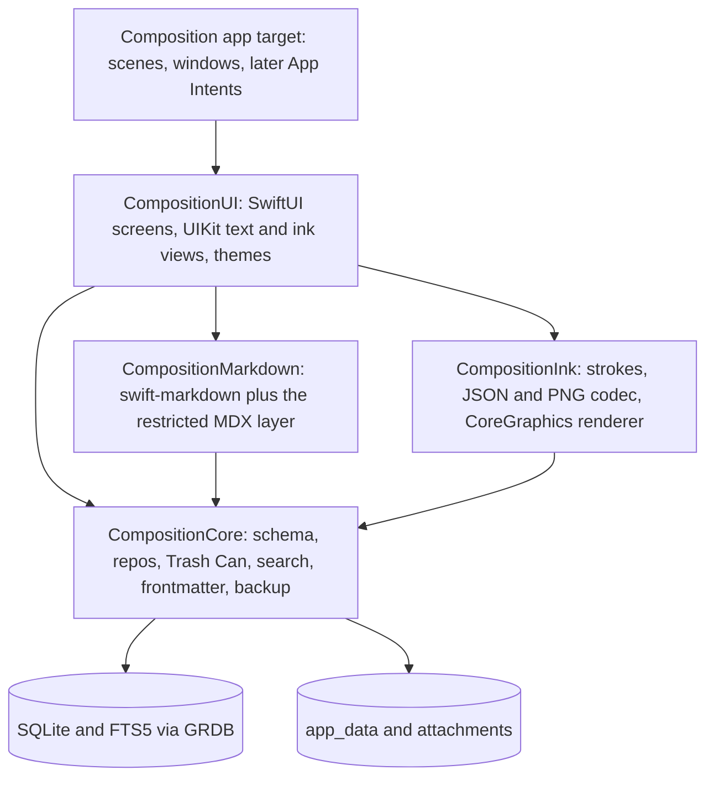

# iPad app: native design, feature tracker and compromises

A native iPad app for Composition, written in Swift (with Objective-C, C and C++ only where something needs
them), with Apple Pencil support. This page is the one place for the design, for which features work (or are
expected to) on the iPad, and for every compromise made to get it running.
**Design, plus the first slice of spike S1** (`apps/ios/CompositionCore`: the schema pass and its tests, see
[S1 status](#s1-status)). **Nothing has been tried on a device;** the code has run on the Mac and in the iPad
Simulator only. Dates are 2026-11-05.

**Direction (changed 2026-11-05).** The two earlier research sessions leaned towards the existing web UI in a
`WKWebView` shell with a native PencilKit plugin. You then asked for the app to feel **as native as possible**,
in native languages. That is a requirement, not a Pencil feature, so it changes the weights: this page now
designs a native app. The web-shell route stays as a fallback and a possible bring-up scaffold (O2 below).

It consolidates *iPad app feasibility* (2026-11-01) and *iPad app and Apple Pencil feasibility* (2026-11-03, with
its addendum on a native Swift rewrite), re-checked against `main` as of today. Where `main` has moved on or the
chats differ, see [What this page corrects](#what-this-page-corrects).

## How to read this page

Three things are tracked, each in its own section:

- the [**feature tracker**](#feature-tracker): every feature, what kind of work it is, whether it is in v1, and how far along it is;
- the [**compromise register**](#compromise-register): what we give up on the iPad, why, and what would make us revisit it;
- the [**decision log**](#decisions): what is decided, what is proposed, and what needs your input.

Legend for the tracker:

| | Meaning |
|---|---|
| **Kind** | What sort of work the row is. A prediction until Status says otherwise. |
| 🔁 | **Port:** the behaviour exists in the TypeScript app and is rewritten in Swift. The rules must match ([conformance](#keeping-two-implementations-honest)). |
| ⭐ | **Native upgrade:** the platform gives something better than the web version for free or cheaply. |
| 🆕 | **New** on the iPad |
| ⚠️ | **Risky:** unknown until tried on a device |
| ❌ | Not on the iPad |
| **Plan** | **M1**, **M2** or **M3†**: the [milestone](#v1-scope-and-milestones) that builds it (**†** is release polish, first to drop from v1) · **Later** · **Never** (a deliberate decision, see the compromise) |
| **Status** | ⬜ not started · 🔬 spiked (answer found, not built) · 🔨 built · 📱 verified on the iPad · ⛔ dropped |

**Verified working on a device today: nothing.** A row only gets 📱 after a person has used it on the iPad.

## Summary

- **Feasible, and the native route is the more expensive one.** The whole notes UI (about 12,000 lines of
  TypeScript, measured 2026-11-03) and the notes logic it sits on are rewritten, not reused. In return the app can
  use the system text engine, Scribble, PencilKit, drag and drop, windows and Spotlight directly, and a whole
  class of web-on-touch problems (hover-only controls, right-click, keyboard-only features) disappears.
- **Recommended shape** (proposed, settled by spikes): SwiftUI for screens and navigation; UIKit's `UITextView`
  on TextKit 2 for the editor and the preview; **GRDB over SQLite with the schema kept identical to the desktop's**,
  so a backup restores in either direction; **FTS5** for search; **swift-markdown** (cmark-gfm) plus a small
  restricted MDX layer of our own, drawing the ten components as native views; **PencilKit** for ink, stored as a
  PNG that carries its own stroke data. Handwriting is an `<Ink>` MDX component, so a note stays Markdown.
- **Languages:** Swift by default. C arrives through packages and the system (SQLite, zlib, cmark-gfm). Objective-C
  and C++ are **not needed anywhere in the plan yet**; each use must be earned by a spike and recorded
  ([Languages](#languages-and-dependencies)).
- **The costs that matter most:** two implementations of the notes rules to keep in step
  ([C3](#compromise-register)), search stops being typo-tolerant ([C1](#compromise-register)), the iPad has its
  own database with no live sharing ([C2](#compromise-register)), the plugins wait ([C6](#compromise-register)),
  and the Live tab may arrive after v1 ([C12](#compromise-register)).
- **The risks that decide the design:** whether TextKit 2 can hide Markdown marks away from the caret for the
  Live tab, and whether view-based attachments are solid enough to hold images, charts and ink in the text
  ([S3](#spikes-and-gates)).
- **Sync is decided for v1 (D8):** the iPad ships with backup and restore, built **sync-ready**, and does not wait
  for the sync service. Syncing with the Mac, Windows and Linux desktop apps comes later from a separate design.
  The `uuid` column the shared schema needed first has landed on the desktop (2026-11-05). The change-capture
  triggers and the outbox have not, so the decided fallback is the working plan ([Sync](#sync-and-the-data-model)).
- **Nothing is waiting on you.** Every decision in the [log](#decisions) is decided or a proposal that its gate settles.

## Goals and non-goals

**Goals** (proposed)

1. Read and write notes on the iPad, in the same Markdown and with the same MDX components as the other products.
2. **Feel native** ([the native bar](#the-native-bar)): system text editing, navigation, windows, accessibility, drag and drop.
3. Local-first and offline, like the desktop app.
4. Apple Pencil: handwrite into the editor (Scribble), and draw or handwrite notes (`<Ink>`).
5. Move data to and from the desktop app without loss, at minimum through backup and restore.
6. **One note format and one schema.** The iPad does not invent its own.

**Non-goals for v1**

- The sync engine, sign-in and server ([D8](#decisions): later, designed separately), and ink *editing* on Windows ([D11](#decisions)).
- The To-do, RSS Reader, Reading List and AI helper plugins ([C6](#compromise-register)).
- The terminal app, the panel grid and pop-out windows ([C5](#compromise-register), [C7](#compromise-register)).
- iPhone, macOS (Catalyst) and Android. The core package is kept free of UIKit so it *could* be reused; that is not a goal.
- Apple Pencil Pro features (squeeze, barrel roll). The test iPad does not support that Pencil.

**Already decided by you**

| | |
|---|---|
| Design before code | Nothing is built until this page is agreed. |
| **Native, in Swift and Objective-C, with C and C++ where necessary** | Stated 2026-11-05. Reflected in [Languages](#languages-and-dependencies). |
| Test hardware | iPad Pro with the M2 chip and a wireless-charging Apple Pencil. Assumed to be the **2nd generation**, since Apple lists the Pencil Pro only for M4/M5 iPad Pro and M2-and-later iPad Air ([Apple](https://support.apple.com/guide/ipad/aside/ipad47ee2e98/ipados)). It has hover and double-tap and no squeeze or barrel roll. The screen size and the iPadOS version are not recorded. |
| A handwritten note may depart from "Markdown only" on the iPad | Stated as acceptable. The design below keeps it Markdown anyway. |

## What the app is today

Facts that drive the design, checked against `main`.

| Fact | What it means for a native app | Source |
|---|---|---|
| **A note is Markdown text in a SQLite row** (`notes.content`, frontmatter included). It is not a file. Images and diagrams are files in `app_data/`, which the Markdown refers to by path. | The iPad keeps the same model. A handwritten note is a smaller departure than it feels: "Markdown that points at a binary side-asset" is how images and `<Drawio>` already work. | [data-model.md](architecture/data-model.md), [images.md](architecture/images.md) |
| **Ids are `INTEGER PRIMARY KEY AUTOINCREMENT`**, and notes link as `[text](note:id)`. Since 2026-11-05 every note, group, notebook, trashed item and attachment **also carries a `uuid`**: 32 lowercase hex characters, the same for the life of the row, kept by the Trash Can and by backups. | Two devices would both create "note 57", which blocks record-level sync on integer ids alone. The `uuid` is the name a second device knows a row by. The integer id stays the **local handle**, so favorites, `note:<id>` links and the search index are unchanged. The Swift core must keep the column, its trigger and its index ([Sync](#sync-and-the-data-model)). The earlier chats did not raise any of this. | [data-model.md](architecture/data-model.md#identity-the-uuid-column), [note-links.md](ui/note-links.md) |
| **Schema changes are additive `ensureColumn` checks** (`PRAGMA table_info`, then `ALTER TABLE … ADD COLUMN`), not numbered migrations. `db.ts` turns WAL on. | The Swift core must migrate the same way, so a database either side has touched is a no-op for the other. Not GRDB's `DatabaseMigrator`, whose bookkeeping table the desktop would not know. The `uuid` pass (`ensureUuids`) is the newest of these and adds a trigger and an index as well as a column, so the Swift core must reproduce it exactly. | [data-model.md](architecture/data-model.md), [db.ts](../apps/web/src/lib/composition/db.ts) |
| **The preview parses MDX at run time** with a restricted layer: tags from an allowlist of ten (`Info`, `Warning`, `Image`, `Drawio`, `Toc`, `Mark`, `Footnotes`, `YouTube`, `Repo`, `Chart`), with string or bare attributes only. `{expressions}`, `import`/`export` and fragments are rejected. Only notes that mention a component are parsed as MDX; the rest stay plain Markdown. | The Swift side needs its own small parser for exactly this subset. **No MDX parser for Swift was found**, but the subset is small. | [remarkRestrictMdx.ts](../apps/web/src/components/notes/mdx/remarkRestrictMdx.ts), [components.ts](../apps/web/src/components/notes/mdx/components.ts) |
| **There are two writing surfaces.** The Markdown tab is a `<textarea>` with a colour overlay. The Live tab is CodeMirror 6, drawing the note as it will read with the syntax shown only at the caret. Both go through one `EditorSurface`. | A native editor does not need the overlay (attributed text colours directly). The Live tab's behaviour, written down in [live-editor.md](ui/live-editor.md), is the spec to port, and it is the hardest part. | [MarkdownEditor.tsx](../apps/web/src/components/notes/MarkdownEditor.tsx), [LiveEditor.tsx](../apps/web/src/components/notes/LiveEditor.tsx) |
| **The UI reaches its backend through one contract.** `CompositionApi` has 42 methods (`API_METHODS`); desktop adds nine more groups (attachments, backup, panels, to-dos, Reading List, feeds, updates, window, AI stream). | In Swift this becomes the public surface of the core package. The v1 subset excludes the AI and data-location methods, plus the plugin groups. | [api.ts](../apps/web/src/lib/composition/api.ts), [desktopBridge.ts](../apps/web/src/lib/composition/desktopBridge.ts) |
| **The data layer is synchronous and Node-bound:** `better-sqlite3` in `db.ts`, `backup.ts`, `groupsRepo.ts`, `todosRepo.ts`; 13 files in `lib/composition` import `node:` modules. Backup is tar and gzip over `node:zlib`. | Nothing here is reused as code. The SQL, the rules and the file formats are the spec. | [service.ts](../apps/web/src/lib/composition/service.ts), [tarArchive.ts](../apps/web/src/lib/composition/tarArchive.ts) |
| **Frontmatter is parsed with `js-yaml`** (YAML 1.1 rules; unquoted dates become dates and are un-quoted again on write). | Swift's YAML options resolve some scalars differently. This is a classic drift spot; it needs fixtures. | [frontmatter.ts](../apps/web/src/lib/composition/frontmatter.ts) |
| **Search is a Meilisearch child process.** Only the query parser (`parseSearchQuery`) and the index shape carry over. | iOS apps cannot spawn bundled executables. The index is derived data. | [search.md](architecture/search.md) |
| **Size** (measured 2026-11-03): `apps/web/src` about 36,000 non-test lines; notes UI and MDX about 12,000; `lib/composition` about 13,000. The v1 subset of the 13,000 has not been measured. | Sets the scale of the rewrite. Measure the v1 subset in S1. | earlier session |
| **Already iPad-aware:** `useIsMac` counts iPad as a Mac. Fonts are open-source families bundled by `next/font`. | Nothing to port; the font files can be bundled in the app if you want the same choices. | [useIsMac.ts](../apps/web/src/components/shortcuts/useIsMac.ts), [editorFonts.ts](../apps/web/src/lib/composition/editorFonts.ts) |

## Options considered

| | Option | Verdict |
|---|---|---|
| O1 | **Thin client to the web build** (open the Next server from the iPad) | Not offline, not local-first, not native. Whether the web app has any authentication was not checked. **Rejected.** |
| O2 | **Web UI in a `WKWebView` shell** (Capacitor or Tauri 2) with a native PencilKit plugin and a new iOS data backend | The earlier lean. Reuses the UI, MDX stack, themes and tests, but the editor, hover controls, right-click and shortcuts all stay web behaviours on touch. Fails the native requirement. **Kept as a fallback** and for the one scaffold allowed in [D6](#decisions). Capacitor led Tauri 2 on fit (Tauri adds a Rust toolchain), not on evidence. |
| O3 | **Fully native:** SwiftUI and UIKit, TextKit 2, GRDB, PencilKit, our own MDX layer | Meets the requirement. The most work, and two implementations of the rules. **Recommended.** |
| O4 | **Native shell, web preview:** native data, editor and ink, with the existing MDX renderer in a `WKWebView` for the preview pane only | Keeps the ten components, themes and tests. Not "as native as possible". **Allowed only as a temporary scaffold** until the native renderer passes the fixtures ([D6](#decisions)). |
| O5 | React Native, Flutter, or other cross-platform toolkits | Not researched. They do not meet the stated Swift, Objective-C, C and C++ direction. |

## Languages and dependencies

Native feel comes from using Apple's frameworks, not from the choice of language, so the policy is: **the
newest language that reaches the API, and no more.**

| Language | Use | Where, today |
|---|---|---|
| **Swift 6** (strict concurrency) | Everything by default | Core packages, UI, app target |
| **SwiftUI** | Screens, navigation, lists, settings, the To-do board later | `CompositionUI` |
| **UIKit** | Where SwiftUI falls short, wrapped in `UIViewRepresentable`: the text editor and preview (`UITextView`, TextKit 2), the ink canvas (`PKCanvasView`), key commands, Pencil interactions, fine drag and drop | `CompositionUI`, `CompositionInk` |
| **Objective-C** | **Not planned.** Only if a spike finds an Apple API with no Swift surface, or a C++ library needs an Objective-C++ wrapper. | none |
| **C** | Reached through packages and the system, not hand-written: SQLite (inside GRDB, or the `sqlite3` C API), **zlib for gzip** (below), cmark-gfm (inside swift-markdown), libyaml (inside Yams, if used). A bridging module map where a system library has none (zlib did not need one, below). | `CompositionCore`, `CompositionMarkdown` |
| **C++** | **Not planned.** Only for a measured hot path (for example edit-distance matching over a large search vocabulary, or processing very large ink strokes), through Swift's C++ interoperability first and Objective-C++ second. | none |

Why zlib is the first honest C use: Apple's Compression framework's `COMPRESSION_ZLIB` produces **raw DEFLATE**,
without a zlib or gzip header ([Apple](https://developer.apple.com/documentation/compression/compression_zlib.md)),
and backups are `.tar.gz`. Either the gzip header and CRC-32 trailer are written by hand in Swift around the
Compression framework, or the system zlib is linked from C. **Decided in S1 (2026-11-05): the system zlib.** The SDK
already exposes it as a Swift module, so `import zlib` is all it takes: no C shim and no module map of ours, on the
Mac and in the iPad Simulator SDK alike. zlib writes and checks the gzip header (with its optional name, comment and
extra fields) and the CRC-32 and length trailer itself. I did not build the Compression-framework route to compare, so
this was decided by what that route would have to add, not by trying both; it stays open if a system library ever
causes trouble in the app target.

**Dependencies.** Apple frameworks first, then a short list of well-known Swift packages. Each gets a row here
before it is added, pinned to an exact version, with `Package.resolved` checked in, in line with the repo's
supply-chain posture ([SECURITY.md](../SECURITY.md), Dependabot, pinned Actions).

| Package | For | Licence (confirm at adoption) | Why not Apple's |
|---|---|---|---|
| [GRDB.swift](https://github.com/groue/GRDB.swift) | SQLite, FTS5, observation | MIT | Core Data and SwiftData hide the store, cannot keep our schema identical, and give no control over FTS5. |
| [swift-markdown](https://github.com/apple/swift-markdown) | CommonMark and GFM parsing (cmark-gfm) | Apache-2.0 | No Markdown parser in the SDK suited to a syntax tree with source ranges. |
| Yams (or a hand parser) | Frontmatter YAML | MIT | Decided with the frontmatter fixtures; `frontmatter.ts` may be small enough to port by hand. |

## Proposed architecture



**Layout (proposed):** `apps/ios/`, beside `apps/cli`, `apps/desktop` and `apps/web`, as Swift packages with a
thin Xcode app project. `CompositionCore` imports Foundation and GRDB only, never UIKit, so it builds and tests on
a Mac without a simulator, and could be reused beyond the iPad.

### Data: GRDB over the same schema

- GRDB on SQLite, with the schema, the `ensureColumn` rule, the Trash tables, notebooks and `adoptOrphans`
  behaviour copied exactly (see [data-model.md](architecture/data-model.md)). **Not Core Data or SwiftData**:
  their stores are opaque and cannot be made identical to the desktop's.
- A `DatabasePool` (WAL, concurrent readers, one writer), `ValueObservation` to drive lists, and a store actor so
  the UI never touches the database on the main thread.
- **Autosave, and iOS ending the app.** Debounce as today, and flush when the scene leaves the foreground
  (`scenePhase`, `UIApplication.willResignActive`) inside `beginBackgroundTask`. Everything that matters is in
  SQLite, never only in memory. `@SceneStorage` restores the selected note and caret.
- Images and attachments live in the app container (`app_data/`, `attachments/`) as on desktop. Content-hashed
  file names (`trip-plan-route-map-3f9c2a71b0de.png`) make image files merge-safe across devices. The system's
  device backup already includes the container, a safety net that is not sync.

### Keeping two implementations honest

Native means the notes rules (ordering, Trash Can, notebook invariants, frontmatter, backup, search parsing,
MDX parsing) exist **twice**: TypeScript and Swift. The old Python CLI showed what drift costs
([data-model.md](architecture/data-model.md)). The guard is a shared **conformance corpus** (proposed):

1. Database snapshots as each earlier schema version created them, opened by both implementations.
2. Operation scripts (create, move, reorder, delete, restore, move between notebooks) with the expected end
   state, generated from the TypeScript code and replayed in XCTest.
3. Frontmatter round-trip, `parseSearchQuery` and MDX-parse vectors.
4. A backup `.tar.gz` made by each side and restored by the other.

The corpus lives in the repo (for example `fixtures/conformance/`) and the TypeScript tests read it too, so a
change to the TypeScript behaviour fails until the fixtures and the Swift side are updated together.

### Markdown and MDX

- **Parse:** swift-markdown for the CommonMark and GFM layer. A small restricted-MDX scanner of our own handles
  the allowlisted tags (string attributes, flow and inline), rejects what `remarkRestrictMdx` rejects, and, like
  `usesMdxComponent`, only runs on notes that mention a component. How cmark-gfm treats footnotes (`[^1]`, which
  the web side handles in `rehypeFootnotes.ts`) is **unverified**.
- **Draw:** one read-only `UITextView` for the preview, with the non-text blocks as view-based attachments, so
  text selection works across blocks (the preview's highlight menu needs it). The same engine, made editable,
  is the Live tab.
- **A TextKit 2 rule:** never touch `textView.layoutManager`. That forces a fallback to TextKit 1, where
  view-based attachments disappear (reported by developers; the iOS 16 view-provider behaviour is partly
  undocumented, [Apple forums](https://developer.apple.com/forums/thread/697381)).

| Component | Native drawing |
|---|---|
| `<Info>`, `<Warning>` | A tinted panel with an icon (SwiftUI hosted in an attachment) |
| `<Toc>` | Generated from the headings; tap to scroll |
| `<Mark>` | Background-colour attribute in five colours; port `markContrast` so text stays legible |
| `<Footnotes>` | Superscript citations and a list, numbered by where they are cited |
| `<Image>`, header image | `UIImage` from `app_data/`, at the `width` the tag asks for |
| `<Chart>` | **Swift Charts**, from the same CSV-in-a-block spec; series colours from theme tokens |
| `<Repo>` | A card drawn from the address alone; opens in `SFSafariViewController` |
| `<Drawio>` | The PNG, drawn as an image. Editing: [C9](#compromise-register) |
| `<YouTube>` | **A `WKWebView`** of the privacy-enhanced player, or a thumbnail that opens YouTube. A listed exception ([C8](#compromise-register)); the player's Referer rules are **unverified** in a native web view. |
| `<Ink>` | The strokes drawn by CoreGraphics; tap to edit in PencilKit |

### The editor

`UITextView` on TextKit 2, wrapped for SwiftUI. What it gives for free: the selection loupe, spelling and
autocorrect, dictation, **Scribble**, Writing Tools where available, Dynamic Type, system edit menus, and the
system find bar (`isFindInteractionEnabled`, `UIFindInteraction`, iOS 16+,
[Apple](https://developer.apple.com/documentation/uikit/uitextview/isfindinteractionenabled.md)).

| Tab | Native approach | Risk |
|---|---|---|
| **Markdown** | Source text with syntax colours as attribute runs. No overlay: the web one existed because a textarea cannot colour its text. | Low |
| **Preview** | The read-only text view above | Medium |
| **Split** | Two columns; one at narrow widths | Low |
| **Live** | The source text with marks hidden away from the caret, headings and rules drawn large, images inline | **High.** TextKit 2 offers ways to substitute what a paragraph displays and to draw custom layout fragments, but hiding characters without breaking the caret, selection and undo is **unverified**. See [C12](#compromise-register). |

Typing features port as UIKit pieces: the `<` component and prop completion and the `[[` note-link picker as
popovers at `caretRect(for:)`; Tab and Shift+Tab indent as `UIKeyCommand`s plus buttons on the keyboard
accessory bar; image paste through `UITextPasteDelegate`; highlight, recolour and remove as edit-menu actions in
both the editor and the preview (which replaces right-click); the ruler and reflow ported from `liveReflow.ts`.

### Ink and the Pencil

PencilKit is the primary drawing surface. There is no web ink canvas in this design.

| Layer | What | Notes |
|---|---|---|
| **0. Scribble** | Handwrite into the editor; the system converts it to typed text | `UITextView` supports it by default. Test in both Markdown and Live (S3). |
| **1. PencilKit** | `PKCanvasView` with `PKToolPicker`, full-screen to start and inline later as a text attachment | System latency and prediction, palm rejection |
| **2. Pencil events** | `UIPencilInteraction` (double-tap), `UIHoverGestureRecognizer` (hover pose) | The M2 iPad Pro with a 2nd-generation Pencil has both. Later. |

PencilKit's `dataRepresentation()` is a binary blob, not an interchange format, so it is never the only copy.

**`<Ink>` is an MDX component, modelled on `<Drawio>`:**

```mdx
Meeting sketch:

<Ink src="app_data/trip-plan-sketch-3f9c2a71b0de.png" alt="Whiteboard: three boxes, arrows left to right" width="80%" />
```

A handwritten page is a note whose body is one tall `<Ink>`, so title, tags, groups, Trash Can, search and
backup keep working. **Not v1:** ink drawn over rendered Markdown, because anchors break when text reflows.

**Storage** (the `<Drawio>` trick, where the PNG contains its own editable source):

| Part | Content | Read by |
|---|---|---|
| PNG pixels | The ink rendered on transparent | CLI, desktop, backups, anything that shows an image |
| An embedded, versioned **stroke JSON** | Strokes with per-point x, y, pressure, tilt and time; tool and **ink type**; **semantic** colour; canvas size; unknown fields preserved | The Swift and web renderers, any platform |
| An optional embedded **PencilKit blob** | The original drawing | Lossless re-edit on the iPad |

`images.ts` sniffs bytes, so a PNG container needs no allowlist change. Whether a multi-megabyte chunk is
acceptable or a sidecar `.ink.json` is better depends on stroke counts: measure a dense page ([S5](#spikes-and-gates)).

**Themes.** Black ink baked into a transparent PNG disappears on a dark scheme, and PencilKit itself reverses
ink brightness in dark mode (developer reports; `PKInkingTool.convertColor(_:from:to:)` exists for it,
[Apple](https://developer.apple.com/documentation/pencilkit/pkinkingtoolreference.md)). So stroke JSON stores
**semantic** colours ("ink", "accent"), the renderer maps them through the theme, and the PNG is the fallback for
the CLI. The desktop's web renderer does the same from the JSON with SVG it generates at render time (never
accepted as an upload: `images.ts` refuses SVG on purpose).

**Search.** Handwriting is opaque to search. On save, the Vision framework recognises the text on the device and
the result is written to the tag's `alt`, which is already note text. Accuracy on real handwriting is
**unverified**; the transcript stays editable ([C11](#compromise-register)).

**Where `<Ink>` must be wired** (following `<Drawio>`; confirm when built): the allowlist and `components.ts` on
the web side, completions and snippets, the CLI's `mdx.ts` (it draws the PNG), and the docs. The Live tab draws
other MDX tags as text.

### Search

The query parser ports as it is. **SQLite FTS5 replaces Meilisearch.**

- An external-content FTS5 table over title, description, content and tags, kept in step by the store (the same
  places that call `indexNote` today), `unicode61` with diacritics removed, prefix indexes, `bm25` weights with
  the title heaviest. `tag:`, `title:`, `description:`, `created:` and `updated:` become SQL clauses and
  column-scoped `MATCH`. Results stay capped at 50.
- **FTS5 availability.** FTS5 is a compile-time option of SQLite. GRDB's author says the system SQLite has it from
  iOS 11.4 and that GRDB's package build enables it ([secondhand](https://github.com/steipete/GRDB.swift/blob/master/Documentation/CustomSQLiteBuilds.md)).
  **S1 result (2026-11-05):** present, with the `unicode61`, `porter`, `ascii` and `trigram` tokenizers, in the SQLite
  GRDB 7.12.0 links on the Mac (3.54.0) and in the iPad Pro 11-inch (M5) Simulator runtime (3.51.0). **Not yet
  checked on the iPad itself,** whose iPadOS version is not recorded. The fallback, if the device lacks it, is a custom SQLite build.
- **Typo tolerance is the regression** ([C1](#compromise-register)): today `title: routng` finds "routing", and
  FTS5 has no fuzzy matching. In the order I would try them: (1) rescore titles and descriptions in memory by
  edit distance, cheap at personal-notes scale and plain Swift; (2) expand each query word against the index's
  `fts5vocab` table; (3) the trigram tokenizer. C++ only if (2) measures too slow. **Acceptance test (proposed):**
  the 100-note corpus from `pnpm search:playground` in `apps/cli`, exact queries return the same top results as
  Meilisearch, and one-edit typos in titles are still found.
- Native extras: search tokens in `.searchable` for the `tag:` style filters, and **Spotlight** indexing
  (`CSSearchableIndex`), both ⭐ and Later.

### App structure, windows and themes

- **Navigation:** `NavigationSplitView` (notebooks and groups, notes, the note). Swipe actions and context menus
  for delete (to the Trash Can), favorite, move. Home page as the landing detail. Back and forward as navigation
  history, plus Cmd+[ and Cmd+].
- **Windows:** iPadOS scenes replace the panel grid and pop-outs: "Open in New Window", Split View, Slide Over and
  Stage Manager come from size classes and scenes. The same note in two windows shares one database pool.
- **Drag and drop:** SwiftUI `draggable` and `dropDestination` (or UIKit's interactions) for notes and groups,
  and for dropping images and files in from Photos and Files, which the web app could not do.
- **Themes:** the six schemes become a `Theme` of semantic tokens ported from `themes.ts`, injected through the
  SwiftUI environment and UIKit trait collection. Add a **System** scheme that follows light and dark. "Follow the
  sun" ports `sunTimes.ts` (pure maths) and needs the saved city. Fonts default to the system fonts; the
  desktop's open-source choices can be bundled as options.
- **Keyboard:** `UIKeyCommand` and `.keyboardShortcut`, with `discoverabilityTitle`, so holding Cmd lists them.
  That replaces the shortcuts helper window.

### Sync and the data model

**Decided (2026-11-05, you): iPad v1 is backup and restore, built sync-ready.** The iPad does not wait for the
sync service, because that service needs longer to settle its architecture. Syncing with the Mac, Windows and
Linux desktop apps comes later. Its design is a separate page, `docs/cross-device-sync-design.md`, written in a
parallel session and not yet in this tree (link it once both are merged). That page takes **our own
account-based, record-level service** and records its own decisions: notes are end-to-end encrypted, the server
is hosted first and self-hostable later, and the desktop app syncs the CLI's edits. Its open questions are its
own to settle; this page only needs the iPad to be ready for it.

The iPad is a separate device with a sandbox, so it cannot open the Mac's `~/.composition/composition.db`. Until
sync ships, data moves by backup and restore through Files ([C14](#compromise-register)). There is also no
Windows app today, so "show the ink on a Windows PC" currently means the web app in a browser.

| Option | Where it landed |
|---|---|
| **Backup and restore through Files** | **v1.** Exists today. Ink files ride along. Manual, and the way to test round trips. |
| **Our own account-based sync service** | **Later, and the target.** Covers every platform. Designed separately. |
| **CloudKit** (`CKSyncEngine`, iOS 17+) | Not chosen. Apple-only, and the Mac app is Electron, which (inference) has no way to call `CKSyncEngine`, so it would sync iPad to iPad only. |
| **A folder of `.md` files as a sync engine** | Not chosen. A folder of Markdown files that a file-sync tool (iCloud Drive, Dropbox, Syncthing, git) carries between devices, with no Composition server. Earlier research (committed as `2a207d3`, `docs/markdown-files-git-research.md` on branch `claude/markdown-files-git-portability-16ee92`) recommended against making files the source of truth, and the two-way version needs a per-note sync state, file watchers and conflict handling. Plain `.md` files in a shared folder also cannot be end-to-end encrypted by us. Kept as an **export** for backup, history and portability ([Later](#feature-tracker)), not as sync. |
| **The database in iCloud Drive** | **Never.** Unsafe: WAL's sidecar files can be delivered out of order by cloud sync and corrupt the database ([SQLite forum](https://sqlite.org/forum/info/47107ab818977549?t=h)). |

**Where the desktop's prerequisites stand** (checked against `main` at `df801fd`, 2026-11-05):

| Prerequisite | On `main`? |
|---|---|
| **A `uuid` on notes, groups, notebooks, trashed notes, trashed groups and attachments**: the column, an `AFTER INSERT` fill trigger, a unique index, a batched backfill, carried both ways by the Trash Can and by backups | **Landed** in [#244](https://github.com/meddlin/composition/pull/244). Spec: [data-model.md](architecture/data-model.md#identity-the-uuid-column) |
| Change-capture triggers feeding a `sync_outbox` table | Not on `main` |
| The `sync_*` bookkeeping tables | Not on `main` |

The fallback's minimum is therefore met: the iPad can start S1 against a schema that has the `uuid`. Whether the
capture triggers and the outbox are in M1 depends on whether they reach `main` before Gate A.

**Sync-ready means** (proposed; each item is the sync design's, adopted here):

- **The shared schema carries what sync needs, and the iPad starts from it.** A `uuid` column on notes, groups,
  notebooks, the `trashed_*` tables and attachments (added the `ensureColumn` way, backfilled, uniquely indexed, and
  filled by an insert trigger so rows written by an older build still get one); the Trash Can carrying the uuid;
  SQLite triggers feeding a `sync_outbox` table; and the `sync_*` bookkeeping tables. The first two have landed
  (table above). The rest are the sync design's P1 ("ships alone, changes nothing a user can see"), and the iPad's
  "identical schema" rule covers them once they land. The integer ids stay as the local handle.
- **The triggers ship in v1 even though no engine exists, if they are ready by Gate A** (otherwise see the fallback
  below). They are built-in SQL only, so GRDB runs the same text.
  The outbox holds at most one row per changed record, and shipping them now means the sync release needs no schema
  upgrade. A first sign-in uploads everything anyway, so nothing depends on the outbox being complete before then.
- **Backups carry the new columns,** so an iPad backup restores on the desktop and the reverse.
- **Note links keep `note:<int>` locally.** The sync design translates them to `note:<uuid>` on the wire. The iPad
  learns that rewrite when its engine is built, and the conformance corpus pins it.
- **Nothing visible in v1:** no engine, no sign-in, no server address, no sync screen.
- **Data made before sync is not stranded.** An iPad used alone and signed in later is merged by union: nothing is
  overwritten or deleted on either side (the sync design's first-sign-in rule).

**What the Swift core does with the `uuid`** (from [data-model.md](architecture/data-model.md#identity-the-uuid-column);
each point is a conformance fixture, [D7](#decisions)):

- **Runs the same pass on every open.** In one immediate transaction, for each of the six tables: add the column, an
  `AFTER INSERT … WHEN NEW.uuid IS NULL` trigger (`trg_<table>_fill_uuid`) and a unique index (`idx_<table>_uuid`).
  Then fill the rows that have none, 200 per write transaction. The fill is `lower(hex(randomblob(16)))`: built-in SQL
  only, so GRDB runs the same text and an older desktop build that opens the file still gets a uuid on its inserts.
  The second open of a current database writes nothing.
- **Leaves the `uuid` out of its inserts** and lets the trigger fill it, as the desktop does.
- **Carries it through the Trash Can.** Delete copies the uuid into `trashed_*` and restore puts it back, so a restored
  note keeps it (a fresh one is issued only if a live row already holds it). Moves, renames and reorders are
  `UPDATE`s and leave it alone.
- **Keeps it out of the search index and out of the interface.**
- **Backups carry it,** because the snapshot copies the schema as well as the rows. A backup from before the column is
  backfilled on the next open. What an *older desktop build* loses is the uuid across a Trash move, which it issues
  anew; to a future sync that reads as a delete plus a create, a degradation and not a loss.

**The one dependency that could delay the iPad, and the fallback (decided 2026-11-05, you).** The sync design says
the uuid and trigger work must land on the desktop **before the iPad's Gate A**. If the triggers slip, the iPad starts
from the `uuid` column alone and adds the triggers, outbox and `sync_*` tables in a later release, since they are
`CREATE … IF NOT EXISTS`. That is safe for v1: a first sign-in uploads everything, and an iPad used alone merges by
union. The `uuid` column itself is the minimum and had to land on the desktop first, because the schema is shared.
**Status (2026-11-05): the minimum has landed and the rest has not, so the fallback is the working plan until the
triggers reach `main`.** The fallback relaxes the sync design's ordering, so that page should be updated to match.

A note's content is one text blob, so two devices editing it need a conflict rule. That rule belongs to the sync
design (keep both versions as a conflicted copy); the iPad does not need one in v1.

## The native bar

"As native as possible" needs a test, or it becomes an opinion. The app claims native when these hold. Audited in
[S7](#spikes-and-gates) and again before each release; the only web views are the exceptions in [C8](#compromise-register).

| # | Criterion | How it is checked | Status |
|---|---|---|:-:|
| N1 | Text editing uses the system text engine: loupe, spelling, autocorrect, dictation, Scribble, system find, system edit menus | Hands-on with the Pencil and a hardware keyboard | ⬜ |
| N2 | Navigation and controls are SwiftUI or UIKit: split view, lists, swipe actions, context menus, sheets, popovers | Review of the view hierarchy; no web view outside the exceptions | ⬜ |
| N3 | Adapts: rotation, Split View, Slide Over, Stage Manager, a third of the screen, multiple windows | Resize through every size class | ⬜ |
| N4 | Input: Pencil (draw, Scribble, double-tap, hover), pointer hover effects, keyboard shortcuts with the Cmd-hold list, drag and drop within and across apps | Hands-on | ⬜ |
| N5 | System integration: Files and Photos pickers, share sheet, state restoration, saves that survive being backgrounded | Kill and relaunch mid-typing | ⬜ |
| N6 | Accessibility: VoiceOver labels, Dynamic Type, Reduce Motion, contrast in all seven schemes | Accessibility Inspector, then a person | ⬜ |
| N7 | Performance (targets are proposals): cold launch to a usable notes list in about a second; typing in a 5,000-line note without a visible lag; ink latency no worse than Apple's Notes on the same iPad | Instruments, and side by side | ⬜ |

## v1 scope and milestones

**Decided (2026-11-05, you): v1 is the full notes editor, without plugins** ([D13](#decisions)). It is built and
installed in three milestones. M1 and M2 are test installs on your personal/dev iPad, before v1. M3 combines them
into the first release.

| Milestone | What | Installed as |
|---|---|---|
| **M1: usable notebook** | The sync-ready store; notebooks, groups, notes, Trash Can and favorites; the Markdown, Preview and Split tabs; Scribble and the system text engine; search (FTS5 plus the typo layer); images (paste, picker, Photos); the MDX components other than `<Ink>` and `<YouTube>`; the six colour schemes plus a System scheme; backup and restore | A test install on your dev iPad, from Xcode. **Pre-v1.** |
| **M2: Pencil** | `<Ink>`, the PencilKit canvas, handwritten pages, stroke JSON in the PNG, theme-aware ink, and drawing ink on the desktop app and in the CLI | A fast-follow install on your dev iPad, from Xcode. **Pre-v1.** |
| **M3: first release (v1)** | M1 and M2 combined and hardened as a release: the release-polish rows (marked †), the native-bar audit ([S7](#spikes-and-gates)), the manual test page, and distribution ([D12](#decisions)) | **The first release**, through TestFlight |

The tracker's **Plan** column says which milestone builds each row. A **†** marks release polish: the first rows
to drop from v1 if the schedule bites. A dropped row becomes *Later* (a v1.1), not a failure. Not in v1 at all:
the plugins ([C6](#compromise-register)) and the Live tab ([C12](#compromise-register)).

**Never cut:** the store, the Trash Can, backup and restore, search, the Preview, images and Scribble.

**The cut line, in the order I would drop things** (a proposal; correct it on what you use):

1. the `<YouTube>` player (a link to it instead);
2. the "Follow the sun" scheme;
3. notebook colours (switching notebooks stays);
4. the Images page's browse and unused view (the insert-an-image picker stays);
5. header image;
6. ruler and reflow;
7. the home page's recent and pinned extras;
8. the heading rail.

**Exit criteria** (proposed):

- **M1:** installs and runs on the dev iPad; create, edit, search, delete and restore from the Trash Can; a backup made on the desktop restores on the iPad and the reverse; every M1 row is at least 🔨. Gates A and B ([S1 to S4](#spikes-and-gates)) are passed along the way, and S6 is done.
- **M2:** draw, save and reopen ink; a backup restored on the desktop shows the ink in every colour scheme, and the CLI shows its PNG. Gate C ([S5](#spikes-and-gates)) is passed first.
- **M3:** the † rows are done or moved to *Later*; the native-bar audit passes the bar you accept; `docs/manual-tests/ipad.md` has been run by hand; the distribution checklist below is done.

**Distribution** ([D12](#decisions), decided). Unlike the desktop app's GitHub Releases download, an iPad app reaches
other people only through Apple: TestFlight, the App Store, or a build from source with their own Apple ID (which
expires after 7 days on a free account).

| Stage | Route | Notes |
|---|---|---|
| M1 and M2 | Install from Xcode onto the dev iPad | Fastest loop; no pipeline yet |
| M3 | TestFlight: internal first, then an external link if others are invited | Per third-party guides (confirm in App Store Connect help): internal testers skip Beta App Review, external testers need a review of the first build per version, and every build expires 90 days after upload |
| Later | **The App Store waits.** Not part of M3; revisit once M3 is in daily use | Would need a privacy policy, privacy-label answers, iPad screenshots and a review per release |

**Settle before M1's first install:**

- the **bundle id**, effectively permanent after release (the desktop's `appId`, `com.rushinglabs.composition`, carries the same warning);
- the **Apple team** (individual or organization) and whether the **app name** is available;
- the **app icon** (the desktop's source is `build/app-icon-1024.png`) and the **minimum iPadOS version** ([C15](#compromise-register));
- **licence notices** for GRDB (MIT) and swift-markdown (Apache-2.0), shown in the app, as the desktop does with `collect-licenses.mjs`;
- **CI signing:** a macOS runner and an App Store Connect API key in the `release` environment, with every new `uses:` pinned to a commit SHA ([AGENTS.md](../AGENTS.md)).

**When sync and encryption arrive:** the privacy label stops being "no data collected", and the encryption
export-compliance questions apply. The specifics are unverified.

Two dependencies to plan around. M1 cannot start before Gate A. The desktop's `uuid` work, which M1 also needed,
landed in #244 ([D8](#decisions)); the capture triggers and the outbox are the open part, and the fallback covers
them. And M2 changes the desktop app and the CLI as well as the iPad, because ink must be drawn there too.

## Feature tracker

Sections follow [feature-matrix.md](feature-matrix.md). Compromise ids point at the
[register](#compromise-register). The **Plan** column says which [milestone](#v1-scope-and-milestones) builds each row. **Update a row in the same pull request that changes it.**

### Platform and shell

| Feature | Kind | Plan | Status | Native approach and notes |
|---|:-:|:-:|:-:|---|
| App shell, scenes, lifecycle | 🆕 | M1 | ⬜ | SwiftUI `App`; flush on leaving the foreground |
| Six colour schemes | 🔁 | M1 | ⬜ | `Theme` tokens ported from `themes.ts`; add a **System** scheme (⭐) |
| "Follow the sun" scheme | 🔁 | M3† | ⬜ | Port `sunTimes.ts`; needs a saved city |
| Fonts | 🔁 | M1 | ⬜ | System fonts by default; bundled open-source families as options |
| Dynamic Type, VoiceOver, Reduce Motion | ⭐ | M1 | ⬜ | The native bar, N6 |
| Hardware-keyboard shortcuts | ⭐ | M1 | ⬜ | `UIKeyCommand`; audit iPadOS-reserved combinations |
| Shortcuts helper (Cmd+/) | ⭐ | M1 | ⬜ | Replaced by the system's Cmd-hold list |
| Split View, Slide Over, Stage Manager | ⭐ | M1 | ⬜ | Size classes (N3) |
| Window translucency | ❌ | Never | ⛔ | macOS setting; system materials may be used in the UI, not as a setting |
| Auto-update, Updates settings | ❌ | Never | ⛔ | TestFlight or the App Store ([C13](#compromise-register)) |
| Application data location setting | ❌ | Never | ⛔ | Sandbox ([C13](#compromise-register)) |
| Developer docs viewer (`/docs`) | ❌ | Never | ⛔ | Reads this repo from disk; not in desktop either |

### Notes and organization

| Feature | Kind | Plan | Status | Native approach and notes |
|---|:-:|:-:|:-:|---|
| Create, edit, delete notes, autosave | 🔁 | M1 | ⬜ | GRDB; debounce plus flush |
| Frontmatter (title, description, tags, dates) | ⚠️ | M1 | ⬜ | `js-yaml` rules (dates) vs Yams or a hand parser; fixtures |
| Groups: create, rename, delete, move, reorder | 🔁 | M1 | ⬜ | Same rules; conformance corpus |
| Notebooks: switch, colours | 🔁 | M1 | ⬜ | Sidebar |
| Favorites | 🔁 | M1 | ⬜ | |
| Trash Can (60 days) | 🔁 | M1 | ⬜ | |
| Drag and drop of notes and groups | ⭐ | M1 | ⬜ | Native drag and drop, reorder, and drops from Files and Photos |
| Home page (recent, pinned) | 🔁 | M3† | ⬜ | |
| Heading rail | 🔁 | M3† | ⬜ | An outline popover or trailing rail |
| Back and forward | 🔁 | M1 | ⬜ | Navigation history plus Cmd+[ and Cmd+] |
| Resizable columns | ⭐ | M1 | ⬜ | `NavigationSplitView` manages column widths; the Split tab keeps a draggable divider |
| Open a note in another window | ⭐ | Later | ⬜ | Scenes ([C5](#compromise-register)) |
| Panels grid, pop-outs, command palette | ❌ | Never | ⛔ | Windows replace them; the iPadOS menu bar may replace the palette ([C5](#compromise-register)) |
| Notebook backgrounds (architect grid) | 🔁 | Later | ⬜ | Custom drawing behind the text |

### Search

| Feature | Kind | Plan | Status | Native approach and notes |
|---|:-:|:-:|:-:|---|
| Full-text search | ⚠️ | M1 | 🔬 | FTS5 through GRDB ([C1](#compromise-register)); present in the Simulator and on the Mac, trigram included; the typo layer is S2; not checked on the device |
| Typo-tolerant search | ⚠️ | M1 | ⬜ | A rescoring layer; not out of the box ([C1](#compromise-register)) |
| Field filters: `tag:`, `title:`, `description:`, `created:`, `updated:` | 🔁 | M1 | ⬜ | Port `searchQuery.ts` (pure); fixtures |
| Search bar | ⭐ | M1 | ⬜ | `.searchable`, with tokens for filters |
| Find in a note | ⭐ | M1 | ⬜ | `UIFindInteraction` |
| Spotlight indexing | 🆕 | Later | ⬜ | Core Spotlight |

### Writing

| Feature | Kind | Plan | Status | Native approach and notes |
|---|:-:|:-:|:-:|---|
| Markdown tab | ⭐ | M1 | ⬜ | TextKit 2 with attribute runs; no overlay |
| Preview tab | 🔁 | M1 | ⬜ | Read-only text view with view-based attachments |
| Split tab | 🔁 | M1 | ⬜ | One column at narrow widths |
| Live tab | ⚠️ | Later | ⬜ | Hidden marks away from the caret ([C12](#compromise-register), S3) |
| Scribble, autocorrect, dictation, Writing Tools | ⭐ | M1 | ⬜ | System text engine |
| Tab and Shift+Tab indent | 🔁 | M1 | ⬜ | `UIKeyCommand` plus accessory-bar buttons |
| `<` component, prop and value completion | 🔁 | M1 | ⬜ | Popover at `caretRect(for:)` |
| Note links: `[[` and the picker | 🔁 | M1 | ⬜ | Popover; tap a link to open |
| Insert a stored image | 🔁 | M1 | ⬜ | Picker sheet |
| Paste an image | ⭐ | M1 | ⬜ | `UITextPasteDelegate` |
| Add a photo, a camera shot or a file | ⭐ | M1 | ⬜ | `PHPickerViewController`, document picker; HEIC to JPEG ([C18](#compromise-register)) |
| Markdown image to `<Image />`, and its width | 🔁 | M1 | ⬜ | Edit-menu action |
| Highlight text with `<Mark>` | ⭐ | M1 | ⬜ | Edit-menu action in the editor *and* the preview; replaces right-click |
| Ruler, reflow, editor and preview fonts | 🔁 | M3† | ⬜ | Port `liveReflow.ts` |
| Header image | 🔁 | M3† | ⬜ | |

### MDX components

| Component | Kind | Plan | Status | Native approach and notes |
|---|:-:|:-:|:-:|---|
| `<Info>`, `<Warning>`, `<Toc>`, `<Mark>`, `<Footnotes>` | 🔁 | M1 | ⬜ | See the table under [Markdown and MDX](#markdown-and-mdx) |
| `<Image>` | 🔁 | M1 | ⬜ | |
| `<Chart>` | ⭐ | M1 | ⬜ | Swift Charts |
| `<Repo>` | 🔁 | M1 | ⬜ | `SFSafariViewController` |
| `<YouTube>` | ⚠️ | M3† | ⬜ | A `WKWebView` exception ([C8](#compromise-register)) |
| `<Drawio>` shown | 🔁 | M1 | ⬜ | The PNG |
| `<Drawio>` edited | ❌ | Never | ⛔ | [C9](#compromise-register) |
| `<Ink>` | 🆕 | M2 | ⬜ | PencilKit; see [Ink and the Pencil](#ink-and-the-pencil) |

### Images and files

| Feature | Kind | Plan | Status | Native approach and notes |
|---|:-:|:-:|:-:|---|
| Stored images in `app_data/` | 🔁 | M1 | ⬜ | App container; same file names |
| Images page: browse, reuse, find unused | 🔁 | M3† | ⬜ | |
| Image size limit | 🔁 | M1 | ⬜ | None, as on desktop; the data stays on the device |
| Attachments | ⭐ | Later | ⬜ | Document picker, share sheet, Quick Look |
| Backup and restore | 🔁 | M1 | 🔬 | The core (create, stage, apply with rollback) is built and checked against the desktop both ways ([S1 status](#s1-status)); tar in Swift, gzip via the system zlib. No Files picker or screen yet ([C14](#compromise-register)) |

### Plugins and other products

| Feature | Kind | Plan | Status | Native approach and notes |
|---|:-:|:-:|:-:|---|
| To-do panel and weekly cycle | 🔁 | Later | ⬜ | SwiftUI list and board ([C6](#compromise-register)) |
| RSS Reader | 🔁 | Later | ⬜ | `URLSession` and `XMLParser`; port the private-address guard |
| Reading List | ⭐ | Later | ⬜ | `SFSafariViewController`; the Electron `<webview>` has no twin |
| AI helper: Ollama | 🔁 | Later | ⬜ | `URLSession` streaming; plain `http://` and Local Network permission ([C19](#compromise-register)) |
| AI helper: ChatGPT sign-in | ⚠️ | Later | ⬜ | The desktop flow redirects to `http://127.0.0.1:1455`; an iOS app cannot rely on that ([C19](#compromise-register)) |
| Terminal app (CLI) | ❌ | Never | ⛔ | [C7](#compromise-register) |

### Ink and the Pencil (new)

| Feature | Kind | Plan | Status | Native approach and notes |
|---|:-:|:-:|:-:|---|
| Ink canvas | 🆕 | M2 | ⬜ | `PKCanvasView`, full-screen first, inline later |
| `<Ink>` component, stroke JSON in the PNG | 🆕 | M2 | ⬜ | Format frozen at Gate C ([D9](#decisions)) |
| Theme-aware ink | ⚠️ | M2 | ⬜ | Semantic colours; PencilKit flips brightness in dark mode |
| Handwritten page (a note that is one `<Ink>`) | 🆕 | M2 | ⬜ | |
| View ink on desktop and in the CLI | 🔁 | M2 | ⬜ | The PNG always works; the web renderer reads the strokes |
| Handwriting recognition into `alt` | ⚠️ | Later | ⬜ | Vision ([C11](#compromise-register)) |
| Pencil double-tap and hover | 🆕 | Later | ⬜ | `UIPencilInteraction`, hover pose |
| Edit ink on a non-Apple device | 🆕 | Later | ⬜ | View only first; basic strokes only if added ([C10](#compromise-register), [D11](#decisions)) |
| Pencil Pro squeeze and barrel roll | ❌ | Never | ⛔ | The test iPad does not support that Pencil |
| Ink over rendered Markdown | ❌ | Never | ⛔ | Anchors break when text reflows |

### Sync and portability

| Feature | Kind | Plan | Status | Native approach and notes |
|---|:-:|:-:|:-:|---|
| Backup round trip, iPad to desktop and back | ⚠️ | M1 | ⬜ | The schema must stay identical; the corpus tests it |
| Stable `uuid` on notes, groups, notebooks, the Trash Can and attachments | 🔁 | M1 | ⬜ | **Landed on the desktop** (#244, 2026-11-05). The Swift core runs the same pass (column, fill trigger, unique index, batched backfill), copies it through the Trash Can and leaves it out of inserts ([Sync](#sync-and-the-data-model)) |
| Change capture: triggers, `sync_outbox`, `sync_*` tables | 🆕 | Later | ⬜ | Not on `main`. Moves to M1 if it lands before Gate A; otherwise the fallback adds it in a later release ([D8](#decisions)) |
| Sign-in and the sync engine | 🆕 | Later | ⬜ | Own account-based service, designed separately ([D8](#decisions)) |
| Export as `.md` files plus assets | 🆕 | Later | ⬜ | Optional export for backup, history and portability only; never storage and not a sync engine |
| The database in iCloud Drive | ❌ | Never | ⛔ | WAL corruption risk |

## Compromise register

What we give up to get the iPad app running. Ids are permanent once this page is agreed: never renumber, add the
next one. **Status:** *Proposed* (not agreed) · *Accepted* · *Deferred* (a future compromise, not yet in play) ·
*Resolved* · *Rejected*. **Impact** is how visible the loss is to the person using the app.

| Id | Compromise | Impact | Why | Mitigation and when to revisit | Status |
|---|---|:-:|---|---|:-:|
| **C1** | **Search is no longer typo-tolerant out of the box.** FTS5 replaces Meilisearch, which has no fuzzy matching. | High | iOS cannot spawn Meilisearch, in any approach. [desktop-app-plan.md](desktop-app-plan.md) calls search the product's differentiator. | Rescoring titles in memory, `fts5vocab` expansion or trigrams, measured against the acceptance test. Revisit if S2 cannot reach one-edit tolerance on titles. | Proposed |
| **C2** | **The iPad has its own database.** It cannot see the Mac's `~/.composition`. Moving data is by backup and restore. | High | App sandbox. Sync arrives later ([D8](#decisions)). | Revisit when the sync engine ships. | Accepted for v1 (you, 2026-11-05) |
| **C3** | **The notes rules and the MDX renderer exist twice** (TypeScript and Swift). Behaviour can drift; a new MDX component must be built twice; the iPad's rendering will differ in small ways from the desktop's. | Med | The price of a native app. | The conformance corpus. A component is not "done" until both sides draw it. Revisit if drift bites repeatedly. | Proposed |
| **C4** | **The iPad looks like iPadOS, not like the desktop app.** Native navigation, controls and materials; the six schemes are re-expressed, not copied; no panel grid. | Low | It is the point of the requirement. | A **System** scheme, and the six schemes kept for colour. | Proposed |
| **C5** | **No panel grid or pop-out windows.** iPadOS windows, Split View and Stage Manager do that job. No command palette. | Med | Panels and pop-outs are desktop-only, and pop-outs are Electron windows. | Open in New Window ships after v1; the iPadOS menu bar can stand in for the palette. | Proposed |
| **C6** | **The plugins wait:** To-do and its weekly cycle, RSS Reader, Reading List, AI helper. | Med | Each needs its own port. Keeps v1 to notes, search, images, ink, settings, Trash Can, backup. | Add one at a time after v1, cheapest first. | Proposed |
| **C7** | **No terminal app on the iPad.** | Low | No terminal and no bundled runtimes. | None needed. | Proposed |
| **C8** | **A few things stay web views:** the `<YouTube>` player, and later the draw.io editor. Sign-in pages use the system browser sheet, not our own web view. | Low | No native equivalent exists. | Listed exceptions to the native bar; any other web view fails N2. | Proposed |
| **C9** | **`<Drawio>` diagrams are shown but not edited in v1.** | Med | Editing needs the vendored draw.io editor in a web view on its own origin, and touch behaviour is unknown. `<Ink>` covers sketching. | Revisit after v1 if S8 shows the editor works with touch and Pencil. | Proposed |
| **C10** | **Ink is fully editable on Apple devices only.** We store our own stroke JSON beside a PNG. PencilKit's textured inks do not re-render identically elsewhere, so off Apple the promise is "view always, edit basic strokes". | Med | PencilKit's binary is not an interchange format. A PNG alone cannot be re-edited or recoloured for themes. | View only first (D11, decided); revisit when sync ships or a pen-capable non-Apple device is in daily use. | Accepted for v1 (you, 2026-11-05) |
| **C11** | **Handwriting is searchable only through recognised text** written into `alt`. Quality on real handwriting is unknown. | Med | Handwriting is opaque to search. | Keep the transcript editable. Revisit after S5 with real pages. | Proposed |
| **C12** | **The Live tab may arrive after v1, or ship reduced,** and the Markdown tab is the first writing surface. | Med | Hiding Markdown marks away from the caret in TextKit 2 is the riskiest part of the editor and is unverified. | Decide at Gate B from S3. | Deferred |
| **C13** | **No in-app updater and no data location setting.** TestFlight or the App Store updates the app. | Low | Sandbox and platform rules. | None needed. | Proposed |
| **C14** | **Backup and restore go through the Files picker,** by hand. | Med | No sync in v1 (C2). | Stays until the sync engine ships; backup then remains as a safety net. | Accepted for v1 (you, 2026-11-05) |
| **C15** | **A minimum iPadOS version** (proposed: 17, for `CKSyncEngine` and the Observation framework). Older iPads are left out. | Low | Newer text and sync APIs. The device's iPadOS version is not recorded. | Set the floor at Gate A. | Proposed |
| **C16** | **Contributors need a Mac, Xcode and Swift to touch the iPad app,** and CI needs a macOS runner. The Windows and Linux builds cannot build it. | Low | Native toolchain. | Keep the core package buildable with `swift test` on a Mac without a simulator. New workflow actions are pinned to commit SHAs ([AGENTS.md](../AGENTS.md)). | Proposed |
| **C17** | **Swift packages enter the supply chain:** GRDB, swift-markdown, perhaps Yams. | Low | Writing a SQLite wrapper and a Markdown parser ourselves is worse. | Exact versions, `Package.resolved` checked in, a row in [Languages](#languages-and-dependencies) before each addition. | Proposed |
| **C18** | **Photos from the Photos app are converted from HEIC to JPEG** on import. | Low | `images.ts` accepts only PNG, JPEG, GIF and WebP, and the desktop cannot show HEIC. | Allow HEIC only if conversion proves too lossy. | Proposed |
| **C19** | **The AI helper needs more than a `localhost` address,** and ChatGPT sign-in may not work. Ollama on a LAN host needs plain-`http://` exceptions in Info.plist and the Local Network permission, or Tailscale and HTTPS. ChatGPT sign-in redirects to a loopback address that an iOS app cannot count on. | Med | App Transport Security and sandbox rules. | Handle when the AI helper moves from Later to In. | Deferred |

**Web-route compromises this design avoids** (kept so the trade is visible): hover-only controls becoming always
visible; drag and drop falling back to a "Move to…" menu; right-click highlighting replaced by long-press;
keyboard-only features needing a toolbar; Scribble and autocorrect working through a web view's text fields;
the web view being reclaimed while typing; layouts that break at a third of the screen; and a bridge copying
10 MB images as base64. The native route replaces them with system behaviour, at the price of C3.

## Decisions

Recommendations are proposals until the status says *Decided*. **Needs your input:** none right now; the proposals settle at their gates.

| Id | Decision | Recommendation | Status |
|---|---|---|:-:|
| D0 | Design before code. | Nothing is built until this page is agreed. | **Decided** (you) |
| D1 | **Native app in Swift, Objective-C, C and C++ where necessary.** | O3. Languages per [Languages](#languages-and-dependencies); Swift first. | **Decided** (you); details proposed |
| D2 | Storage. | **SQLite is the source of truth, not a folder of `.md` files.** Access through GRDB on the identical schema, `ensureColumn` migrations, no Core Data or SwiftData. | SQLite: **Decided** (you, 2026-11-05). GRDB and the rest: proposed; settled at Gate A |
| D3 | Search. | FTS5 plus a typo-tolerance layer, accepting C1 if the acceptance test passes. | Proposed; settled at Gate A |
| D4 | Markdown and MDX engine. | swift-markdown plus our restricted MDX scanner, drawing native views in a TextKit 2 text view. | Proposed; settled at Gate B |
| D5 | Editor. | `UITextView` on TextKit 2; Markdown, Preview and Split first, Live after v1 unless S3 makes it cheap (C12). | Proposed; settled at Gate B |
| D6 | May the existing web renderer be used as a **temporary** preview scaffold (O4)? | Yes, only to get the editor and store to a usable app sooner; it must be removed once the native renderer passes the fixtures, and it counts against N2 until then. | Proposed |
| D7 | Keeping the rules in step. | The shared conformance corpus. | Proposed; settled at Gate A |
| D8 | **Sync.** | **v1 is backup and restore, built sync-ready; the iPad does not wait for the sync service.** Syncing with the Mac, Windows and Linux desktop apps comes later, from `docs/cross-device-sync-design.md`. Sync-ready is defined in [Sync](#sync-and-the-data-model). **Fallback:** if the desktop's trigger work slips, the iPad starts from `uuid` alone. **Status:** the `uuid` landed on `main` in #244 (2026-11-05); the capture triggers, outbox and `sync_*` tables have not, so the fallback is in effect. | **Decided** (you, 2026-11-05) |
| D9 | Ink storage format. | A PNG with embedded versioned stroke JSON using semantic colours, plus an optional PencilKit blob. The stroke JSON also keeps each stroke's **ink type** and per-point data, so the iPad can rebuild textured strokes after another platform edits the drawing, and **preserves unknown fields on edit**. An edit elsewhere makes the PencilKit blob stale, so the iPad prefers the JSON afterwards. | Proposed; frozen at Gate C |
| D10 | Which Pencil layers ship. | Scribble and PencilKit in v1; Pencil events after. No web ink canvas on the iPad. | Proposed |
| D11 | **Does Windows ever edit ink, or only view it?** | **View only first** on every non-Apple client (the Windows and Linux desktop apps and the web app): ink shows from the stroke JSON in theme colours, with the PNG as fallback. The stroke format keeps the door open for editing later (see D9). Revisit when sync ships, or when a pen-capable non-Apple device is in daily use. | **Decided** (you, 2026-11-05) |
| D12 | **Distribution.** | **M1 and M2:** installed from Xcode onto the dev iPad; the paid Apple membership that already signs the desktop app avoids the 7-day limit of a free Apple ID ([Apple](https://developer.apple.com/support/compare-memberships)). **M3:** TestFlight first, internal and then an external link if others are invited. **The App Store waits** (you, 2026-11-05): it is not part of M3 and is revisited once M3 is in daily use. The checklist under [v1 scope and milestones](#v1-scope-and-milestones) is settled before M1's first install. | **Decided** (you, 2026-11-05) |
| D13 | **v1 scope.** | **The full notes editor without plugins**, built in three milestones: M1 and M2 as test installs on the dev iPad, M3 as the first release combining them ([v1 scope and milestones](#v1-scope-and-milestones)). A capture-and-read companion was rejected: with no sync in v1 it would be a data silo, and it saves only UI polish. | **Decided** (you, 2026-11-05) |
| D14 | Test hardware. | iPad Pro (M2) and a 2nd-generation Pencil. | **Decided** (you) |
| D15 | A handwritten note may leave "Markdown only" on the iPad. | Acceptable; the design keeps it Markdown anyway. | **Decided** (you) |
| D16 | Deployment floor. | iPadOS 17 (C15), confirmed against the iPad's actual version. | Proposed |
| D17 | Panels, pop-outs and plugins stay out of v1. | See C5 and C6. | Proposed |
| D18 | `<Drawio>` is not edited on the iPad in v1. | See C9. | Proposed |

## Risks and unknowns

Everything marked ⚠️ in the tracker plus these. **Unverified** means no source or test confirmed it.

| Id | Risk | Chance and impact | Mitigation |
|---|---|---|---|
| R1 | TextKit 2 cannot hide Markdown marks cleanly (caret, selection, undo), so the Live tab is not viable natively. | Medium, medium | S3; C12 lets v1 ship without it. |
| R2 | View-based attachments (images, charts, ink in the text) are fragile: undocumented behaviour, and TextKit 1 fallback removes them. | Medium, high | S3; never touch `layoutManager`; test with a long note. |
| R3 | The rewrite is larger than v1 can afford: about 12,000 lines of UI plus the logic subset. | High, high | D13 scope; the D6 scaffold; measure the logic subset in S1. |
| R4 | The TypeScript and Swift implementations drift. | High, high | D7: the conformance corpus; run in CI on both sides. |
| R5 | cmark-gfm treats some Markdown (footnotes, tables, autolinks) differently from the web renderer. | Medium, medium | S4 compares the same notes side by side and lists divergences. |
| R6 | FTS5 is not available in the system SQLite, or GRDB's configuration lacks it. | Low–medium, high | S1 runs it; fallback: a custom SQLite build. |
| R7 | FTS5 plus the typo layer is not good enough for you. | Medium, high | The S2 acceptance test, then your judgement on a real corpus. |
| R8 | The iPad's schema starts before the desktop has landed the rest of the sync prerequisites (capture triggers, outbox, `sync_*` tables), so the "identical schema" rule breaks or the iPad is delayed. The `uuid` part landed in #244, which retired the worst of it. | Low–medium, medium | Gate A takes the schema from the desktop as it is then; fallback decided and in effect: start from the `uuid` ([Sync](#sync-and-the-data-model)). |
| R9 | YAML parsing differs from `js-yaml` (dates, quoting), so a frontmatter round trip changes a note. | Medium, medium | Fixtures from real notes; a hand parser if Yams cannot match. |
| R10 | Tar and gzip written in Swift mis-restore a desktop backup or produce one the desktop rejects. | Medium, high | Round-trip both ways in S1, including a large archive. **Done 2026-11-05 on the Mac and the Simulator** ([S1 status](#s1-status)); not yet on the device. |
| R11 | Vision reads handwriting poorly, so handwritten notes stay unsearchable. | Medium, medium | C11; S5 with your handwriting. |
| R12 | PencilKit's dark-mode colour inversion fights the six schemes. | Medium, low | Semantic colours; `convertColor`; S5. |
| R13 | Typing lags in a very long note with attachments. | Medium, high | S3 with a 5,000-line note; N7. |
| R14 | Only one test device: no mini or Air, no Pencil Pro; the Simulator is believed not to emulate Pencil pressure, tilt or hover (unverified). | Certain, low | Recorded in D14; the Simulator covers sizes. |
| R15 | CI on a macOS runner is slow or costly, and Xcode versions drift. | Medium, low | Pin the Xcode version; keep the core on `swift test`. |

## Spikes and gates

Each spike is small and answers one question before anything is built for real. Targets are proposals.

| # | Spike | Answers | Exit criteria |
|---|---|---|---|
| **S1** | **Core and store.** A Swift package with GRDB opens a *copy* of a desktop `composition.db` in the Simulator, lists notes, leaves it unchanged under the `ensureColumn` pass (including `ensureUuids`, which the desktop landed in #244, and the outbox triggers if they have landed by then), and checks FTS5. Restores a desktop `.tar.gz` and writes one the desktop restores (zlib or hand-written gzip). Sets up the conformance harness. Measures the v1 logic subset. **Unblocked:** the `uuid` schema it needs is on `main`. | R6, R9, R10; D2, D7, C15 | Round trip both ways; FTS5 present; the harness runs one fixture on both sides; a current desktop database is a no-op for the Swift pass (the pass writes nothing; GRDB's own pool open does, see [S1 status](#s1-status)); every uuid survives a Trash round trip and a backup in each direction |
| **S2** | **Search.** FTS5 plus the typo layer on 1,000 notes, with the `pnpm search:playground` corpus. | R7; D3, C1 | Under 200 ms end to end; the C1 acceptance test passes |
| **S3** | **Editor, on the device.** `UITextView` on TextKit 2: Markdown colours as attributes, Scribble in the editor, a hidden-marks prototype for the Live tab, a view-provider attachment holding an image and a `PKCanvasView`, `UIFindInteraction`, a completion popover at the caret, a 5,000-line note. | R1, R2, R13; D4, D5, C12 | **Gate B** (with S4) |
| **S4** | **Markdown and MDX.** Parse the repo's MDX test notes with swift-markdown and the restricted layer; draw the ten components natively; compare screenshots with the web preview for the same notes. | R5; D4, C3 | A list of divergences; every component draws |
| **S5** | **Ink.** PencilKit full-screen and inline; export to the stroke JSON and back; the PNG with its chunk; render in every scheme, in dark mode too; the desktop and CLI show it from a backup. Real handwriting through Vision. | R11, R12; D9, C10, C11 | **Gate C**: format frozen; a dense page's size measured |
| **S6** | **Lifecycle.** Background while typing, kill and relaunch, state restoration, a second window on the same database. | N5; R4 | No lost keystrokes |
| **S7** | **The native-bar audit:** VoiceOver, Dynamic Type, the Cmd-hold list, trackpad, a third-width window, Stage Manager. | N1–N7 | The table above, filled in |
| **S8** | **Web exceptions.** `<YouTube>` in a `WKWebView` (Referer), the draw.io editor on its own origin, and whether a ChatGPT sign-in can complete on iOS. | C8, C9, C19 | Optional |

### S1 status

**Started 2026-11-05; not finished.** The package is `apps/ios/CompositionCore` (Swift 6, GRDB 7.12.0 pinned exactly,
`Package.resolved` committed; `swift test` on a Mac needs no simulator). 36 tests pass on the Mac, and 33 in the iPad Pro
11-inch (M5) Simulator, which cannot run the three that shell out to the system `gzip` and `tar`.

| Exit criterion | State |
|---|---|
| Opens a *copy* of a desktop `composition.db` and lists its notes | **Done,** against databases made by the real `db.ts` and repos |
| The schema a Swift-created database gets is the desktop's | **Done:** `sqlite_master` is identical, object by object, to a fresh desktop database, trigger whitespace included |
| A current desktop database is a no-op for the Swift pass | **Done** for a populated database (two notebooks, nested groups, notes, an attachment, a trashed note and a trashed group): schema and every row unchanged. Running the pass again writes nothing (log size, schema cookie and change count) |
| `ensureColumn`, `ensureUuids` (column, trigger, unique index, batched backfill) and `adoptOrphans` ported | **Done,** plus a database from before groups, tags and notebooks, and a backfill across more than one batch |
| FTS5 present (R6) | **Done** for the Mac and the Simulator; **not the device** |
| Every uuid survives a Trash round trip | **Not done:** needs the Swift Trash Can. Only the desktop's uuids being well formed and distinct is checked |
| Restore a desktop `.tar.gz` and write one it restores; zlib or hand-written gzip (R10) | **Done, both ways, with the real desktop code on the other side.** Swift restores a backup made by the desktop's `createBackup` and finds every note, uuid, Trash Can row and file (by hash). Swift's own backup is then restored by the desktop's `stageBackup` and `applyStagedBackup` and opened by `db.ts`, and the system `gzip -t` and `tar -t` read it. Done at 100 MB, and the streaming measured up to 1 GB (below). System zlib, above |
| The harness runs one fixture on both sides, in CI | **Mostly:** `apps/ios/scripts/conformance.sh` runs the three steps in order (the desktop writes, Swift reads and writes, the desktop reads), and the same archives were restored from the Simulator. **Not in CI** |
| Measure the v1 logic subset (R3) | **Not started** |

What S1 found, beyond the criteria:

- **GRDB's pool open writes.** On every open where the write-ahead log is missing or empty (always, after a clean
  close), `DatabasePool` runs `CREATE TABLE grdb_issue_102; DROP TABLE grdb_issue_102`
  (`setUpWALMode`, GRDB/Core/Database.swift). A few pages are written and the schema cookie moves, whatever our pass does.
  So "a second open writes nothing" is true of the pass and not of the pool; the criterion is reworded above. Harmless
  for a single-process app; worth knowing before anything compares file hashes or watches the file.
- **Trigger text is part of the schema file.** SQLite keeps a trigger's text verbatim, so the TypeScript source's
  indentation is in the desktop's `sqlite_master`. The Swift string reproduces it, and the conformance test would fail
  if `db.ts` is reformatted without it.
- **Fixtures are generated, not committed** (`*.db` is gitignored, and a binary would go stale silently). After
  `cd apps/web && pnpm install --frozen-lockfile`, run `apps/ios/scripts/conformance.sh` (add a directory to keep the
  fixtures; `IOS_FIXTURE_LARGE_MB=20` makes the large backup smaller). Without `COMPOSITION_CONFORMANCE_DIR` the
  Swift conformance tests are reported as *skipped*. For the Simulator, name the variable `TEST_RUNNER_COMPOSITION_CONFORMANCE_DIR`.
- **Streaming needs an autorelease pool per chunk.** The first large-backup measurement showed peak memory growing with
  the attachment, about 2.3 times its size (314 MB at 64 MB, 1.2 GB at 512 MB): `FileHandle.read` returns autoreleased
  data, and a tight loop on a background thread keeps all of it until the thread's pool drains. With an
  `autoreleasepool` around each 64 KiB chunk, peak memory is flat at 122 to 142 MB for 16 MB, 64 MB and **1 GB**
  attachments (the Mac, a debug build; most of that is the test process itself). On the iPad that difference is a
  backup finishing or the system ending the app. Measured with `/usr/bin/time -l`; the Simulator and the device were not measured.
- **A WAL-flagged database in an archive.** A database file copied after a clean close has WAL mode in its header, and
  the system SQLite cannot open it with a plain read-only connection (it needs to create `-wal` and `-shm`: error 14).
  The desktop's `better-sqlite3` opens the same file, so an archive the desktop restores would have been refused
  here. Backups made by `VACUUM INTO` (the desktop's and ours) are not affected. Validation and counting now open the
  staged file `immutable=1`, which also means no side files are ever created in the staging folder.
- **The iPad's backup has no `settings.json`.** The desktop keeps its own settings when a backup has none, which is right
  until the iPad has settings worth carrying (colour scheme, favorites). A `settings.json` in a backup the iPad restores
  is handed back to the caller as it was and not applied.
- **Plugin tables are created too.** The iPad has no plugins in v1 (C6), but its file has the desktop's shape, so a
  desktop backup restores without a missing table.
- **Not built, and not part of S1:** the safety backup taken before a restore (the app layer's job, once the data
  location on the iPad is decided), the search index rebuilt after a restore (the FTS layer is S2), and the Files picker.

**Gate A** (after S1 and S2): commit to the native data layer, GRDB and FTS5; take the sync-ready schema from
the desktop as it is then (D8: the `uuid` is on `main`; take the capture triggers too if they have landed); set the iPadOS floor (D2, D3, D7, D16); then write the build plan as its own page (`ipad-build-plan.md`, in the style of
[windows-build-plan.md](windows-build-plan.md)). **Gate B** (after S3 and S4): commit to the editor and renderer,
decide whether the Live tab is in v1, and whether the D6 scaffold is needed. **Gate C** (after S5): freeze D9. A
final pass on the device is yours.

## Testing

- **Core logic:** XCTest or Swift Testing for `CompositionCore` and `CompositionMarkdown`, runnable on a Mac with
  `swift test`: migrations from each earlier schema (the intent of `db.test.ts`), the operation scripts, FTS5
  queries, the C1 corpus, backup round trips.
- **The conformance corpus** runs on both sides ([Keeping two implementations honest](#keeping-two-implementations-honest)).
- **UI:** XCUITest for the main flows, snapshot tests for the ten components in the six schemes, Instruments for
  typing and ink latency.
- **A manual test page,** `docs/manual-tests/ipad.md`, written when something is built: install, create and
  search a note, every MDX component, Scribble, ink, backup and restore to and from the desktop, background
  mid-typing, a third-width window, VoiceOver.
- **Devices:** the M2 iPad Pro with a 2nd-generation Pencil, and the Simulator for other sizes.

## Docs to change when it ships

- [feature-matrix.md](feature-matrix.md): an iPad column, or a section, and the "macOS only" lines.
- [product-builds.md](product-builds.md): the iPad's own database, and a decision-log entry.
- [architecture/data-model.md](architecture/data-model.md), [architecture/images.md](architecture/images.md) (ink assets) and [architecture/search.md](architecture/search.md) (the FTS5 variant).
- [ui/mdx-components.md](ui/mdx-components.md): add `<Ink>`. Its opening line says "Notes stay `.md` files", which is loose (a note is a SQLite row); fix it then.
- [desktop-app-plan.md](desktop-app-plan.md): its sync non-goal, when the sync engine ships.
- [AGENTS.md](../AGENTS.md): the Swift test command, once there is one.
- New: `apps/ios/README.md`, `docs/ui/ipad.md` for the touch UI, `docs/manual-tests/ipad.md`.

## What this page corrects

Where the earlier chats are out of date or differ from `main` as of 2026-11-05, or from this page's direction:

1. **The recommendation changed, on requirements.** The second chat's addendum judged a full Swift rewrite not worth it for the Pencil alone. "As native as possible" is a different reason, so the web shell dropped to a fallback (O2). The technical facts it relied on still hold, including that no MDX parser for Swift was found.
2. **The editor is no longer one textarea.** Both chats described a textarea with a colour overlay. `main` also has the Live tab (CodeMirror 6, PRs #223, #234, #235), whose behaviour is now the spec for the hardest native feature.
3. **Hover-only controls** (five files in the second chat) are in ten files now. They matter less natively, but their behaviour is a spec: `group-hover` appears in `GroupTree`, `NotebookPanel`, `HeadingRail`, `HomePage`, `Drawio` and `Repo`, plus four desktop-only panel files.
4. **The seam is bigger than `CompositionApi`.** The chats said "a third implementation of `CompositionApi`"; desktop's bridge adds nine more groups. For a native app these are a checklist of what the core must eventually offer.
5. **Integer ids block record-level sync.** New in this page; the sync design answers it with a `uuid` column, which landed on `main` the same day (#244).
6. **The thin-client route** from the first chat is rejected (O1).
7. **"Notes stay `.md` files"** in [mdx-components.md](ui/mdx-components.md) is loose; the second chat corrected the premise.

## Keeping this page true

- When a spike or a build changes a feature, update its row in the same pull request. A ⚠️ row changes to
  another Kind only after a spike resolves it, and an expectation that turns out wrong gets a line in the
  Change log.
- A new compromise gets the next id. A compromise that stops applying becomes *Resolved*; it is never deleted.
- A decision's status changes in place, with the date in the Change log.
- A new dependency gets a row in [Languages](#languages-and-dependencies) first; a new use of Objective-C or C++
  gets a line there saying which API or measurement required it.
- Counts and line sizes in this page are as of the date shown; re-measure before relying on them.

## Change log

- 2026-11-05: first version. Consolidates the 2026-11-01 and 2026-11-03 research sessions and re-checks them
  against `main`. **Direction changed to a native app (Swift first; Objective-C, C and C++ only where
  necessary) at the user's request**, replacing a web-shell recommendation. Adds the tracker, the compromise
  register (C1 to C19), the decision log (D0 to D18) and spikes S1 to S8. Nothing is built or verified on a device.
- 2026-11-05: **D8 decided (you):** iPad v1 is backup and restore, built sync-ready, and does not wait for the sync
  service; syncing with the Mac, Windows and Linux desktop apps comes later from `docs/cross-device-sync-design.md`.
  C2 and C14 accepted for v1. The `.md`-folder option is dropped as a sync engine and kept as an export. R8
  reworded: the risk is now the iPad's schema starting before the desktop lands the sync prerequisites.
- 2026-11-05: **Fallback decided (you):** if the desktop's trigger work slips, the iPad starts from the `uuid`
  column alone and adds the triggers, outbox and `sync_*` tables in a later release. The sync design's ordering
  ("before the iPad's Gate A") needs updating to match.
- 2026-11-05: **Storage engine decided (you): SQLite is the storage design, not a folder of `.md` files.** D2
  split: SQLite is decided; GRDB on the identical schema stays proposed until Gate A.
- 2026-11-05: **D13 decided (you): v1 is the full notes editor.** Three milestones: M1 and M2 are test installs on the dev iPad (pre-v1); M3 combines them into the first release. Tracker column `v1` became `Plan`; added the scope section, the cut line and exit criteria.
- 2026-11-05: **D11 and D12 decided (you).** D11: ink is view-only on every non-Apple client first, and the stroke JSON keeps ink type, per-point data, a version and unknown fields so editing can be added later (folded into D9). D12: Xcode installs for M1 and M2, TestFlight for M3, the App Store waits (not part of M3; revisit once M3 is in daily use); added the distribution checklist to the scope section. C10 accepted for v1.
- 2026-11-05: **The desktop's `uuid` work landed on `main`** (#244; #245, which keeps the web tests off the real
  `~/.composition`, merged after it). The `uuid` column, fill trigger, unique index, batched backfill and Trash Can carry-through
  are in; the capture triggers, `sync_outbox` and `sync_*` tables are not, so the D8 fallback is in effect. Changed: a
  status table and a list of what the Swift core must do with the `uuid` (Sync); the facts table; the tracker row, split
  into the `uuid` (M1, desktop part landed) and change capture (Later, M1 if it lands before Gate A); R8 lowered to
  low–medium chance and medium impact; S1 unblocked, with exit criteria for a no-op second open and uuid round trips;
  Gate A and the D8 status. The sync design page still needs its line about the fallback.
- 2026-11-05: **Spike S1 started.** `apps/ios/CompositionCore` ports the schema pass (`ensureColumn`, `ensureUuids`,
  `adoptOrphans`) and is checked against databases made by the real `db.ts`. Changed: the opening line, the FTS5
  availability note (present on the Mac and in the Simulator, trigram included; not yet the device), the full-text search
  row (🔬), the S1 exit criterion about a second open, and a new [S1 status](#s1-status) section. The restore and write
  of `.tar.gz`, the Trash round trip of uuids and the logic-subset measurement are not done.
- 2026-11-05: **S1 backup and restore built; gzip decided.** `Backup.create`, `stage` and `apply` over a streaming tar and
  gzip in Swift, checked in both directions against the desktop's real `createBackup`, `stageBackup` and `applyStagedBackup`
  (R10: done on the Mac and the Simulator). Decided: the system zlib through `import zlib`, no C shim (the alternative was
  not built). Found: streaming needs an autorelease pool per chunk (memory was 2.3 times the attachment before, flat after), and
  a WAL-flagged database in an archive needs an `immutable=1` open to match the desktop. R10 and the backup row updated;
  the S1 status rows and counts changed. Still open in S1: the Trash round trip of uuids, CI, the logic-subset measurement.

## Sources

- Native APIs: [UITextView.isFindInteractionEnabled](https://developer.apple.com/documentation/uikit/uitextview/isfindinteractionenabled.md), [UIFindInteraction](https://developer.apple.com/documentation/uikit/uifindinteraction.md), [COMPRESSION_ZLIB is raw DEFLATE](https://developer.apple.com/documentation/compression/compression_zlib.md), [PKInkingTool](https://developer.apple.com/documentation/pencilkit/pkinkingtoolreference.md), [text attachment view providers (Apple forums)](https://developer.apple.com/forums/thread/697381), [swift-markdown](https://github.com/apple/swift-markdown), [GRDB custom SQLite builds](https://github.com/steipete/GRDB.swift/blob/master/Documentation/CustomSQLiteBuilds.md)
- Apple Pencil: [Importing Bézier path data into PencilKit](https://developer.apple.com/documentation/pencilkit/importing-external-drawing-data-into-pencilkit.md), [PKStrokePoint](https://developer.apple.com/documentation/pencilkit/pkstrokepoint-swift.struct.md), [Apple Pencil updates](https://developer.apple.com/documentation/updates/applepencil.md), [UIPencilHoverPose](https://developer.apple.com/documentation/uikit/uipencilhoverpose.md), [HIG: Apple Pencil and Scribble](https://developer-mdn.apple.com/design/human-interface-guidelines/inputs/apple-pencil-and-scribble), [WWDC20 10106 (Scribble)](https://developer.apple.com/videos/play/wwdc2020/10106), [Pencil compatibility](https://support.apple.com/guide/ipad/aside/ipad47ee2e98/ipados), [Choosing a Membership](https://developer.apple.com/support/compare-memberships)
- WebKit (for the fallback route): [bug 296943 (Pencil hover, tilt, twist)](https://bugs.webkit.org/show_bug.cgi?id=296943), [W3C touch-events #81](https://github.com/w3c/touch-events/pull/81), [Scribble in a Capacitor field (Apple forums)](https://developer.apple.com/forums/thread/848865), [Tauri SQL plugin](https://v2.tauri.app/plugin/sql/)
- SQLite and sync: [SQLite forum thread](https://sqlite.org/forum/info/47107ab818977549?t=h), [Quilltap 4.3.1 notes](https://github.com/foundry-9/quilltap-server/releases/tag/4.3.1), [GRDB full-text search](https://www.mintlify.com/groue/GRDB.swift/advanced/full-text-search), [CKSyncEngine guide](https://skills.cat/skills/charleswiltgen/axiom/axiom-cloud-sync), [CKSyncEngine Q&A](https://christianselig.com/2026/01/cksyncengine/)
- Formats and libraries: [perfect-freehand](https://www.npmjs.com/package/perfect-freehand) (the web renderer's smoothing), [draw.io XML in PNG](https://www.drawio.com/blog/xml-in-png), [PencilKit PKDrawing guide (third party)](https://skills.sh/dpearson2699/swift-ios-skills/pencilkit-drawing), [Skip's 2026 post (Swift on Android)](https://skip.tools/blog/skip-2026)
