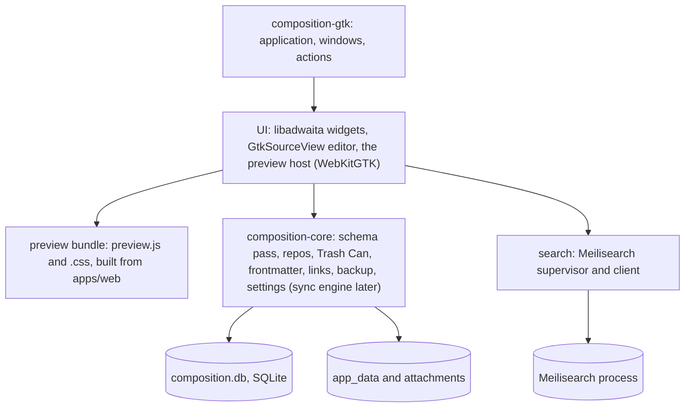

# Linux native app: design, feature tracker and compromises

A native Linux desktop app for Composition, written in Rust with GTK 4 and libadwaita (gtk-rs), made to feel at home on GNOME. This page is
the one place for the design, for which features port, and for every compromise made. **Design and spikes only: no production code is
written, and no gate has been passed.** **The Electron app, including its Linux build (`.deb` and AppImage, x64), stays the shipping plan
until you say otherwise.** Dates are 2026-11-07.

**Direction.** You decided on 2026-11-07 to go native per platform for the most native-feeling tooling on each: macOS in Swift (later, after
the iPad), Windows in C# on .NET with WinUI 3 (another session is designing it; `docs/windows-native-app-design.md` was not read here),
and Linux in Rust with GTK 4 and libadwaita. This page is the Linux half, modelled on [ipad-app-design.md](ipad-app-design.md).

**What is evidence and what is not.** Six small spikes ran (`apps/linux/spikes/`, one result note each). They ran on this Mac and in an
**Ubuntu 24.04 container** (arm64 natively, x86-64 emulated for the core only), against the libraries Ubuntu 24.04 really ships. That is
not a GNOME desktop: it has no GNOME Shell, no screen reader, no GPU, and WebKitGTK's own sandbox could not start in it. Everything that
needs those is marked **unverified**, and [What was not verified](#what-was-not-verified) lists it. Statements about libadwaita and GTK
version differences were checked against the installed headers; statements about Qt, Flathub policy and GitHub's runners are from memory.

## How to read this page

Three things are tracked: the [**feature tracker**](#feature-tracker) (every feature, what kind of work it is, whether it is in v1, how far
along), the [**compromise register**](#compromise-register) (what we give up on Linux and why) and the [**decision log**](#decisions) (what is
decided, proposed, or needs you).

| | Meaning |
|---|---|
| **Kind** | What sort of work the row is. A prediction until Status says otherwise. |
| ♻️ | **Reuse:** the web app's own code runs unchanged (the preview bundle). Nothing to port, nothing to keep identical. |
| 🔁 | **Port:** the behaviour exists in TypeScript (and Swift on the iPad) and is rewritten in Rust. The rules must match ([conformance](#keeping-the-implementations-honest)). |
| ⭐ | **Native upgrade:** GTK, libadwaita or the desktop gives something better than the web version for free or cheaply. |
| 🆕 | **New** on Linux |
| ⚠️ | **Risky:** unknown until tried on a real GNOME desktop |
| ❌ | Not on the Linux native app |
| **Plan** | **M1**, **M2** or **M3†**: the [milestone](#v1-scope-and-milestones) that builds it (**†** is release polish, first to drop) · **Later** · **Never** (a deliberate decision, see the compromise) |
| **Status** | ⬜ not started · 🔬 spiked (answer found, not built) · 🔨 built · 🖥️ verified on a real GNOME desktop · ⛔ dropped |

**Verified on a real GNOME desktop today: nothing.** A row only gets 🖥️ after a person has used it on the VM or the machine you provide.

## Summary

- **Feasible, and it works end to end in a container.** A Rust crate with no GTK in it opens the desktop's database, migrates it by the
  same `ensureColumn` rule, runs the `uuid` pass and round-trips the backup `.tar.gz`; a libadwaita window over it shows notes, search and a
  GtkSourceView editor next to a WebKitGTK preview that runs **the desktop's own MDX renderer**. All of it built and ran on Ubuntu 24.04.
- **Recommended shape (your decisions in bold):** a headless `core` crate (rusqlite, bundled SQLite, FTS5 present) under a GTK 4 +
  libadwaita 1.5 app; **GtkSourceView 5 for the editor; a WebKitGTK view, built from the web app's own `NoteMarkdown`, for the Preview
  only**; **Meilisearch bundled as on the desktop**; **GNOME first, KDE best-effort**; **`.deb` first, then Flatpak, no AppImage**.
- **The finding that most changes the picture: the memory win is not there.** With the preview on, the whole app measured **329 to 452 MB
  PSS** in the container, against the 395 MB measured for Electron on a Mac. WebKitGTK's web process alone was about 170 MB, and Meilisearch
  adds about 105 to 115 MB resident on top (a different measure). Different OS and method, so no verdict; but nothing here shows a saving, so the case for this app is **how it feels
  and what it integrates with** (libadwaita, dark mode, IME, AT-SPI, GNOME conventions), not its footprint ([C1](#compromise-register)).
- **Meilisearch is bundled exactly as the desktop does it, and the Rust twin gets the desktop's own answers.** All 274 corpus queries over
  100 and 1,000 notes matched the committed answers with 0 differences, on Linux arm64 (no network) and macOS; a hard kill and restart passed;
  the sidecar dies 54 ms after the app is killed. A Linux arm64 pin is needed and verified ([Search](#search), [S9](../apps/linux/spikes/s9-meili/RESULT.md)).
- **No third MDX port.** Because the Preview reuses the web code, the ten components, footnotes, charts and themes cost nothing to keep
  identical on Linux. That is the biggest saving of the design, and it is why the Preview stays a web view ([C3](#compromise-register)).
- **The costs that matter most:** the notes rules now exist three times in code (TypeScript, Swift, Rust) and the sync engine will be written
  again ([C2](#compromise-register)); a web view and a 121 MB search sidecar stay in a "native" app ([C3](#compromise-register),
  [C4](#compromise-register)); WebKitGTK's sandbox is untested on a real Ubuntu 24.04 ([R1](#risks-and-unknowns)).
- **The conformance corpus is on `main` now, in two places, and it caught the Rust core falling behind.** The iPad PR (#247) landed
  `apps/ios/conformance/` and its generator; the PDF PR (#267) landed `fixtures/conformance/` with the PDF tables. When `main` then gained the
  PDF tables, three more `uuid` tables and a `documents/` folder in backups, the Rust schema test failed and the desktop's own `db.ts`
  found work to do in a Rust-made file; the core was brought level (13 of 13 tests on macOS, the desktop accepts everything Rust writes).
  Nothing was copied or invented ([Conformance](#keeping-the-implementations-honest)).
- **The Live tab is in v1 on Linux too (you, 2026-11-09), as on the iPad.** S8's six open items are now schedule, not a question ([D24](#decisions), [C10](#compromise-register), [R7](#risks-and-unknowns)).
- **Needs you:** which of two homes the corpus keeps ([D12](#decisions)), a real **Ubuntu 24.04 VM** for Gate B (decided; yours to provide), and
  Gate A. [D19](#decisions) is a question for later.

## Goals and non-goals

**Goals** (proposed)

1. Read and write notes on Linux in the same Markdown, with the same MDX components, as the other products.
2. **Feel native on GNOME** ([the native bar](#the-native-bar-on-gnome)): libadwaita, system dark mode, IME, AT-SPI, system fonts.
3. Local-first and offline, on **the same `~/.composition/composition.db`** the Electron app and the CLI use: either side can open a
   database the other touched ([data layer](#the-data-layer)).
4. **One schema and one note format.** The Linux app does not invent its own.
5. Move data between devices without loss, at minimum by backup and restore.
6. Be testable without a screen: the core and its conformance run anywhere Rust builds.

**Non-goals for v1**

- The sync engine, sign-in and server ([D17](#decisions): later, from [cross-device-sync-design.md](cross-device-sync-design.md)).
- The To-do, RSS Reader, Contacts and AI helper plugins; the panel grid and pop-out windows ([C8](#compromise-register), [C9](#compromise-register)).
- KDE-specific polish, Qt, AppImage, an in-app updater ([C5](#compromise-register), [C6](#compromise-register), [C11](#compromise-register)).
- Replacing the Electron Linux build.

**Already decided by you**

| | |
|---|---|
| Design before code | Nothing is built until you pass Gate A. |
| **Native per platform; Linux = Rust + GTK 4 + libadwaita (gtk-rs)** | Stated 2026-11-07, for the most native-feeling tooling. |
| The Electron Linux build stays the shipping plan | Until you say otherwise. This app ships beside it, never in its place ([D2](#decisions), [D21](#decisions)). |
| **GNOME on Ubuntu is the target; KDE best-effort** | 2026-11-07 ([D3](#decisions)). |
| **The Preview is WebKitGTK running the desktop's own renderer** | 2026-11-07 ([D4](#decisions)). |
| **Search: Meilisearch, bundled, as the desktop does** | 2026-11-07, over my recommendation of FTS5 ([D5](#decisions)). |
| **Packaging: `.deb` first, Flatpak second, no AppImage** | 2026-11-07 ([D6](#decisions)). |
| **Test hardware: an Ubuntu 24.04 VM on this Mac now, a physical x86-64 machine before release** | 2026-11-07 ([D7](#decisions)). |
| One run with WebKitGTK's sandbox off, in a throwaway container | 2026-11-07, done ([D8](#decisions)). |
| **The Live tab is in v1, as on the iPad** | 2026-11-09 ([D24](#decisions)), over S8's recommendation. A milestone between M1 and M2; it may ship reduced. |
| The core is a crate of its own, apart from the GTK UI | Stated in the brief ([D10](#decisions)). |

## What the app is today

Facts that drive the design, checked against `main` (`da75aa3`).

| Fact | What it means for a native Linux app | Source |
|---|---|---|
| **A note is Markdown text in a SQLite row** (`notes.content`, frontmatter included); images are files in `app_data/`, attachments in `attachments/`. | Same model; the Rust core opens the same file. | [data-model.md](architecture/data-model.md) |
| **Ids are `INTEGER PRIMARY KEY AUTOINCREMENT`, and every note, group, notebook, trashed item and attachment also has a `uuid`** (a trigger fills it, a unique index enforces it, the Trash Can carries it). | The Rust core must run the same pass, leave the `uuid` out of its inserts and carry it through the Trash Can. | [data-model.md](architecture/data-model.md#identity-the-uuid-column), [db.ts](../apps/web/src/lib/composition/db.ts) |
| **Schema changes are additive `ensureColumn` checks** run on every open, and WAL is on. | Reproduced in Rust and shown to be a no-op in both directions ([S1](../apps/linux/spikes/s1-core/RESULT.md)). | [db.ts](../apps/web/src/lib/composition/db.ts) |
| **The preview is `NoteMarkdown`**: react-markdown with remark and rehype plugins and the ten `mdx/` components, with a restricted MDX layer. | Reused as a bundle in a WebKitGTK view instead of ported ([S5](../apps/linux/spikes/s5-preview/RESULT.md)). | [NoteMarkdown.tsx](../apps/web/src/components/notes/NoteMarkdown.tsx) |
| **Two writing surfaces:** the Markdown tab (a `<textarea>` with a colour overlay) and the Live tab (CodeMirror 6, marks shown only at the caret). | A native editor needs no overlay. The Live tab is the hardest feature ([C10](#compromise-register), [S4b](../apps/linux/spikes/s3-shell/RESULT.md)). | [MarkdownEditor.tsx](../apps/web/src/components/notes/MarkdownEditor.tsx), [live-editor-parity-plan.md](live-editor-parity-plan.md) |
| **Search is a Meilisearch child process** (random port, master key in a 0600 file, rebuilt from SQLite at start, an index of its own per app). The lock file pins `linux-x64` only. | Kept ([D5](#decisions)); the supervision and the index code are ported to Rust; an arm64 pin must be added ([Findings](#gaps-found-to-report)). | [search.md](architecture/search.md), [meili.ts](../apps/desktop/src/main/meili.ts), [meilisearch.lock.json](../apps/desktop/meilisearch.lock.json) |
| **The Electron Linux build exists:** `.deb` and AppImage, x64, unsigned, `executableName: composition-desktop`, `appId: com.rushinglabs.composition`; the `.deb` is updated by hand and the AppImage updates itself; the CLI is bundled in `resources/cli`. | The native app needs another executable name (`composition` is the CLI's) and another app id ([D14](#decisions)). | [electron-builder.yml](../apps/desktop/electron-builder.yml), [product-builds.md](product-builds.md) |
| **Data lives in `~/.composition`**, whose location the desktop and the CLI agree on through `~/.composition-location.json`; settings are per product. | The native app reads that agreement and keeps its own settings file ([D15](#decisions), [D16](#decisions)). | [product-builds.md](product-builds.md) |
| **The panel grid, pop-outs and their store are desktop-only** (a React store shared by several windows). | Not ported; GTK windows do the job ([C8](#compromise-register)). | [panel-system-plan.md](panel-system-plan.md) |
| **Backup is one `.tar.gz`** (manifest, `settings.json`, a `VACUUM INTO` snapshot, `app_data/`, `attachments/`), restored in two strict steps. | Round-tripped both ways ([S1](../apps/linux/spikes/s1-core/RESULT.md)). | [backup-restore.md](architecture/backup-restore.md) |
| **Sync is designed, not built.** The `uuid` landed; the capture triggers, `sync_outbox` and `sync_*` tables did not; a self-hosted server exists in `apps/sync-server/`. The engine is to run in the desktop app and the iPad app, not in the CLI. | Linux needs its own engine, later ([D17](#decisions)). | [cross-device-sync-design.md](cross-device-sync-design.md) |
| **Plugins:** To-do (with its weekly cycle), Reading List (a sandboxed `<webview>`), RSS Reader, Contacts, and the AI helper (Ollama, and ChatGPT through a sign-in on `http://127.0.0.1:1455`). | All Later ([C9](#compromise-register)); the Reading List and the ChatGPT redirect are easier on Linux than on the iPad. | [feature-matrix.md](feature-matrix.md) |

## Options considered

| | Option | Verdict |
|---|---|---|
| O1 | **Keep Electron on Linux only** | The shipping plan today and the baseline. Kept, per your decision. |
| O2 | **Rust + GTK 4 + libadwaita, WebKitGTK for the Preview only** | Meets "native on GNOME". **Recommended, and decided.** |
| O3 | **GTK shell around the whole web UI in WebKitGTK** (a Tauri-like thin shell) | Reuses everything, including the editor, so IME, spelling and accessibility would be a web view's. Not native. Rejected. |
| O4 | **Native GTK rendering of Markdown and MDX** (parse in Rust, draw widgets, as the iPad and Windows do) | The most native and the one that drops the web view. A third MDX port and ten components. **Rejected for v1 by you; the way out if the sandbox or the footprint bites.** |
| O5 | **Qt 6** (Kirigami or Widgets, with the Rust core underneath) | Right on KDE, foreign on GNOME. See [KDE](#which-linux-desktops-count). Not chosen. |
| O6 | **Electron with GTK-like theming** | Not native. Rejected. |

## Which Linux desktops count

**Decided (2026-11-07, you): GNOME is the target, KDE is best-effort.** The acceptance desktop is **GNOME on Ubuntu 24.04** (the floor);
the same binary is checked on **Ubuntu 26.04** and **Fedora 45 Workstation** (the ceiling). The app runs on KDE Plasma, looks like a GTK app
there, and no KDE-specific bug blocks a release.

**What Qt would change** (not researched or spiked; from general knowledge): a second UI toolkit and a second set of widgets, an editor
(`QPlainTextEdit` or KDE's KTextEditor) with its own IME and accessibility behaviour, a web view that is Chromium (Qt WebEngine) or an
older WebKit instead of WebKitGTK, and a different packaging story. The Rust core, the corpus and the data layer are reused unchanged.
So Qt costs **a second UI and a second acceptance test, not a second implementation of the rules**. If KDE users turn out to matter, that is
the shape of the extra work.

## Languages and dependencies

The policy is the iPad's: **the newest language that reaches the API, and no more.**

| Language | Use |
|---|---|
| **Rust** (stable; 1.97.1 in the spikes; Ubuntu's own `rustc` is 1.75 and too old, so the app is built with rustup) | The core and the app |
| **C and C++** | Only through the system libraries gtk-rs binds (GTK, libadwaita, GtkSourceView, WebKitGTK, SQLite when bundled). None is hand-written |
| **TypeScript** | The preview bundle, built from `apps/web`'s own source with the Vite already installed there (no new dependency) |
| **JavaScript** | Nothing else; the bridge is a few lines in the bundle's entry |

**Crates** (spike versions, exact, with `Cargo.lock` checked in; each needs a licence row at adoption, as the desktop's
`collect-licenses.mjs` does):

| Crate | For | Notes |
|---|---|---|
| `gtk4` 0.11, `libadwaita` 0.9 (feature `v1_5`), `sourceview5` 0.11, `webkit6` 0.6 (feature `v2_42`) | The UI | gtk-rs; `v1_5` makes the compiler refuse anything newer than Ubuntu 24.04's libadwaita |
| `rusqlite` 0.41 with `bundled` | SQLite 3.54.1, FTS5 | System SQLite also tested: 3.45.1 on Ubuntu 24.04 |
| `flate2` 1.1 (pure-Rust backend), `tar` 0.4 | Backup | No C zlib needed |
| `serde`, `serde_json`, `sha2`, `thiserror`, `unicode-normalization` | Settings, backup, errors | |
| `ureq` 3.5.1 (blocking HTTP), `libc` (signals, `prctl`) | The Meilisearch sidecar ([S9](../apps/linux/spikes/s9-meili/RESULT.md)) | The ten REST calls were written by hand; whether to use `meilisearch-sdk` instead is open |
| A YAML reader | Later | The iPad hand-wrote its YAML for `js-yaml` rules |

Supply chain, in line with [SECURITY.md](../SECURITY.md): exact versions, a locked tree, `cargo deny` or `cargo audit` in CI, and every new
`uses:` in a workflow pinned to a commit SHA ([AGENTS.md](../AGENTS.md)).

**Versions the floor is set by**, from the package managers in containers ([container/RESULT.md](../apps/linux/spikes/container/RESULT.md)):

| | Ubuntu 24.04.5 | Ubuntu 26.04.1 | Fedora 45 |
|---|---|---|---|
| GTK 4 | 4.14.5 | 4.22.4 | 4.24.1 |
| libadwaita | 1.5.0 | 1.9.1 | 1.10.0 |
| WebKitGTK 6.0 | 2.52.6 | 2.52.6 | 2.54.2 |
| GtkSourceView 5 | 5.12.0 | 5.18.0 | 5.22.0 |

**What the floor (libadwaita 1.5) has and lacks**, checked in the installed headers: it **has** `AdwDialog`, `AdwAboutDialog`,
`AdwPreferencesDialog`, `AdwNavigationSplitView`, `AdwOverlaySplitView`, `AdwToolbarView`, `AdwBreakpoint`, `AdwTabView`, `AdwTabOverview`,
`AdwToastOverlay`, `AdwBanner`. It **lacks** `AdwSpinner`, `AdwToggleGroup`, `AdwBottomSheet`, `AdwMultiLayoutView`, `AdwWrapBox`,
`AdwShortcutsDialog` and the **accent-colour API** (so no system accent colour on 24.04, [C7](#compromise-register)). GTK 4.14 has
`GtkFileDialog`, `GtkUriLauncher` and `GtkAccessibleText` but no `GtkShortcutsDialog` (use `GtkShortcutsWindow`).

## Proposed architecture

**Layout (proposed):** `apps/linux/`, a Cargo workspace beside `apps/cli`, `apps/desktop` and `apps/web`: `crates/core` (promoted from the
S1 spike; imports no GTK), `crates/app` (GTK), `preview/` (the Vite entry and `build.sh`, from S5), `data/` (desktop entry, AppStream
metainfo, icons, GResource), `packaging/` (`.deb`, Flatpak). The core builds and tests on a Mac without a display, which is what the
spikes did.

**Threads.** GTK's main thread only draws and handles input. The core is a synchronous library; the app calls it from one store thread
(a writer) and a small reader pool over WAL, and returns results to the main loop. The spike called the core from the main thread, which
is fine for a spike and not for 5,000-line notes or a backup restore.

### The data layer

[S1](../apps/linux/spikes/s1-core/RESULT.md) is the evidence for everything in this section.

- **Same schema text, same pass.** `ensureColumn` on every open, in `db.ts`'s order; the six `uuid` tables get the column, the
  `AFTER INSERT ... WHEN NEW.uuid IS NULL` trigger and the unique index in one immediate transaction, then a 200-row backfill; `adoptOrphans`.
  The schema made from nothing is **byte-identical** to the desktop's (including the odd indentation of the trigger text, which
  `sqlite_master` keeps). The pass on a desktop-populated database commits nothing, and the desktop's real `db.ts` finds nothing to do in a
  database Rust touched.
- **What it must also do** (not yet built): leave the `uuid` out of inserts; carry it through the Trash Can both ways; keep it out of the
  search index and the interface ([data-model.md](architecture/data-model.md#identity-the-uuid-column)).
- **Change capture.** The `sync_outbox` triggers and `sync_*` tables are not on `main`, so there is nothing to port. The iPad's fallback
  applies: start from the `uuid`, and add the capture triggers as another `CREATE ... IF NOT EXISTS` block when they land (before Gate A:
  take them).
- **Backup.** `tar` and `flate2`, streaming. The core restores the desktop's real 14 KB and 20 MB backups with every `uuid`, title and
  file hash intact, writes archives that plain `tar` lists and the desktop's real `stageBackup` restores, and refuses 13 hostile or broken
  archives leaving nothing behind. Restoring and re-creating the 20 MB backup peaked at 10 MB of memory.
- **SQLite, and FTS5.** Asked of the library each build linked: bundled 3.54.1 and Ubuntu 24.04's system 3.45.1 both have FTS5,
  `fts5vocab`, the trigram tokenizer and `unicode61 remove_diacritics 2` with prefix indexes. **Recommendation: `bundled`**, so the app does
  not depend on what a distribution built. Fedora's SQLite is **unverified**. With Meilisearch decided, FTS5 is only the fallback
  ([Search](#search)).
- **Three platforms.** 13 of 13 core tests on macOS arm64 and Ubuntu 24.04 arm64 (bundled and system SQLite), rerun on 2026-11-09 against `main`'s current files; 12 of 12 on Ubuntu 24.04 x86-64 (emulated) before `main`'s PDF tables, **not rerun** since.
- **Other writers.** The Electron app and the CLI write the same file. WAL and a 5-second busy timeout (what `better-sqlite3` waits) cover
  that; the app polls `PRAGMA data_version` to notice another writer's edits, as the sync design proposes for the CLI.
- **Location and settings.** The app opens `~/.composition` unless `~/.composition-location.json` says otherwise, writing that file only
  when it moves the data ([D16](#decisions)). Its own settings are a JSON file in the format `parseWebSettings` reads (the iPad's
  `settings-cases.json` already tests it), under the XDG config directory, not GSettings, so a backup carries them ([D15](#decisions)).

### Keeping the implementations honest

The rules (ordering, Trash Can, notebook invariants, frontmatter, backup, search parsing, typing aids, and later sync) now exist in
TypeScript, Swift and Rust, and in C# on Windows. The guard is the shared corpus proposed in the iPad doc.

**What exists (2026-11-09, on `main`):** two homes, from two PRs that both merged after this branch was cut.

- **The iPad's corpus** is `apps/ios/conformance/` (PR #247): 13 JSON files (about 1.1 MB) and a showcase note with two images, plus the
  generator `apps/web/scripts/ios-conformance-fixtures.test.ts`, which runs the desktop's real code over those cases and writes the databases,
  backups and expected results the Swift tests read.
- **`fixtures/conformance/`** (PR #267) has a README and `pdf/` fixtures only (the PDF tables). Its README says the rest of the proposed
  corpus "is not here yet".

**I did not copy anything, fork it, or write a corpus of my own.** The Rust tests read the iPad's files through the same variable the Swift
tests use, `COMPOSITION_CONFORMANCE_DIR`, and [`s1-core/run.sh`](../apps/linux/spikes/s1-core/run.sh) runs the generator from this repository.

**The corpus did its job.** Merging `main` into this branch brought in `DOCUMENTS_SCHEMA` (three tables), three more `uuid` tables
(`documents`, `pdf_annotations`, `pdf_bookmarks`) and a `documents/` folder in backups. Rerunning S1 against it: the Rust schema test failed
(the schema was no longer the desktop's), and the desktop's real `db.ts` found work to do in the databases Rust had made (4 of 5 checks
failed). The core was updated in three places (the table text copied from `db.ts`, the `uuid` list, `documents/` in `create`, `stage` and
`apply` with a `documents` count) and passes again: **13 of 13 Rust tests, 6 of 6 desktop-side checks**. A desktop backup that holds a PDF
would have been refused by the old Rust (`documents/...` is an unknown file); that is the kind of drift the corpus exists to find.

| Corpus part | Covered by the Rust spike | |
|---|---|---|
| `desktop-empty.db`, `desktop-populated.db` (schema, the pass is a no-op) | Yes | S1 |
| `desktop-backup*.tar.gz` and its expected files, both directions | Yes (the other direction is `tools/rust-fixtures.test.ts`, the desktop's real `stageBackup`). **Neither backup holds a PDF**, so a PDF-bearing backup is tested with one built in the Rust tests, not from the corpus | S1 |
| `fixtures/conformance/pdf/` (the PDF tables, validation, scripts) | **No**: not needed until the Linux app has a PDF reader (a Later row) | |
| `search-queries.json`, `search-parse-expected.json`, `search-expected.json`, the two corpus databases | Yes (272 queries, parser identical; the iPad's acceptance bar met) | S2 |
| `trash-script.json`, `store-script.json` (every operation, every row after each step) | **No**: build step 2 | |
| `frontmatter-cases.json`, `settings-cases.json`, `images-cases.json`, `organization-cases.json` | **No** | |
| `editing-cases.json` (completions, props, snippets, indent, emphasis, note links) | **No**: the native editor must port these (M2) | |
| `mdx-notes.json`, `component-cases.json`, `appearance-expected.json` | **Not needed for the Preview**, which runs the web code. Needed only for the colour schemes' tokens, which the Rust side re-expresses | |

**Gaps to report, not filled:** (1) the corpus has two homes, the iPad's under an iPad-specific path with `IOS_` variable names and `fixtures/conformance/` holding only the PDF tables; (2) the generator's "reads what the Swift core wrote" half has no Linux twin except my `tools/rust-fixtures.test.ts`, a second TypeScript file that should be one generalised file once the corpus has one home; (3) **no backup in the corpus holds a PDF**, so the `documents/` folder is untested by it; (4) there is no corpus for the capture triggers, the outbox or sync yet; (5) nothing in it is Linux-specific (XDG paths, the Flatpak home permission). Choosing the one home is [D12](#decisions).

### Editor and preview

**What is native and what is a web view.**

| Part | Native or web | Notes |
|---|---|---|
| Window, header bars, sidebar, lists, dialogs, preferences, menus, About, shortcuts window | **Native** (libadwaita) | |
| Navigation, back and forward, search entry | **Native** | `AdwNavigationSplitView`, `GtkSearchEntry` |
| Text editing, caret, selection, input method, spelling, accessibility of the editor | **Native** (GtkSourceView 5) | |
| **The Preview** | **WebKitGTK**, running `NoteMarkdown` | Exception E1 ([D4](#decisions)) |
| Charts, `<Info>`, `<Warning>`, `<Toc>`, `<Mark>`, footnotes, diagrams, `<Repo>`, `<YouTube>` | Inside the Preview | Shared code |
| The preview's right-click highlight menu | **Native** menu | WebKit's `context-menu` signal; replaces `PreviewHighlightMenu` |
| Find in the editor, find in the preview | Native search bar; WebKit's `FindController` | `webkit_find_controller_search` is in 2.52.6 |
| The draw.io editor | A WebKitGTK window on its own origin | Exception E2, **Later** |
| The Reading List page | A WebKitGTK view with its own ephemeral session | Exception E3, **Later** |
| ChatGPT sign-in | The system browser | Not our own web view |

**Why a web view for the Preview, and why it holds up.** The Preview is where the MDX components live, and they are expensive to rebuild
(charts, diagrams, footnotes, Toc, ten tags with a restricted parser). Reusing the web code gives Linux **the same output with no
conformance burden for MDX**. [S5](../apps/linux/spikes/s5-preview/RESULT.md) shows it works: `entry.tsx` imports the web app's own
`NoteMarkdown` and `NoteLinksProvider`, Vite 8 (already in `apps/web`) builds it to **2.0 MB (616 KB gzipped) of JS and 123 KB of CSS**,
the shared showcase note renders in jsdom, in a Chromium pane, and in **WebKitGTK 2.52.6 inside the libadwaita window**, in dark and light:
every component drew (charts, Toc, the Info and Warning panels, `<Mark>`, footnotes with back-links, images, the `<Drawio>` PNG, the `<Repo>` card, a
table, highlighted code) **except the `<YouTube>` player**, which needs the network the container run did not have. The `.desktop.ts` variants are preferred when
bundling, so `imageUrl.desktop.ts` yields `app://composition/app_data/<name>`: the shell registers an `app` URI scheme on its `WebContext`
and serves the page, the bundle and the images (only names the core's `is_image_name` accepts), and the web code needs **no fork**.
The bridge is `UserContentManager` messages one way and `evaluate_javascript` the other.

**What it costs.** The web view is an exception to the native bar ([C3](#compromise-register)); its sandbox and AppArmor behaviour on a real
Ubuntu 24.04 are unverified ([R1](#risks-and-unknowns)); its web process is about 170 MB; Orca's reading of web content in the view is
unverified; and the desktop's wrappers around `NoteMarkdown` (frontmatter card, heading rail, highlight menu, find) need native or bundle
counterparts.

**The editor widget: GtkSourceView 5** (5.12 on Ubuntu 24.04), a `GtkTextView` with undo, a Markdown language definition, Adwaita style
schemes and a completion framework. What the container showed ([S4](../apps/linux/spikes/s3-shell/RESULT.md)):

| Question | Result |
|---|---|
| Accessibility | `GtkTextView` and `GtkSourceView` implement `GtkAccessibleText`; over AT-SPI the editor is one editable, multi-line, focusable `text` node whose content, caret and count are readable; the sidebar is a `list` of named `list item`s. **Orca itself: unverified** |
| Input method | IBus with `ibus-hangul` on X11 composed `gksrmf` into `한글 ` in the editor, read back through AT-SPI. **Wayland (text-input-v3), Fcitx 5 and other engines: unverified** |
| Spelling | Not tried. 24.04 ships `libspelling` 0.2.0 and `gspell` 1.12.2; whether a Rust binding exists for either was **not checked** |
| The Live tab (**in v1**, you, 2026-11-09) | Hiding marks with `invisible` tags by construct works ([S8](../apps/linux/spikes/s8-live/RESULT.md)): copy gives the Markdown, undo restores it, IBus Hangul composes inside a revealed construct, a screen reader is given the visible text, and a caret move costs 0.05 ms in a 5,000-line note. `End` and Left at a construct's right edge land before the hidden marks, and overlay pictures and rules were misplaced in the middle of the long note ([C10](#compromise-register)) |

### Search

**Decided (2026-11-07, you): Meilisearch, bundled, exactly as the Electron app and the Windows design do** ([D5](#decisions)). The earlier
FTS5 recommendation is kept as evidence only ([S2](../apps/linux/spikes/s1-core/RESULT-search.md)); nothing in the plan depends on it.

**It is the same mechanism, step for step, and S9 ran it** ([S9](../apps/linux/spikes/s9-meili/RESULT.md): a Rust twin of `meili.ts` and
`searchIndex.ts`, on Linux arm64 with no network and on macOS):

| | Same as the desktop |
|---|---|
| **The binary** | The community build pinned in `meilisearch.lock.json` (version, asset name, SHA-256, size), fetched and verified by the same rule (delete on a digest mismatch), never an `enterprise` asset. In a package it sits beside the app, as `electron-builder` puts it in `meilisearch/` |
| **The process** | A random loopback port; the master key in a `0600` file and in the environment, never argv; `MEILI_ENV=production`; `--db-path`, `--dump-dir`, `--snapshot-dir`, `--no-analytics`; the state folder as the working directory; a pid file and a reaper that kills only a process whose command line names our data folder; a health poll (143 to 317 ms to healthy); `SIGTERM`, then `SIGKILL` |
| **The index** | One index `notes`, primary key `id`; searchable `title, content, description`; filterable `tags, created_at_ts, updated_at_ts`; sortable `updated_at_ts`; the same document shape and the same query |
| **The result** | **All 274 corpus queries over 100 and over 1,000 notes returned the committed Meilisearch answers with 0 differences** (same ids, same order), on both platforms; a hard kill in the middle of indexing, a restart and a rebuild passed |

**What S9 added or found, for the build:**

- **Feed documents in `DISPLAY_ORDER`** (`position IS NOT NULL, position, updated_at DESC, id DESC`, what `listNotes()` returns). Meilisearch
  breaks ties by the order it was given the documents; loading by id changed the order of 203 of 274 answers.
- **Ask for `id` only** (`attributesToRetrieve`). The desktop's query returns whole notes it discards; on Linux that made a median query
  **44 to 47 ms** in the Rust client instead of **0.6 to 0.9 ms**, with identical answers. Whether the TypeScript client pays the same on
  Linux is unverified.
- **`PR_SET_PDEATHSIG`**: the sidecar was gone **54 ms** after the app was `SIGKILL`ed, which the Electron app cannot do (it reaps an orphan at
  its *next* start). It must be spawned from the main thread; the pid-file reaper stays as the second line. This is the Linux counterpart of
  the Windows design's Job Object, which has only been compiled.
- **Memory of the sidecar:** 61 to 70 MB right after start, **105 to 115 MB** resident after indexing 1,000 notes, and a **transient of about
  550 MB while indexing**. The 923 MB peak measured on the Mac earlier was for a different workload and was not reproduced.
- **A Linux arm64 pin is needed and was verified:** `meilisearch-linux-aarch64`, 127,575,104 bytes, SHA-256
  `c156cbf7914c7af737422bcb60196366e9f9680a7ebd19ea5fd78fdaf7ac1256`, from GitHub's digest (the `linux-amd64` digest GitHub shows is the
  desktop's existing pin, so the field can be trusted). `meilisearch.lock.json` and its validator (which accepts only `mac-arm64`,
  `mac-x64`, `linux-x64`) need a `linux-arm64` entry; **neither was edited**. The native app reuses that one lock, as the Windows design does.
- **In a `.deb`:** one binary per architecture, beside the app (for example `/usr/lib/composition-gtk/meilisearch/meilisearch`), found
  relative to the executable; the amd64 package carries `linux-amd64`, the arm64 package `linux-aarch64`.
- **Where its state lives:** a `search/` folder under the XDG data directory (`meili_data`, `dumps`, `snapshots`, the key, the pid file and the
  log), the shape of the desktop's `Application Support/Composition/search`, and **never shared with the Electron app's** ([D23](#decisions)).
- **Licences:** the MIT text ships as the desktop's `licenses/meilisearch-LICENSE-MIT.txt` does, and the desktop's own warning applies unchanged:
  the Meilisearch **Rust-crate licence list is not generated yet, which its build calls a release blocker for a public release**.
- **The same behaviour as the desktop** (typo tolerance and ranking), which the iPad does not have, and **the same drift**: the native app and
  the Electron app each own an index, so an edit in one is missing from the other's search until it rebuilds
  ([product-builds.md](product-builds.md#search-index-drift-between-the-apps)).
- **Not covered:** x86-64 Linux (the amd64 binary was never run), a `.deb` or Flatpak sandbox, AppArmor, a Rust client crate (the ten REST calls
  were written by hand over `ureq`), and starting it from the GTK app.

**The fallback evidence** ([S2](../apps/linux/spikes/s1-core/RESULT-search.md)): FTS5 plus the iPad's typo layer, ported to Rust, also met the
iPad's acceptance criteria on the first run, with no sidecar. It is not planned work; reopening [D5](#decisions) is yours.

### App structure, windows and themes

- **Navigation:** `AdwNavigationSplitView` with an `AdwBreakpoint` so it collapses at narrow widths (the spike set none and did not
  collapse at 720 px). The sidebar holds a notebook switcher, favorites and the group tree (`GtkListView` over a `GtkTreeListModel`); the
  content holds the note. Home page as the landing view ([M3†](#feature-tracker)). Back and forward on `Alt+Left` and `Alt+Right`.
- **Windows:** one note per window; "Open in New Window" from the note's menu; no panel grid ([C8](#compromise-register)).
  `AdwTabView` and `AdwTabOverview` (both in 1.5) are the route if tabs are wanted later.
- **Themes:** a **System** scheme is the default and follows GNOME's light and dark live through `AdwStyleManager` (forced either way in
  the spikes, never changed through the system setting: unverified). The five colour schemes become a CSS provider over libadwaita's named
  colours, custom GtkSourceView style schemes, and the preview's `data-theme`. "Follow the sun" ports `sunTimes.ts`. There is no system
  accent colour on Ubuntu 24.04 (libadwaita 1.5).
- **Fonts:** the system font and the system monospace font by default; the desktop's open-source choices as options.
- **Keyboard:** `GtkShortcutsWindow` on `Ctrl+?` replaces the shortcuts helper; GNOME's text-editing keys come with GTK.
- **System integration:** a desktop entry and AppStream metainfo; `GtkFileDialog` and `GtkUriLauncher` (portal-aware when sandboxed);
  drag and drop with `GtkDragSource` and `GtkDropTarget`, including images from Files and the browser; pasting an image from the clipboard;
  a GNOME Shell search provider for notes (**Later**, ⭐, the counterpart of the iPad's Spotlight).
- **Identity:** application id `com.rushinglabs.Composition`, executable `composition-gtk` (proposed; `composition` is the CLI's and
  `composition-desktop` is Electron's). The id is effectively permanent after release ([D14](#decisions)).

### Sync and the data model

**Proposed: v1 is backup and restore, built sync-ready**, as on the iPad ([D17](#decisions)). The `uuid` has landed; the capture triggers, the
outbox and `sync_*` tables have not, so the iPad's fallback applies. The sync engine, when it comes, runs **inside the Rust app** (not the
CLI) and is **one more copy of the sync rules** after the desktop's TypeScript and the iPad's Swift: the server's contract suite
(`apps/sync-server/protocol/contract/`) and the corpus are what keep it honest, and this is the place where a shared Rust core would pay
most ([D19](#decisions)).

## The native bar on GNOME

"Feels native on GNOME" needs a test, or it becomes an opinion. The app claims native when these hold. They become the acceptance test at
Gate B (VM) and Gate C (a physical machine); the last column says whether a container could check anything.

| # | Criterion | How it is checked | Container | Status |
|---|---|---|---|:-:|
| N1 | **libadwaita, not imitation:** `AdwApplicationWindow`, `AdwHeaderBar`, `AdwNavigationSplitView`, `AdwPreferencesDialog`, `AdwAboutDialog`; no custom chrome | Review of the widget tree; a screenshot beside GNOME Text Editor on the same VM | Partly (screenshots) | ⬜ |
| N2 | **Dark and light follow the system, live:** change GNOME Settings while the app runs; the editor, preview and charts follow without a restart; the five schemes still selectable | VM, both directions | No | ⬜ |
| N3 | **Accent colour and high contrast:** high contrast follows; the accent colour does not exist on 24.04 and is checked on 26.04 and Fedora | VM, then 26.04 and Fedora | No | ⬜ |
| N4 | **HiDPI and fractional scaling:** 100 %, 125 %, 150 % and 200 % on Wayland, `GDK_SCALE` on X11; icons, text and the preview crisp | VM at each scale; screenshots | Partly (scale 1 and 2 ran) | ⬜ |
| N5 | **Wayland and Xorg:** correct in both Ubuntu sessions: window controls, clipboard images, drag and drop between apps, portals | VM, both sessions | Partly (Xvfb and Weston ran) | ⬜ |
| N6 | **Accessibility:** Orca reads the sidebar, the list, the editor (text, caret, selection) and every dialog; every control has a name; every function works from the keyboard; focus is visible; the preview's content is readable by Orca | Orca on the VM; `container/atspi_dump.py` as a regression check | Partly (the tree) | ⬜ |
| N7 | **Input methods:** Japanese, Chinese and Korean by IBus on Wayland and Xorg; Compose and dead keys; the emoji picker; Fcitx 5 best-effort | VM, each engine | Partly (one engine, X11) | ⬜ |
| N8 | **System fonts and text scaling:** `font-name`, `monospace-font-name` and Settings' text scaling respected; CJK and emoji fall back | VM | No | ⬜ |
| N9 | **GNOME conventions:** launcher entry and dock icon match the window; About; shortcuts window; preferences; the primary menu; middle-click paste; `Ctrl+Shift+U`; the context menu with spelling suggestions | VM | No | ⬜ |
| N10 | **Adapts:** down to 360 px with the sidebar collapsing; maximised and tiled windows | VM, resizing | No | ⬜ |
| N11 | **Performance (proposals):** a usable note list within about a second of launch; typing in a 5,000-line note with no visible lag; scrolling the preview; idle memory (a target set after the first real measurement) | VM, then the physical machine | No | ⬜ |
| N12 | **Install and removal:** the `.deb` installs on a clean VM and starts from the launcher; Meilisearch dies with the app; removal leaves the data | Clean VM | Partly (the sidecar dies with a killed app, S9) | ⬜ |
| N13 | **Web views only where listed** (E1 Preview, E2 draw.io editor, E3 Reading List), **with the WebKitGTK sandbox on** | Review; the sandbox checked on the VM | No | ⬜ |
| N14 | **Data safety:** a save survives killing the app mid-typing; the Electron app and the CLI can open the database afterwards | Kill and relaunch; open in each | Partly (the core) | ⬜ |

## v1 scope and milestones

**Proposed:** v1 is the full notes editor without plugins, **with the Live tab** (you, 2026-11-09, as on the iPad), in four milestones. M1 and M2 are builds you install on the VM
(Gate B) and the machine; M3 hardens and ships them. **It ships beside the Electron build as a "native preview"** ([D21](#decisions)).

| Milestone | What | Installed as |
|---|---|---|
| **M1: usable notebook** | The sync-ready store; notebooks, groups, notes, Trash Can and favorites; the Markdown, Preview and Split tabs; Meilisearch search; images (paste, picker, files); the MDX components through the preview; the five schemes plus System; backup and restore; accessibility and IME basics | A `.deb` on the VM. **Pre-v1** |
| **ML: the Live tab** | Construct-level reveal, headings drawn large, pictures and rules that stay put, the cursor keys fixed at a construct's edge, range-based re-reading, the mouse, a real line parser; the six open items of [S8](../apps/linux/spikes/s8-live/RESULT.md). **May ship reduced** (pictures and rules as dimmed text) | A `.deb` on the VM, checked at **Gate L**. **Pre-v1** |
| **M2: writing parity** | Typing aids (`<` completions, `[[` picker, Tab indent), `<Mark>` highlighting in the editor and the preview, find in a note, spelling, attachments, the Images page, application data location, open in a new window, the draw.io editor (E2) once a spike shows the vendored editor works in WebKitGTK | A fast-follow `.deb`. **Pre-v1** |
| **M3: first release** | M1 and M2 hardened: the † rows, the native-bar audit on the physical machine, the manual test page, `.deb` for x64 and arm64 in GitHub Releases, then a Flatpak | The first release, as a native preview |

**If the schedule bites, the Live tab ships reduced before anything on the cut line goes:** pictures and rules as dimmed text (what the Markdown tab shows), and if that is still too much, the Markdown tab alone ([C10](#compromise-register)).

**Never cut:** the store, the Trash Can, backup and restore, search, the Preview, images, accessibility and the input method.

**The cut line, in the order I would drop things:** (1) the `<YouTube>` Referer handling (a link instead); (2) "Follow the sun"; (3) notebook
colours; (4) the Images page's browse view; (5) header image; (6) ruler and reflow; (7) the home page's extras; (8) the heading rail.

**Exit criteria** (proposed): **M1:** installs and runs on the VM; create, edit, search, delete and restore from the Trash Can; a backup
made on the desktop restores here and the reverse; Gates A and B passed. **ML:** the six S8 items done; keys, copy, undo, a Hangul and a Japanese composition and a 5,000-line note pass with real key events on the VM; pictures and rules stay put in the long note and memory is flat across re-reads; Orca and Wayland input checked; Gate L passed. **M2:** every M2 row at least 🔨. **M3:** the † rows done or moved
to *Later*; N1 to N14 pass on the physical machine; `docs/manual-tests/linux-native.md` run by hand.

**Distribution** ([D6](#decisions), decided).

| Stage | Route | Notes |
|---|---|---|
| M1, M2 | A `.deb` built in CI, installed on the VM | `Depends: libgtk-4-1 (>= 4.14), libadwaita-1-0 (>= 1.5), libwebkitgtk-6.0-4, libgtksourceview-5-0`, which pull the other ~140 libraries; the package carries the binary, the preview bundle, data and Meilisearch |
| M3 | GitHub Releases: `.deb` for x64 and arm64, unsigned like the Electron `.deb`, marked a native preview | Updates by hand until an apt repository exists ([C11](#compromise-register)) |
| After M3 | Flatpak | The GNOME runtime supplies GTK, libadwaita and WebKitGTK; the shared `~/.composition` needs a home-folder permission that Flathub may refuse (unverified, [R12](#risks-and-unknowns)) |
| Never | AppImage | About 250 MB of libraries before Meilisearch, WebKitGTK's helper and sandbox paths to fix up, and the user-namespace question ([container/RESULT.md](../apps/linux/spikes/container/RESULT.md)) |

**Settle before the first build:** the application id and executable name ([D14](#decisions)), the app icon (GNOME wants a full-colour icon
and a symbolic one), licence notices for the crates (`cargo about` or the like), a Linux CI job on x64 and arm64 runners (whether GitHub
offers arm64 runners for this repository is **unverified**) with every action pinned to a SHA, and the Meilisearch arm64 pin.

## Feature tracker

Sections follow [feature-matrix.md](feature-matrix.md). Compromise ids point at the [register](#compromise-register). **Update a row in the
same pull request that changes it.**

### Platform and shell

| Feature | Kind | Plan | Status | Native approach and notes |
|---|:-:|:-:|:-:|---|
| App shell, windows, lifecycle | 🆕 | M1 | 🔬 | `AdwApplication`; flush on `close-request`; spiked ([S3](../apps/linux/spikes/s3-shell/RESULT.md)) |
| Five colour schemes | 🔁 | M1 | ⬜ | CSS over libadwaita colours, GtkSourceView schemes, the preview's `data-theme`; add **System** (⭐) |
| "Follow the sun" | 🔁 | M3† | ⬜ | Port `sunTimes.ts`; needs the saved city |
| Fonts | 🔁 | M1 | ⬜ | System fonts by default; bundled families as options |
| Keyboard shortcuts and helper | ⭐ | M1 | ⬜ | `GtkShortcutsWindow` |
| Accessibility, IME, text scaling | ⭐ | M1 | 🔬 | AT-SPI tree and IBus Hangul shown in a container; the native bar N6 to N8 |
| Window translucency | ❌ | Never | ⛔ | macOS setting |
| Auto-update, Updates settings | ❌ | Never | ⛔ | The package manager or Flatpak ([C11](#compromise-register)) |
| Application data location | 🔁 | M2 | ⬜ | Folder portal; moves the files; writes `~/.composition-location.json` |
| Install command-line tool | ❌ | Never | ⛔ | The CLI is a separate download ([D20](#decisions)) |
| Command palette | ⭐ | Later | ⬜ | GNOME has no palette norm; a quick switcher if wanted |
| Developer docs viewer | ❌ | Never | ⛔ | Not in the desktop either |

### Notes and organization

| Feature | Kind | Plan | Status | Native approach and notes |
|---|:-:|:-:|:-:|---|
| Create, edit, delete notes, autosave | 🔁 | M1 | ⬜ | Debounce 500 ms plus a flush on close; a store thread |
| Frontmatter | ⚠️ | M1 | ⬜ | `js-yaml` rules (dates); a hand reader and writer, as the iPad did; `frontmatter-cases.json` |
| Groups, notebooks, favorites | 🔁 | M1 | ⬜ | Same rules; `store-script.json` |
| Trash Can (60 days) | 🔁 | M1 | ⬜ | The `uuid` carried through; `trash-script.json` |
| Drag and drop of notes and groups | ⭐ | M1 | ⬜ | `GtkDragSource` and `GtkDropTarget`; drops from Files |
| Back and forward | 🔁 | M1 | ⬜ | History plus `Alt+Left` and `Alt+Right` |
| Resizable columns | ⭐ | M1 | ⬜ | `AdwNavigationSplitView` and a `GtkPaned` for the Split tab |
| Open a note in another window | ⭐ | M2 | ⬜ | A second `AdwApplicationWindow` on the same store |
| Home page, heading rail | 🔁 | M3† | ⬜ | |
| Several notes side by side | 🔁 | Later | ⬜ | New windows meanwhile ([C8](#compromise-register)) |
| **Panel grid, pop-outs, panel commands** | ❌ | Never (v1) | ⛔ | Windows replace them; the store and the React roots are Electron's ([C8](#compromise-register)) |
| Notebook backgrounds (architect grid) | 🔁 | Later | ⬜ | Custom drawing behind the text |

### Search

| Feature | Kind | Plan | Status | Native approach and notes |
|---|:-:|:-:|:-:|---|
| Fuzzy full-text search | 🔁 | M1 | 🔬 | **Meilisearch**, bundled like the desktop ([D5](#decisions)); the Rust twin of `meili.ts` and `searchIndex.ts` matched all 274 committed answers ([S9](../apps/linux/spikes/s9-meili/RESULT.md)) |
| Search engine comes with the app | 🔁 | M1 | 🔬 | The lock-pinned community binary in the package; a Linux arm64 pin to add; the supervisor ported (S9) |
| Field filters (`tag:`, `title:`, `created:` ...) | 🔁 | M1 | 🔬 | The parser is ported and identical on 272 queries |
| Search bar | ⭐ | M1 | ⬜ | `GtkSearchEntry` in the sidebar (spiked) |
| Find in a note | ⭐ | M2 | ⬜ | GtkSourceView search context; WebKit `FindController` in the preview |
| GNOME Shell search provider | 🆕 | Later | ⬜ | |

### Writing

| Feature | Kind | Plan | Status | Native approach and notes |
|---|:-:|:-:|:-:|---|
| Markdown tab | ⭐ | M1 | 🔬 | GtkSourceView 5; colours from its Markdown language ([S3](../apps/linux/spikes/s3-shell/RESULT.md)) |
| Preview tab | ♻️ | M1 | 🔬 | The preview bundle in WebKitGTK ([S5](../apps/linux/spikes/s5-preview/RESULT.md)) |
| Split tab | 🔁 | M1 | 🔬 | `GtkPaned`; one pane at narrow widths |
| Live tab | ⚠️ | **v1** (after M1, before M2) | 🔬 | Works in a prototype: hidden marks by construct, headings, copy is the Markdown, undo, IBus Hangul, 0.05 ms per caret move on 5,000 lines. **In v1 (you, 2026-11-09).** Open: End and Left at a construct's edge, pictures and rules in a long note, range-based re-reading, the mouse ([S8](../apps/linux/spikes/s8-live/RESULT.md), [C10](#compromise-register)) |
| IME, dead keys, emoji, spelling | ⭐ | M1 (spelling M2) | 🔬 | IBus Hangul composed on X11; Wayland and Fcitx unverified |
| Tab and Shift+Tab indent | 🔁 | M2 | ⬜ | `indent-on-tab` plus the list-indent rules (`indentLines`) |
| `<` completion, props, values | 🔁 | M2 | ⬜ | `GtkSourceCompletion`; the catalogues from `editing-cases.json` |
| Note links: `[[` picker | 🔁 | M2 | ⬜ | A popover at the caret |
| Insert, paste and add an image, photo or file | 🔁 / ⭐ | M2 | ⬜ | Clipboard texture; `GtkFileDialog`; the image rules from `images-cases.json` |
| Markdown image to `<Image />` and its width | 🔁 | M2 | ⬜ | Edit-menu action |
| Highlight with `<Mark>` | ⭐ | M2 | ⬜ | Editor menu and the preview's native context menu |
| Ruler, reflow, fonts | 🔁 | M3† | ⬜ | `liveReflow.ts` |
| Header image | 🔁 | M3† | ⬜ | |

### MDX components

| Component | Kind | Plan | Status | Native approach and notes |
|---|:-:|:-:|:-:|---|
| `<Info>`, `<Warning>`, `<Toc>`, `<Mark>`, `<Footnotes>`, `<Image>`, `<Chart>`, `<Repo>`, `<Drawio>` shown | ♻️ | M1 | 🔬 | All drawn by the web code in the preview (all rendered in WebKitGTK in S5) |
| `<YouTube>` | ♻️ | M3† | ⚠️ | Needs the network and the desktop's Referer handling (`embedReferer.ts`); how to do that in WebKitGTK is **unverified** |
| `<Drawio>` edited | ⚠️ | Later | ⬜ | A WebKitGTK window on its own origin ([C3](#compromise-register)); `drawioHost.ts` ported |

### Images and files

| Feature | Kind | Plan | Status | Native approach and notes |
|---|:-:|:-:|:-:|---|
| Stored images in `app_data/` | 🔁 | M1 | ⬜ | Same files and names; served at `app://composition/app_data/` |
| Images page | 🔁 | M3† | ⬜ | |
| Attachments | ⭐ | M2 | ⬜ | `GtkFileDialog`; "show in Files" through the portal |
| Backup and restore | 🔁 | M1 | 🔬 | Round-tripped with the desktop ([S1](../apps/linux/spikes/s1-core/RESULT.md)) |

### Plugins and other products

| Feature | Kind | Plan | Status | Native approach and notes |
|---|:-:|:-:|:-:|---|
| To-do panel and weekly cycle | 🔁 | Later | ⬜ | GTK list and board ([C9](#compromise-register)) |
| RSS Reader | 🔁 | Later | ⬜ | Rust HTTP client; the private-address guard ported |
| Reading List | ⭐ | Later | ⬜ | A WebKitGTK view with an ephemeral session: the natural fit (E3) |
| Contacts | 🔁 | Later | ⬜ | |
| AI helper: Ollama | 🔁 | Later | ⬜ | HTTP streaming |
| AI helper: ChatGPT sign-in | ⚠️ | Later | ⬜ | The loopback redirect works on desktop Linux as in Electron (no iOS limit); opens the system browser |
| Terminal app (CLI) | ❌ | Never | ⛔ | A separate download ([D20](#decisions)) |
| PDF reader and markup ([pdf-markup-plan.md](pdf-markup-plan.md), PR #267, merged; desktop first) | 🔁 | Later | ⬜ | A web view of pdf.js is the natural fit on Linux. The Rust core already carries its tables, the `documents/` folder in backups and their `uuid`s (S1, 2026-11-09); its fixtures are in `fixtures/conformance/pdf` |
| `<Sheet>` (`docs/sheet-component-plan.md` on PR #269, open on 2026-11-09) | ♻️ | When it lands | ⬜ | Comes with the preview bundle, as every new MDX component does; editing it from the preview needs the bridge below |

### Sync and portability

| Feature | Kind | Plan | Status | Native approach and notes |
|---|:-:|:-:|:-:|---|
| Backup round trip, Linux to desktop and iPad | ⚠️ | M1 | 🔬 | Desktop both ways shown; the iPad's archive format is the same |
| Stable `uuid` everywhere, Trash Can carry | 🔁 | M1 | 🔬 | The pass is shown; the carry is build step 2 |
| Change capture: triggers, `sync_outbox` | 🆕 | Later | ⬜ | Not on `main`; M1 if it lands before Gate A |
| Sign-in and the sync engine | 🆕 | Later | ⬜ | In-process Rust ([D17](#decisions)) |
| Export as `.md` files | 🆕 | Later | ⬜ | Export only |

## Compromise register

What we give up. Ids are permanent once this page is agreed. **Status:** *Proposed* · *Accepted* · *Deferred* · *Resolved* · *Rejected*.
**Impact** is how visible the loss is to the person using the app.

| Id | Compromise | Impact | Why | Mitigation and when to revisit | Status |
|---|---|:-:|---|---|:-:|
| **C1** | **No memory saving is shown.** With the preview on the app measured 329 to 452 MB PSS in a container, against 395 MB for Electron on a Mac, and Meilisearch adds about 105 to 115 MB resident (a different measure, so the sum is only indicative: roughly 430 to 570 MB). | High | WebKitGTK's web process costs about what Chromium's renderer does (about 170 MB here); the preview bundle is 2.0 MB of JS; Meilisearch is a second process. | Measure on the VM and the machine before the claim is made anywhere; trim the bundle (lazy highlight languages); revisit D5 if Meilisearch dominates. The case for this app is feel and integration. | Proposed |
| **C2** | **The notes rules exist three times in code** (TypeScript, Swift, Rust), plus C# on Windows, and the sync engine will be written again. | High | The price of native per platform. | The shared corpus; the sync server's contract suite; revisit with [D19](#decisions). | Accepted (your 2026-11-07 direction) |
| **C3** | **The Preview is a web view,** an exception to the native bar, with a sandbox that is unverified on a real Ubuntu 24.04. | Med | Rebuilding ten MDX components natively is the cost it avoids. | E1 to E3 are the only web views; sandbox on; the native-renderer route (O4) is the way out. | Accepted (you, 2026-11-07) |
| **C4** | **Search stays Meilisearch:** 121 to 126 MB bundled, a second process (about 105 to 115 MB resident for 1,000 notes, a transient of about 550 MB while indexing, both measured on Linux arm64), a separate index per app (drift), an arm64 pin to add, and behaviour that differs from the iPad's FTS5. | Med | Your decision, for identical search to the desktop and Windows. | Proven to give the desktop's own answers ([S9](../apps/linux/spikes/s9-meili/RESULT.md)); `--max-indexing-memory` was not tried. | Accepted (you, 2026-11-07) |
| **C5** | **GNOME first, KDE best-effort:** it looks like a GTK app on Plasma. | Low | Your decision. | A Qt front end on the same core if KDE users matter. | Accepted (you, 2026-11-07) |
| **C6** | **No AppImage;** `.deb` first, Flatpak second. | Low | About 250 MB of libraries, helper and sandbox paths, the user-namespace question. | Revisit only if users ask. | Accepted (you, 2026-11-07) |
| **C7** | **A floor of libadwaita 1.5 and GTK 4.14** (Ubuntu 24.04): no system accent colour, none of the 1.6+ widgets; Ubuntu 22.04 and older are out. | Low | Checked in the headers. | Raise the floor when 24.04 ages out; newer widgets behind feature checks. | Proposed |
| **C8** | **No panel grid or pop-out windows;** one note per window, new windows on request. | Med | The panels are a React store across windows. | Tabs (`AdwTabView`) or side-by-side later. | Proposed |
| **C9** | **The plugins wait:** To-do and its cycle, RSS, Contacts, AI helper (the Reading List first, since a web view is easy). | Med | Each needs its own port. | One at a time after v1. | Proposed |
| **C10** | **The Live tab is in v1 (you, 2026-11-09, as on the iPad), and may ship reduced:** the Markdown tab is the first writing surface and stays the fallback. | Med | S8 showed the mechanism, copy, undo and an input method working and cheap; what is left is parity work (cursor movement at a construct's edge, pictures and rules that stay put in a long note, range-based re-reading, the mouse, a real parser) and it is now on the schedule. | The six items in the S8 note become build step 5 and spike S11; if the schedule bites, pictures and rules ship as dimmed text, then the Markdown tab alone. | Accepted (you, 2026-11-09) |
| **C11** | **No in-app updater.** The `.deb` is updated by hand until an apt repository exists; a Flatpak updates itself. | Low | Platform norms; a signed apt repository is its own project. | Build the repository when there are users. | Proposed |
| **C12** | **The CLI is not bundled.** The Electron `.deb` carries it. | Low | The native app should not need Node. | A separate download; the database is shared. | Proposed |
| **C13** | **Two Linux apps on one database:** each has its own Meilisearch index and settings; a Flatpak needs a home-folder permission. | Low | Shared data, per-product state ([product-builds.md](product-builds.md)). | WAL covers the writes; the drift is documented. | Proposed |
| **C14** | **Contributors need Linux (or Docker) and the GTK development packages;** a Mac builds only the core. CI needs Linux runners. | Low | A native toolchain. | The core is the Mac-testable part; a container image is in the spikes. | Proposed |
| **C15** | **Rust crates enter the supply chain** (114 crates in the shell spike's lock file, 56 in the core's). | Low | Writing the bindings ourselves is worse. | Exact versions, locked, audited in CI. | Proposed |
| **C16** | **The WebKitGTK sandbox needs unprivileged user namespaces,** which Docker and (by default) Ubuntu 24.04's AppArmor restrict. | Med | Unverified on a real machine ([R1](#risks-and-unknowns)). | Run with the sandbox on at Gate B; an AppArmor profile in the `.deb` or the Flatpak sandbox if needed. | Deferred |

## Decisions

Recommendations are proposals until the status says *Decided*. **Needs you:** [D12](#decisions) (which corpus home), the VM for Gate B
(decided, yours to provide), and Gate A. [D19](#decisions) is a question for later.

| Id | Decision | Recommendation | Status |
|---|---|---|:-:|
| D0 | Design before code. | Nothing is built until you pass Gate A. | **Decided** (you) |
| D1 | **Native per platform; Linux is Rust + GTK 4 + libadwaita.** | O2. | **Decided** (you, 2026-11-07) |
| D2 | The Electron Linux build stays the shipping plan. | Until you say otherwise. | **Decided** (you) |
| D3 | **Which desktops count.** | **GNOME first (Ubuntu 24.04, then 26.04 and Fedora 45), KDE best-effort.** | **Decided** (you, 2026-11-07) |
| D4 | **The Preview.** | **WebKitGTK running the desktop's own renderer**, over a native editor. | **Decided** (you, 2026-11-07) |
| D5 | **Search.** | **Meilisearch, bundled, exactly as the desktop and the Windows design do:** the same lock, process, flags, key handling and index, proven to give the desktop's own answers (S9). I had recommended FTS5 plus the iPad's typo layer; that is evidence only. | **Decided** (you, 2026-11-07); S9 done |
| D6 | **Packaging.** | **`.deb` first, Flatpak second, no AppImage.** | **Decided** (you, 2026-11-07) |
| D7 | **Test hardware.** | **An Ubuntu 24.04 VM on this Mac for Gate B; a physical x86-64 machine before release.** | **Decided** (you, 2026-11-07) |
| D8 | One run with WebKitGTK's sandbox off, in a throwaway container. | Done: no network, no real notes, our bundle only. | **Decided** (you, 2026-11-07) |
| D9 | Storage. | **The same SQLite file and schema** (decided in the brief); `rusqlite` with `bundled`. | Schema: **Decided**; `bundled`: proposed, settled at Gate A |
| D10 | The core is its own crate, apart from the GTK UI. | Yes. | **Decided** (brief) |
| D11 | The editor widget. | GtkSourceView 5. | Proposed, settled at Gate B |
| D12 | **Which home the conformance corpus keeps.** | **`fixtures/conformance/`** (the PDF PR started it): move `apps/ios/conformance/` there and rename the generator and its `IOS_` variables, in one change that updates the Swift tests and the Rust harness together. Until then the Rust harness reads the iPad's files through `COMPOSITION_CONFORMANCE_DIR`. Both are on `main` already, so this is tidiness, not a blocker. | **Needs you** |
| D13 | The platform floor. | Ubuntu 24.04: libadwaita 1.5, GTK 4.14, WebKitGTK 2.42 and later; checked on 26.04 and Fedora 45. | Proposed |
| D14 | Identity. | `com.rushinglabs.Composition`, executable `composition-gtk`; settled before the first build. | Proposed |
| D15 | Settings. | The app's own JSON file in the `parseWebSettings` format, under the XDG config directory, so a backup carries it. | Proposed |
| D16 | Data location. | `~/.composition`, honouring `~/.composition-location.json` as the desktop does. | Proposed |
| D17 | Sync. | v1 backup and restore, built sync-ready; the engine later, in-process in Rust, from [cross-device-sync-design.md](cross-device-sync-design.md). | Proposed |
| D18 | Panels and plugins stay out of v1. | See C8 and C9. | Proposed |
| D19 | **Should the Rust core become the shared core for the Windows and macOS apps** (a stable C interface, so C# and Swift call it instead of each keeping its own rules)? | **No, not now.** The iPad already has a Swift core and Windows is being designed in C#. Keeping the core free of GTK with a small surface keeps the option cheap; decide at Gate A, when the Windows design exists. | Open (not blocking) |
| D20 | The CLI is not bundled. | A separate download. | Proposed |
| D21 | Coexistence with Electron. | Ships beside it as a native preview with its own app id until you say otherwise. | Proposed |
| D22 | No in-app updater in v1. | The package manager or Flatpak. | Proposed |
| D23 | **Where Meilisearch's state lives, and its lock.** | A `search/` folder under the XDG data directory, never the Electron app's; one binary per architecture in the package; the native app reuses `meilisearch.lock.json` with a `linux-arm64` entry (values in S9), added by whoever owns `apps/desktop`. | Proposed |
| D24 | **The Live tab.** | **In v1, as on the iPad.** S8 recommended after v1 (the parity work is a project of its own); you chose in v1, so it is a milestone between M1 and M2 (build step 5), may ship reduced (C10), and has its own gate on the VM (Gate L). | **Decided** (you, 2026-11-09) |

## Risks and unknowns

Everything marked ⚠️ in the tracker plus these. **Unverified** means no source or test confirmed it.

| Id | Risk | Chance and impact | Mitigation |
|---|---|---|---|
| R1 | WebKitGTK's bubblewrap sandbox is blocked, or has to be weakened, on a real Ubuntu 24.04, where unprivileged user namespaces are restricted by AppArmor by default (unverified for a `.deb` app). The preview would not start. | Medium, high | Gate B runs with the sandbox on; an AppArmor profile in the `.deb`; the Flatpak sandbox; the native-renderer route (O4) as the way out. |
| R2 | The footprint is no better than Electron's, and Meilisearch makes it worse ([C1](#compromise-register)). | High, medium | Measure on the VM and the machine; trim the bundle; the FTS5 fallback. |
| R3 | Meilisearch on x86-64 Linux and inside a `.deb` or Flatpak sandbox: the amd64 binary was never run, the 121 to 126 MB binary, the transient of about 550 MB while indexing, `PR_SET_PDEATHSIG` under a sandbox (arm64 container: passed). | Low, medium | Run S9 again on the VM and the x86-64 machine (Gates B and C). |
| R4 | The Rust, Swift and TypeScript implementations drift, and Windows adds a fourth. | High, high | D7's corpus; run it in CI on every side; D12. |
| R5 | Input methods other than IBus-on-X11 with one engine: Wayland's text-input, Fcitx 5, Japanese and Chinese engines (unverified). | Medium, high | The Gate B matrix (N7). |
| R6 | Orca with `GtkTextView` and with the web view's content (unverified; only the AT-SPI tree was read). | Medium, high | Gate B with Orca on; N6. |
| R7 | The Live tab is in v1, so its parity work is on the schedule: `End` and Left at a construct's edge differ from the web, overlay pictures and rules were misplaced in a long note (cause not found), `Enter` re-reads the whole note, the mouse and a real parser are untried, and Orca and Wayland input are unchecked. | Medium, medium | The six S8 items as build step 5 and spike S11; ships reduced if needed (C10); Gate L on the VM. |
| R8 | The gtk-rs bindings lag a GTK feature or lack a library (a binding for `libspelling` was not checked; `GtkSourceCompletion` use was not tried). | Medium, medium | Check at the start of M2; raw FFI for a small gap. |
| R9 | The corpus has two homes and the iPad's carries iPad-specific names; moving it breaks the Swift and Rust harnesses together unless the move updates both. | Low, medium | D12. |
| R10 | The sync engine is a third copy of the sync rules. | High, high | The server contract suite and the corpus; D19. |
| R11 | arm64: the Meilisearch pin, GitHub arm64 runners (unverified), real arm64 hardware for the release gate (none named). | Medium, low | Name the arm64 test route at Gate C. |
| R12 | The home-folder permission a Flatpak needs for `~/.composition` is refused by Flathub (unverified). | Medium, low | A self-hosted Flatpak repository; or the app's own data folder with an import. |
| R13 | Two apps, two Meilisearch indexes, one database ([C13](#compromise-register)): stale search in one after an edit in the other. | Medium, low | The desktop's known drift; `data_version` polling. |
| R14 | All UI evidence so far is from a container, not GNOME ([What was not verified](#what-was-not-verified)). | Certain, medium | Gate B on the VM before any UI claim. |
| R15 | The first Rust and gtk-rs build is slow and unfamiliar for contributors. | Medium, low | The container image; build only the core on a Mac. |

## Spikes, gates and build steps

**Spikes already run** (2026-11-07; results in `apps/linux/spikes/`):

| # | Spike | Answers | Result |
|---|---|---|---|
| **S1** | **Core and store:** schema pass, `uuid` pass, backup, FTS5, against the desktop's own files | R4; D9, D10 | **Done.** 13 of 13 tests on macOS arm64 and Ubuntu 24.04 arm64 (12 of 12 on emulated x86-64 before `main`'s PDF tables); the corpus caught the core falling behind `main` on 2026-11-09 and it was fixed; the desktop opens and restores what Rust wrote; FTS5 in the bundled and the system SQLite. The Trash Can, store scripts and capture triggers not covered ([RESULT](../apps/linux/spikes/s1-core/RESULT.md)) |
| **S2** | **Search:** FTS5 plus the typo layer against Meilisearch's answers | D5 | **Done; not chosen.** The iPad's bar met on the first run; the parser exact on 272 queries ([RESULT](../apps/linux/spikes/s1-core/RESULT-search.md)) |
| **S3** | **The shell:** libadwaita over the core, on Ubuntu 24.04, X11 and Wayland | N1 | **Done in a container.** Builds with `v1_5`; X11 (GL on llvmpipe), Weston Wayland at scale 2, dark and light ([RESULT](../apps/linux/spikes/s3-shell/RESULT.md)) |
| **S4** | **The editor widget:** accessibility and input method | D11; R5, R6 | **Done in a container.** `GtkAccessibleText`; the AT-SPI tree; IBus Hangul composes. Orca, Wayland and Fcitx unverified |
| **S4b** | **Hidden marks** for the Live tab | C10; R7 | **Done:** the mechanism works |
| **S8** | **The Live tab proper:** construct-level reveal, headings, pictures and rules, real keystrokes, an input method, a 5,000-line note | C10, R7; D24 | **Done in a container:** keys, copy, undo and IBus Hangul work; a caret move costs 0.05 ms; overlay pictures and rules were wrong in the middle of the long note; End and Left differ from the web; I recommended after v1; **you decided in v1** (D24) ([RESULT](../apps/linux/spikes/s8-live/RESULT.md)) |
| **S5** | **The preview bundle in WebKitGTK** | D4; R1 | **Done with the sandbox off, in a throwaway container:** renders every component; sandbox-on unverified ([RESULT](../apps/linux/spikes/s5-preview/RESULT.md)) |
| **S6** | **Versions, closure, memory** | D6; R2 | **Done in a container:** 232 MB of libraries; 329 to 452 MB PSS with the preview on ([RESULT](../apps/linux/spikes/container/RESULT.md)) |
| **S9** | **Meilisearch from Rust, like the desktop** | D5; R3 | **Done (Linux arm64, no network; macOS):** 274 of 274 answers identical on both corpora; hard kill and restart; the sidecar dies with the app; the Linux arm64 pin verified ([RESULT](../apps/linux/spikes/s9-meili/RESULT.md)) |

**Spikes still to run:**

| # | Spike | Answers | Exit criteria |
|---|---|---|---|
| **S7** | **The real desktop:** the shell and preview on an Ubuntu 24.04 VM, GNOME on Wayland and Xorg, the WebKitGTK sandbox **on**, Orca, IBus and Fcitx, scales 100 to 200 %, system dark mode, memory | R1, R5, R6, R14; N2 to N10 | **Gate B** |
| **S11** | **The Live tab's pictures and rules in a long note:** a tag-drawn rule (tiny font on a paragraph background), pictures drawn at draw time in a `GtkTextView` subclass's `snapshot_layer`, or pooled overlays for the visible lines only; why the overlays were misplaced | C10, R7; D24 | Pictures and rules stay put through scrolling, a re-read and a resize in a 5,000-line note; memory flat |
| **S10** | **Packaging dry runs:** a `.deb` on a clean VM, a Flatpak manifest, the AppArmor profile if R1 needs one | D6, R1, R12 | Gate C |

**Gate A** (yours, before any production code): accept the shape, [D12](#decisions) settled, the VM named, the floor ([D13](#decisions)) and
`bundled` SQLite ([D9](#decisions)) confirmed, [D19](#decisions) looked at once the Windows design exists. **Gate B** (the VM): the shell
and preview on real GNOME, the sandbox on. **Gate L** (the VM, after step 5): the Live tab on real GNOME, with Orca and Wayland input, and your look. **Gate C** (the physical x86-64 machine): the native bar audit, the numbers, packaging.
**Gate D** (yours): only then, whether this app becomes the Linux default in place of Electron. Nothing before it changes that plan.

**Build steps** (none starts before Gate A):

| # | Step | Gate |
|---|---|---|
| 1 | The workspace: `crates/core` promoted from S1, a Linux CI job (x64 and arm64) running `cargo test` against the corpus with actions pinned to SHAs, the settings store | |
| 2 | Core operations against the corpus: notes, groups, notebooks, Trash Can (`store-script.json`, `trash-script.json`), frontmatter, links, image rules, autosave sessions; the supervisor and index promoted from S9, fed in `DISPLAY_ORDER`, with the arm64 pin added to the lock | |
| 3 | The shell: sidebar, note, Markdown, Preview and Split, search, System and dark mode, the preview bundle build wired into the app | **Gate B** (S7) |
| 4 | M1: organization, images, backup and restore, the five schemes, accessibility and IME basics | M1 installed on the VM |
| 5 | ML: the Live tab: S11 first (pictures and rules), then the six S8 items (cursor keys at a construct's edge, range-based re-reading, the mouse, a real parser, pooled visible-only overlays), a scenario driver like `live_drive.py` as a regression test | **Gate L** (VM) |
| 6 | M2: typing aids, `<Mark>`, find, spelling, attachments, the Images page, windows | M2 installed |
| 7 | Packaging and release: the `.deb` for x64 and arm64, the release workflow, then the Flatpak (S10) | **Gate C** |
| 8 | M3: the † rows, the native-bar audit, `docs/manual-tests/linux-native.md`, the release | **Gate D** |

## Testing

- **Core:** `cargo test` on Linux x64, Linux arm64 and macOS, against the shared corpus ([run.sh](../apps/linux/spikes/s1-core/run.sh) is the
  prototype): migrations from each earlier schema, the operation scripts, search parsing, backup both ways and hostile archives.
- **UI:** a smoke test under Xvfb and AT-SPI as in the spikes (the tree must have no unnamed controls); a screenshot per colour scheme drawn
  with `GtkSnapshot`; the preview bundle through jsdom as in `verify.sh`.
- **A manual test page,** `docs/manual-tests/linux-native.md`, written when something is built: install the `.deb`, create and search a
  note, every MDX component, backup and restore to and from the desktop, kill the app mid-typing, Orca, an input method, dark mode,
  a tiled window.
- **Devices:** the Ubuntu 24.04 VM and a physical x86-64 machine ([D7](#decisions)); Ubuntu 26.04 and Fedora 45 for the ceiling.

## Where this can run

Worked out by running it, in [spikes/README.md](../apps/linux/spikes/README.md#what-a-container-can-and-cannot-show).

- **A container can show:** that the code builds and runs against Ubuntu 24.04's libraries; a libadwaita window under Xvfb and under a
  headless Weston; the toolkit's accessibility tree; an IBus engine composing into the editor; WebKitGTK rendering the preview (with its
  sandbox off); a bundled Meilisearch started, killed, restarted and queried (no network); library sizes and `Depends`.
- **A container cannot show:** GNOME Shell and mutter (a headless mutter was not tried), whether it *feels* native, Orca, Wayland text input,
  Fcitx, system fonts and accent colours, **WebKitGTK's sandbox** (Docker denies user namespaces) and Ubuntu's AppArmor behaviour, portals,
  drag and drop between apps, `.deb` installation, real memory and speed (llvmpipe inflates the shell by about 125 MB), and x86-64 for the GTK
  parts.
- **You must provide, before any UI gate** ([D7](#decisions)): an **Ubuntu 24.04 Desktop VM on this Mac** (arm64) for Gate B, and a
  **physical x86-64 Ubuntu machine** once before release.

## What was not verified

Every item here is **unverified**; none should be read as working.

- Anything on **GNOME Shell**, mutter or a real compositor; the feel of any interaction; frame times; a GPU.
- **WebKitGTK with its sandbox on**; the Ubuntu 24.04 AppArmor user-namespace restriction for a `.deb` app; the WebKit AT-SPI bridge for the preview's content.
- **Orca** reading anything; braille; caret and selection events.
- Input methods other than **IBus with `ibus-hangul` on X11**: Wayland text-input, Fcitx 5, Pinyin, Anthy.
- Changing the system's dark mode or font while the app runs (both were forced from inside the app).
- A real `.deb`, Flatpak or AppImage build; the size of a real package; `apt` resolving the `Depends`; Flathub's view of the home-folder permission.
- Fedora's SQLite having FTS5 (Fedora 45 ships 3.53.4); x86-64 behaviour of the GTK app (only the core ran there, emulated); arm64 hardware.
- Meilisearch on **x86-64** Linux (the amd64 binary was never run), inside a `.deb` or Flatpak sandbox, under Ubuntu's AppArmor, started from the GTK app's main thread, and whether `--max-indexing-memory` would cap its indexing transient. What *was* run, on Linux arm64 in a container: the supervisor, the index, 274 answers, the kill tests ([S9](../apps/linux/spikes/s9-meili/RESULT.md)).
- Whether the desktop's own TypeScript search client pays the ~40 ms per query the Rust client paid until it asked for `id` only.
- `libspelling` or `gspell` from Rust; `GtkSourceCompletion` for `<` and `[[`; clipboard image paste; drag and drop; the portals; `AdwBreakpoint` collapsing the sidebar.
- The Live tab beyond S8: the mouse, `Home` and `Page` keys, wrapped lines, paste, nesting and a real parser, why overlay pictures and rules were misplaced in the middle of a long note, Wayland and Fcitx input, Orca, drawing speed on a real GPU.
- A note-link click from the preview and typing in the editor driving the preview (the paths are wired and the first render was seen; neither was exercised by hand).
- The `<YouTube>` embed and its Referer handling under WebKitGTK (the container had no network).
- The Windows design (not read), Qt (from memory), GitHub's arm64 runners (from memory).

## Gaps found (to report)

Reported, not filled:

1. **The conformance corpus has two homes on `main`:** the iPad's `apps/ios/conformance/` with an iPad-specific generator, and `fixtures/conformance/` with only the PDF tables ([D12](#decisions)). No backup in it holds a PDF.
2. **`meilisearch.lock.json` has no Linux arm64 asset.** Upstream v1.53.1 does (`meilisearch-linux-aarch64`, 121 MB, community). The native app needs its own lock; `apps/desktop` was not touched.
3. **The capture triggers, `sync_outbox` and `sync_*` tables are not on `main`**, so the data layer has no sync tables to reproduce.
4. **The sync design places the engine in "the desktop app's main process and the iPad app"** only; the native Linux (and Windows) apps each add one.
5. **A third copy of the schema text** exists (TypeScript, Swift, Rust), kept identical by hand.
6. **The "reads what the Swift core wrote" half of the generator has no Linux twin** except `s1-core/tools/rust-fixtures.test.ts`.
7. **`meilisearch.lock.json` and `scripts/meilisearch-lock.mjs`'s platform pattern lack `linux-arm64`** (values and source in [S9](../apps/linux/spikes/s9-meili/RESULT.md#the-binary-used-and-the-pin-linux-needs)); not edited. The Windows design also needs an entry the lock does not have.
8. **The desktop's search query has no `attributesToRetrieve`**, so it returns whole notes it throws away; in the Rust client on Linux that cost ~44 ms per query (S9). Whether the TypeScript client does too is unverified.
9. **The Docker image `ubuntu:24.04` on this Mac was an x86-64 image** (earlier Linux work ran emulated); the spikes force `--platform linux/arm64` for native speed.

## Docs to change when it ships

- [feature-matrix.md](feature-matrix.md): a Linux native column or section.
- [product-builds.md](product-builds.md): the native app's settings path, its Meilisearch directory, the shared database, a decision-log entry.
- [architecture/search.md](architecture/search.md): the Rust supervisor; [architecture/data-model.md](architecture/data-model.md): the Rust core as a third implementation.
- [desktop-build-and-release.md](desktop-build-and-release.md): a pointer to the native app's own release steps.
- [AGENTS.md](../AGENTS.md): the Cargo commands, once there are any.
- New: `apps/linux/README.md`, `docs/manual-tests/linux-native.md`, a `docs/index.md` line.

## Keeping this page true

- When a spike or a build changes a feature, update its row in the same pull request.
- A new compromise gets the next id; one that stops applying becomes *Resolved*, never deleted. A decision's status changes in place, with the date in the change log.
- A new dependency gets a row in [Languages and dependencies](#languages-and-dependencies) first.
- Counts, sizes and versions are as of 2026-11-07; re-measure before relying on them.
- Anything not run on a real GNOME desktop keeps the word *unverified* until it is.

## Change log

- 2026-11-07: first version. Design and spikes S1 to S6 (and S4b) for a native Linux app in Rust with GTK 4 and libadwaita, modelled on the iPad
  design. **Decided (you):** GNOME first with KDE best-effort (D3); the Preview is WebKitGTK running the desktop's own renderer (D4);
  **search is Meilisearch, bundled**, over my FTS5 recommendation (D5); `.deb` first, Flatpak second, no AppImage (D6); an Ubuntu 24.04 VM now and a
  physical x86-64 machine before release (D7); one container run with WebKitGTK's sandbox off (D8). Nothing was verified on a real GNOME
  desktop. No gate has been passed.

- 2026-11-07 (later): **Meilisearch bundling made explicit and proven (S9)**, at your instruction to bundle it like Windows and the Electron app: same lock, process, flags, key handling and index; 274 of 274 committed answers identical over both corpora on Linux arm64 and macOS; hard kill and restart; the sidecar dies with the app (54 ms); the Linux arm64 pin verified and the binary downloaded once with your approval. D5 firmed, D23 added, C1, C4, R3 and the spikes table updated. Found: feed documents in `DISPLAY_ORDER`; ask for `id` only (44 ms to 0.7 ms per query in this client).

- 2026-11-08: **S8 run (the Live tab proper)**, in the container: construct-level reveal, headings, copy, undo, IBus Hangul, a 5,000-line note, driven by real key events. Viable and cheap; not in v1. Found: `End` and Left at a construct's edge differ from the web; overlay pictures and rules are unreliable in a long note (cause not found); naive overlays cost about 90 MB and grew memory to 662 MB over 20 re-reads. R7 lowered; C10 and D18 updated.

- 2026-11-09: **`main` caught up with this branch's assumptions** (PRs #247, #267 and others merged; `main` merged into this branch). The corpus is on `main` in two homes; main's PDF tables, three more `uuid` tables and `documents/` in backups made the Rust schema test and the desktop-side checks fail, and the core was updated to match (13 of 13 Rust tests, 6 of 6 desktop-side). D12 reworded (tidiness, not a blocker); D18 asks whether the Linux Live tab follows the iPad's into v1.

- 2026-11-09 (later): **D24 decided (you): the Linux Live tab is in v1, as on the iPad**, over S8's recommendation. A milestone ML between M1 and M2 (build step 5, spike S11, Gate L); C10 now Accepted with a reduced-ship fallback; R7 is a schedule risk; D18 narrowed to panels and plugins.

## Sources

- In this repository: [ipad-app-design.md](ipad-app-design.md) (the template), [architecture/data-model.md](architecture/data-model.md),
  [db.ts](../apps/web/src/lib/composition/db.ts), [cross-device-sync-design.md](cross-device-sync-design.md), [feature-matrix.md](feature-matrix.md),
  [panel-system-plan.md](panel-system-plan.md), [product-builds.md](product-builds.md), [desktop-build-and-release.md](desktop-build-and-release.md),
  [architecture/backup-restore.md](architecture/backup-restore.md), [architecture/search.md](architecture/search.md),
  [meili.ts](../apps/desktop/src/main/meili.ts), [electron-builder.yml](../apps/desktop/electron-builder.yml).
- On `main` (PR #247, merged after this branch was cut): `apps/ios/conformance/` (the corpus), `apps/web/scripts/ios-conformance-fixtures.test.ts`
  (its generator), `apps/ios/CompositionCore/` (the Swift reference the Rust was ported from); and `fixtures/conformance/` (PR #267).
- The spikes' own result notes: [S1](../apps/linux/spikes/s1-core/RESULT.md), [S2](../apps/linux/spikes/s1-core/RESULT-search.md),
  [S3 to S4b](../apps/linux/spikes/s3-shell/RESULT.md), [S5](../apps/linux/spikes/s5-preview/RESULT.md), [S6](../apps/linux/spikes/container/RESULT.md), [S9](../apps/linux/spikes/s9-meili/RESULT.md).
- Package versions: `apt-cache policy` in `ubuntu:24.04` and `ubuntu:26.04`, `dnf repoquery` in `fedora:latest` (45); crate versions from crates.io;
  Meilisearch assets and digests from `gh api repos/meilisearch/meilisearch/releases/tags/v1.53.1`; the `linux-aarch64` binary itself downloaded once, with your approval, and checked against that digest. No GNOME, GTK, libadwaita, WebKitGTK or Qt
  documentation was consulted for this page.
