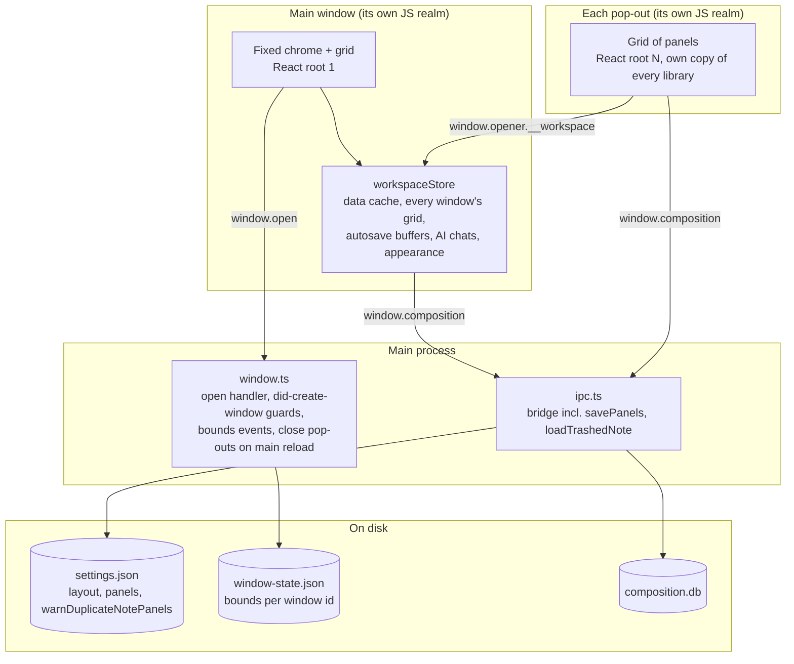

# Panel system: design and build plan

A VS Code-style panel system for the desktop app: resizable panels in a grid, each showing one thing, any of which
can be pulled into a second Composition window. The evidence behind the pop-out design is in
[panel-system-research.md](panel-system-research.md). Status: **designed and agreed with the owner (2026-10-28);
Steps 1, 2, 3 and 4 are built and Gates A, B, C and D have passed.** Anything marked **my pick** is a judgment, not something the owner decided; **Inference** is
reasoning from a fact, not a measurement.

## Goal

The owner takes notes in Composition and keeps a separate to-do app beside it. Running two actively developed
apps is the cost. The panel system makes the notes app a canvas that other features can land on, starting with
what exists (a note, a notes browser, the AI helper) and leaving room for the to-do list, which is **not** built
here. A panel can be resized, rearranged, and pulled into its own window that is still part of Composition.

## Vocabulary

| Word | Meaning |
|---|---|
| **Panel** | A resizable container in the grid. It shows exactly one thing, its *kind*. Anything you can drag, resize, split or pop out is a panel. |
| **Kind** | What a panel shows: `empty`, `note`, `notes-browser`, `ai`; later `todo`. A kind supplies a component and owns its own saved state. |
| **Empty panel** | A real kind. A landing place that lists the other kinds. It exists so a layout can be arranged before it is filled. |
| **Grid** | A window's layout: nested rows and columns of panels, with draggable dividers. |
| **Window** | The main window, or a pop-out. Each has its own grid. |
| **Pop-out** | A second window opened from the main window. Not a separate app: it shares the main window's store. |
| **Store** | The one in-memory object, owned by the main window, that holds the workspace's data and every window's layout. |
| **Pane** | The old word, for one note in the single row ([`panes.ts`](../apps/web/src/components/notes/panes.ts)). It stays in the web app and the terminal app. On desktop a pane becomes a `note` panel. |

`NotebookPanel`, `AssistantPanel` and `AttachmentsPanel` are older names for fixed sidebars and docks. They keep
their names. `AssistantPanel` becomes the content of the `ai` kind.

## What is decided

From the owner, 2026-10-28 (the reasons are in [Settled by the owner](#settled-by-the-owner-2026-10-28)):

- **One view per panel.** No tab stacks of views. The note panel keeps its own Markdown / Preview / Split tabs.
- **Kinds:** `empty` (built in), `note` (today's note pane), `notes-browser` (a second, independent notebook list
  and note tree), `ai` (the AI helper), and `todo` later. The registry is internal; third-party plugins are future work.
- **Any number of panels of any kind**, including the same note in several panels (with a warning that can be
  switched off).
- **Layout:** a nested split grid in the content area. The header (Home and search), the notebook list and the
  note sidebar stay fixed. Home and the group page still cover the grid.
- **Desktop only.** The web app and the terminal app keep the single row of panes.
- **Pop-outs:** a pop-out is its own React root on a shared in-memory store (architecture "A′" in the research).
  Each pop-out has its own grid. Pop-outs do not outlive the main window.
- **Saved layout:** the grid, each panel's state, and the pop-out windows with their bounds are restored on launch.
- **Making panels:** a `+` button on each panel; dragging a note onto a panel. Keyboard shortcuts and native-menu
  entries come later.
- **A deleted note** leaves its panels open, struck through and grayed out.
- **Cross-window drag-and-drop of notes** is in v1, with a manual test.
- **Build order and gates:** [Build order](#build-order).

## Non-goals and future work

- **Dock regions** (fixed left, right and bottom areas, as in VS Code's Panel and secondary sidebar). They would be
  extra trees beside the grid.
- **Third-party panel plugins** loaded at runtime. They would need a sandbox, an API surface and signing.
- **Dragging a panel out of the window** to pop it out. The `⋯` menu does it in v1.
- **Native-menu entries** for the panel commands. The commands, their keys and a command palette exist.
- **The full to-do panel.** A basic one is built (see [panels.md](ui/panels.md#the-to-do-panel)): a `todos` table, five bridge
  methods (`TodosApi`) and a `todos` store on the workspace store, so every to-do panel in any window shares one list. What the
  Taskfile project has beyond that is future work.
- **Pop-outs that outlive the main window.** That needs the store to live somewhere other than the main window, for
  example a hidden host window.
- **Anything for the web app or the CLI.**

## Decisions this plan adds

| # | Decision | My pick | Why | Cost to reverse |
|---|---|---|---|---|
| P1 | Store API | **`createWorkspaceStore(initial)`** returns `{ subscribe, getSnapshot, actions }`; React reads it with `useSyncExternalStore`; snapshots are immutable | Works across windows (the research's spike 2). A factory is safe for the web app's server render; a module-level singleton there would leak state between requests | Medium |
| P2 | Where the store lives | Desktop: **one instance at client module scope, reached by pop-outs as `window.opener.__workspace`**. Web: one per client, created in component state from the server's data | Module scope survives client-side route changes (Settings, Images). The opener is how a same-origin, same-process pop-out reaches the main realm | Medium |
| P3 | Layout representation | **An immutable tree: `split` (direction, children each with a relative size) or `leaf` (panel id)**, a pure module in `apps/web/src/components/panels/`, tested like `panes.ts`. `panes.ts` is not touched | The CLI imports `panes.ts`. A pure module is testable without React or Electron | Low |
| P4 | Panel ids | **Opaque strings made by the store**, never note ids | A note id stopped identifying a panel once the same note can be open twice | Low |
| P5 | What a kind provides | **`{ id, title, icon, component, initialState, restore }`**, where `restore(saved)` returns the state or `null` (a `null` becomes an empty panel). The kind owns its saved state as versioned JSON; the host stores it and hands it back untouched | Adding the to-do kind is one registration. Nothing in the host knows what a note panel saves | Low |
| P6 | The desktop seam | **A `.desktop` sibling of the content-area component** (web renders `PaneArea`; desktop renders the grid), in the style of [`next.config.ts`](../apps/web/next.config.ts) | One swap point; the web build never imports the grid | Low |
| P7 | Pop-out URL | **`app://composition/popout/?w=<windowId>`**, a static route (`app/popout/page.desktop.tsx`) opened by `window.open` from the main window. A pop-out with no `window.opener` closes itself | `window.opener` only exists for windows opened from the main realm, so restore is renderer-initiated | Medium |
| P8 | Window allow rule | **`setWindowOpenHandler` stays deny-all except one rule** for that URL on our origin, with fixed size, sandbox, context isolation and preload. Context-menu and navigation guards are attached to each new window in `did-create-window` | Today it denies every window ([`window.ts`](../apps/desktop/src/main/window.ts)); `installContextMenu` is per `webContents` | Low |
| P9 | Saving | **Two files, one writer each.** The renderer writes a versioned `panels` key in `settings.json` (new `savePanels` IPC). The main process writes `window-state.json` (window id to bounds and display) from its own move and resize events | The settings file is whole-file, last writer wins; the main process is the only one that sees window geometry | Low |
| P10 | Appearance in pop-outs | **An `appearance` slice in the store** (theme, fonts, sun tone); Settings writes it, and a small `AppearanceSync` in the root layout applies it to its own `<html>` | The root layout script and `SunThemeSync` set these per document; a pop-out inherits the layout but not later changes | Low |
| P11 | Main window throttling | **`backgroundThrottling: false`** on the main window | The store's timers (autosave) run in the main window's realm, and the research measured them dropping to about one tick a second when it is minimised | Low |
| P12 | Deleted notes | **The store keeps a tombstone** (last content) while any panel shows the note; after a relaunch the content comes from a new read-only bridge method **`loadTrashedNote(id)`** | The Trash Can list returns titles and dates only | Low |
| P13 | Duplicate warning setting | **`warnDuplicateNotePanels`** (default on) in the desktop settings, with a Settings switch to turn it back on | A "don't warn again" with no way back is a trap | Low |
| P14 | Drag payloads | Notes reuse `NOTE_DRAG_TYPE` and `PANE_DRAG_TYPE`; panel headers get a new **`PANEL_DRAG_TYPE`**, which works within a window only in v1 | Plain ids under custom types carry no realm-specific objects ([`dragTypes.ts`](../apps/web/src/components/notes/dragTypes.ts)) | Low |
| P15 | Minimum sizes | **Per kind, 240 px by default; `ai` 280 px** (the dock's current minimum) | Generalises `MIN_PANE_WIDTH` and `DOCK_MIN_WIDTH` | Low |
| P16 | Data crossing windows | **Plain data and functions only.** No DOM nodes, and no `instanceof` on values that came from the store (`Array.isArray` is fine) | `instanceof Array`, `Error`, `Map` and `Date` are false across realms (the research's realm results) | Low |

## Architecture

Every window mounts its own React root. They share one set of plain objects, so a library in a pop-out never has
to understand another window's `document`. The store holds no DOM, and its timers are the main window's
(hence P11).

## How panels behave

### The grid

A tree of rows and columns. A divider resizes the two panels beside it (the rule `dragPaneSizes` already has),
sizes are relative, and each kind has a minimum width (P15). Dividers stay keyboard-resizable like
[`ResizeHandle`](../apps/web/src/components/notes/ResizeHandle.tsx). Dropping on a panel's top, bottom, left or right
edge splits it; dropping on the centre swaps (headers) or fills (an empty panel). A window always has at least one
panel: closing the last one in the main window leaves an empty panel, which replaces today's "No note is open"
screen; closing the last one in a pop-out closes the pop-out.

### The panel header

One row per panel: the kind's icon, its title, the kind's own tabs (a note panel's Markdown / Preview / Split),
a `+` button, a `⋯` menu, and a close button. The header is the drag handle. The `⋯` menu holds **Split right**,
**Split down**, **Move to new window**, **Move to window ▸** (the open windows), **Move back to main window** (in a
pop-out), and **Close**.

### Making a panel

`+` splits to the right of its panel (Option-click splits below) and creates an **empty panel**, which lists the
registered kinds as buttons; choosing one turns it into that kind in place. Dropping a note on an edge creates a
note panel there, and dropping it on an empty panel fills it. A panel that cannot be restored on launch (a kind
this build does not know, or a note that is gone for good) becomes an empty panel, so the layout survives.

### The same note in several panels

Allowed. Picking a note in the sidebar still **focuses** the panel that already shows it, so ordinary navigation
never makes a duplicate. **Open to the side**, `+`, and dragging make a second panel on purpose, and ask first:

> "Title" is already open in another panel. Both panels show the same note and stay in sync, but the undo history
> in the other panel may reset when you type here. [Open anyway] [Cancel] ☐ Don't warn me again

The checkbox sets `warnDuplicateNotePanels` to false; Settings has a switch to turn the warning back on. Both
panels edit one autosave buffer per note held in the store, so there are no competing writes. **Inference:** the
other panel's `<textarea>` gets a new `value`, which browsers treat as a programmatic change that clears its undo
stack. Check this at Gate B.

### A deleted note

Deleting a note (Trash Can) does not close or change its panels. Each shows the header title with a
line-through and a tooltip ("Deleted — in the Trash Can"), and the content grayed out and read-only (still
selectable, so it can be copied). Unsaved edits at the moment of deletion are discarded, as today. If the note is
restored from the Trash Can (it keeps its id), every panel for it, in any window, comes back to life. After a
relaunch, a panel whose note is in the Trash Can restores in the deleted state; if the note is gone for good, the
panel becomes empty. An `ai` panel pinned to a deleted note gets the same treatment with its input disabled and its
chat still readable. The user closes the panel themselves, so deletion never rearranges the layout.

### The AI panel

The AI helper stops being a dock inside a note pane and becomes the `ai` kind, with `AssistantPanel` as its
content. It is **pinned** to the note of the panel it was opened from; a header toggle, **Follow focused note**,
makes it track the focused note panel instead (for example on a second monitor). `Mod+Shift+L` in a note panel
opens an `ai` panel beside it pinned to that note, or focuses the one already pinned to it. Chats stay keyed by note
in the store, so they follow the note between windows. **The dock stays on the web app**, which has no panels; only
the desktop note panel omits it.

### The notes browser

A second notebook list and note tree with its own selected notebook, expansion state and search, built from the
pieces `NotebookPanel` and `NoteSidebar` already take as props. Picking a note in one opens it in the focused note
panel **of the same window**, or in a new note panel beside the browser if that window has none. The fixed sidebar
in the main window opens notes in the main window's focused note panel, as now.

## Windows

| Event | What happens |
|---|---|
| Open a pop-out (`Move to new window`) | The main realm calls `window.open` with the pop-out URL; the open handler applies fixed options and any saved bounds for that window id; the panel is removed from the source grid and added to the new window's grid. |
| Move a panel between windows | The panel's component unmounts in one realm and mounts in the other. Anything worth keeping lives in the panel's saved state; scroll position and caret are not kept. |
| Close a pop-out | Pending saves are flushed first, then its panels are closed. |
| Close the main window | Pop-outs close with it. The layout on disk is the one from before the close, so reactivating the app on macOS (or relaunching after Cmd+Q) restores the pop-outs. |
| Reload or navigate the main window | The store is gone, so the main process closes every pop-out (`did-start-navigation` on the main frame). |
| Visit Settings or Images | The store survives (client-side navigation). Pop-outs keep running; open panels are kept when the user returns, which is a change from today. On return the workspace is re-read from the database and reconciled into the store (Step 1.4). An AI answer that is streaming keeps streaming into the store while Settings is open. |
| Relaunch | The main window opens as it does now. After the workspace loads, the renderer reopens each saved pop-out with `window.open`. |
| Quit, or close any window | Every pending save is sent first (see Risks). |

A pop-out keeps the native macOS frame. Its title follows its focused panel's title. Streams from the AI helper
run in the window that started them and apply events to the store; if that window closes, the stream is aborted.

## Saving and restoring

- **`panels`** (a key in the desktop `settings.json`, versioned, written by the renderer through `savePanels`):
  each window's grid, and each panel's id, kind and saved state. Written on structural changes and at the end of a
  drag, not on every pointer move (as `useLayout.commit` does).
- **`window-state.json`** (written by the main process): window id to bounds and display. On restore, bounds that
  fall on a display that is gone are clamped onto a visible one.
- A `panels` document with an unknown or newer version is ignored: the app starts with one empty panel and
  does not crash. A kind that is not registered, a `restore` that returns `null`, or a note id that no longer
  exists all give an empty panel.
- `sidebarWidth` and `editorRatio` stay in the existing `layout` key, unchanged.

## Build order

Four steps, with check-ins after the first three. Work stays on this worktree's branch, in small commits. Nothing is
committed or pushed unless the owner asks. Anything previewed uses a scratch `HOME`, never the owner's real notes.

### Step 1: extract the store (shared with web, behavior unchanged)

1. Tests first for the store's pure logic: note, group and notebook changes, one debounced save per note, favorites
   and home settings, trash and restore, the existing pane state.
2. `createWorkspaceStore(initial, deps)` in `apps/web/src/components/notes/workspaceStore.ts`, framework-free,
   beside `panes.ts` and `applySavedNote`, which it uses (a file in `lib/` importing from `components/` would invert
   the layering). `deps` is the client module (`@/lib/composition/client`), passed as a namespace and read only when
   an action runs. `Workspace` in [`NotesApp.tsx`](../apps/web/src/components/notes/NotesApp.tsx) becomes a consumer
   through `useSyncExternalStore`; its mutation functions become store actions that call the bridge. Interface
   state that belongs to one window (the open notebook, Home, the viewed group, dialogs, error text) stays in the
   component; actions that can fail return their error instead of the store holding it.
3. Move the AI helper's chats into a framework-free `createChatsStore` in `lib/composition/assistant/` (the
   reducer in `conversations.ts` already exists) that the workspace store owns. `AssistantProvider` becomes a
   thin wrapper that can take a store; a store it creates itself is aborted on unmount as before, a shared one is
   not.
4. Desktop creates the instance once at client module scope. Every later visit to the workspace re-reads it from
   the database and **reconciles** it into the store, keeping the open panes and any pending saves: Settings can
   restore notes from the Trash Can, restore a backup or move the data, so a surviving cache would otherwise be
   stale. Panes whose note is gone are closed. Web creates one store per mount from the server's data, as
   today.
5. `paneState` (from `panes.ts`) moves into the store as is.

**Gate A.** Web and desktop tests and typechecks pass. By hand: edit, open to the side, switch notebooks, search,
and visit Settings and come back (the panes should now survive).

#### Built (2026-10-28, uncommitted on the worktree branch)

- [`workspaceStore.ts`](../apps/web/src/components/notes/workspaceStore.ts) (29 tests): `createWorkspaceStore(initial,
  deps, assistant)` holds the notes, groups, notebooks, favorites, Home settings and the pane state, with one debounced
  save per note and the actions `Workspace` used to carry. Interface state that belongs to one window (the open
  notebook, Home, the viewed group, dialogs) stays in the component. Actions the backend can refuse return the
  reason (`ChangeResult`) and undo their change; the component shows it.
- [`chatsStore.ts`](../apps/web/src/lib/composition/assistant/chatsStore.ts): the AI helper's chats and running
  answers. `AssistantProvider` is now a thin reader of it and takes an optional `store`; one it makes itself is
  aborted on unmount, a shared one is not.
- [`NotesApp.tsx`](../apps/web/src/components/notes/NotesApp.tsx) reads the store through `useSyncExternalStore`;
  its optional `store` prop is the workspace kept from an earlier visit. [`workspaceInstance.ts`](../apps/web/src/components/notes/workspaceInstance.ts)
  wires a store to the client module (passed as a namespace, read only when an action runs, so tests that mock a few
  client functions still work) and the real AI client.
- Desktop: [`keptWorkspace.ts`](../apps/web/src/components/desktop/keptWorkspace.ts) keeps one store for the life of the
  page, and `WorkspaceLoader` reconciles it with a fresh `loadWorkspace` on every visit. The web build still makes one
  store per mount from the server's data, as before.
- [`smoke.mjs`](../apps/desktop/scripts/smoke.mjs) gains two checks (the open panes, and the AI helper's chat, survive a
  visit to Settings). Both fail with the old make-a-new-workspace-each-visit behavior. Its stale steps are fixed:
  Settings is now tabbed (the AI, Styling and General tabs are clicked), and the update toggles, which a development
  build does not show, only run for a packaged app.

Differences from the plan as first written: the store lives in `components/notes/` (not `lib/composition/`); revisiting
reconciles instead of only reusing; the store takes the chats store as a third argument and exposes it as `assistant`.

Verified: web suite 129 files and 2002 tests (37 of them new), all passing with the SQLite binding available; lint clean
for everything touched; desktop typecheck and 313 tests; the whole smoke test, 78 checks, against a real build; and by
hand in the web app under a scratch `HOME` (a note created, edited and saved through the real Server Actions, a group
created, nothing in the console). The store calls Server Actions outside `startTransition`, which only a live run
could prove.

Not done here, by design: sending pending saves on `pagehide` (Step 3, with window close), the `appearance` slice
(Step 3), and `editorRatio` in the store (when a panel in a pop-out needs it).

### Step 2: the grid in the main window

1. The pure layout module and its tests: split, close, move, resize, drop zones with top and bottom, restore.
2. The kind registry with `empty`, `note` and `notes-browser`. `NotePanel` wraps the existing `NotePane` with the
   panel header (tabs on the same row), omitting the dock. The notes browser reuses `NoteSidebar` and
   `NotebookPanel` through props.
3. The content-area seam (P6), the header, `+`, `⋯`, drag and drop within the window, and the empty panel.
4. The duplicate warning and its setting; the deleted-note state and `loadTrashedNote`.
5. `savePanels`, the `panels` key, and restore on launch.

**Gate B.** The owner tries the grid: split, resize, drag, empty panels, duplicates (including the undo-history
effect), the deleted state, and a relaunch.

#### Built (2026-10-28, uncommitted on the worktree branch)

How it behaves is in [ui/panels.md](ui/panels.md). Where it lives:

- [`layoutTree.ts`](../apps/web/src/components/panels/layoutTree.ts) (34 tests): the pure tree (P3). Split, close (with the
  tidying that merges a split into one that runs the same way), move, drop zones on four sides, divider drag with
  per-child minimums, and `restoreLayout` (rejects anything damaged, duplicate ids, or nesting past 32).
- [`panelsState.ts`](../apps/web/src/components/panels/panelsState.ts), [`kinds.ts`](../apps/web/src/components/panels/kinds.ts),
  [`panelsDocument.ts`](../apps/web/src/components/panels/panelsDocument.ts): the pure rules over the layout (focus order, opening a
  note, drops, links), the kind registry (`initialState`, `restore`, `minWidth`), and the saved form. Tested through the store, as agreed.
- [`workspaceStore.ts`](../apps/web/src/components/notes/workspaceStore.ts) (45 more tests in `workspaceStore.panels.test.ts`): a
  fourth argument, `{ panels }`, makes a workspace a grid. Panel actions, one `save` callback for changes worth saving (not focus,
  not each step of a divider drag; `commitPanels` sends the end of one), restore from a saved document, and the deleted-note
  tombstones (`snapshot.deleted`) with their rules (edits ignored, forgotten once no panel shows them, revived by `reconcile`).
- UI: [`PanelGrid.tsx`](../apps/web/src/components/panels/PanelGrid.tsx), `PanelFrame`, `PanelMenu`, `EmptyPanel`,
  `NotesBrowserPanel`, `DuplicateNoteDialog`, `usePanelDrop`; 31 jsdom tests in `PanelGrid.test.tsx`. `NotePane` gained a `panel`
  mode and `MarkdownEditor` a `readOnly` prop; `ResizeHandle` an `orientation`; `DropOverlay` top and bottom; `NoteSidebar` a `"fill"` width.
- The seam (P6) is [`noteSurface.tsx`](../apps/web/src/components/notes/noteSurface.tsx) / `noteSurface.desktop.tsx`: the web one is
  the old `PaneArea` branch moved out of `NotesApp`, unchanged in behavior; the desktop one is the grid and the duplicate
  warning. Beside it, `workspaceInstance.desktop.ts` and `PanelSettings.desktop.tsx` (Settings → General → Panels).
- Saving: a desktop-only `PanelsApi` (`loadPanels`, `savePanels`, `loadTrashedNotes`) with its own IPC, validators and tests,
  beside the backup API; the `panels` key in `settings.json`; `WorkspaceLoader` brings the panels back
  (`panelsRestore.ts`). The web app's Server Actions are untouched.
- [`smoke.mjs`](../apps/desktop/scripts/smoke.mjs): +8 checks (add a panel, make a notes browser, dividers, pick from the
  browser, a deleted note's panel, the Settings switch, and a **relaunch** that restores all of it, the deleted panel included).

Differences from the plan as first written:

- **The AI helper's dock stayed in the note panel until Step 4.** The plan said to omit it in Step 2 and also that Step 4 removes it
  "last, because it removes a feature's current home". The second was right: the dock went in Step 4, once the `ai` kind existed.
- **The editor tabs stay on their own row** under the note panel's header rather than in it; the header is already full at
  the minimum width. At 240 px the title is clipped to a few letters (the tools there are icon-only in a panel).
- **The notes browser has a notebook menu**, not a second notebook column, which would not fit in a panel.
- **`warnDuplicateNotePanels` is a `localStorage` preference** (like the sidebar's other per-viewer conveniences), not a key in
  `settings.json`. It is read where it is used, so it needs no IPC.
- **`loadTrashedNotes(ids)`** (plural, one IPC call) replaces `loadTrashedNote(id)`.
- A note panel can have **no note yet** (a "Note" chosen in an empty panel): it takes the next note picked or dropped.
- Only the main window is read from the saved document, until pop-outs exist.
- Home and a group's page replace the grid while open, which unmounts its panels (their state is in the store, but scroll and
  caret are not).

Verified: web suite 136 files and 2136 tests; desktop 324; typecheck and lint clean (two warnings that were already there);
the whole real-app smoke test, 86 checks, against a fresh build; screenshots of the grid and of a relaunch. Mutation-checked:
every group of tests (layout tree, store, grid UI) was run against deliberate breakages and caught each one it was
meant to. **Not verified:** the undo-history effect of two panels on one note (Gate B, by hand), a divider drag with a real
mouse (only the keyboard and synthetic pointer events were driven), and dragging a note or a panel header with a real
mouse (the drop logic is tested with synthetic drag events; the smoke test does not drag).

### Step 3: pop-outs

1. Main process: the open-handler allow rule, per-window guards and context menu, bounds events and
   `window-state.json`, close pop-outs with the main window and on its navigation, `backgroundThrottling: false`.
2. The `/popout` route, the window registry in the store, `Move to new window`, `Move to window ▸`,
   `Move back to main window`, close-with-flush.
3. The appearance slice and `AppearanceSync`.
4. Restoring pop-outs on launch and on macOS reactivation.
5. Cross-window note drag-and-drop.
6. The smoke scenarios in [Testing](#testing).

**Gate C.** The owner tries pop-outs on one and two displays, including dragging a note between windows by hand.
If that drag does not work, **Open to the side** remains the way to put a note in a pop-out, and it becomes a
follow-up.

#### Built (2026-10-28, uncommitted on the worktree branch)

How it behaves is in [ui/panels.md](ui/panels.md#pop-out-windows). Where it lives:

- **Store** ([`workspaceStore.ts`](../apps/web/src/components/notes/workspaceStore.ts), [`panelsState.ts`](../apps/web/src/components/panels/panelsState.ts)):
  `movePanelToNewWindow`, `movePanelToWindow`, `closeWindow`; closing the last panel of a pop-out removes it; the saved
  document, restore and the id counters cover every window; `createNote` takes a window; `flushSaves()` now resolves when
  what it sent has been saved. A window is only data here.
- **Controller** ([`popoutController.ts`](../apps/web/src/components/panels/popoutController.ts)): in the main page, keeps one real
  window per pop-out in the store (opening the saved ones at launch), closes the real window of one that leaves it,
  brings a window's panels back to the main window if `window.open` fails, and notices a real window closed without
  telling the store.
- **The page** ([`PopoutApp.tsx`](../apps/web/src/components/desktop/PopoutApp.tsx), route `app/popout/page.desktop.tsx`,
  [`popoutLink.ts`](../apps/web/src/components/desktop/popoutLink.ts)): finds the workspace by `window.opener.__workspace`, renders its
  window's `PanelGrid`, titles itself for the panel in front, and on `pagehide` closes its window in the store (after the flush).
  The sidebar actions and the delete question were extracted from `Workspace` into
  [`useWorkspaceActions.tsx`](../apps/web/src/components/notes/useWorkspaceActions.tsx), which a pop-out's notes browser shares.
  `useNoteSurface` takes a window id. The `⋯` menu gained Move to new window / Move to window ▸ / Move back to main window.
- **Main process** ([`popoutWindows.ts`](../apps/desktop/src/main/popoutWindows.ts), [`popoutManager.ts`](../apps/desktop/src/main/popoutManager.ts),
  [`windowState.ts`](../apps/desktop/src/main/windowState.ts)): the one URL the main window may open (P7, P8), the guards and context
  menu on each pop-out, `window-state.json` (P9) with bounds brought onto a display, pop-outs destroyed when the main window closes
  or its main frame navigates, `backgroundThrottling: false` on the main window (P11).
- **Appearance** ([`appearance.ts`](../apps/desktop/src/main/appearance.ts), [`AppearanceSync.tsx`](../apps/web/src/components/desktop/AppearanceSync.tsx)).
- **Quitting** ([`flushRenderers.ts`](../apps/desktop/src/main/flushRenderers.ts), `keptWorkspace.ts`): the page flushes on `pagehide`, and the
  main process asks every page to flush, and waits (up to 2 s), before it stops Meilisearch and closes the database.

Differences from the plan as first written (the first four were agreed with the owner at the seams):

- **Appearance is a main-process broadcast, not a store slice (P10).** After `saveTheme`, `savePreviewFont`, `saveEditorFont` or
  `saveLocation` succeeds, every window is sent the new look, and each applies it to its own document.
- **The main process tells the workspace when the *user* closes a pop-out, and a pop-out page no longer reports its own closing.**
  Found in testing: `BrowserWindow.destroy()` still runs the page's `beforeunload`, `pagehide` and `unload` in this Electron, so a
  page cannot tell the app tearing it down (the main window closing or reloading, or quitting) from the user closing it, and the first
  version dropped every pop-out from the saved layout on quit. Now the manager destroys pop-outs as soon as the main window starts to
  close (and `shutDown` does it before the app quits), and sends the main page `popout-closed` only for a pop-out it did not destroy.
  The controller does not poll for gone windows either, for the same reason.
- **An AI answer streams in the main window**, whichever window's dock asked, so closing a pop-out never cuts one off.
- **A pop-out's editor/preview split is its own and is not saved**, because the layout is saved as a pair with the sidebar width, which
  a pop-out does not have.
- **Closing the main window destroys the pop-outs rather than flushing each** (the main page flushes everything on `pagehide`, and
  the main process before the database closes). A pop-out the user closes flushes first, as planned.
- **A pop-out opened for the first time cascades from the main window's corner** (40 px, then 30 px more for each one open) rather than
  being placed by display geometry.

Verified: web suite 140 files and 2198 tests; desktop 25 files and 396; typecheck and lint clean (the same two warnings as before);
the web production build; and the whole real-app smoke test, 101 checks, against a fresh build. The pop-out ones: Move to new window opens
`/popout/?w=w1` with that panel; the page has the bridge and `window.opener` and no Node; text typed in it reaches the database and the main
window's copy; a Radix menu in it dismisses on an outside click; Move back to main window returns the panel and closes the window; reloading
the main window closes the pop-out and the saved layout reopens it; a visit to Settings leaves it open; a color scheme chosen in Settings
reaches it; and after a relaunch it is back, at the position it was put, with text typed in it just before the app quit. Mutation-checked:
the window logic in the store, the controller, and (in the main process) the open rule, bounds file and manager. Two defects were found by
the real app and fixed: the quit path dropped pop-outs from the saved layout (see the first difference above), and a smoke click arrived
faster than Radix attaches its outside-click listener (a test artefact, not a bug).

**Not verified (for Gate C, by hand):** dragging a note between windows; two displays and a display that goes away; full screen and Spaces;
IME and spellcheck in a pop-out; arrow-key navigation in a pop-out's menus; a real-mouse divider drag in a pop-out; the cost of a second
copy of the bundle per pop-out; and the undo-history effect of two panels on one note (still open from Gate B).

### Step 4: the `ai` kind

`AssistantPanel` as a kind, pinned or following, `Mod+Shift+L` opening or focusing it, the dock removed from the
desktop note panel. Last because it removes a feature's current home rather than enabling the headline one.

**Gate D (passed 2026-10-28).** The owner tries the AI helper as a panel: opening it from a note and with the shortcut, pinning and
following, moving it to a pop-out, deleting a note it is about, quitting and relaunching. They ran it by hand against the real app
and reported that all of it passes.

#### Built (2026-10-28, uncommitted on the worktree branch)

How it behaves is in [ui/panels.md](ui/panels.md#the-ai-helper-as-a-panel). Where it lives:

- **Kind** ([`kinds.ts`](../apps/web/src/components/panels/kinds.ts)): `ai` with state `{ noteId, follow }`, `minWidth` 280 (the dock's
  minimum). `restore` accepts `{follow: true}` (the note is dropped, since a following panel has none) or a pinned panel whose
  note exists; anything else becomes an empty panel. `aboutNoteId(panel)` is the note a panel keeps a tombstone for: a note
  panel's note, or an `ai` panel's pinned one (`noteIdOf` is still "the note a note panel shows", used to find a panel showing a
  note, so an AI panel never counts as one).
- **Rules** ([`panelsState.ts`](../apps/web/src/components/panels/panelsState.ts)): `openAssistantFor` (the AI panel of that window
  pinned to the note, focused, else a new one to the right; none for a panel with no note), `assistantSubject` (pinned: its note;
  following: the note panel used last in its window that shows a note, then the main window's), `setAssistantFollow` (off pins to
  the note it is about now; with none, stays following).
- **Store** ([`workspaceStore.ts`](../apps/web/src/components/notes/workspaceStore.ts)): `openAssistantFor`, `setAssistantFollow`. A
  deleted note's tombstone is kept for an AI panel pinned to it, as for a note panel, and its **chats are kept with it**
  (`removeNote` no longer forgets them straight away when an AI panel is pinned to the note; they are forgotten once no AI panel is, or
  not at all if the note comes back first). `loadPanelsToRestore` asks the Trash Can about notes only an AI panel is pinned to.
- **UI**: [`AiPanel.tsx`](../apps/web/src/components/panels/AiPanel.tsx) around `AssistantPanel`, which gained a `panel` prop (its
  header says *About <note>*, struck through when deleted, with no close button of its own) and an optional `onClose`; a follow
  toggle in the panel header (`PanelFrame` gained an `extras` slot); `EmptyPanel` offers **AI helper**; a window titled *AI helper*.
  `NotePane`'s panel mode has no dock: its button and shortcut call `panel.onOpenAssistant`, which opens or focuses the panel and
  puts the cursor in its question box. The dock is untouched in the web app.
- Tests: 32 more in `workspaceStore.panels.test.ts` (opening, the subject rule, following, save and restore, tombstones, kept chats),
  1 in `panelsRestore.test.ts`, 12 in `PanelGrid.test.tsx`; the existing `NotePane.assistant` and `AssistantPanel` tests are the net for
  the web dock and passed unchanged. [`smoke.mjs`](../apps/desktop/scripts/smoke.mjs): the dock steps became panel steps, with a
  selection check, closing and reopening the panel, one in a pop-out, and one after the relaunch.

Differences from the plan as first written:

- **The toggle is called "Follow the note in use"**, not "Follow focused note".
- **`Mod+Shift+L` opens or focuses and never closes**, because a panel has its own close; it does nothing from inside the AI panel
  (it used to close the dock from inside it).
- **A following panel looks in its own window first, then in the main window**; the plan only said "the focused note panel".
- **The question box is enabled while the models are still being looked for** (it was off until they arrived), so the cursor can
  go there at once. Sending still waits for a model. This applies to the web dock too.
- **Chats of a deleted note are kept while an AI panel is pinned to it** (see the store above), which the plan implied ("chat still
  readable") but whose cost, a change to `removeNote`, it did not name.
- **Several AI panels for one note are allowed** (only the open-from-note path reuses a pinned one in the same window).

Verified: web suite 140 files and 2242 tests; desktop 25 files and 396; typecheck and lint clean (the same two warnings as before);
the desktop production export; and the whole real-app smoke test, 109 checks, run against a scratch copy of the app (the existing
main process and preload with the new renderer), so the app the owner has open was not touched. The AI ones: the button opens a panel of
its own and none inside the note; it is about the note it was opened from and lists the server's chat models; the question box has the
cursor; text selected in the note arrives as *Selection (5 characters)* and goes with the question; the answer streams in the panel and
*New note from this* makes the separate note; the panel and its chat survive a visit to Settings; closing the panel and opening another
brings the chat back; one opens in a pop-out about its note with the same chat; and after a relaunch the pop-out's AI panel is back,
still about the note. Mutation-checked: the tombstone rule for an AI panel, kept chats (three mutants), and the question-box reset on a
change of note. One existing smoke check ("a chat turn streams the reply ... over IPC") failed twice: the call's answer and the pushed
events travel separately, and the check read its events the moment the call returned. The page's own client already waits up to a
second for the end of the turn; the check now does the same. No product code changed for it.

**Not covered by the Gate D list:** the header at the panel's narrowest width (280 px) with a long note title (the panel header and
the AI helper's own row each have a **+**, one making a panel and one a chat); `Mod+Shift+L` while a pop-out is the front window; and
a real Ollama (the smoke test uses a stand-in).

### After that

Dragging a panel header out of the window to pop it out, and native-menu entries for the panel commands (the commands, their keys and a
command palette are built: see below). Docs (`docs/ui/panels.md` for the behavior, and a row in [feature-matrix.md](feature-matrix.md))
as each step lands.

### Follow-up: panel commands and a command palette

Asked for as "keyboard shortcuts and menu entries for panel commands". A command palette was investigated as an alternative to a native
menu, found much easier, and built **instead of** the menu: no main-process, preload or IPC work; each window (the main one and every
pop-out) has its own palette and key handler over the shared store; and the real-app test can press the keys, which it cannot for a
native menu's accelerators. A menu can still be added later from the same table.

#### Built (2026-10-28, uncommitted on the worktree branch)

How it behaves is in [ui/panels.md](ui/panels.md#panel-commands-and-the-command-palette). Where it lives:

- [`panelCommands.ts`](../apps/web/src/components/panels/panelCommands.ts): the one table (id, label, search keywords, key), the palette's
  search (every word must match; name start, word start, keyword, substring, letters in order), and matching a key event to a command
  by its **physical key** (`event.code`) with Cmd or Ctrl and Shift, never Alt, never a held-down repeat.
- [`runPanelCommand.ts`](../apps/web/src/components/panels/runPanelCommand.ts): what each command does to a window's focused panel, over the
  store. The store gained `focusNeighbour(delta, windowId)` (layout order, wrapping).
- [`PanelCommandPalette.tsx`](../apps/web/src/components/panels/PanelCommandPalette.tsx) and `focusPanelElement.ts`: one document key
  handler and the palette dialog, mounted through the desktop notes surface's `dialog`, which the main window and the pop-out page
  already render. After a command the cursor is put in the window's focused panel (the dialog's own focus restore is cancelled, or it would
  put the cursor back in the panel the command moved away from, and focusing that panel would undo the command).
- The shortcuts helper lists a desktop-only **Panels** group from the same table (`shortcutGroups(desktop)`, `useIsDesktop`), and its AI
  entry now reads "Open the AI helper beside the note (on the web, again to close it)".
- Tests: 17 in `panelCommands.test.ts`, 13 in `runPanelCommand.test.ts`, 16 in `PanelCommandPalette.test.tsx`, 6 for `focusNeighbour`
  in `workspaceStore.panels.test.ts`, 3 for the mounting (`noteSurface.desktop`, `PopoutApp`), 4 for the helper. Every behavior was
  mutation-checked. [`smoke.mjs`](../apps/desktop/scripts/smoke.mjs) presses the keys in the real app, in the main window and in a pop-out.

Verified: web suite 143 files and 2301 tests; typecheck and lint clean (the same two warnings as before); the desktop production export;
and the whole real-app smoke test, 115 checks (six new: the palette opens from inside a note and lists all seven commands; a command run
from it leaves the cursor in the panel it moved to; `]` and `[` walk the panels in layout order and wrap; `\` splits and the new panel
takes the cursor; `W` closes it and the cursor goes back; the palette and keys work in a pop-out on that window's own panels), run
against a scratch copy of the app, so the build the owner has open was not touched. A first run failed three of those checks because the
smoke helper looked for the panel's name on the nearest `<section>`, and an editor sits inside an unnamed one of its own; the product
was right (reproduced with a small script that logged the key events and the cursor). Mutation-checked: the focus rule, the table's
search and key matching, the dispatcher, and the palette's focus handling.

**By hand (passed 2026-10-28):** the owner rebuilt `apps/desktop/dist` and tried the palette, the keys (including with the cursor in an
editor and in the AI helper's question box), a pop-out, and the shortcuts list, and reported that all of it passes, which includes the
check the smoke test cannot make: that no macOS menu shortcut takes `Mod+Shift+W`, `\`, `[`, `]` or `P` before the page sees it.
**Not covered:** a non-US keyboard layout (the keys are matched by physical key, but only a US layout was used) and the palette at the
narrowest window width.

Differences from the design confirmed first:

- **No native menu** (see above): Q3 and Q6 were answered by the palette.
- **A file name** `PanelCommandPalette.tsx`, not `PanelCommands.tsx`, which differs from `panelCommands.ts` only by case and resolved to the
  wrong file on macOS.

## Testing

- **Pure modules** (the layout tree, kind restore, the store) in Vitest, in the style of `panes.test.ts`.
- **Components** (the grid, the header, the empty panel, the warning dialog, the deleted state) in jsdom.
- **[`smoke.mjs`](../apps/desktop/scripts/smoke.mjs)** gets a pop-out scenario, which is the regression test for
  the research's findings: the store syncs both ways; a Radix menu in the pop-out dismisses on an outside click;
  closing a pop-out flushes its saves; closing the main window destroys the pop-outs; reloading the main window
  closes them; the layout restores on relaunch. Its one stale check (it expects 16 bridge methods; there are
  18) is fixed in the same change.
- **By hand** at each gate, and once on Electron's next major, because `window.open` behavior is Electron's.
- **Previewing** UI: the grid is desktop-only, so the web `launch.json` server cannot show it. Use the desktop
  dev loop with a scratch `HOME`.

## Risks

- **The store extraction is the largest change** and it touches the web app. The existing `NotesApp` tests
  (about 1,250 lines) are the safety net, which is why it is its own step with a gate.
- **Flushing on quit.** Today a pending save is sent when React unmounts. A module-level store has to send them
  itself from `pagehide` in every window, and the main process has to finish handling in-flight saves before it closes
  the database in `before-quit`. **Inference:** the request is sent synchronously and the main process handles it
  after the window is gone; the smoke test must prove it.
- **A second copy of the bundle per pop-out** costs memory and start-up time. The spike's was about 1.4 MB; the
  real app's has not been measured.
- **Moving a panel remounts it**, so scroll position and caret are lost.
- **Values crossing windows.** `instanceof` fails across realms (P16). The store and its callers must stay with
  plain data.
- **Radix and the rest are safe in a pop-out only because they run in its realm.** A future change that renders
  one window's UI through another's `createPortal` would bring the failures back.
- **A pop-out depends on `window.opener`.** A dev-server reload of the main window closes every pop-out.
- **Electron upgrades** can change `window.open` handling; rerun the smoke scenarios on each major.

## Still to verify

Dragging a note between windows (Gate C, by hand); arrow-key navigation in menus inside a pop-out; IME and
spellcheck in a pop-out; full-screen and Spaces on macOS; the bundle's real size and start-up cost; the
undo-history effect of two panels on one note (Gate B). The research lists these under
[Not verified](panel-system-research.md#not-verified).

## Settled by the owner (2026-10-28)

- A panel kind is, at heart, an empty panel: a canvas for more functionality to land on. The note panel, the
  to-do app (eventually) and the AI panel are all kinds, and future ones will be too.
- Panels can be added with a "New panel +" or by drag and drop. Keyboard shortcuts and native-menu entries can come
  later.
- Every kind may be opened as many times as the user wants, including the same note. The user is not expected to
  type into one note in two places at once, so autosave needs no conflict handling; a warning, with a checkbox to
  ignore it, tells them when a note is open in more than one panel.
- Each pop-out has its own grid that can be split further. Closing a pop-out closes its panels after their saves are
  flushed.
- A deleted note's panel stays: the header title gets a line-through and the content is grayed out, so the user
  knows to close it, without the layout changing suddenly.
- The AI helper is a panel kind. Only the desktop app gets the panel system for now.
- Pop-outs do not need to outlive the main window.
- Third-party plugins, dock regions and dragging a panel out of the window are future work.
- Cross-window note drag-and-drop is in v1, with a manual test at the pop-out gate.
