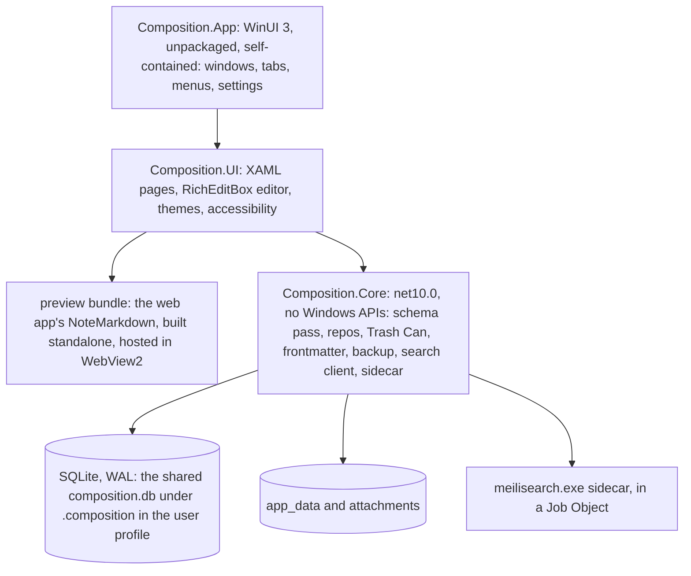

# Windows native app: design, feature tracker and compromises

A native Windows desktop app for Composition: **C#/.NET and WinUI 3** (Windows App SDK), with the note's preview in a **WebView2** inside native
chrome. This page is the one place for the design, for which features the Windows app has (or is expected to), and for every compromise made to
get it running. **Design and spikes only: no production app code is written.** Dates are 2026-11-07. Built on the iPad design ([ipad-app-design.md](ipad-app-design.md)),
whose structure and rules it follows.

**Direction (2026-11-07, you).** Composition goes native per platform: macOS in Swift (later, after the iPad), **Windows in C#/.NET with WinUI 3**,
Linux in Rust with GTK4 (another session). The goal is the most native-feeling tooling on each platform. **The Electron desktop app stays the shipping
Windows plan** ([windows-build-plan.md](windows-build-plan.md)) until you say otherwise; nothing on this page changes it.

## How to read this page

- the [**feature tracker**](#feature-tracker): every feature of [feature-matrix.md](feature-matrix.md), the panel system and the plugins: port, skip or later;
- the [**compromise register**](#compromise-register): what we give up on Windows, why, and what would make us revisit it;
- the [**decision log**](#decisions): what you decided on 2026-11-07, what is proposed, and what needs you;
- the [**spikes**](#spikes-and-gates): what each one proved, **where it ran**, and which need a Windows machine.

| | Meaning |
|---|---|
| 🔁 | **Port:** the behaviour exists in the TypeScript app and is rewritten in C#. The rules must match ([conformance](#keeping-implementations-honest)) |
| ♻️ | **Reuse:** the web app's own code runs unchanged inside a WebView2 (the preview) |
| ⭐ | **Native upgrade:** Windows gives something better than the web version for free or cheaply |
| 🆕 | **New** on Windows |
| ⚠️ | **Risky:** unknown until tried on Windows |
| ❌ | Not in the Windows app |
| **Plan** | **M1**, **M2**, **M3†** (†: release polish, first to drop): the [milestone](#v1-scope-and-milestones) · **Later** · **Never** (a deliberate decision) |
| **Status** | ⬜ not started · 🔬 spiked (answer found, not built) · 🔨 built · 🪟 verified on Windows · ⛔ dropped |

**Verified on Windows today: nothing.** The Mac-side spikes ran on macOS. A row only gets 🪟 after it ran on a Windows machine. Whatever this page says about
WinUI 3, WebView2 or Windows behaviour and does not give a source or a spike result for is **unverified**.

## Summary

- **Feasible, and the data layer is the part that is already proved.** A .NET core library opens the desktop's database without changing it, and the desktop opens
  the library's database without changing it; backups restore both ways, uuids intact; the SQLite .NET ships has FTS5. 16 tests, checked against the desktop's
  **real** `db.ts` and `backup.ts` ([S1](#spikes-and-gates)). That was done on a Mac, as plain .NET.
- **Recommended shape:** a WinUI 3 app, **unpackaged and self-contained** (your D4), over a `Composition.Core` library with no Windows dependencies (so it builds and tests
  on a Mac or in Linux CI); **Microsoft.Data.Sqlite** on the identical schema; the note's **preview is the web app's own `NoteMarkdown` in a WebView2** (it builds standalone, untouched,
  in 3 seconds and renders; S3), the **Markdown tab is a native `RichEditBox`, gated on a Windows measurement** (your D2); **Meilisearch** as a sidecar (your D1), driven from .NET.
- **The costs that matter most:** the notes rules now exist once per platform guarded only by a corpus that **does not exist on `main`** ([the gap](#keeping-implementations-honest));
  the preview, and possibly the editor, stay web ([C1](#compromise-register)); unpackaged means we own the installer, the updater and the signing ([C5](#compromise-register));
  Meilisearch keeps the Arm64 and footprint costs the iPad avoided ([C4](#compromise-register)); two or three apps can write one database ([C3](#compromise-register)).
- **What nobody has seen yet:** any WinUI 3 behaviour. There is no Windows machine. Gate B waits for S5, which is written and not run.
- **Decided by you today:** search, editor, database, packaging, scope and test machine ([D1 to D6](#decisions)). **Waiting on you:** where the shared corpus lives (D10), the signing route (W4, unchanged), and the app's name and identity (D11).

## Goals and non-goals

**Goals** (proposed)

1. Read and write notes on Windows in the same Markdown and with the same MDX components as the other products.
2. **Feel native** ([the native bar](#the-native-bar-windows)): Fluent controls, Mica, snap layouts, high contrast, Narrator, system dark mode, IME, touch, DPI.
3. Local-first and offline, on the **same database** as the Electron app and the CLI (D3).
4. Windows on Arm as a native build of our own code (Electron's plan excluded it; see [W6](#what-carries-over-from-the-electron-windows-plan)).
5. **One note format and one schema.** The Windows app invents neither.

**Non-goals for v1** (D5)

- The panel grid, pop-out windows and command palette; every plugin (To-do and its weekly cycle, Contacts, RSS Reader, Reading List, AI helper). Electron remains the full-featured Windows app until parity.
- The sync engine, sign-in and server (a separate design), the terminal app, a Microsoft Store listing (D4), and the Live tab (C11).

**Already decided by you**

| | |
|---|---|
| Native per platform, Windows = C#/.NET + WinUI 3 | 2026-11-07 |
| The Electron app stays the shipping Windows plan | 2026-11-07 |
| Design before code; no production app code until a gate you define | This task |
| **D1** Search: bundle Meilisearch like Electron (against my recommendation of FTS5) | 2026-11-07 |
| **D2** The Markdown tab is a native RichEditBox, gated on a Windows measurement | 2026-11-07 |
| **D3** The app opens the same database file as Electron and the CLI | 2026-11-07 |
| **D4** Unpackaged exe plus an installer (against my recommendation of MSIX through the Store) | 2026-11-07 |
| **D5** v1 is the full notes editor: no panels, no plugins | 2026-11-07 |
| **D6** Test machine: a Windows 11 Arm VM on this Mac, and a real x64 PC for the final pass | 2026-11-07 |

## What carries over from the Electron Windows plan

[windows-build-plan.md](windows-build-plan.md) is the plan for the Electron app. Which of its decisions also bind a native build:

| Decision there | Applies to the native app? |
|---|---|
| **W1** Sequence with the Linux build | **No.** The native app is a new `apps/windows` and touches none of the ~20 Electron files. (Its `.gitattributes` hygiene step helps both: line endings in fixtures and `.cmd` files.) |
| **W2** NSIS, per-user, one click | **The installer differs, the rule carries.** electron-updater can only update NSIS builds, which does not help a .NET app. The native app is also **per-user, no UAC prompt**, with a fixed install folder; the tool is [D9](#decisions) (Velopack is the lead candidate, S7 decides). |
| **W3** `composition` on PATH | **No.** The native app does not bundle the CLI in v1 (D13). |
| **W4** Signing | **Yes, unchanged, and more so.** Unpackaged means SmartScreen reputation is ours to earn, so the **installer, the app exe, every first-party DLL and `meilisearch.exe`** need a signature (the plan found `meilisearch.exe` unsigned). Start the identity validation now; one validated identity and certificate profile can sign both builds. **Needs you:** individuals qualify only in the US or Canada, and my sources disagree on which countries' organisations do (the plan's list is longer than the one in a signing guide I found, which names the US, Canada, the EU and the UK). Check Microsoft's own quickstart before relying on either. The Store route, which would have avoided all of this, was not chosen (D4). |
| **W5** CLI support policy and fallback | **Not applicable.** No CLI inside the native app. Electron's W5 stands. A Windows user who wants the CLI uses the Electron app's bundle or runs it from source, and it shares the database. |
| **W6** Windows 10 22H2 and 11, x64 only | **Changed.** x64-only existed because Meilisearch has no Arm64 build. The app itself is native Arm64; **Meilisearch stays x64, so on Arm it runs under emulation** (unverified: S8), which I believe exists only on Windows 11 on Arm. Floor: Windows 10 22H2 and Windows 11 ([D8](#decisions)). |
| **W7** Data location | **Yes, unchanged.** `%USERPROFILE%\.composition\composition.db` and `~\.composition-location.json`, shared. Settings and the search index get their own folders ([D14](#decisions)). |
| **W8** Stopping Meilisearch is a hard kill | **Yes, and tested:** a hard kill during indexing, then a start, then a search, passed on macOS ([S4](#spikes-and-gates)); the Windows run is S8. |
| **W9** Opaque in v1, Mica later | **No.** Mica is a native-bar item from M1 (Windows 11; Windows 10 falls back to a solid colour, per Microsoft's materials page). |
| **W10** Windows unit tests in CI | **Separate.** That is about the TypeScript tests. The native core adds its own legs: `dotnet test` on macOS, Linux and Windows. |
| **W11** Windows machine for the manual pass | **Decided here (D6):** an Arm VM on this Mac for building and every spike, and a real x64 PC for numbers, touch and pen, and the final pass. The same machines serve the Electron plan's Gate D. |

Also carried: Meilisearch's **mandatory file locks** on Windows block a file replacement by an updater, so the app must exit and take Meilisearch with it before the update swaps files (the Job Object in S4 is built for it).

## What the app is today

Facts that drive the design, checked against `main` at da75aa3 (2026-11-07).

| Fact | What it means for a native Windows app | Source |
|---|---|---|
| **A note is Markdown text in a SQLite row** (`notes.content`, frontmatter included); images are files in `app_data/` | Same model on Windows | [data-model.md](architecture/data-model.md), [images.md](architecture/images.md) |
| **Schema changes are additive `ensureColumn` checks** run on every open; the `uuid` pass adds a column, trigger and unique index to six tables | Ported statement for statement. **Proved no-op both ways** (S1). Not a migration framework with its own bookkeeping table: the desktop would not know it | [db.ts](../apps/web/src/lib/composition/db.ts) |
| **The desktop's `better-sqlite3` 13 bundles SQLite 3.53.2** | A .NET core on Microsoft.Data.Sqlite reads files written by a **newer** SQLite (3.46.1). Worked in S1 (a `VACUUM INTO` file from 3.53.2). Any future schema feature newer than 3.46 would break the .NET side first: a reason to keep the oracle test running | S1 |
| **The preview is `NoteMarkdown`:** react-markdown, remark-mdx restricted to ten tags, Recharts, and so on | Reused in a WebView2 rather than re-ported ([S3](#spikes-and-gates)): the one place a native rewrite is declined | [NoteMarkdown.tsx](../apps/web/src/components/notes/NoteMarkdown.tsx) |
| **Frontmatter is parsed with `js-yaml`** and must stay byte-identical whichever app last saved | Stock YamlDotNet is not enough: 93 of 111 parse cases, **61 of 123** generate cases byte-identical (S2). A hand port of js-yaml's rules, as the iPad did | [frontmatter.ts](../apps/web/src/lib/composition/frontmatter.ts) |
| **Search is a Meilisearch child process** per app, one index `notes`, derived from SQLite | Kept (D1). Driven from .NET over REST, same flags and index shape (S4) | [search.md](architecture/search.md), [searchIndex.ts](../apps/web/src/lib/composition/searchIndex.ts) |
| **Backup is a `.tar.gz`** (`composition-backup.json`, `settings.json`, `composition.db` from `VACUUM INTO`, `app_data/`, `attachments/`) | .NET reads and writes it with the framework's gzip (no hand-written gzip header, unlike iOS). Round trip proved (S1) | [backup-restore.md](architecture/backup-restore.md), [backup.ts](../apps/web/src/lib/composition/backup.ts) |
| **A restore replaces the app's settings with the backup's** (the iPad plan's G5) | A native app must carry `settings.json` as it came, or a restore resets the desktop's colour scheme. Bytes carried unchanged in S1 | the iPad build plan (`docs/ipad-build-plan.md` on the iPad branch, not yet on `main`) |
| **Several writers on one file** (desktop, CLI, web) with WAL; the desktop holds a single-instance lock | The native app is a third kind of writer ([C3](#compromise-register)) | [product-builds.md](product-builds.md) |
| **The sync design's capture triggers, `sync_outbox` and `sync_*` tables are not on `main`**; the `uuid` is (#244) | The iPad's fallback applies unchanged: Windows starts from the `uuid` alone ([Sync](#sync-and-the-data-model)) | [cross-device-sync-design.md](cross-device-sync-design.md) |
| **Meilisearch has no Windows Arm64 binary** (v1.53.1) and `meilisearch.exe` is unsigned | [C4](#compromise-register); sign it ourselves (W4) | [windows-build-plan.md](windows-build-plan.md) |
| **Measured on a Mac:** Electron idle about 395 MB, of which Electron's own floor is about 85 MB; Meilisearch peaked at 923 MB | The native win is real and **unmeasured on Windows**. The measurement is not in this tree; S5 prices the native side. Do not compare Windows numbers to the Mac's | the session that started this one |
| **Panels and pop-outs are React on an Electron store** | A native rebuild, so Later (D5) | [panel-system-plan.md](panel-system-plan.md) |
| **`<Mark>` highlighting, the Drawio edit button and note-link clicks live in `NotePane`, not `NoteMarkdown`** | The shell supplies them through a bridge or natively ([S3](#spikes-and-gates)) | [S3 note](../apps/windows/spikes/results/S3-preview-bundle.md) |

## Options considered

| | Option | Verdict |
|---|---|---|
| O1 | **Keep Electron on Windows** (the status quo) | **Stays the shipping plan** until you say otherwise. Not native, a ~395 MB idle on the Mac |
| O2 | **WinUI 3 chrome and editor, WebView2 preview** | **Recommended, and decided by D2 and the brief.** Keeps the ten components, their themes and their tests; native where a person types and navigates |
| O3 | **Fully native, including the preview** (a native renderer for the ten components, like the iPad) | The iPad's route. Costly on Windows: charts, footnotes, a Toc, draw.io images, YouTube would each be rebuilt, and Windows has no Swift Charts or `UITextView` view attachments. The WebView2 preview is the cheaper way to the same pixels. Revisit only if S5 shows WebView2 costs too much memory |
| O4 | **WinUI 3 plus CodeMirror 6 in WebView2 for the editor too** | The fallback for D2 if RichEditBox fails S5; the cheapest way to get the Live tab. Counts as two web views against [N2](#the-native-bar-windows) |
| O5 | WPF or WinForms | Not pursued: no Fluent or Mica without extra work, and it is the older toolkit. Not researched further |
| O6 | .NET MAUI, Uno, Avalonia | Not researched. They do not meet "the most native tooling on each platform" |
| O7 | One shared Rust core for Windows, Linux and iPad | **Already decided against** (native per platform). Recorded because it is the cure for the triple implementation ([C2](#compromise-register)) if drift bites |

## Languages and dependencies

| Item | Use | Notes |
|---|---|---|
| **C# on .NET 10 (LTS)** | Everything by default | **.NET 9 (STS) ends support on 2026-11-10**; .NET 10 is supported to 2028-11-14 ([policy](https://dotnet.microsoft.com/en-us/platform/support/policy/dotnet-core)). The spikes target `net9.0` because that is the only SDK on the Mac; retargeting is untried |
| **XAML / WinUI 3** (Windows App SDK) | Screens, navigation, settings | Latest stable seen on NuGet 2026-11-03: **2.6.5**; release 2.0 was 2026-04-29, and every 1.x/2.x release supports back to Windows 10 1809 ([versioning](https://learn.microsoft.com/en-us/windows/apps/get-started/versioning-overview)). **I do not know what 2.x changed from 1.8.** Pin one exact version at Gate A |
| **Win32 P/Invoke** | A Job Object for the sidecar; anything WinUI lacks | `kernel32` only so far (S4, unrun) |
| **C++ and C** | **Not planned.** SQLite arrives inside SQLitePCLRaw; zlib is the framework's | Each use must be earned by a measurement and recorded here |

| Dependency | For | Why not the platform's | Status |
|---|---|---|---|
| `Microsoft.Data.Sqlite` 9.0.x (→ SQLitePCLRaw `bundle_e_sqlite3` 2.1.10, SQLite 3.46.1) | SQLite | The OS's `winsqlite3.dll` was not checked for FTS5 and its version is not ours to pin | Used in S1; has FTS5 (executed on macOS, win-x64 and win-arm64 DLLs inspected) |
| `Microsoft.WindowsAppSDK` | WinUI 3, WebView2 control, windowing | Is the platform | Restores on a Mac for win-x64 and win-arm64 (S5); not built |
| `Microsoft.Web.WebView2` (transitive) | The WebView2 runtime API | Is the platform | 1.0.3719.77 restored |
| Meilisearch 1.53.1 (`windows-amd64`), from `meilisearch.lock.json` | Search | D1 | S4 against the macOS build |
| Velopack (lead candidate, `vpk`) | Installer and updater | We would write an updater otherwise | Unverified: S7. The docs say it installs per user under `%LocalAppData%` and **replaces the whole `current` folder on update** (so settings live elsewhere), and hosts updates on static files such as GitHub Releases. Arm64, delta updates and Artifact Signing support were **not confirmed** |
| A splitter control (`CommunityToolkit.WinUI` sizers, or ours) | Resizable columns | WinUI 3 has no splitter | Not chosen |
| YamlDotNet | **None.** Not a dependency (S2); a hand port of js-yaml's rules instead | | |

Every package gets a row here before it is added, pinned to an exact version, with `packages.lock.json` checked in ([SECURITY.md](../SECURITY.md), Dependabot, pinned Actions: new `uses:` in a workflow must be a commit SHA, [AGENTS.md](../AGENTS.md)).

## Proposed architecture

**Layout (proposed):** `apps/windows/`, beside `apps/ios` and `apps/linux`: `Composition.Core` and its tests (a plain .NET solution that builds on any OS), `Composition.App` (the WinUI 3 project, Windows only), `preview/` (the bundle build), `spikes/` (this branch's, deleted or promoted at Gate A).
`Composition.Core` references nothing from `Microsoft.UI` or `Windows.*`, so `dotnet test` runs on a Mac and in Linux CI. [C9](#compromise-register): the app project, its XAML compiler and every UI test need Windows.

### Data

- **Microsoft.Data.Sqlite on the same file, `Pooling=False`, WAL, `busy_timeout` 5 s** (better-sqlite3's default wait). Pooling is off because a pooled connection keeps the file open after `Close()`, which on Windows blocks the restore's file swap (unverified there; correct in design).
- **The schema pass is `Schema.cs`**: the desktop's statements, same order, same SQL text. S1 compares `sqlite_master` byte for byte against the real `db.ts` for a fresh and for the oldest database. When `db.ts` changes, that test fails until the port follows.
- **`uuid`:** the pass, the trigger, the unique index and the 200-row backfill are in and proved. The app **leaves the uuid out of its inserts** and lets the trigger fill it. The Trash Can port must carry it through `trashed_*` (not yet ported; the oracle scripts need the corpus).
- **Several writers.** The app notices another process's writes by polling `PRAGMA data_version` on window activation and on a timer, and refreshes lists and the open note (and re-indexes, [Search](#search)). It never assumes it is the only writer. A single-instance lock like Electron's keeps it to one app instance; two **different** apps (Electron and native) can still both be open, which [C3](#compromise-register) accepts.
- **Backup and restore:** `Backup.cs` (S1). Restore needs every connection closed and the Meilisearch sidecar stopped before the swap; an in-app restore stops, swaps, reopens and re-indexes.
- **Settings:** a `settings.json` in the web `WebSettings` shape at `%APPDATA%\Composition (native)\` (proposal D14), unknown keys preserved. The native app does **not** share the Electron app's settings file (each product keeps its own). It reads and honours `~\.composition-location.json`.
- **Autosave and being closed.** Debounce as today; flush on window deactivation and on `AppWindow.Closing`. Windows can end a process at shutdown without warning, so everything that matters is in SQLite, never only in memory.
- **OneDrive.** Known Folder Move can sync Documents and Desktop. The data folder is under the user profile, not Documents, but a person who points the data location into a synced folder risks WAL corruption (the iPad doc's iCloud Drive "Never" applies). Warn in Settings.

### Keeping implementations honest

The notes rules (ordering, Trash Can, notebook invariants, frontmatter, backup, search parsing, MDX parsing) now exist once per platform: TypeScript, Swift, C#, Rust. The guard is a shared conformance corpus. **What exists** (S2, checked 2026-11-07):

- `fixtures/conformance/`, which the iPad design proposed: **did not exist** when I checked on 2026-11-07, on `main` or any branch. **Since then** the PDF-markup work created it on its **unmerged** branch (PR #267): a README and `pdf/` fixtures (`schema.json`, `validation.json`, `scripts.json`) for the PDF tables only. Its convention differs from the iPad's: the **expected answers are committed** in the files (regenerated with `UPDATE_FIXTURES=1`), so a harness in any language reads them with no TypeScript at all.
- A larger corpus exists on the **unmerged iPad branch** (PR #247) at `apps/ios/conformance/`: 15 input files (store and Trash Can operation scripts, frontmatter, settings, search queries, MDX notes, organization, images, editing and component cases). There the expected answers are **not committed**: a test file in `apps/web` on that branch runs the inputs through the desktop's real code at test time and writes them; a script drives both sides.

**Gaps, reported and not filled** (this branch invented no corpus): nothing of this is on `main`; the iPad's cases sit under `apps/ios/` and need a test file from an unmerged branch to produce their answers, so a Windows harness cannot regenerate them from `main`; the two branches use **two conventions** (inputs plus a test-time oracle, or committed expectations); nothing says which cases a port must pass. **Your call (D10):** merge one shared folder, and my recommendation is `fixtures/conformance/` in the PDF branch's committed-expectation style, with the iPad's cases moved into it. The Windows harness is built to take a **directory**, so it reads either (S2 read the iPad's from a `git archive` extract, copying nothing).

How the .NET side runs it: the oracle phase (TypeScript, real code) writes answers; `dotnet test` reads the same inputs and the answers and compares; a second phase makes the desktop read what .NET wrote. That is `apps/windows/spikes/run-core-spike.sh` today (S1), generalised at step 1. **No port without an oracle.**

### Editor and preview

What is native and what is a web view:

| Part | Native or web | Why |
|---|---|---|
| Window, title bar, Mica, snap layouts, navigation (notebooks, groups, notes), tabs, menus, settings, dialogs, flyouts | **Native** (WinUI 3) | The point of the exercise |
| Markdown tab (writing) | **Native `RichEditBox`**, gated (D2). Fallback: CodeMirror in WebView2 (O4) | System text engine: TSF and IME, spelling, handwriting panel, UI Automation, system menus. **Unproven for a 5,000-line note** |
| Preview | **Web: the web app's `NoteMarkdown` in a WebView2** | The ten components exist, are tested and themed. Rebuilding them is the iPad's cost without its frameworks (O3) |
| Split tab | Native two-column layout of the two above | |
| Live tab | **Later** (C11). Hiding marks in a RichEditBox is unverified; CodeMirror's Live tab is the cheap path | |
| Search box, results, find bar | Native (`AutoSuggestBox`, lists) | |
| Draw.io editor, Reading List page | Web, in their own WebView2 windows (Later) | Already web; WebView2 is the natural twin of Electron's `<webview>` |

**Why a WebView2 preview, with evidence.** (1) `NoteMarkdown` builds as a standalone page with the app's own Vite, **unmodified**, 1.1 MB of JavaScript (about 320 KB gzipped) plus 123 KB of CSS in 3 s,
and renders Info, Warning, Mark, Toc, Chart, tables, code, task lists and footnotes; it re-renders from a message with a new colour scheme (S3, in Chromium). (2) The WebView2 runtime is preinstalled on Windows 11, with a
roughly 2 MB bootstrapper for the rest ([distribution](https://learn.microsoft.com/microsoft-edge/webview2/concepts/distribution)); Evergreen is Microsoft's recommended mode. **Unknowns, not claims:** WebView2's memory
and start-up cost in this app (S5 measures `msedgewebview2` working sets: the Mac baseline does not transfer); whether a XAML flyout can draw over a WebView2 (the "airspace" problem); how the preview behaves under Narrator, high
contrast and forced colours; and how many web views M1 needs (the preview, plus the editor if D2 falls back).

**The contract:** shell to page `PostWebMessageAsJson({ type: "render", body, theme })`; page to shell `{ type: "rendered", ms, height }`. The shell strips the frontmatter and owns all data; stored images load by `https://composition.local/app_data/<name>` through
`SetVirtualHostNameToFolderMapping` (no bridge, no local web server). The preview needs more bridge messages than M1 has yet: note-link clicks, the highlight menu (`<Mark>`), the Drawio edit button, scroll position, selection for find.

**The editor, honestly.** A `RichEditBox` is RichEdit under WinUI: it brings TSF/IME, spell checking, UI Automation and Windows text editing for free, and it has a text-range API that can colour ranges (the S5 spike colours a note this way). It is **not** a code editor: no incremental
parser, no folding, and colouring a long note on every keystroke is a hand-built incremental model. Whether it can hide Markdown marks away from the caret without breaking the caret, selection and undo is unverified, which is why the Live tab is Later. S5 measures the first two questions (can it hold and colour 5,000 lines; what does an edit cost); a person judges feel at Gate B.
Spell check, IME in Japanese and Chinese, handwriting and Narrator on the editor are the checks that decide it ([the bar](#the-native-bar-windows), S6).

Typing features port as XAML pieces: the `<` component and prop completion and the `[[` note-link picker as flyouts at the caret (`ITextRange.GetPoint`), Tab and Shift+Tab indent, image paste (clipboard bitmap to a stored PNG), highlight, recolour and remove
as commands (in the editor and, through the bridge, the preview), and the ruler and reflow ported from `liveReflow.ts` (M3†).

### Search

**Decided (D1): bundle Meilisearch, as the Electron app does.** My recommendation was FTS5 plus a typo layer (as the iPad); the case for it was Arm64, footprint and no child process. This page records the choice and its consequences instead of re-arguing it.

- **What carries over unchanged:** the index shape, the query parser (`searchQuery.ts`, a pure function, ported and checked by the corpus), typo tolerance out of the box (the iPad's C1 does not apply; S4 finds `kubernets` and `routng`), the 50-hit cap.
- **S4** drives `meilisearch` from .NET over REST with the desktop's flags, environment, index settings and document shape; healthy in 228 to 645 ms, a hard kill mid-index and a restart passed (macOS).
- **Windows:** the sidecar is put in a **Job Object with kill-on-close**, so an app crash or a Task Manager kill takes `meilisearch.exe` with it (compiled in S4, **never run**). That would fix the Electron plan's orphan problem rather than detect it.
  Hidden console: `CreateNoWindow`. The index is derived data, rebuilt from SQLite at start, as today; it lives under `%LOCALAPPDATA%\Composition (native)\search` (D14), **never in the Electron app's folder** (two servers on one index collide).
- **The costs it keeps** ([C4](#compromise-register)): the binary is x64 only (128 MB), so a native Arm64 build spawns it under emulation (S8); the installer carries it; its idle and peak memory (923 MB on the Mac) sit beside the app's; `meilisearch.exe` is unsigned and we sign it.
- **A fallback exists and is cheap to take:** S1 proves FTS5 is in the SQLite we already ship, on win-x64 and win-arm64 (inspected), so the iPad's design could be adopted without a new dependency if S8 or the memory numbers say so. That is a Gate decision, not a plan.

### App structure, windows and themes

- **Navigation:** a `NavigationView` or a custom three-column layout for notebooks and groups, the notes list and the note; a `TabView` for open notes; **Open in new window** through `AppWindow`. Back and forward as history plus Alt+Left and Alt+Right.
  Resizable columns need a splitter (WinUI 3 has none): a Toolkit sizer or our own.
- **Materials and chrome:** Mica as `Window.SystemBackdrop` on Windows 11 (a solid colour on Windows 10, and wherever transparency effects are off or the GPU is below DirectX 11: [materials](https://learn.microsoft.com/en-us/windows/apps/develop/ui/materials)); a custom title bar only if it keeps the system caption buttons so **snap layouts** keep working (unverified, S5).
- **Themes:** the six schemes become resource dictionaries of semantic tokens ported from `themes.ts`, plus a **System** scheme that follows Windows light, dark and **high contrast** (⭐). "Follow the sun" is the four hand-set hours built on the other platforms on 2026-11-12 (`sunHours.ts`, with `fixtures/conformance/sun.json` as its oracle), not the city lookup of `sunTimes.ts`, which is gone: no network request and no saved city (M3†). The WebView2 preview receives the scheme as `data-theme` (S3 re-rendered one).
  Fonts default to Segoe UI Variable and Cascadia Mono; the desktop's open-source families can be bundled.
- **Keyboard:** `KeyboardAccelerator`s with the Windows shortcuts that exist (Ctrl+N, Ctrl+F, Ctrl+W, F6); the shortcuts helper becomes a dialog (M3†).
- **Drag and drop:** `CanDrag` and `AllowDrop` for notes and groups, plus files and images dropped from Explorer.

### Sync and the data model

The iPad's rule carries: **v1 shares the database and is built sync-ready.** The `uuid` is on `main` and proved here; the capture triggers, `sync_outbox` and `sync_*` tables are **not on `main`**, so the iPad's fallback is in force: Windows starts from the `uuid` alone and the rest arrives later as `CREATE … IF NOT EXISTS`.
**Open question for the sync design, not this page:** the engine runs in the desktop's main process and in the iPad app. On a Windows machine with the Electron app and the native app both installed, **two engines must not run on one database**; it needs a lease or one engine per database. Flagged for the sync design ([D12](#decisions)).

## Packaging, updates and signing

**Decided (D4): unpackaged exe plus an installer.** (My recommendation was MSIX through the Microsoft Store: individual registration has been free since September 2025 and the Store signs the package. This page records the choice.)

| Topic | Design | Status |
|---|---|---|
| **Runtime** | `WindowsPackageType=None`, `WindowsAppSDKSelfContained=true`: the Windows App SDK runtime is copied beside the exe, so the installer does not chain a runtime installer. .NET self-contained for `win-x64` and `win-arm64` | Unverified; the footprint is printed by S5 |
| **WebView2** | Evergreen runtime; the installer runs the roughly 2 MB bootstrapper if the runtime is absent. Not the Fixed Version (over 250 MB per one third-party figure; check Microsoft's page) | Unverified |
| **Install** | **Per user, no UAC prompt**, a fixed folder (Velopack's `%LocalAppData%`), like the Electron plan's W2. User data stays on uninstall: `~\.composition\`, settings, search index | Rule carried; tool is D9 |
| **Updates** | Our own: an unpackaged app has **no package identity**, so no App Installer or Store updates ([docs](https://learn.microsoft.com/en-us/windows/apps/package-and-deploy/unpackage-winui-app)). Lead candidate Velopack: static files on GitHub Releases, whole-`current`-folder replacement (so nothing user-owned lives there). The update must stop Meilisearch first (mandatory locks; the Job Object covers a normal exit) | **S7 decides (Gate C)** |
| **Signing** | W4 as above: installer, exe, DLLs, `meilisearch.exe`; timestamped. Pre-release builds can ship unsigned with a SmartScreen warning, as the Electron plan says | Needs you |
| **Architectures** | `win-x64` and `win-arm64` builds, each its own installer or one installer choosing at run time (tool-dependent). Hosted Arm64 runners exist on GitHub (to be checked before relying on them) | Unverified |
| **Release assets** | In the same GitHub Release as the other platforms, with names distinct from `Composition-<ver>-win-x64.exe` (the Electron build) | Proposed |

**What changes if you revisit D4:** MSIX would add package identity (App Installer or Store updates, share targets) and **file-system virtualization of new writes under `AppData`**; writes outside the package, such as `%USERPROFILE%\.composition`, pass through
([Microsoft](https://learn.microsoft.com/en-us/windows/msix/desktop/desktop-to-uwp-behind-the-scenes), read, not run). The shared database location would be safe, but the search index and settings would land in a package-private store. Not a reason to change D4; recorded so it is not rediscovered.

## The native bar (Windows)

"Most native-feeling" needs a test, or it becomes an opinion. The app claims native when these hold. This list **is the acceptance test**: audited in S6, before each release, and at Gate D. The only web views are the exceptions in [C1](#compromise-register).

| # | Criterion | How it is checked | Status |
|---|---|---|:-:|
| N1 | **Fluent controls.** Navigation, lists, menus, dialogs, flyouts, tooltips, context menus are WinUI 3 controls with Fluent styling; no web view outside the exceptions | Review of the visual tree; Live Visual Tree on every screen | ⬜ |
| N2 | **Materials and chrome.** Mica on Windows 11 (solid fallback on Windows 10, with transparency effects off, and below DirectX 11); the title bar keeps the system caption buttons | Toggle Settings > Personalization > Colors > Transparency effects; run on Windows 10 | ⬜ |
| N3 | **Snap layouts and window management.** The maximize button's snap flyout works (Windows 11), Win+arrows and snap assist work, windows remember size and position, multi-monitor, minimum width usable | By hand on the physical PC | ⬜ |
| N4 | **System dark mode and accent.** Follows light and dark (the System scheme) and live changes without a restart; uses the system accent where the scheme says | Switch modes while running | ⬜ |
| N5 | **High contrast.** Every screen readable in all four high-contrast themes, **including the WebView2 preview** (forced colours), with no information carried by colour alone | Windows high-contrast themes; Accessibility Insights | ⬜ |
| N6 | **Narrator and UI Automation.** Every control has a name and role; the editor and the preview are readable and navigable; focus order is sensible; new content is announced where it should be | Narrator, then Accessibility Insights for Windows, then a person | ⬜ |
| N7 | **Text input and IME.** Japanese, Chinese and Korean IME composition in the editor and the search box without lost or duplicated characters; the emoji panel (Win+.); dictation (Win+H); spell check; the handwriting panel; the touch keyboard | By hand with the IMEs installed | ⬜ |
| N8 | **Touch and pen.** Every control reachable by touch with usable targets; scrolling and selection by touch; pen input into the editor; nothing hover-only | A touch device (the physical PC, if it has a touch screen; a VM cannot) | ⬜ |
| N9 | **DPI and scaling.** Sharp and correctly laid out at 100 to 300 %, and when dragged between monitors of different scale | Two monitors, or the VM's scaling | ⬜ |
| N10 | **Keyboard.** Everything reachable without a mouse; Windows-standard shortcuts; visible focus; Alt-key menu access | Keyboard-only pass | ⬜ |
| N11 | **System integration.** Notifications and jump list entries use the app identity; **Explorer drag-and-drop** of images and notes; the system share and clipboard formats; the taskbar and Start entries; per-user install and clean uninstall | By hand | ⬜ |
| N12 | **Performance (targets are proposals).** Cold start to a usable notes list in about a second on the x64 PC; typing in a 5,000-line note with no visible lag (p95 under 16 ms for the edit call, S5); idle and peak memory compared with the Electron Windows build **on the same machine** | S5, then Windows Performance Analyzer and a stopwatch | ⬜ |
| N13 | **Windows on Arm.** Runs natively as `win-arm64` with the same checks; Meilisearch under emulation answers | The Arm VM | ⬜ |

## v1 scope and milestones

**Decided (D5): v1 is the full notes editor, no panels, no plugins.** Three milestones; M1 and M2 are test installs on your machines, M3 is the first release.

| Milestone | What | Installed as |
|---|---|---|
| **M1: usable notebook** | The sync-ready store; notebooks, groups, notes, Trash Can and favorites; Markdown, Preview and Split tabs; search (Meilisearch); images (paste, drop, picker); the ten MDX components through the preview; the six schemes plus System; backup and restore | A test build run from Visual Studio or a `dotnet publish` folder on the VM. **Pre-v1** |
| **M2: distribution** | The installer, the updater, signing (pre-release unsigned until W4), Windows on Arm, high-contrast and Narrator passes | A test installer on the VM and the x64 PC. **Pre-v1** |
| **M3: first release (v1)** | The † rows, the native-bar audit ([S6](#spikes-and-gates)), `docs/manual-tests/windows-native.md`, release assets in the shared GitHub Release | The first release |

**Never cut:** the store, the Trash Can, backup and restore, search, the preview, images, and the schema-pass guarantees.

**The cut line, in the order I would drop things:** the `<YouTube>` player (a link instead), "Follow the sun", notebook colours, the Images page, the header image, ruler and reflow, the home page extras, the heading rail.

**Exit criteria** (proposed): **M1:** runs on the Arm VM; create, edit, search, delete and restore from the Trash Can; a backup made on the Electron desktop restores on the native app and the reverse, with the real `stageBackup`; every M1 row at least 🔨; Gates A and B passed. **M2:** a signed-or-unsigned installer installs, updates over a running app (once with Meilisearch busy) and uninstalls leaving user data; Gate C passed. **M3:** the † rows done or moved to Later; the native bar audited and accepted; the manual test page run by hand on the x64 PC and the Arm VM.

**Settle before M1's first install** (like the iPad's checklist): **app name, identity and icon** (D11: the Electron app is "Composition" with `com.rushinglabs.composition`; two apps with one name collide in Start and in the taskbar's grouping; a placeholder such as `com.rushinglabs.composition.native.dev` until M3, as the iPad did);
the Windows App SDK and .NET versions (Gate A); the signing route (W4); licence notices for every package, shown in the app as the desktop does with `collect-licenses.mjs`; and CI: a Windows runner for the app, macOS and Linux for the core, every new `uses:` pinned to a commit SHA.

## Feature tracker

Sections follow [feature-matrix.md](feature-matrix.md). Compromise ids point at the [register](#compromise-register). **Update a row in the same pull request that changes it.**

### Platform and shell

| Feature | Kind | Plan | Status | Windows approach and notes |
|---|:-:|:-:|:-:|---|
| App shell, windows, lifecycle, single-instance | 🆕 | M1 | ⬜ | WinUI 3 `Application`, `AppWindow`; flush on deactivate and close |
| Six colour schemes | 🔁 | M1 | ⬜ | Token resource dictionaries ported from `themes.ts`; + **System** scheme (⭐) that follows light, dark and high contrast |
| "Follow the sun" scheme | 🔁 | M3† | ⬜ | **Redesigned and built on the other platforms 2026-11-12:** port the four hand-set hours (`sunHours.ts`, `sunSchedule.ts`; replay `fixtures/conformance/sun.json`) in the Appearance page; the sunrise option and the city lookup are gone, so there is no network use to port |
| Fonts | 🔁 | M1 | ⬜ | Segoe UI Variable and Cascadia Mono by default; bundled families as options |
| Mica, snap layouts, system accent | ⭐ | M1 | ⬜ | The native bar, N2 to N4; Windows 11 only for Mica |
| Hardware-keyboard shortcuts | 🔁 | M1 | ⬜ | `KeyboardAccelerator`; audit against Windows-reserved combinations |
| Shortcuts helper (Ctrl+/) | 🔁 | M3† | ⬜ | A dialog; Windows has no system list |
| Window translucency setting | ❌ | Never | ⛔ | macOS setting; Mica replaces it |
| Auto-update, Updates settings | 🆕 | M2 | ⬜ | Our own updater ([Packaging](#packaging-updates-and-signing)); the toggle and the "ask before downloading, ask before restarting" rule carry |
| Application data location setting | 🔁 | Later | ⬜ | **Reading** `~\.composition-location.json` is M1; the Settings UI that moves the data is Later ([C3](#compromise-register): moving files under another running app) |
| Install Command Line Tool | ❌ | Never | ⛔ | The CLI is not in the native app (D13) |
| Developer docs viewer (`/docs`) | ❌ | Never | ⛔ | Not in the desktop either |

### Notes and organization

| Feature | Kind | Plan | Status | Windows approach and notes |
|---|:-:|:-:|:-:|---|
| Create, edit, delete notes, autosave | 🔁 | M1 | ⬜ | Core + editor; debounce plus flush |
| Frontmatter (title, description, tags, dates) | ⚠️ | M1 | 🔬 | A js-yaml-compatible reader and writer by hand (S2: stock YamlDotNet fails half the generate cases) |
| Groups: create, rename, delete, move, reorder | 🔁 | M1 | ⬜ | Same rules; the corpus's `store-script.json` |
| Notebooks: switch, colours | 🔁 | M1 | ⬜ | |
| Favorites | 🔁 | M1 | ⬜ | In settings, as on desktop |
| Trash Can (60 days) | 🔁 | M1 | ⬜ | Uuid carried through `trashed_*`; the corpus's `trash-script.json` |
| Drag and drop of notes and groups | ⭐ | M1 | ⬜ | `CanDrag` and `AllowDrop`; also from Explorer |
| Home page (recent, pinned) | 🔁 | M3† | ⬜ | |
| Heading rail | 🔁 | M3† | ⬜ | Fed by the preview's headings through the bridge |
| Back and forward | 🔁 | M1 | ⬜ | History plus Alt+Left and Alt+Right |
| Resizable columns, remembered | 🔁 | M1 | ⬜ | A splitter control (WinUI 3 has none) |
| Several notes side by side | 🔁 | M1 | ⬜ | **`TabView` and Open in new window** (D5), not the panel grid |
| Panels grid, pop-outs, command palette, plugin rail | ❌ | Later | ⛔ | React on an Electron store; a native rebuild. Electron keeps them ([C7](#compromise-register)) |
| Notebook backgrounds (architect grid) | 🔁 | Later | ⬜ | |
| To-do panel and weekly cycle | 🔁 | Later | ⬜ | The tables are in the schema pass already and must stay untouched ([C7](#compromise-register)) |
| Reading List | ⭐ | Later | ⬜ | A WebView2 with its own profile is the native twin of Electron's `<webview>` |
| Contacts | 🔁 | Later | ⬜ | Table in the schema pass; backed up and counted |
| RSS Reader | 🔁 | Later | ⬜ | `HttpClient`; port the private-address guard and the size and time limits |
| AI helper: Ollama | 🔁 | Later | ⬜ | `HttpClient` streaming; a plain `http://` LAN host needs no manifest exception on an unpackaged app (unverified) |
| AI helper: ChatGPT sign-in | ⚠️ | Later | ⬜ | The desktop flow redirects to `http://127.0.0.1:1455`; a loopback `TcpListener` works on Windows, unlike iOS (unverified) |

### Search

| Feature | Kind | Plan | Status | Windows approach and notes |
|---|:-:|:-:|:-:|---|
| Fuzzy full-text search | 🔁 | M1 | 🔬 | Meilisearch sidecar over REST (D1; S4 passed on macOS) |
| Field filters: `tag:`, `title:`, `description:`, `created:`, `updated:` | 🔁 | M1 | ⬜ | Port `searchQuery.ts` (pure); the corpus's `search-queries.json` |
| Search engine comes with the app | 🔁 | M1 | ⬜ | `meilisearch.exe` from the lockfile, in the installer; signed by us |
| Sidecar lifecycle: start, health, kill, no orphans | ⚠️ | M1 | 🔬 | Job Object with kill-on-close ([S4](#spikes-and-gates), unrun) |
| Search bar | ⭐ | M1 | ⬜ | `AutoSuggestBox` with filter tokens |
| Find in a note | ⭐ | M3† | ⬜ | `ITextRange.FindText` in the editor; WebView2's find for the preview (unverified) |
| Windows Search / Start menu indexing | 🆕 | Later | ⬜ | |

### Writing

| Feature | Kind | Plan | Status | Windows approach and notes |
|---|:-:|:-:|:-:|---|
| Markdown tab | ⭐ | M1 | ⬜ | Native `RichEditBox`, gated on S5 (D2); fallback CodeMirror in WebView2 |
| Preview tab | ♻️ | M1 | 🔬 | `NoteMarkdown` in WebView2 (S3) |
| Split tab | 🔁 | M1 | ⬜ | Two columns; one at narrow widths |
| Live tab | ⚠️ | Later | ⬜ | [C11](#compromise-register) |
| Spelling, autocorrect, dictation, handwriting | ⭐ | M1 | ⬜ | RichEdit's text services (N7) |
| Tab and Shift+Tab indent | 🔁 | M1 | ⬜ | |
| `<` component, prop and value completion | 🔁 | M1 | ⬜ | A flyout at the caret |
| Note links: `[[` and the picker, click to open | 🔁 | M1 | ⬜ | Flyout; click arrives from the preview through the bridge |
| Insert a stored image; paste an image | 🔁 | M1 | ⬜ | Clipboard bitmap to a stored PNG with the content-hashed name |
| Add a file or photo | ⭐ | M1 | ⬜ | `FileOpenPicker` (with the window handle, as unpackaged apps need) |
| Markdown image to `<Image />`, and its width | 🔁 | M1 | ⬜ | |
| Highlight text with `<Mark>` | ⭐ | M3† | ⬜ | A command in the editor; in the preview, a bridge message and a native menu |
| Ruler, reflow, editor and preview fonts | 🔁 | M3† | ⬜ | Port `liveReflow.ts` |
| Header image | 🔁 | M3† | ⬜ | |

### MDX components

| Component | Kind | Plan | Status | Windows approach and notes |
|---|:-:|:-:|:-:|---|
| `<Info>`, `<Warning>`, `<Toc>`, `<Mark>`, `<Footnotes>`, `<Image>`, `<Chart>`, `<Repo>` | ♻️ | M1 | 🔬 | In the WebView2 preview (S3); `<Repo>` and a real stored image were not inspected |
| `<YouTube>` | ♻️ | M3† | 🔬 | The iframe renders; needs the network; a link is the cut-line fallback |
| `<Drawio>` shown | ♻️ | M1 | 🔬 | The PNG through the virtual host |
| `<Drawio>` edited | ⭐ | Later | ⬜ | The vendored draw.io editor in a second WebView2; works offline as on desktop |

### Images and files

| Feature | Kind | Plan | Status | Windows approach and notes |
|---|:-:|:-:|:-:|---|
| Stored images in `app_data/` | 🔁 | M1 | ⬜ | Same folder and names |
| Images page: browse, reuse, find unused | 🔁 | M3† | ⬜ | |
| Image size limit | 🔁 | M1 | ⬜ | None, as on desktop |
| Attachments | 🔁 | M3† | ⬜ | The table is in the schema pass; the UI is Later if M3 is tight |
| Backup and restore | ⚠️ | M1 | 🔬 | `Backup.cs`: round trip proved (S1) on macOS; the restore swap under Windows file locks is unverified |

### Sync and portability

| Feature | Kind | Plan | Status | Windows approach and notes |
|---|:-:|:-:|:-:|---|
| Backup round trip, Windows to desktop and back | ⚠️ | M1 | 🔬 | Proved with the real desktop code (S1) |
| Stable `uuid` on the six tables | 🔁 | M1 | 🔬 | Pass, trigger, unique index, backfill: proved no-op both ways (S1) |
| Change capture: triggers, `sync_outbox`, `sync_*` tables | 🆕 | Later | ⬜ | Not on `main`; the fallback is in force |
| Sign-in and the sync engine | 🆕 | Later | ⬜ | Separate design; [D12](#decisions) |
| Export as `.md` files plus assets | 🆕 | Later | ⬜ | Export only |
| The database in OneDrive or any synced folder | ❌ | Never | ⛔ | WAL corruption risk; warn in Settings |

## Compromise register

What we give up to get the Windows app running. Ids are permanent once this page is agreed: never renumber, add the next. **Status:** *Proposed* · *Accepted* · *Deferred* · *Resolved* · *Rejected*. **Impact** is how visible the loss is to the person using the app.

| Id | Compromise | Impact | Why | Mitigation and when to revisit | Status |
|---|---|:-:|---|---|:-:|
| **C1** | **The preview, and possibly the editor, are web views.** The native bar has these exceptions: the preview (and Drawio editor, Reading List, YouTube inside it) and, if D2 falls back, the editor | Med | The ten MDX components exist as tested web code; rebuilding them is the iPad's cost without its frameworks | Measure WebView2's memory and behaviour (S5, S6). Revisit if WebView2 costs more than the native number wins | Accepted for the preview (brief, D2) |
| **C2** | **The notes rules exist once per platform** (TypeScript, Swift, C#, Rust) guarded by a corpus that is not shared or on `main` | High | The price of native per platform | The shared corpus (D10); no port without an oracle; revisit a shared core (O7) if drift bites repeatedly | Proposed |
| **C3** | **Two or three apps write one database** (Electron, native, CLI) and each keeps its own search index, so an edit in one is missing from another's search until it re-indexes | Med | D3: one library, no migration | `data_version` polling and re-index on foreign writes in the native app; the product-builds doc's drift options apply; a warning if two apps are open | Accepted (D3) |
| **C4** | **Meilisearch costs:** x64 only (so Arm64 runs it under emulation, unverified), a 128 MB binary in the installer, a large peak, an unsigned binary, a hard kill on stop | High | D1 | Job Object, our signature, the S8 test; FTS5 is proven in the SQLite we ship if the numbers say so | Accepted (D1) |
| **C5** | **Unpackaged:** no package identity (no Store or App Installer updates, no share targets); we own the installer, the updater and the signing; the self-contained runtime is copied into the app folder | Med | D4 | S7 picks the tool; W4 for signing; MSIX stays available as a later packaging of the same build | Accepted (D4) |
| **C6** | **Platform unknowns:** Windows App SDK 2.x (what changed from 1.x is unknown to me), .NET 10 with it, WinUI 3 gaps (no splitter), the WebView2 runtime as a dependency, "airspace" | Med | Nothing here has run | Pin versions at Gate A; S5 | Proposed |
| **C7** | **No panel grid, pop-outs, command palette or plugins in v1.** Electron remains the full Windows app | Med | D5 | Add after v1 by value; the plugin tables are in the schema pass and must be left untouched | Accepted (D5) |
| **C8** | **YAML is a hand port of js-yaml's rules,** not a library | Low | Stock YamlDotNet fails half the generate cases (S2) | The corpus; the iPad did the same | Proposed |
| **C9** | **Contributors need Windows, Visual Studio and the Windows SDK to touch the UI;** the XAML compiler does not run on a Mac (S5), and CI needs a Windows runner (and an Arm one to test Arm) | Low | Native toolchain | `Composition.Core` builds and tests anywhere; new `uses:` pinned to SHAs | Proposed |
| **C10** | **Windows on Arm is tested only in a VM** until a physical Arm device exists | Low | D6 | The VM covers builds and correctness, not speed or touch | Accepted (D6) |
| **C11** | **The Live tab is Later:** hiding characters in a RichEditBox is unverified | Med | Same risk as the iPad's C12 | CodeMirror in WebView2 is the cheap path (O4) if you want it earlier | Deferred |
| **C12** | **Mica is Windows 11 only;** Windows 10 and transparency-off machines get a solid colour | Low | Platform | Documented fallback | Proposed |
| **C13** | **The data layer is a SQLite older than the desktop's** (3.46.1 vs 3.53.2); a future schema feature newer than 3.46 breaks .NET first | Low | Microsoft.Data.Sqlite's bundle | The S1 oracle test; SQLitePCLRaw alternatives if needed | Proposed |
| **C14** | **No terminal app in the native app** | Low | D13 | The Electron app's CLI, or from source | Proposed |

## Decisions

Recommendations are proposals until the status says *Decided*. **Needs your input:** D10, D11 and the signing route (W4).

| Id | Decision | Recommendation | Status |
|---|---|---|:-:|
| D0 | Design before code; electron stays the shipping plan | Nothing is built until you pass a gate | **Decided** (you) |
| **D1** | **Search** | I recommended FTS5 plus a typo layer; **you chose Meilisearch as a sidecar, like Electron.** Consequences in [Search](#search) and C4 | **Decided** (you, 2026-11-07) |
| **D2** | **The Markdown tab** | Native RichEditBox, gated on S5 at Gate B; fallback CodeMirror in WebView2. Preview is WebView2 either way | **Decided** (you, 2026-11-07), as recommended |
| **D3** | **Database** | The same `%USERPROFILE%\.composition\composition.db` as Electron and the CLI; location file honoured | **Decided** (you, 2026-11-07), as recommended |
| **D4** | **Packaging** | I recommended MSIX through the Store; **you chose an unpackaged exe plus an installer.** Consequences in [Packaging](#packaging-updates-and-signing) and C5 | **Decided** (you, 2026-11-07) |
| **D5** | **v1 scope** | Full notes editor, no panels, no plugins | **Decided** (you, 2026-11-07), as recommended |
| **D6** | **Test machine** | A Windows 11 Arm VM on this Mac, plus a real x64 PC for the final pass | **Decided** (you, 2026-11-07), as recommended |
| D7 | **Toolchain:** .NET 10 LTS, one pinned Windows App SDK 2.x, C# with nullable on; no trimming or AOT in v1 | .NET 9 ends 2026-11-10. Pin at Gate A after one clean build on Windows | Proposed |
| D8 | **OS floor and architectures:** Windows 10 22H2 and Windows 11; `win-x64` and `win-arm64` native | The framework supports back to 1809; Arm64 gets Meilisearch under emulation (S8) | Proposed |
| D9 | **Installer and updater** | Velopack is the lead candidate; S7 decides at Gate C. W2's per-user, no-UAC rule carries | Proposed |
| D10 | **Where the shared corpus lives** | One shared `fixtures/conformance/` on `main`: it already exists on the PDF branch (PR #267) with committed expected answers; move the iPad's `apps/ios/conformance/` cases into it in that style and add a manifest. The Windows and Linux harnesses take a directory. Until then no Windows port can pass an oracle from `main`. The Linux session raised the same question (its D12) | **Needs you** |
| D11 | **App name, identity, icon, folders** | A placeholder id until M3, a distinct display name from the Electron app | **Needs you** |
| D12 | **Which engine syncs when two apps share a database** | The sync design's question: one engine per database, with a lease | For the sync design |
| D13 | **No CLI inside the native app in v1** (W5 not applicable) | Electron's bundle or source | Proposed |
| D14 | **Where things live:** settings `%APPDATA%\Composition (native)\settings.json`; search index and logs `%LOCALAPPDATA%\Composition (native)\`; data stays shared | Never share a Meilisearch folder with the Electron app | Proposed |
| D15 | **CI:** `dotnet test` of the core on macOS, Linux and Windows; the app on a Windows runner; new Actions pinned to SHAs | An Arm64 runner only once confirmed to exist | Proposed |

## Risks and unknowns

Everything marked ⚠️ in the tracker plus these. **Unverified** means no source or test confirmed it.

| Id | Risk | Chance and impact | Mitigation |
|---|---|---|---|
| R1 | RichEditBox cannot hold or colour a 5,000-line note acceptably, or typing lags | Medium, high | S5 at Gate B; D2's fallback (CodeMirror in WebView2) |
| R2 | WebView2 costs more memory or start-up than the native rewrite wins, so the "go native" case weakens | Medium, high | S5 measures; compare with Electron **on the same Windows machine**, not with the Mac figure |
| R3 | A XAML flyout or tooltip cannot draw over the WebView2 (airspace), or focus and keyboard routing between the editor and the web view misbehave | Medium, medium | S5 and S6 by hand; layout that never overlaps |
| R4 | The notes rules drift across four implementations; the corpus is unshared | High, high | D10; the oracle in CI; no port without one |
| R5 | Windows App SDK 2.x, or .NET 10 with it, has a blocker or a breaking change I do not know about | Medium, high | Pin and build once on Windows before Gate A; keep 1.8 as the known-good fallback |
| R6 | Meilisearch x64 under Arm64 emulation is slow, crashes or is blocked | Medium, medium | S8 on the Arm VM; FTS5 is the escape hatch |
| R7 | A Job Object does not behave as designed (inherited jobs, handle leaks, a debugger in the way) | Low, medium | S8: kill the host, find no `meilisearch.exe` |
| R8 | An update cannot replace files because Meilisearch, the app or antivirus holds them | High if untreated, medium | Exit order in the updater; S7 on a real machine, once with search busy; Gate C |
| R9 | Unsigned installers meet SmartScreen and Defender (the installer, the exe, `meilisearch.exe`) | High before signing | W4; say so in the release notes of unsigned builds |
| R10 | Signing eligibility (an individual outside the US or Canada; my sources disagree on which organisations qualify) | Unknown, depends on you | Check the quickstart; fall back to an OV or EV certificate with a cloud HSM |
| R11 | Frontmatter written by the C# port differs from js-yaml's by a byte | Medium, medium | The corpus (S2); the port is by hand and checked |
| R12 | The restore swap or a file move fails under Windows locks (pooled connections, antivirus, a held `-wal`) | Medium, high | `Pooling=False`; the rollback exists and is tested on macOS; run S1's backup tests on Windows first |
| R13 | Two apps (or three) write at once and an edit is lost or a view stale | Medium, medium | `data_version` polling; WAL; the busy timeout; a warning when two apps are open |
| R14 | The preview needs bridge messages (links, highlight, find, scroll sync) that are fiddly or slow | Medium, medium | List them at M1; measure round trips in S5 |
| R15 | Only a VM for Arm and no physical x64 PC when Gate B arrives, so numbers are not real | Certain until you provide one, low | D6: Gate B's performance lines wait for the PC |
| R16 | CI cost and availability of Windows (and Arm) runners; the XAML compiler is Windows-only | Medium, low | Core tests everywhere; app builds only on Windows runners |

## Spikes and gates

Each spike answers one question before anything is built for real. **Where it ran** is stated, because most of this page's evidence is from a Mac.

| # | Spike | Answers | Where it ran | Result |
|---|---|---|---|---|
| **S1** | **Core library vs the desktop's real data layer:** schema pass, uuid pass, backup, FTS5; the real `db.ts` and `backup.ts` as oracle in both directions | R12; D3, D7, C13 | **macOS arm64**, SDK 9.0.200. Windows DLLs of SQLite inspected, not run | **16 of 16 pass** ([note](../apps/windows/spikes/results/S1-core.md)). FTS5 present; sqlite_master byte-identical; no-op both ways; uuids and settings carried through backup both ways; two deliberate corruptions caught |
| **S2** | **The shared corpus, and YAML** | R4, R11; D10, C8 | macOS | Nothing is on `main`: the iPad branch has the corpus (`apps/ios/conformance/`), and the PDF branch has since added `fixtures/conformance/` (PDF only, committed answers); YamlDotNet matches js-yaml on 93 of 111 parse and **61 of 123** generate cases ([note](../apps/windows/spikes/results/S2-corpus-and-yaml.md)) |
| **S3** | **The preview as a standalone page** | R2, R14; O2, C1 | macOS, **Chromium in the Browser pane, not WebView2** | Builds untouched in 3 s (1.1 MB JS, 123 KB CSS); renders the components; re-themes from a message. Render time unmeasured ([note](../apps/windows/spikes/results/S3-preview-bundle.md)) |
| **S4** | **Meilisearch from .NET, with a Job Object** | R6, R7; D1, C4 | macOS, Meilisearch 1.53.1. **The Job Object never ran** | 2 of 2 pass: healthy in 228 to 645 ms, typo tolerance, filter, hard kill and restart ([note](../apps/windows/spikes/results/S4-search-sidecar.md)) |
| **S5** | **The WinUI 3 shell:** RichEditBox on 5,000 lines, WebView2 memory and start-up, the preview in WebView2 | R1, R2, R3; D2 | **Windows only. Written, never built, never run** (the XAML compiler does not run on macOS) | Restore of the package graph resolves on macOS; nothing else ([note](../apps/windows/spikes/results/S5-shell-windows.md)) |
| **S6** | **The native-bar audit:** Narrator, IME, high contrast, snap layouts, Mica, touch, DPI, airspace | R3; N1 to N13 | **Windows, a person** | Not started |
| **S7** | **Installer and updater:** Velopack (or another) for x64 and Arm64, per user, signed and unsigned, update over a running app with search busy | R8, R9; D9, C5 | **Windows** | Not started |
| **S8** | **Arm64:** the app natively, Meilisearch under emulation, the Job Object, the S1 backup tests with real file locks | R6, R7, R12; D8, C4, C10 | **Windows 11 Arm** | Not started |

**Machines.** S1 to S4 needed only a Mac and are done. **S5 to S8 need Windows**, so **no UI gate can pass until you provide the machine from D6**: a Windows 11 Arm VM on this Mac (Parallels, VMware Fusion or UTM) builds and runs every spike and UI gate except real x64 speed and memory, touch and pen, and a real GPU for Mica;
those need the **physical x64 PC** at Gates B and D. Visual Studio 2022 with the .NET desktop workload, or the .NET 10 SDK, goes on it.

**Gate A** (after S1 to S4, **ready for your review now**): commit to the core (.NET 10, Microsoft.Data.Sqlite, the schema pass and backup as proved), the sidecar search (D1), the WebView2 preview bundle as the working plan, the corpus location (D10) and the toolchain pins (D7, after one clean Windows build); then promote or delete the spikes.
**Gate B** (after S5, S3 in WebView2, on Windows): commit to the editor (RichEditBox or the CodeMirror fallback), the preview in WebView2 with its measured cost, Mica and snap layouts, and the bridge's size.
**Gate C** (after S7 and S8): the installer, updater, signing route and Arm64 plan. **Gate D**: your by-hand pass on the physical x64 PC and the Arm VM, against the native bar.

## Build steps

Each step ends in something checkable. Steps 1 and 2 are core-only and run on a Mac; from step 3 a Windows machine is required. Nothing below is started.

0. **Gate A** (you). Needs: your answers to D10 and D11, the W4 route, and your read of S1 to S4. Output: the toolchain pins and the folder layout.
1. **Core.** `apps/windows/Composition.Core` promoted from S1 (retargeted to .NET 10, named, documented); a CI workflow running `dotnet test` on macOS, Linux and Windows; the **conformance harness** taking a corpus directory; the repositories (`notesRepo`, `groupsRepo`, `notebooksRepo`, `trashRepo`) ported with their oracle scripts; frontmatter by a js-yaml-compatible reader and writer (S2); settings carried as they came; the `Pooling=False`/busy/WAL rules. *Check:* the corpus passes both directions, and a copy of your own database opens, takes a hundred operations and still restores on the desktop.
2. **Search.** `searchQuery.ts` ported and checked by the corpus; the sidecar promoted from S4 (key file, port, log, index sync at start and after writes, the `data_version` poll for foreign writes); `meilisearch.lock.json` reused. *Check:* the corpus's search queries and a hard kill on the real Windows binary (needs Windows).
3. **Shell on Windows.** A WinUI 3 app, unpackaged self-contained, on the Arm VM: window, Mica, notebooks, groups and notes lists over the core, tabs, state restore, themes in tokens. *Check:* runs on the VM and the physical PC.
4. **Editor and preview.** The RichEditBox editor with an incremental colourer and the completions; the preview bundle built in CI; the bridge (render, links, highlight, find, scroll). **Gate B.**
5. **Organisation and files.** Drag and drop, favorites, Trash Can UI, back and forward, images (paste, drop, picker), backup and restore UI with the sidecar stop and restart. *Check:* a backup from the Electron desktop restores and the reverse, through the real `stageBackup`.
6. **Appearance and accessibility.** The six schemes plus System, high contrast, the Narrator and IME passes (S6), DPI. *Check:* the native bar's N1 to N11 rows.
7. **Installer, updates, signing.** S7, then the pipeline: per-user install, a first update over a running app with search busy, unsigned pre-releases, signing when W4 completes (installer, exe, DLLs, `meilisearch.exe`). **Gate C.**
8. **Arm64 and the audit.** S8; `win-arm64` builds; the N12 and N13 rows on the physical PC and the VM; `docs/manual-tests/windows-native.md`. **Gate D.**
9. **Docs.** The rows listed below.

## Testing

- **Core:** xUnit on `Composition.Core`, runnable with `dotnet test` on a Mac, Linux or Windows: the schema pass from each earlier schema (the intent of `db.test.ts`), the operation scripts, the backup round trips, the oracle both ways, the search client against a real Meilisearch when a binary is present.
- **The conformance corpus** on every side ([above](#keeping-implementations-honest)).
- **UI:** WinAppDriver-style or UI Automation tests for the main flows (not chosen; Windows only), Accessibility Insights for Windows, and the manual native-bar audit.
- **A manual test page,** `docs/manual-tests/windows-native.md`, written when something is built: install, create and search a note, every MDX component, IME, Narrator, high contrast, backup and restore to and from the Electron app, an update over a running app, uninstall.
- **Devices:** the Arm VM for correctness, the physical x64 PC for numbers.

## Docs to change when it ships

[feature-matrix.md](feature-matrix.md) (a Windows-native column and the "macOS only" lines), [product-builds.md](product-builds.md) (the native app's settings and index folders; a decision-log entry), [architecture/data-model.md](architecture/data-model.md) (the third implementation of the schema pass), [architecture/search.md](architecture/search.md) (the .NET sidecar),
[windows-build-plan.md](windows-build-plan.md) (a pointer to this page and what carries over), [AGENTS.md](../AGENTS.md) (the .NET test command), and new: `apps/windows/README.md`, `docs/manual-tests/windows-native.md`.

## What this page corrects

1. **Electron's Windows plan excluded Arm because of Meilisearch.** A native Arm64 app is possible; only the sidecar stays x64 ([W6](#what-carries-over-from-the-electron-windows-plan)).
2. **The brief proposed `fixtures/conformance/`.** When I checked it existed nowhere; the real corpus was on the unmerged iPad branch under `apps/ios/`. The PDF branch has since created `fixtures/conformance/` (PDF cases only), so there are now two conventions on two unmerged branches.
3. **"Notes stay `.md` files"** in [mdx-components.md](ui/mdx-components.md) is loose here as on the iPad (a note is a SQLite row).
4. **The Windows plan's installer decision (NSIS and electron-updater) does not carry** to a .NET app.

## Keeping this page true

When a spike or a build changes a feature, update its row in the same pull request; an expectation that turns out wrong gets a Change log line. A new compromise gets the next id; one that stops applying becomes *Resolved*, never deleted. A decision's status changes in place, with the date in the Change log.
A new dependency gets a row in [Languages and dependencies](#languages-and-dependencies) first. Counts and numbers on this page are as of the date shown; re-measure before relying on them, and **do not compare a Windows number to the Mac's.**

## Change log

- 2026-11-07: first version. Design and five spikes (S1 to S4 on macOS, S5 written and not run). **You decided D1 to D6:** Meilisearch as a sidecar (not my FTS5 recommendation); a native RichEditBox editor gated on a Windows measurement; the same database as Electron and the CLI; an unpackaged exe plus an installer (not my MSIX-through-the-Store recommendation); v1 = the full notes editor with no panels or plugins; a Windows 11 Arm VM on this Mac plus a real x64 PC. Found the shared corpus does not exist on `main`.
- 2026-11-08: corrected the corpus finding: the PDF branch (PR #267) has since created `fixtures/conformance/` with committed expected answers (PDF cases only), so D10 now chooses between two existing conventions; recommendation updated.

## Sources

- .NET and Windows App SDK: [.NET support policy](https://dotnet.microsoft.com/en-us/platform/support/policy/dotnet-core), [Windows versions and SDK overview](https://learn.microsoft.com/en-us/windows/apps/get-started/versioning-overview), [Windows App SDK supported Windows releases](https://learn.microsoft.com/en-us/windows/apps/windows-app-sdk/support), [Microsoft.WindowsAppSDK on NuGet](https://www.nuget.org/packages/Microsoft.WindowsAppSDK)
- Packaging and signing: [how packaged desktop apps run (MSIX virtualization)](https://learn.microsoft.com/en-us/windows/msix/desktop/desktop-to-uwp-behind-the-scenes), [signing package overview](https://learn.microsoft.com/en-us/windows/msix/package/signing-package-overview), [unpackaged WinUI 3 apps](https://learn.microsoft.com/en-us/windows/apps/package-and-deploy/unpackage-winui-app), [free Store registration for individuals](https://blogs.windows.com/windowsdeveloper/2025/09/10/free-developer-registration-for-individual-developers-on-microsoft-store/), [Store FAQ](https://learn.microsoft.com/en-us/windows/apps/publish/faq/get-started-with-the-microsoft-store), [Velopack](https://docs.velopack.io/), [Velopack on Windows](https://docs.velopack.io/packaging/operating-systems/windows)
- WebView2 and materials: [WebView2 distribution](https://learn.microsoft.com/microsoft-edge/webview2/concepts/distribution), [Evergreen vs Fixed Version](https://learn.microsoft.com/microsoft-edge/webview2/concepts/evergreen-vs-fixed-version), [Materials in Windows apps (Mica)](https://learn.microsoft.com/en-us/windows/apps/develop/ui/materials)
- Inspected locally: SQLitePCLRaw 2.1.10's `e_sqlite3.dll` for win-x64 and win-arm64; `Microsoft.WindowsAppSDK` 2.6.5's restored package layout; Meilisearch 1.53.1; the iPad branch's `apps/ios/conformance/`
